# Community Examples · 1699

[简体中文](EXAMPLES.zh-CN.md)

Prompts and results shared by the community on X and around the web, kept as posted. Every entry credits its creator and links to the original post. For our own collection generated on vinano.ai, see the [README](README.md).

**[▶ Generate your own version on vinano.ai](https://vinano.ai?utm_source=github&utm_medium=readme&utm_campaign=awesome-image-video-prompts-updating&utm_content=examples-en)**

## Contents

- [Photography](#photography) (589)
- [Illustration & 3D](#illustration-3d) (429)
- [Product & Brand](#product-brand) (224)
- [Food & Drink](#food-drink) (155)
- [Poster Design](#poster-design) (156)
- [UI & Graphic](#ui-graphic) (51)
- [Video](#video) (95)

## Photography

<table>
<tr><td width="33%" valign="top"> <a href="https://x.com/OliviaRose10un/status/2126073884562575713"><b>@OliviaRose10un</b></a> · <a href="prompts/x/x-01700.md">Prompt</a> GPT Image 2.0 · via X</td><td width="33%" valign="top"><a href="prompts/x/x-01698.md">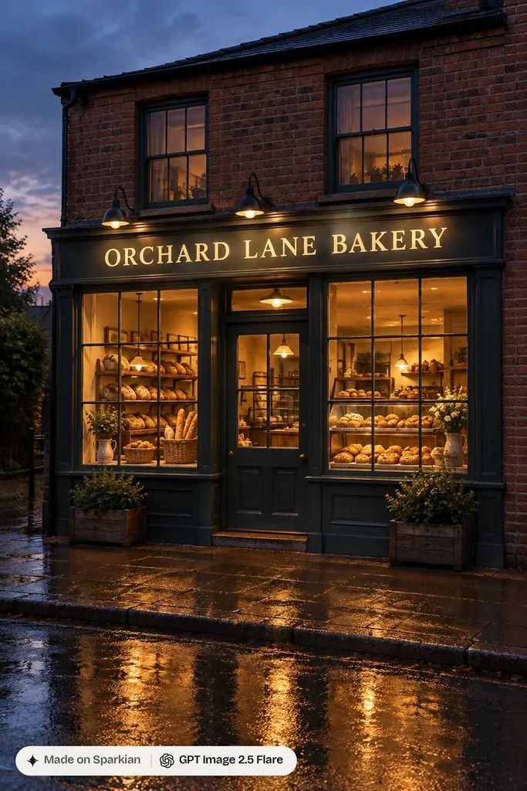</a> <a href="https://x.com/SparkianAI/status/2125998020802294084"><b>@SparkianAI</b></a> · <a href="prompts/x/x-01698.md">Prompt</a> GPT Image 2.5 Flare · via X</td><td width="33%" valign="top"> <a href="https://x.com/WanderingC76/status/2125873901360308484"><b>@WanderingC76</b></a> · <a href="prompts/x/x-01696.md">Prompt</a> GPT Image 2.6 · via X</td></tr>
<tr><td width="33%" valign="top"> <a href="https://x.com/WanderingC76/status/2126137562742112615"><b>@WanderingC76</b></a> · <a href="prompts/x/x-01695.md">Prompt</a> GPT Image 2.6 · via X</td><td width="33%" valign="top"> <a href="https://x.com/dreamydigiarts/status/2125907434774434273"><b>@dreamydigiarts</b></a> · <a href="prompts/x/x-01688.md">Prompt</a> Nano Banana 2 · via X</td><td width="33%" valign="top"> <a href="https://x.com/dreamydigiarts/status/2125945169904107921"><b>@dreamydigiarts</b></a> · <a href="prompts/x/x-01687.md">Prompt</a> Nano Banana 2 · via X</td></tr>
<tr><td width="33%" valign="top"> <a href="https://x.com/dreamydigiarts/status/2125975365516677341"><b>@dreamydigiarts</b></a> · <a href="prompts/x/x-01686.md">Prompt</a> Nano Banana 2 · via X</td><td width="33%" valign="top"><a href="prompts/x/x-01685.md">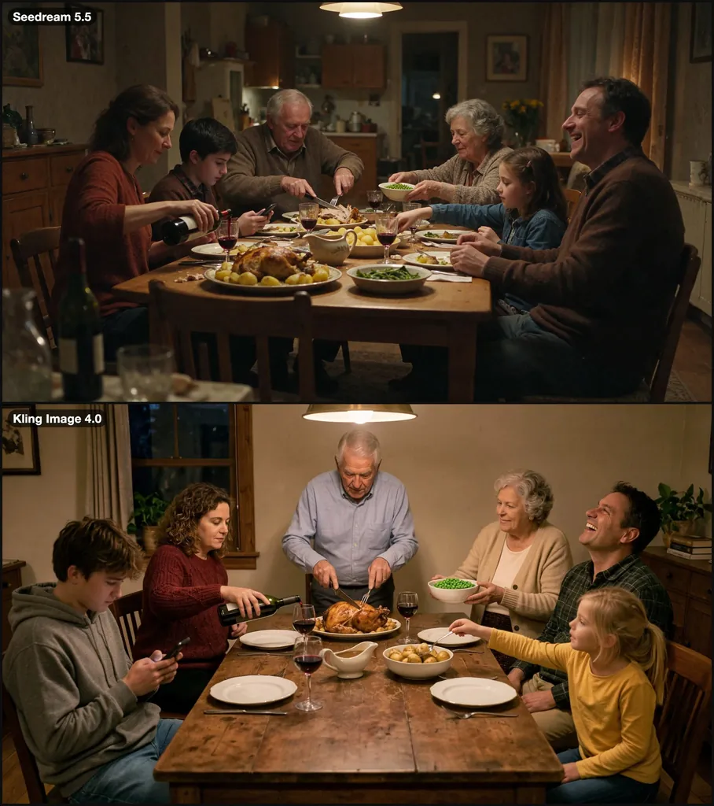</a> <a href="https://x.com/HBCoop_/status/2126057717601329171"><b>@HBCoop_</b></a> · <a href="prompts/x/x-01685.md">Prompt</a> Seedream 5.5 · via X</td><td width="33%" valign="top"><a href="prompts/x/x-01684.md">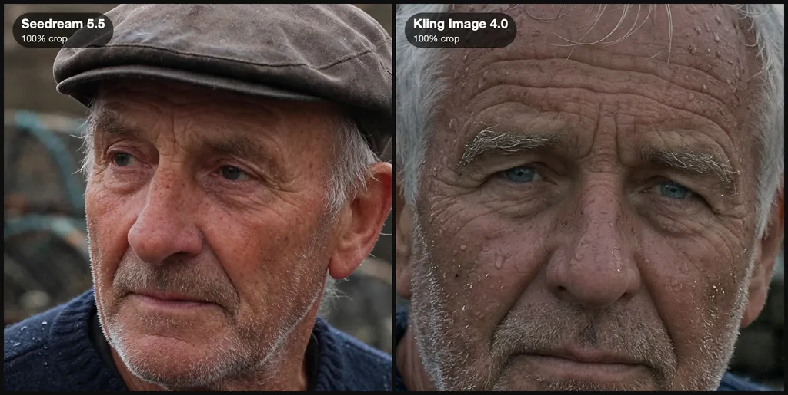</a> <a href="https://x.com/HBCoop_/status/2126057680024510830"><b>@HBCoop_</b></a> · <a href="prompts/x/x-01684.md">Prompt</a> Seedream 5.5 · via X</td></tr>
<tr><td width="33%" valign="top"><a href="prompts/x/x-01678.md">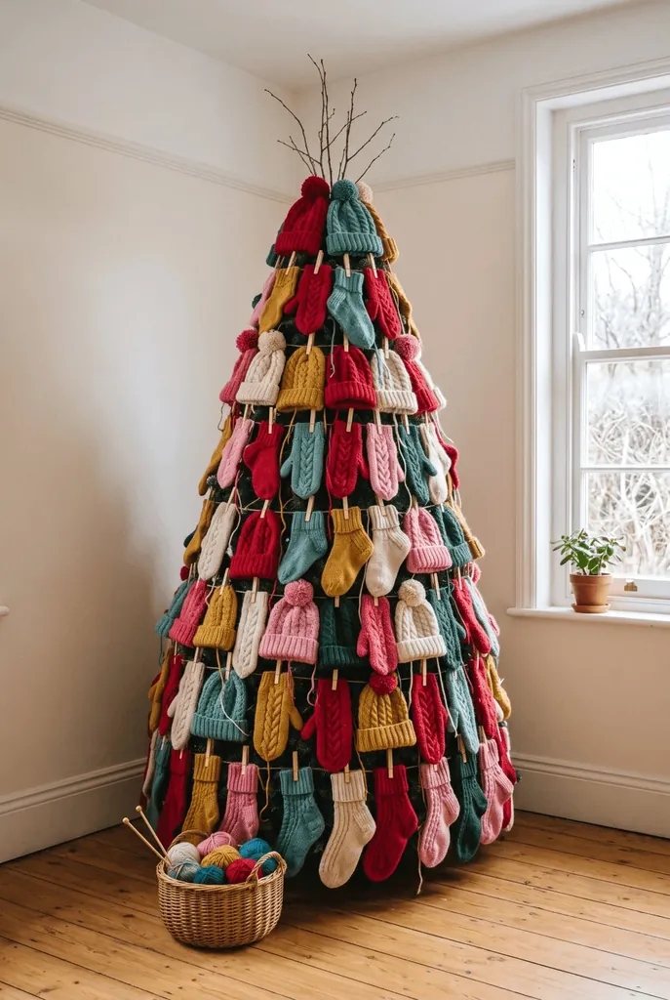</a> <a href="https://x.com/aiartalley/status/2125967990927524329"><b>@aiartalley</b></a> · <a href="prompts/x/x-01678.md">Prompt</a> Nano Banana 2.1 · via X</td><td width="33%" valign="top"> <a href="https://x.com/Goodmanprotocol/status/2125874450914795819"><b>@Goodmanprotocol</b></a> · <a href="prompts/x/x-01677.md">Prompt</a> GPT Image 2.6 · via X</td><td width="33%" valign="top"> <a href="https://x.com/DavidLi36143625/status/2125471084028018987"><b>@DavidLi36143625</b></a> · <a href="prompts/x/x-01659.md">Prompt</a> Grok Imagine · via X</td></tr>
<tr><td width="33%" valign="top"> <a href="https://x.com/King4Prompts/status/2125662220982034797"><b>@King4Prompts</b></a> · <a href="prompts/x/x-01657.md">Prompt</a> Midjourney · via X</td><td width="33%" valign="top"> <a href="https://x.com/King4Prompts/status/2124934728411464021"><b>@King4Prompts</b></a> · <a href="prompts/x/x-01656.md">Prompt</a> Midjourney · via X</td><td width="33%" valign="top"> <a href="https://x.com/92digitalartArt/status/2125541348572803458"><b>@92digitalartArt</b></a> · <a href="prompts/x/x-01655.md">Prompt</a> Midjourney · via X</td></tr>
</table>

**[Browse all 589 Photography examples →](gallery/x-photography.md)**

## Illustration & 3D

<table>
<tr><td width="33%" valign="top"> <a href="https://x.com/static_stare/status/2125924762904105073"><b>@static_stare</b></a> · <a href="prompts/x/x-01693.md">Prompt</a> GPT Image 2.5 · via X</td><td width="33%" valign="top"> <a href="https://x.com/static_stare/status/2125954639401230445"><b>@static_stare</b></a> · <a href="prompts/x/x-01692.md">Prompt</a> GPT Image 2.5 · via X</td><td width="33%" valign="top"> <a href="https://x.com/static_stare/status/2125855378323960059"><b>@static_stare</b></a> · <a href="prompts/x/x-01691.md">Prompt</a> GPT Image 2.5 · via X</td></tr>
<tr><td width="33%" valign="top"> <a href="https://x.com/static_stare/status/2125812239039095076"><b>@static_stare</b></a> · <a href="prompts/x/x-01690.md">Prompt</a> GPT Image 2.5 · via X</td><td width="33%" valign="top"> <a href="https://x.com/static_stare/status/2125939195445379237"><b>@static_stare</b></a> · <a href="prompts/x/x-01689.md">Prompt</a> GPT Image 2.5 · via X</td><td width="33%" valign="top"> <a href="https://x.com/heathergreen/status/2126088624311554353"><b>@heathergreen</b></a> · <a href="prompts/x/x-01682.md">Prompt</a> GPT Image 2.6 · via X</td></tr>
<tr><td width="33%" valign="top"> <a href="https://x.com/heathergreen/status/2126133910136639559"><b>@heathergreen</b></a> · <a href="prompts/x/x-01681.md">Prompt</a> Seedream 5.5 · via X</td><td width="33%" valign="top"> <a href="https://x.com/Goodmanprotocol/status/2126005633980014821"><b>@Goodmanprotocol</b></a> · <a href="prompts/x/x-01676.md">Prompt</a> GPT Image 2.6 · via X</td><td width="33%" valign="top"><a href="prompts/x/x-01658.md">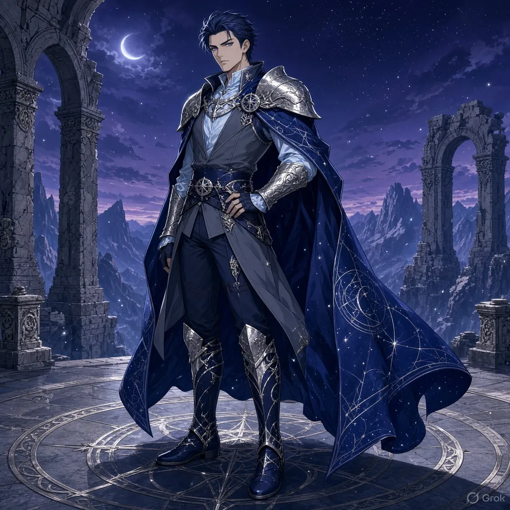</a> <a href="https://x.com/DavidLi36143625/status/2125518722869952620"><b>@DavidLi36143625</b></a> · <a href="prompts/x/x-01658.md">Prompt</a> Grok Imagine · via X</td></tr>
<tr><td width="33%" valign="top"><a href="prompts/x/x-01653.md">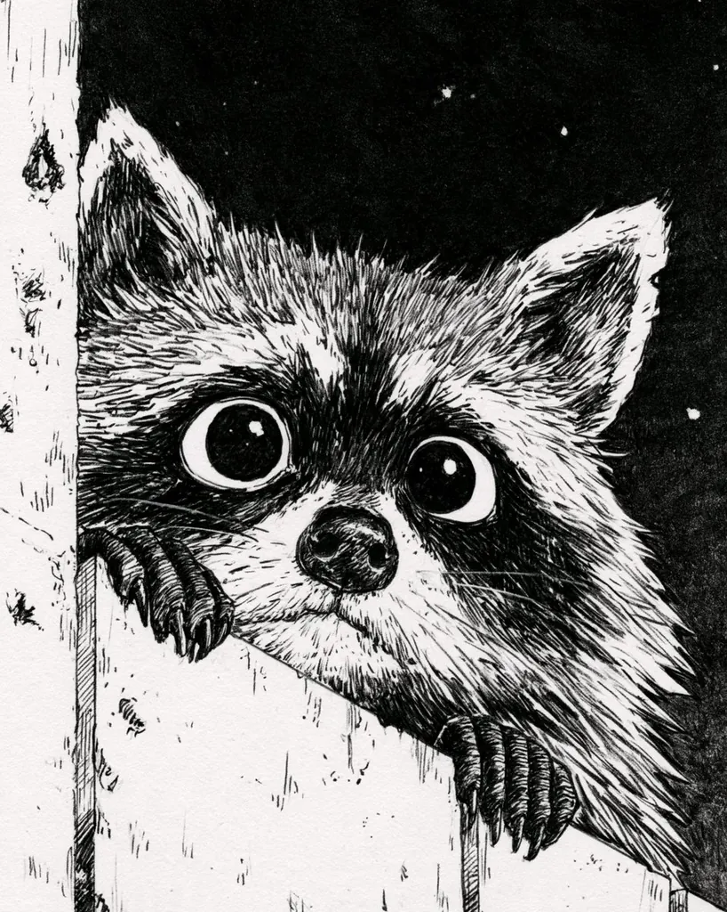</a> <a href="https://x.com/heathergreen/status/2125605434635800800"><b>@heathergreen</b></a> · <a href="prompts/x/x-01653.md">Prompt</a> Midjourney · via X</td><td width="33%" valign="top"> <a href="https://x.com/heathergreen/status/2124986851488301412"><b>@heathergreen</b></a> · <a href="prompts/x/x-01652.md">Prompt</a> Midjourney · via X</td><td width="33%" valign="top"><a href="prompts/x/x-01649.md">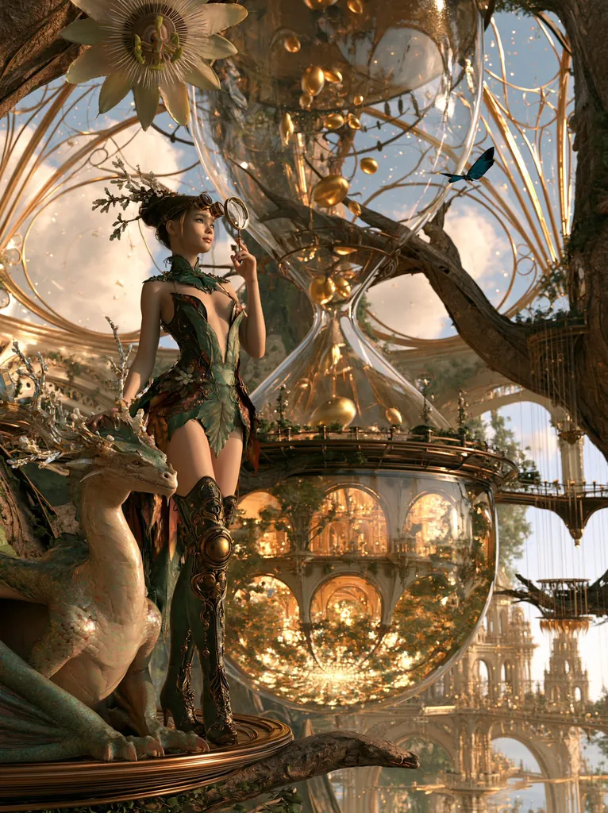</a> <a href="https://x.com/SethCritchley/status/2125582394224976258"><b>@SethCritchley</b></a> · <a href="prompts/x/x-01649.md">Prompt</a> Midjourney · via X</td></tr>
<tr><td width="33%" valign="top"><a href="prompts/x/x-01647.md">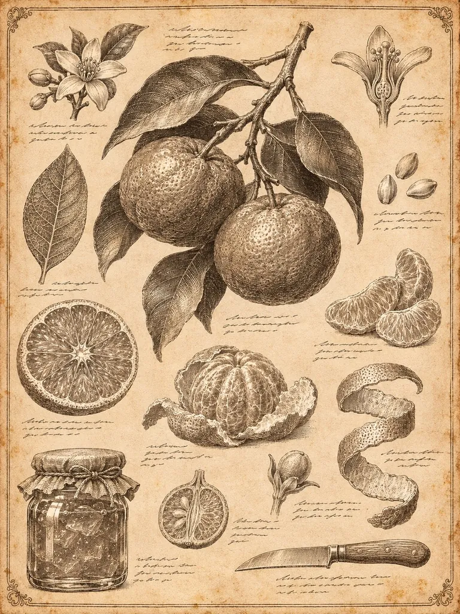</a> <a href="https://x.com/static_stare/status/2125524950857695275"><b>@static_stare</b></a> · <a href="prompts/x/x-01647.md">Prompt</a> GPT Image 2.5 · via X</td><td width="33%" valign="top"> <a href="https://x.com/static_stare/status/2125560967375556838"><b>@static_stare</b></a> · <a href="prompts/x/x-01646.md">Prompt</a> GPT Image 2.5 · via X</td><td width="33%" valign="top"> <a href="https://x.com/static_stare/status/2125591906835185851"><b>@static_stare</b></a> · <a href="prompts/x/x-01645.md">Prompt</a> GPT Image 2.5 · via X</td></tr>
</table>

**[Browse all 429 Illustration & 3D examples →](gallery/x-illustration-3d.md)**

## Product & Brand

<table>
<tr><td width="33%" valign="top"> <a href="https://x.com/zencreator_io/status/2126050863609249954"><b>@zencreator_io</b></a> · <a href="prompts/x/x-01697.md">Prompt</a> Seedream 5 Pro · via X</td><td width="33%" valign="top"> <a href="https://x.com/HBCoop_/status/2126057699800695091"><b>@HBCoop_</b></a> · <a href="prompts/x/x-01683.md">Prompt</a> Seedream 5.5 · via X</td><td width="33%" valign="top"><a href="prompts/x/x-01680.md">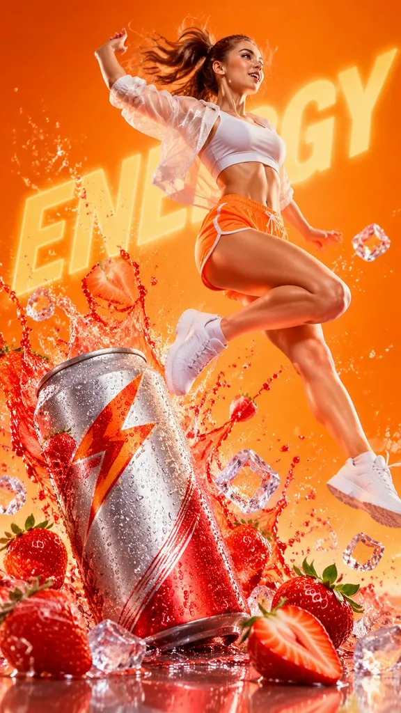</a> <a href="https://x.com/ZDuo_MoreAi/status/2125801722857611674"><b>@ZDuo_MoreAi</b></a> · <a href="prompts/x/x-01680.md">Prompt</a> GPT Image 2.6 · via X</td></tr>
<tr><td width="33%" valign="top"> <a href="https://x.com/SparkianAI/status/2125635626339045853"><b>@SparkianAI</b></a> · <a href="prompts/x/x-01654.md">Prompt</a> Nano Banana 2.1 · via X</td><td width="33%" valign="top"> <a href="https://x.com/seirdotmk/status/2125318285260644519"><b>@seirdotmk</b></a> · <a href="prompts/x/x-01598.md">Prompt</a> MiniMax H3 Image · via X</td><td width="33%" valign="top"><a href="prompts/x/x-01597.md">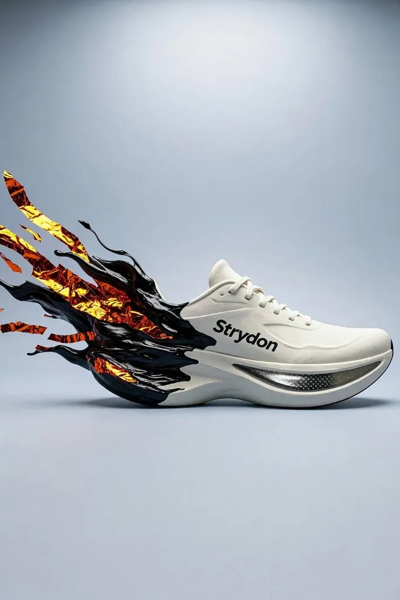</a> <a href="https://x.com/seirdotmk/status/2125122247815786746"><b>@seirdotmk</b></a> · <a href="prompts/x/x-01597.md">Prompt</a> MiniMax H3 Image · via X</td></tr>
<tr><td width="33%" valign="top"><a href="prompts/x/x-01596.md">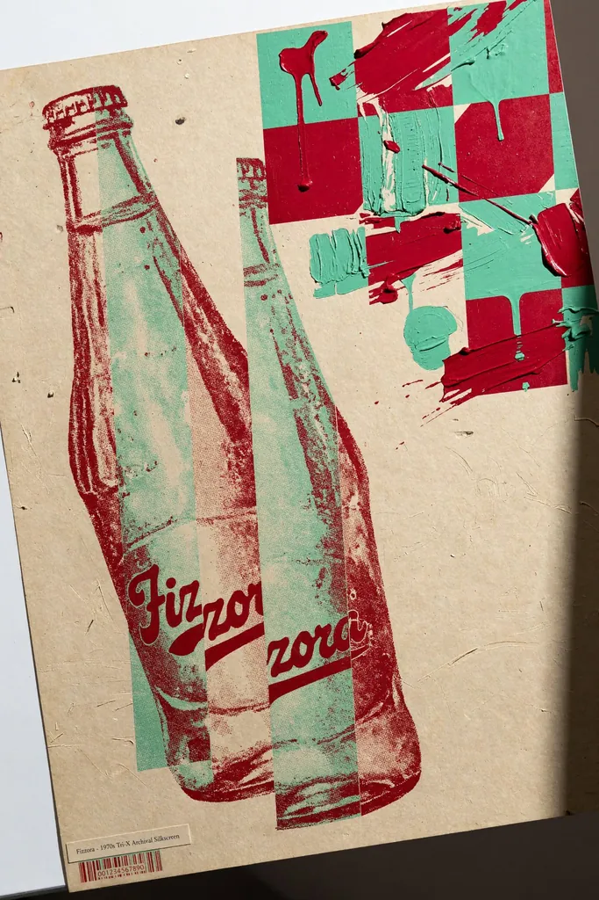</a> <a href="https://x.com/seirdotmk/status/2124941050326499351"><b>@seirdotmk</b></a> · <a href="prompts/x/x-01596.md">Prompt</a> MiniMax H3 Image · via X</td><td width="33%" valign="top"> <a href="https://x.com/ksa8Turky/status/2125349490970476560"><b>@ksa8Turky</b></a> · <a href="prompts/x/x-01587.md">Prompt</a> GPT Image · via X</td><td width="33%" valign="top"><a href="prompts/x/x-01447.md">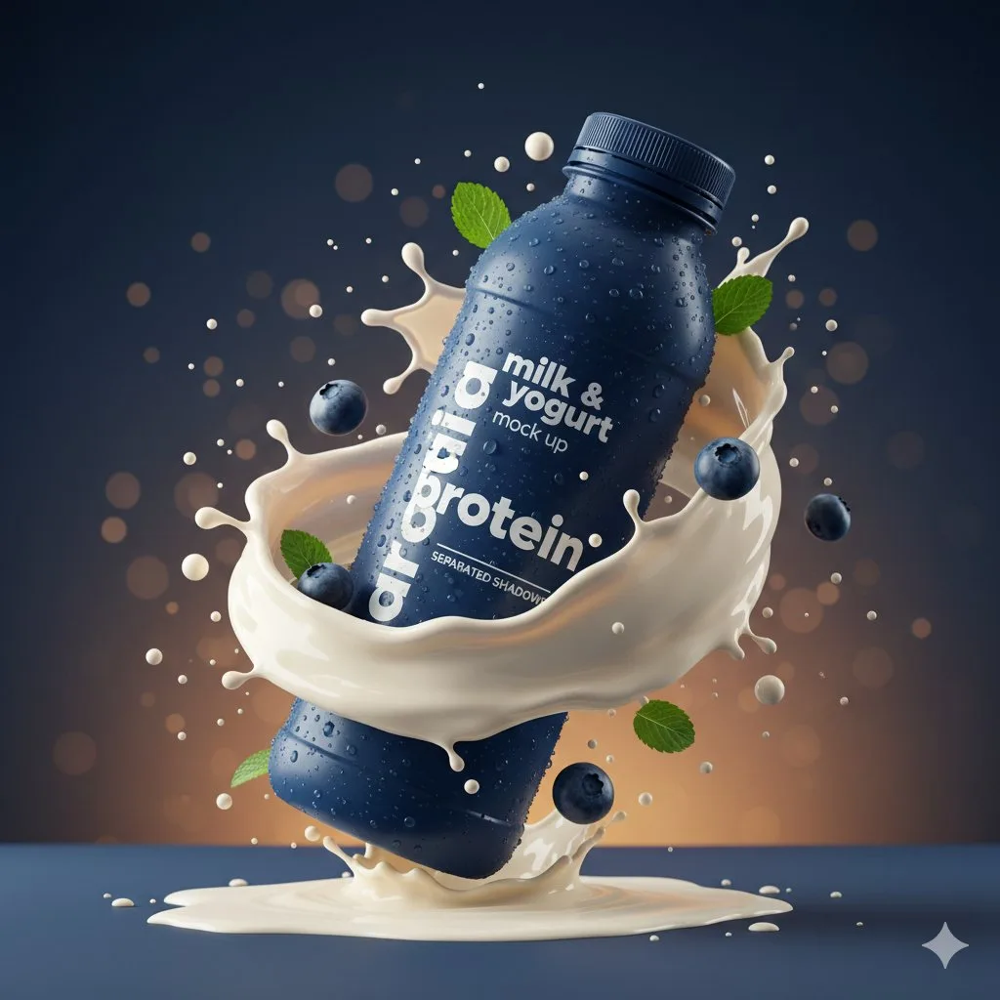</a> <a href="https://x.com/mehvishs25/status/2017420332458774791"><b>@mehvishs25</b></a> · <a href="prompts/x/x-01447.md">Prompt</a> GPT Image · via X</td></tr>
<tr><td width="33%" valign="top"><a href="prompts/x/x-01433.md">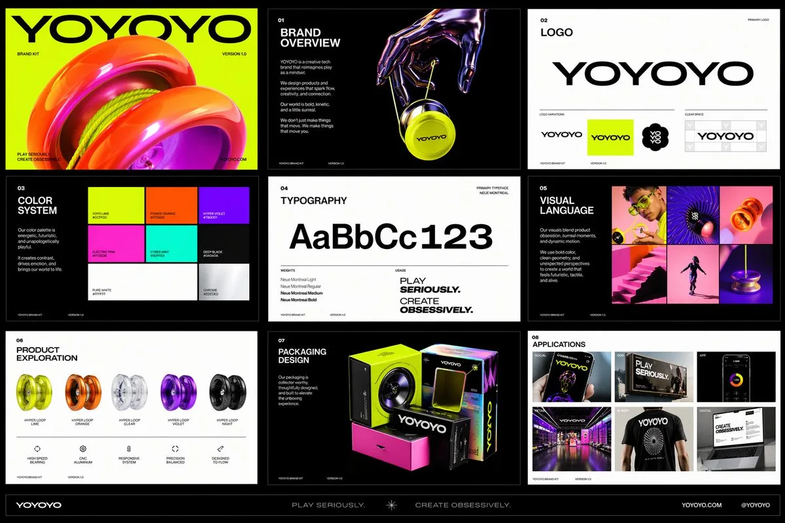</a> <a href="https://x.com/riomadeit/status/2046682439985082441"><b>@riomadeit</b></a> · <a href="prompts/x/x-01433.md">Prompt</a> GPT Image · via X</td><td width="33%" valign="top"><a href="prompts/x/x-01412.md">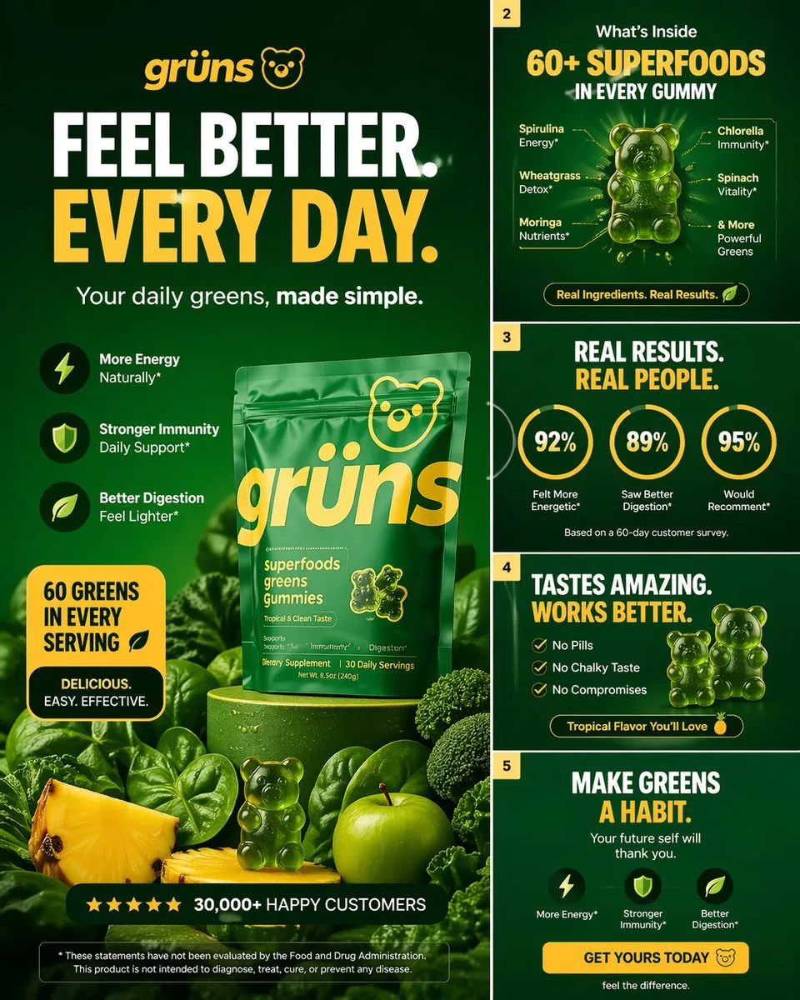</a> <a href="https://x.com/oliverkenyon/status/2047064581051142166"><b>@oliverkenyon</b></a> · <a href="prompts/x/x-01412.md">Prompt</a> GPT Image · via X</td><td width="33%" valign="top"><a href="prompts/x/x-01409.md">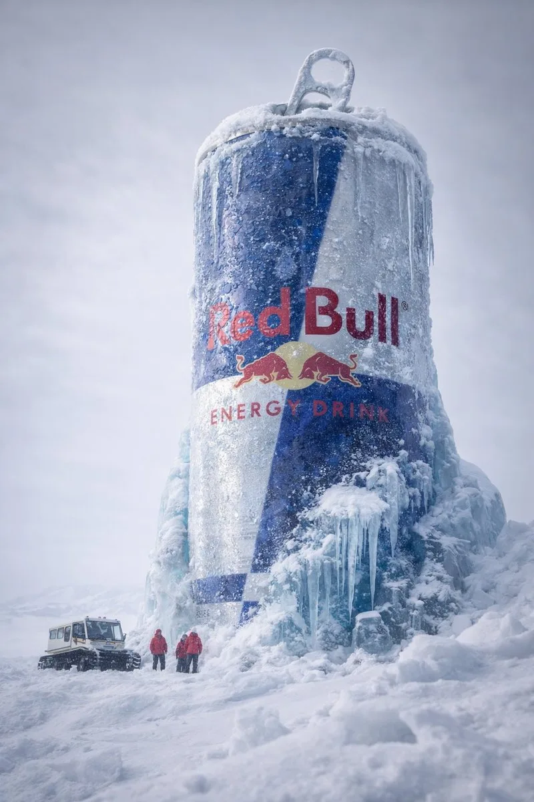</a> <a href="https://x.com/Sheldon056/status/2021057289785053348"><b>@Sheldon056</b></a> · <a href="prompts/x/x-01409.md">Prompt</a> GPT Image · via X</td></tr>
<tr><td width="33%" valign="top"><a href="prompts/x/x-01400.md">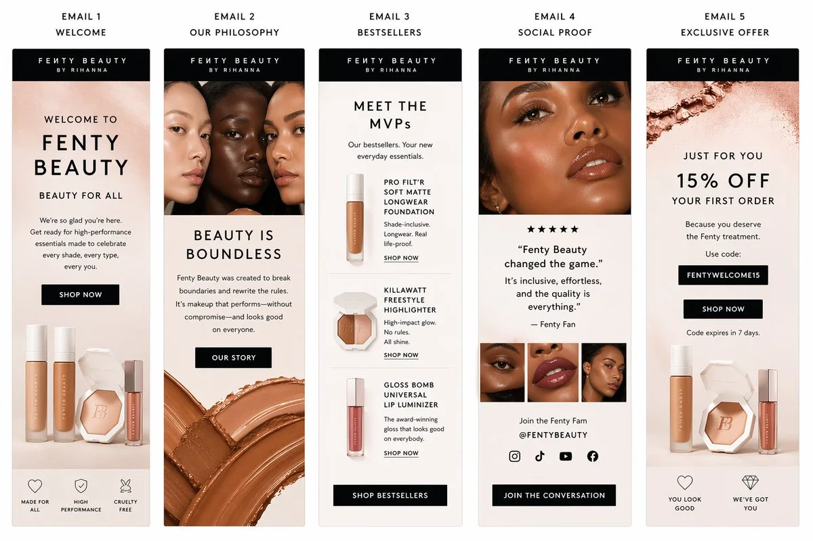</a> <a href="https://x.com/Salmaaboukarr/status/2046717569013293231"><b>@Salmaaboukarr</b></a> · <a href="prompts/x/x-01400.md">Prompt</a> GPT Image · via X</td><td width="33%" valign="top"><a href="prompts/x/x-01397.md">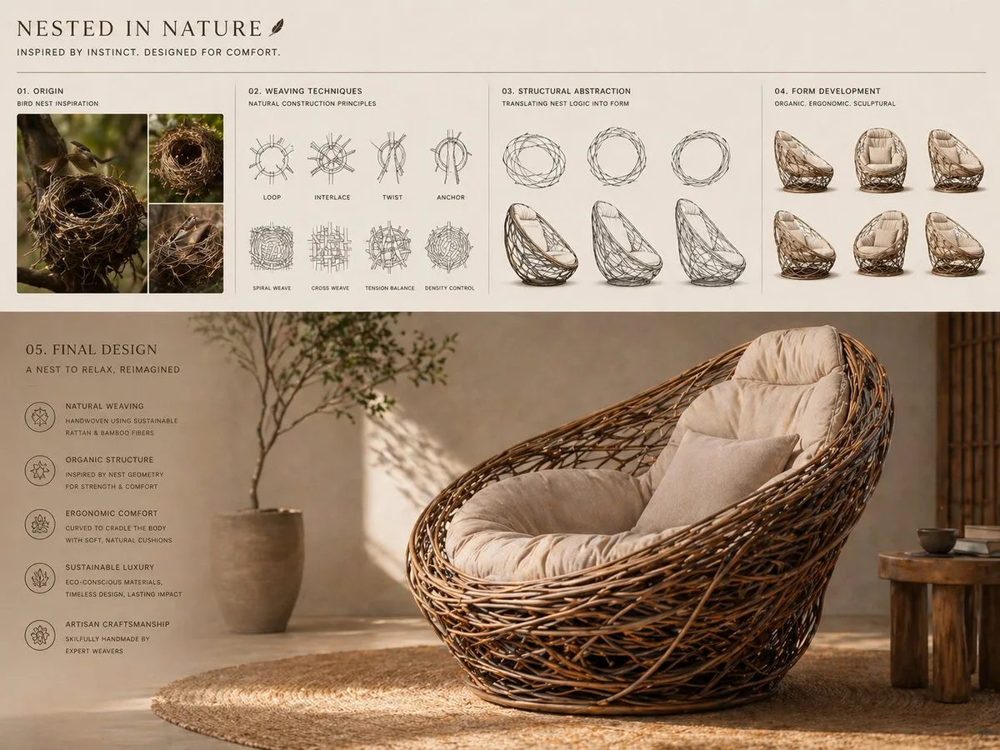</a> <a href="https://x.com/aleenaamiir/status/2048667175112802778"><b>@aleenaamiir</b></a> · <a href="prompts/x/x-01397.md">Prompt</a> GPT Image · via X</td><td width="33%" valign="top"><a href="prompts/x/x-01387.md">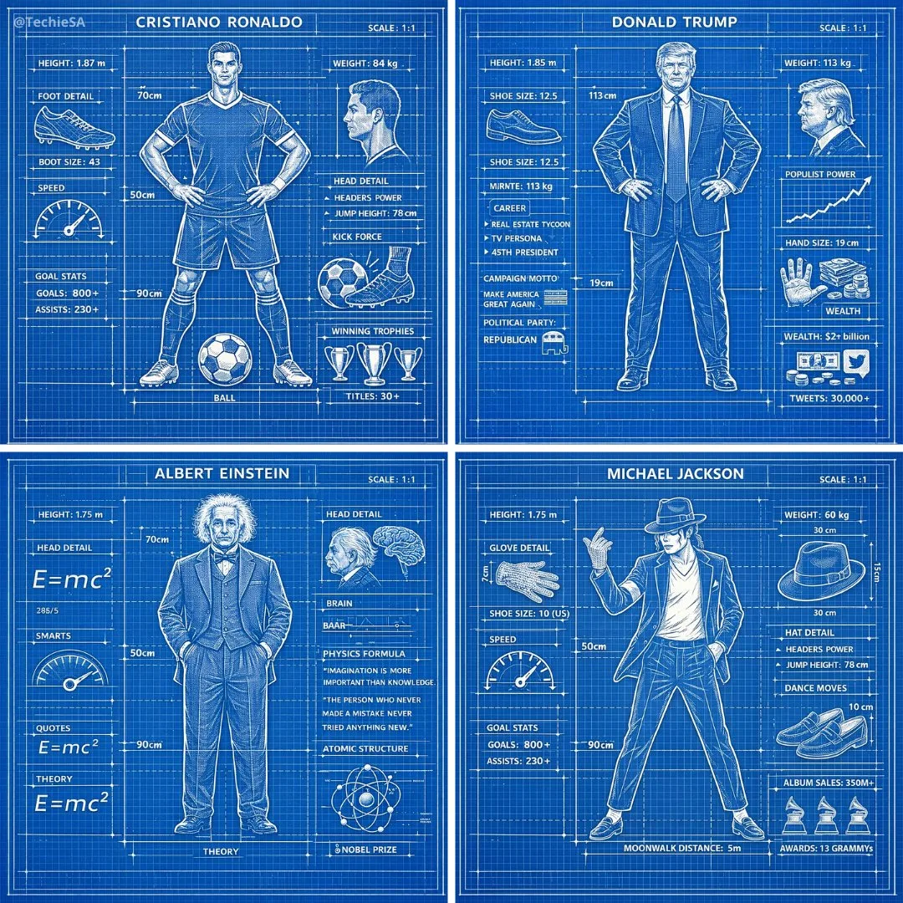</a> <a href="https://x.com/TechieBySA/status/2009585651554116028"><b>@TechieBySA</b></a> · <a href="prompts/x/x-01387.md">Prompt</a> GPT Image · via X</td></tr>
</table>

**[Browse all 224 Product & Brand examples →](gallery/x-product-brand.md)**

## Food & Drink

<table>
<tr><td width="33%" valign="top"><a href="prompts/x/x-01674.md">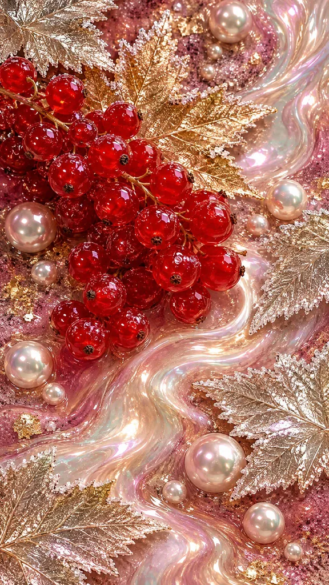</a> <a href="https://x.com/churvikv/status/2125960781292327167"><b>@churvikv</b></a> · <a href="prompts/x/x-01674.md">Prompt</a> GPT Image 2.5 Flare · via X</td><td width="33%" valign="top"><a href="prompts/x/x-01442.md">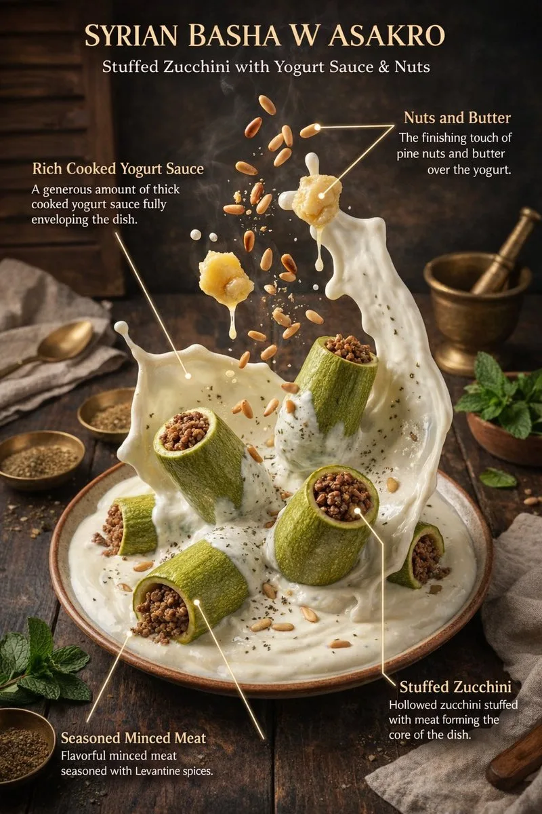</a> <a href="https://x.com/meng_dagg695/status/2011994819124752631"><b>@meng_dagg695</b></a> · <a href="prompts/x/x-01442.md">Prompt</a> GPT Image · via X</td><td width="33%" valign="top"><a href="prompts/x/x-01438.md">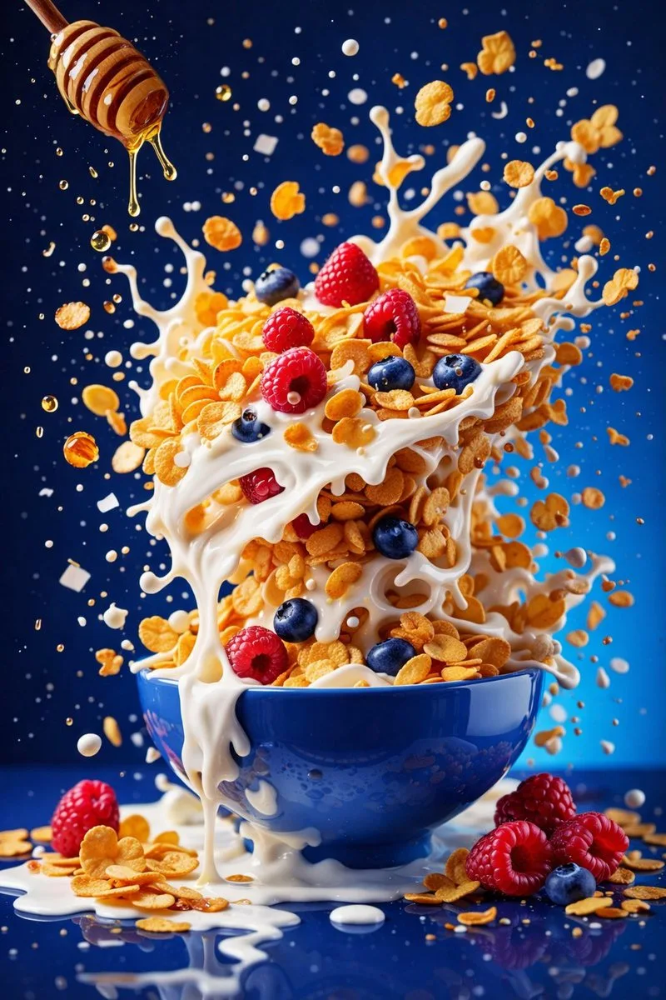</a> <a href="https://x.com/meng_dagg695/status/2009157208240755151"><b>@meng_dagg695</b></a> · <a href="prompts/x/x-01438.md">Prompt</a> GPT Image · via X</td></tr>
<tr><td width="33%" valign="top"> <a href="https://x.com/meng_dagg695/status/2009887009591226787"><b>@meng_dagg695</b></a> · <a href="prompts/x/x-01426.md">Prompt</a> GPT Image · via X</td><td width="33%" valign="top"> <a href="https://x.com/genel_ai/status/2046498264774791514"><b>@genel_ai</b></a> · <a href="prompts/x/x-01416.md">Prompt</a> GPT Image · via X</td><td width="33%" valign="top"> <a href="https://x.com/meng_dagg695/status/2010312584059351261"><b>@meng_dagg695</b></a> · <a href="prompts/x/x-01406.md">Prompt</a> GPT Image · via X</td></tr>
<tr><td width="33%" valign="top"><a href="prompts/x/x-01399.md">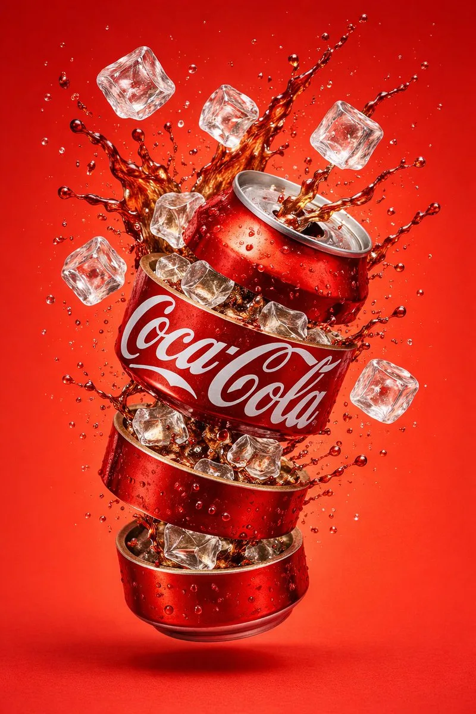</a> <a href="https://x.com/meng_dagg695/status/2009519057717088345"><b>@meng_dagg695</b></a> · <a href="prompts/x/x-01399.md">Prompt</a> GPT Image · via X</td><td width="33%" valign="top"> <a href="https://x.com/Sairah_0/status/2048725842096976020"><b>@Sairah_0</b></a> · <a href="prompts/x/x-01398.md">Prompt</a> GPT Image · via X</td><td width="33%" valign="top"> <a href="https://x.com/meng_dagg695/status/2009446363331973461"><b>@meng_dagg695</b></a> · <a href="prompts/x/x-01395.md">Prompt</a> GPT Image · via X</td></tr>
<tr><td width="33%" valign="top"><a href="prompts/x/x-01393.md">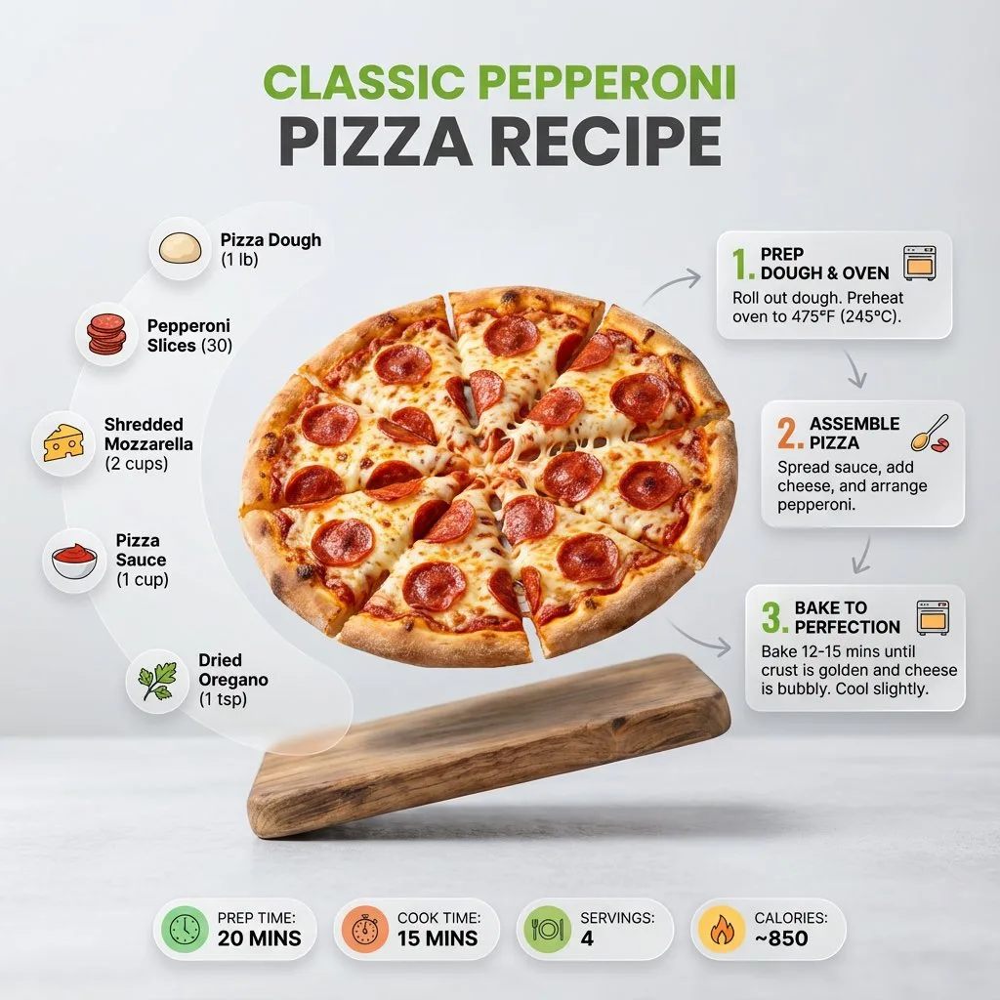</a> <a href="https://x.com/TechieBySA/status/2013233539706233086"><b>@TechieBySA</b></a> · <a href="prompts/x/x-01393.md">Prompt</a> GPT Image · via X</td><td width="33%" valign="top"><a href="prompts/x/x-01381.md">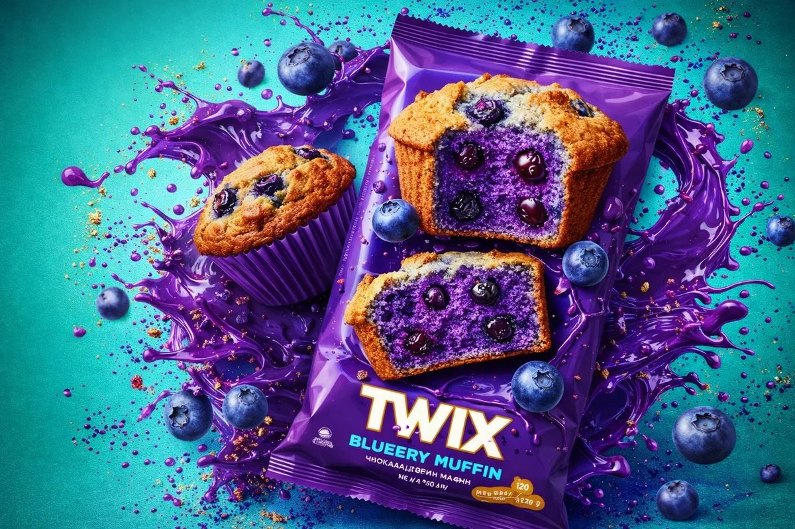</a> <a href="https://x.com/meng_dagg695/status/2012353813425144239"><b>@meng_dagg695</b></a> · <a href="prompts/x/x-01381.md">Prompt</a> GPT Image · via X</td><td width="33%" valign="top"><a href="prompts/x/x-01377.md">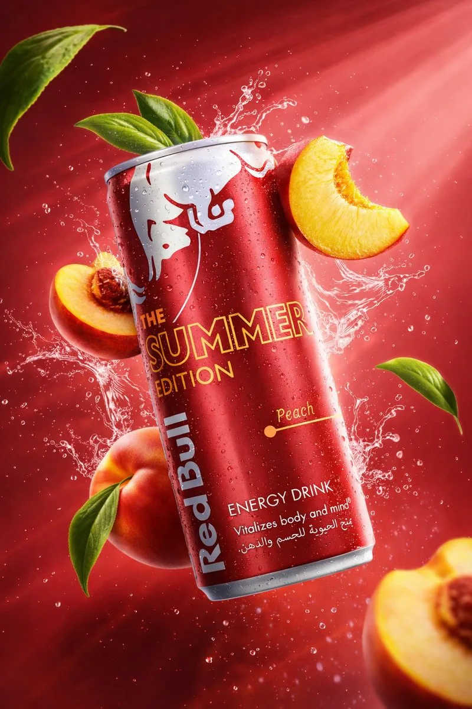</a> <a href="https://x.com/meng_dagg695/status/2010681413562155183"><b>@meng_dagg695</b></a> · <a href="prompts/x/x-01377.md">Prompt</a> GPT Image · via X</td></tr>
<tr><td width="33%" valign="top"> <a href="https://x.com/john_my07/status/2019431396885070327"><b>@john_my07</b></a> · <a href="prompts/x/x-01375.md">Prompt</a> GPT Image · via X</td><td width="33%" valign="top"><a href="prompts/x/x-01372.md">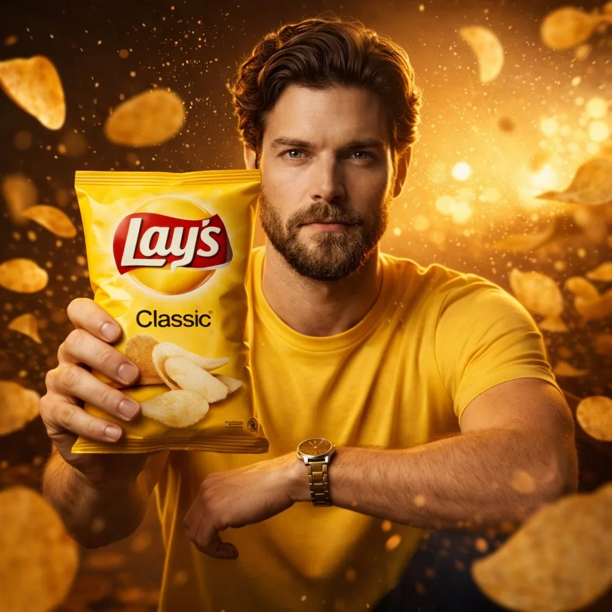</a> <a href="https://x.com/Strength04_X/status/2012780826715619644"><b>@Strength04_X</b></a> · <a href="prompts/x/x-01372.md">Prompt</a> GPT Image · via X</td><td width="33%" valign="top"> <a href="https://x.com/meng_dagg695/status/2010981812609434034"><b>@meng_dagg695</b></a> · <a href="prompts/x/x-01371.md">Prompt</a> GPT Image · via X</td></tr>
</table>

**[Browse all 155 Food & Drink examples →](gallery/x-food-drink.md)**

## Poster Design

<table>
<tr><td width="33%" valign="top"><a href="prompts/x/x-01699.md">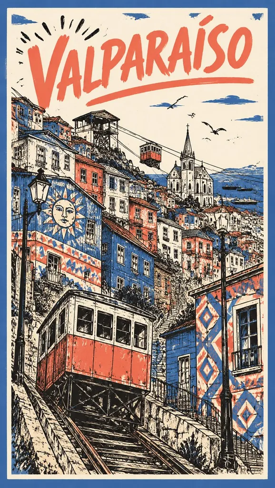</a> <a href="https://x.com/Andy4aicreate/status/2126019163009286328"><b>@Andy4aicreate</b></a> · <a href="prompts/x/x-01699.md">Prompt</a> GPT Image 2.6 Flare · via X</td><td width="33%" valign="top"><a href="prompts/x/x-01694.md">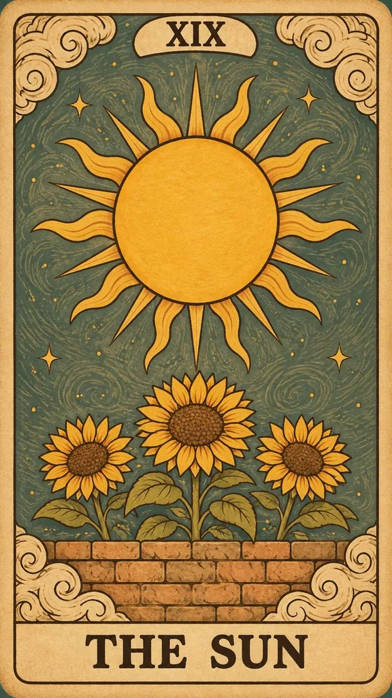</a> <a href="https://x.com/static_stare/status/2125887339839000879"><b>@static_stare</b></a> · <a href="prompts/x/x-01694.md">Prompt</a> GPT Image 2.5 · via X</td><td width="33%" valign="top"> <a href="https://x.com/ZDuo_MoreAi/status/2125907419213771113"><b>@ZDuo_MoreAi</b></a> · <a href="prompts/x/x-01679.md">Prompt</a> GPT Image 2.6 · via X</td></tr>
<tr><td width="33%" valign="top"> <a href="https://x.com/Goodmanprotocol/status/2125825694693564441"><b>@Goodmanprotocol</b></a> · <a href="prompts/x/x-01675.md">Prompt</a> GPT Image 2.6 · via X</td><td width="33%" valign="top"> <a href="https://x.com/DavidLi36143625/status/2125535309999796460"><b>@DavidLi36143625</b></a> · <a href="prompts/x/x-01639.md">Prompt</a> GPT Image 2.6 Sunburst · via X</td><td width="33%" valign="top"> <a href="https://x.com/Just_Anika_Here/status/2125627017622323425"><b>@Just_Anika_Here</b></a> · <a href="prompts/x/x-01630.md">Prompt</a> GPT Image 2.5 · via X</td></tr>
<tr><td width="33%" valign="top"> <a href="https://x.com/Aiwithkami/status/2125476933056217417"><b>@Aiwithkami</b></a> · <a href="prompts/x/x-01626.md">Prompt</a> GPT Image 2.6 · via X</td><td width="33%" valign="top"> <a href="https://x.com/MrLarus/status/2125257923131773007"><b>@MrLarus</b></a> · <a href="prompts/x/x-01618.md">Prompt</a> GPT Image 2.6 · via X</td><td width="33%" valign="top"> <a href="https://x.com/CoopandKCmom/status/2124727709351715301"><b>@CoopandKCmom</b></a> · <a href="prompts/x/x-01578.md">Prompt</a> Nano Banana 2.1 · via X</td></tr>
<tr><td width="33%" valign="top"><a href="prompts/x/x-01559.md">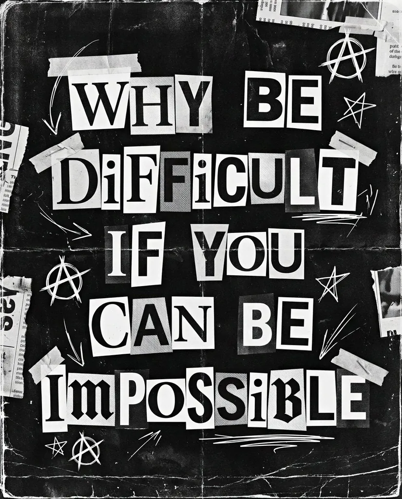</a> <a href="https://x.com/heathergreen/status/2124684359680630949"><b>@heathergreen</b></a> · <a href="prompts/x/x-01559.md">Prompt</a> Nano Banana 2.1 · via X</td><td width="33%" valign="top"><a href="prompts/x/x-01558.md">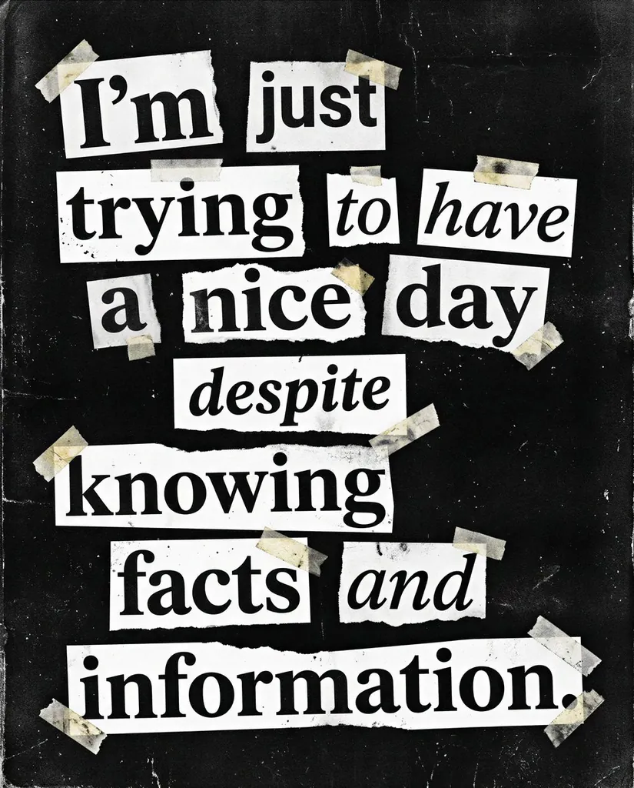</a> <a href="https://x.com/heathergreen/status/2124321978911711493"><b>@heathergreen</b></a> · <a href="prompts/x/x-01558.md">Prompt</a> Nano Banana 2.1 · via X</td><td width="33%" valign="top"><a href="prompts/x/x-01554.md">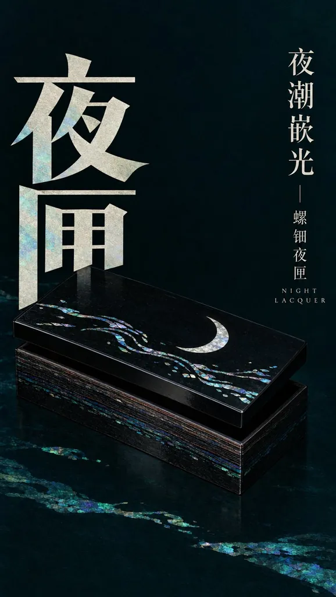</a> <a href="https://x.com/Andy4aicreate/status/2124934011592085845"><b>@Andy4aicreate</b></a> · <a href="prompts/x/x-01554.md">Prompt</a> GPT Image 2.5 Flare · via X</td></tr>
<tr><td width="33%" valign="top"><a href="prompts/x/x-01549.md">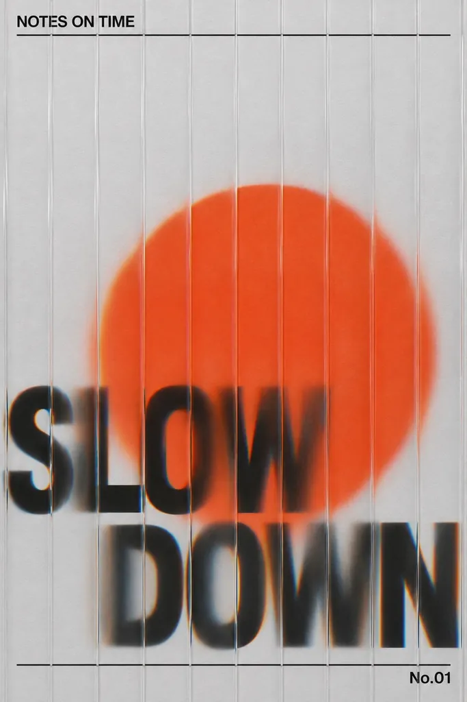</a> <a href="https://x.com/static_stare/status/2124799205839606209"><b>@static_stare</b></a> · <a href="prompts/x/x-01549.md">Prompt</a> GPT Image 2.5 · via X</td><td width="33%" valign="top"> <a href="https://x.com/ZDuo_MoreAi/status/2124764888480543222"><b>@ZDuo_MoreAi</b></a> · <a href="prompts/x/x-01547.md">Prompt</a> GPT Image 2.6 · via X</td><td width="33%" valign="top"><a href="prompts/x/x-01538.md">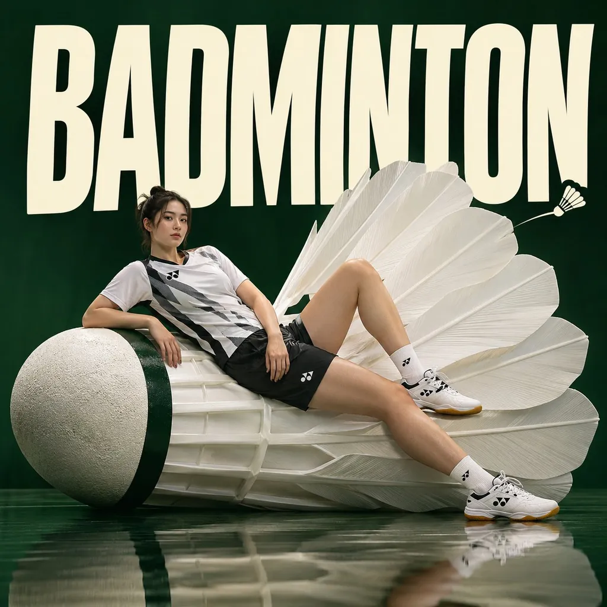</a> <a href="https://x.com/Goodmanprotocol/status/2124756790143488011"><b>@Goodmanprotocol</b></a> · <a href="prompts/x/x-01538.md">Prompt</a> GPT Image 2.6 · via X</td></tr>
</table>

**[Browse all 156 Poster Design examples →](gallery/x-poster-design.md)**

## UI & Graphic

<table>
<tr><td width="33%" valign="top"><a href="prompts/x/x-01650.md">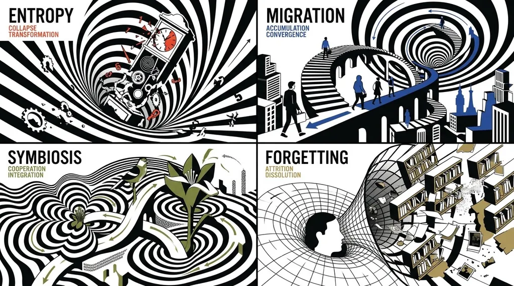</a> <a href="https://x.com/Gdgtify/status/2125519615304274301"><b>@Gdgtify</b></a> · <a href="prompts/x/x-01650.md">Prompt</a> Nano Banana 2.1 · via X</td><td width="33%" valign="top"><a href="prompts/x/x-01582.md">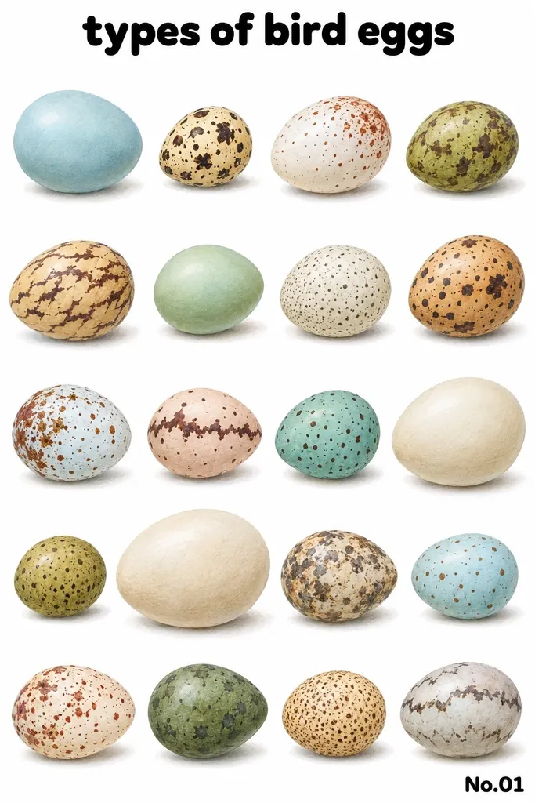</a> <a href="https://x.com/static_stare/status/2125161133804015882"><b>@static_stare</b></a> · <a href="prompts/x/x-01582.md">Prompt</a> GPT Image 2.5 · via X</td><td width="33%" valign="top"><a href="prompts/x/x-01523.md">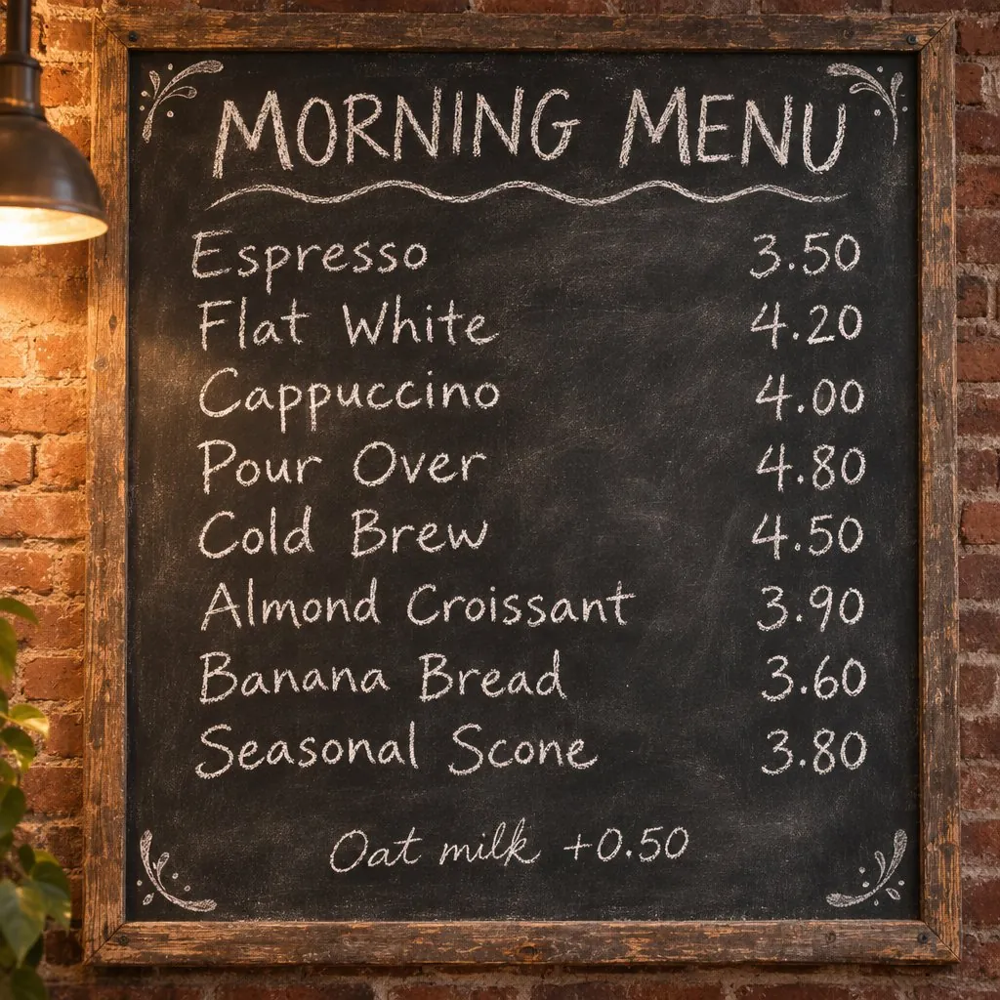</a> <a href="https://x.com/DavidLi36143625/status/2123941784585990611"><b>@DavidLi36143625</b></a> · <a href="prompts/x/x-01523.md">Prompt</a> GPT Image 2.6 Sunburst · via X</td></tr>
<tr><td width="33%" valign="top"><a href="prompts/x/x-01476.md">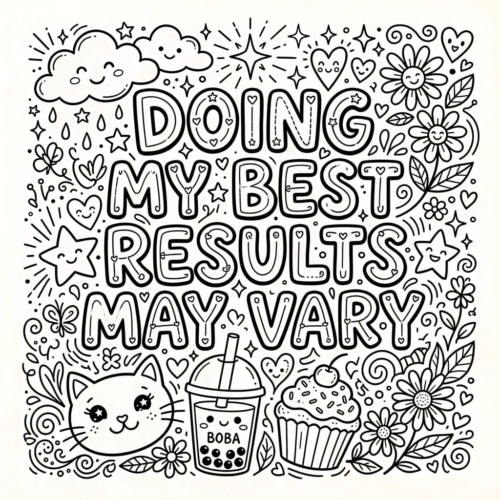</a> <a href="https://x.com/heathergreen/status/2091812770274492604"><b>@heathergreen</b></a> · <a href="prompts/x/x-01476.md">Prompt</a> Nano Banana 2 · via X</td><td width="33%" valign="top"><a href="prompts/x/x-01448.md">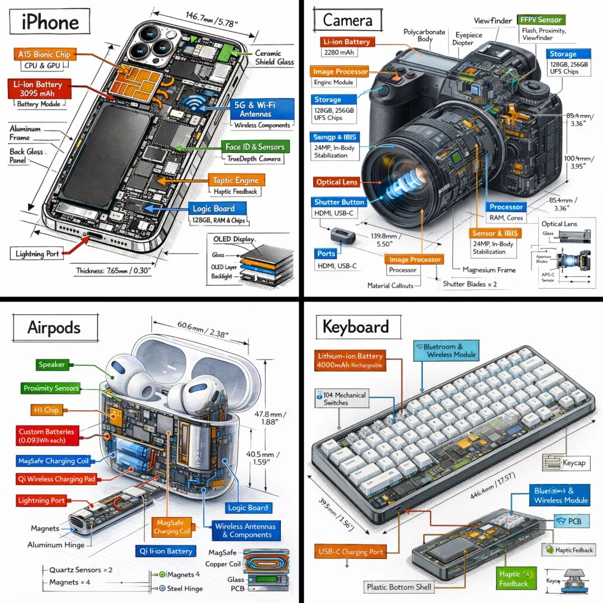</a> <a href="https://x.com/TechieBySA/status/2017928823497453789"><b>@TechieBySA</b></a> · <a href="prompts/x/x-01448.md">Prompt</a> GPT Image · via X</td><td width="33%" valign="top"><a href="prompts/x/x-01420.md">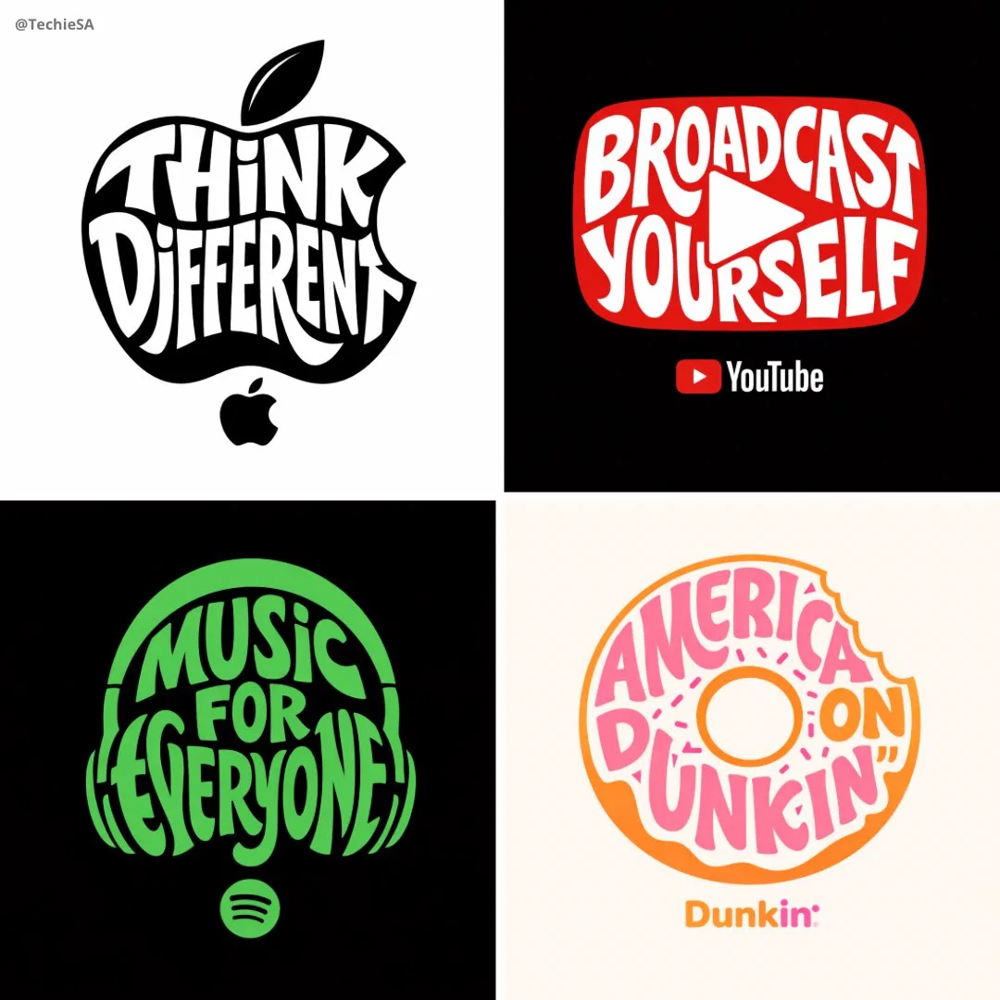</a> <a href="https://x.com/TechieBySA/status/2005620980891480567"><b>@TechieBySA</b></a> · <a href="prompts/x/x-01420.md">Prompt</a> GPT Image · via X</td></tr>
<tr><td width="33%" valign="top"> <a href="https://x.com/azed_ai/status/2047993289283133945"><b>@azed_ai</b></a> · <a href="prompts/x/x-01404.md">Prompt</a> GPT Image · via X</td><td width="33%" valign="top"> <a href="https://x.com/Sheldon056/status/2016088197714084320"><b>@Sheldon056</b></a> · <a href="prompts/x/x-01396.md">Prompt</a> GPT Image · via X</td><td width="33%" valign="top"> <a href="https://x.com/Noor_ul_ain43/status/2047227731839184901"><b>@Noor_ul_ain43</b></a> · <a href="prompts/x/x-01335.md">Prompt</a> GPT Image · via X</td></tr>
<tr><td width="33%" valign="top"> <a href="https://x.com/Naiknelofar788/status/2018668607966769212"><b>@Naiknelofar788</b></a> · <a href="prompts/x/x-01321.md">Prompt</a> GPT Image · via X</td><td width="33%" valign="top"><a href="prompts/x/x-01304.md">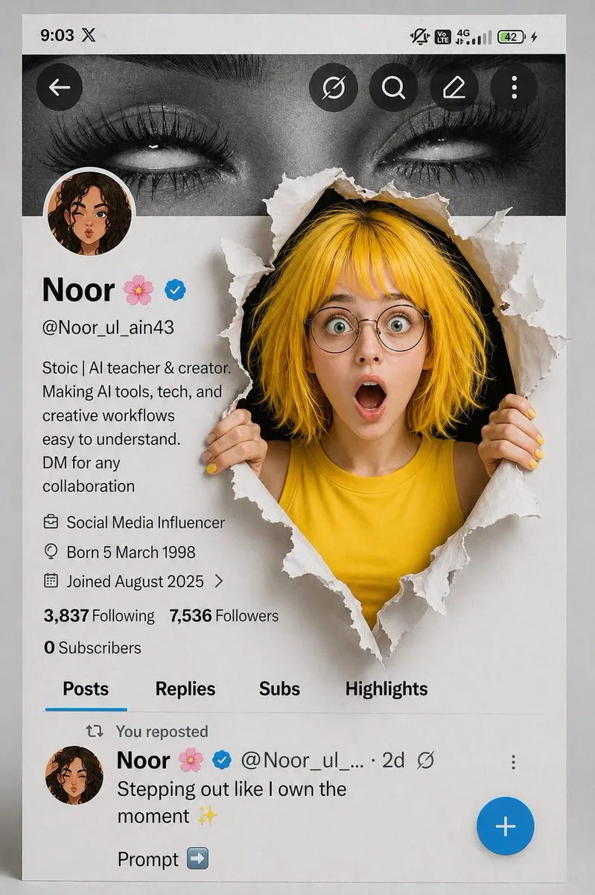</a> <a href="https://x.com/Noor_ul_ain43/status/2048088005836173316"><b>@Noor_ul_ain43</b></a> · <a href="prompts/x/x-01304.md">Prompt</a> GPT Image · via X</td><td width="33%" valign="top"><a href="prompts/x/x-01239.md">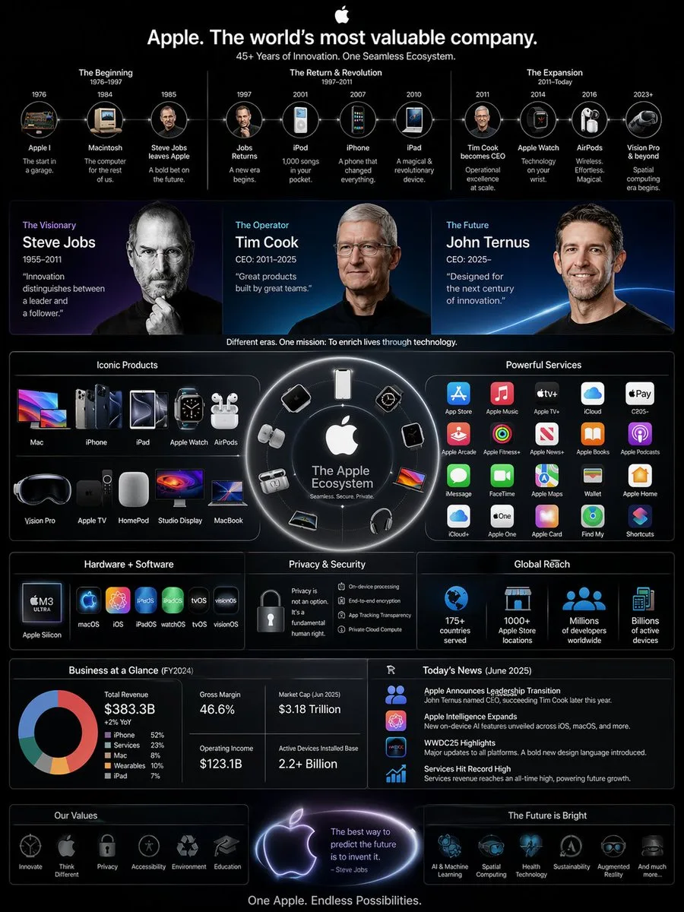</a> <a href="https://x.com/Jackywine/status/2046480096471765192"><b>@Jackywine</b></a> · <a href="prompts/x/x-01239.md">Prompt</a> GPT Image · via X</td></tr>
<tr><td width="33%" valign="top"> <a href="https://x.com/ecomchasedimond/status/2047172163313222013"><b>@ecomchasedimond</b></a> · <a href="prompts/x/x-01226.md">Prompt</a> GPT Image · via X</td><td width="33%" valign="top"> <a href="https://x.com/aleenaamiir/status/2047546614257221653"><b>@aleenaamiir</b></a> · <a href="prompts/x/x-01209.md">Prompt</a> GPT Image · via X</td><td width="33%" valign="top"> <a href="https://x.com/Naiknelofar788/status/2048746995465203876"><b>@Naiknelofar788</b></a> · <a href="prompts/x/x-01196.md">Prompt</a> GPT Image · via X</td></tr>
</table>

**[Browse all 51 UI & Graphic examples →](gallery/x-ui-graphic.md)**

## Video

<table>
<tr><td width="33%" valign="top"> <a href="https://x.com/IABossOfficiel/status/2125865342786269664"><b>@IABossOfficiel</b></a> · <a href="prompts/x/x-01713.md">Prompt</a> ▶ Video · Seedance 2.0 · via X</td><td width="33%" valign="top"> <a href="https://x.com/0xCortiq/status/2125989462639567046"><b>@0xCortiq</b></a> · <a href="prompts/x/x-01712.md">Prompt</a> ▶ Video · Seedance 2.0 · via X</td><td width="33%" valign="top"> <a href="https://x.com/KlRITO369/status/2126048544943690226"><b>@KlRITO369</b></a> · <a href="prompts/x/x-01711.md">Prompt</a> ▶ Video · Grok Imagine · via X</td></tr>
<tr><td width="33%" valign="top"> <a href="https://x.com/DevonSt75210440/status/2126094856313573521"><b>@DevonSt75210440</b></a> · <a href="prompts/x/x-01710.md">Prompt</a> ▶ Video · Grok Imagine · via X</td><td width="33%" valign="top"><a href="prompts/x/x-01709.md">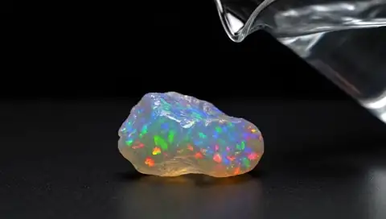</a> <a href="https://x.com/lstrew/status/2125992073694462132"><b>@lstrew</b></a> · <a href="prompts/x/x-01709.md">Prompt</a> ▶ Video · Grok Imagine · via X</td><td width="33%" valign="top"> <a href="https://x.com/HawkinsonLindy/status/2125802909069889554"><b>@HawkinsonLindy</b></a> · <a href="prompts/x/x-01708.md">Prompt</a> ▶ Video · Grok Imagine · via X</td></tr>
<tr><td width="33%" valign="top"> <a href="https://x.com/SpaceEagle/status/2126117557950378482"><b>@SpaceEagle</b></a> · <a href="prompts/x/x-01707.md">Prompt</a> ▶ Video · Grok Imagine · via X</td><td width="33%" valign="top"> <a href="https://x.com/adam_james_hill/status/2126074178021343737"><b>@adam_james_hill</b></a> · <a href="prompts/x/x-01706.md">Prompt</a> ▶ Video · Kling 3.0 · via X</td><td width="33%" valign="top"><a href="prompts/x/x-01705.md">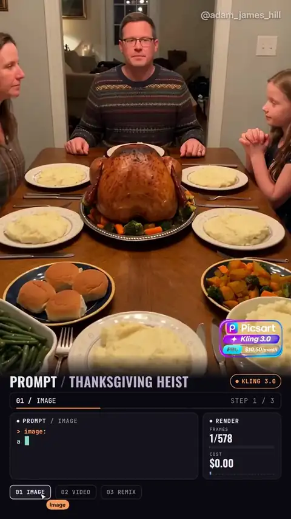</a> <a href="https://x.com/adam_james_hill/status/2125996896506253514"><b>@adam_james_hill</b></a> · <a href="prompts/x/x-01705.md">Prompt</a> ▶ Video · Kling 3.0 · via X</td></tr>
<tr><td width="33%" valign="top"><a href="prompts/x/x-01704.md">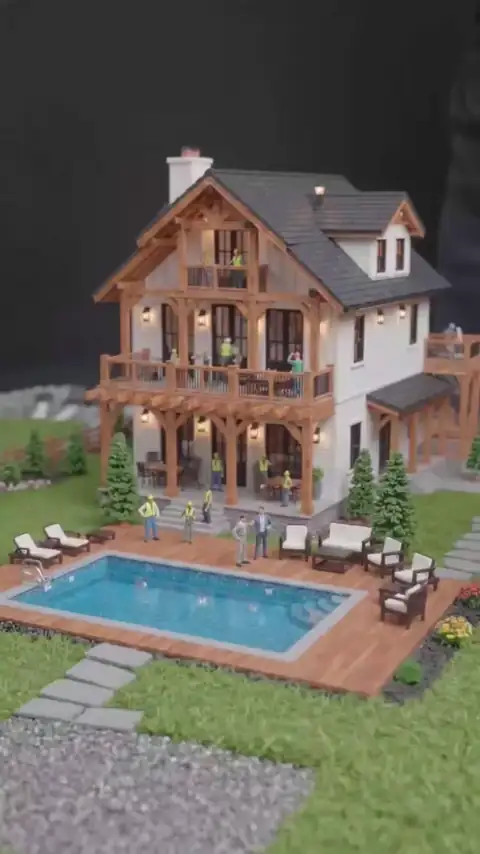</a> <a href="https://x.com/OliviaRose10un/status/2125973480688721964"><b>@OliviaRose10un</b></a> · <a href="prompts/x/x-01704.md">Prompt</a> ▶ Video · Seedance 2.0 · via X</td><td width="33%" valign="top"> <a href="https://x.com/OliviaRose10un/status/2125822470519472466"><b>@OliviaRose10un</b></a> · <a href="prompts/x/x-01703.md">Prompt</a> ▶ Video · Seedance 2.0 · via X</td><td width="33%" valign="top"> <a href="https://x.com/AIwithMinal/status/2125814785157853489"><b>@AIwithMinal</b></a> · <a href="prompts/x/x-01702.md">Prompt</a> ▶ Video · Seedance 2.0 · via X</td></tr>
<tr><td width="33%" valign="top"> <a href="https://x.com/draavenai/status/2125967360893018427"><b>@draavenai</b></a> · <a href="prompts/x/x-01701.md">Prompt</a> ▶ Video · Seedance 2.0 · via X</td><td width="33%" valign="top"> <a href="https://x.com/Elvorya/status/2125462047274193084"><b>@Elvorya</b></a> · <a href="prompts/x/x-01673.md">Prompt</a> ▶ Video · Kling 4.0 · via X</td><td width="33%" valign="top"> <a href="https://x.com/carolletta/status/2125575301019398548"><b>@carolletta</b></a> · <a href="prompts/x/x-01672.md">Prompt</a> ▶ Video · Grok Imagine · via X</td></tr>
</table>

**[Browse all 95 Video examples →](gallery/x-video.md)**

> Images, videos and prompts belong to their creators and are shown with credit for reference. Creators can ask for changes or removal by opening an issue.
