# 社区案例 · 1439

[English](EXAMPLES.md)

社区用户在 X 和其它网站分享的提示词和作品，按原样保留，每条都署名并链接到原帖。我们自己整理、用 vinano.ai 生成的合集见 [README](README.zh-CN.md)。

**[▶ 在 vinano.ai 上生成你自己的版本](https://vinano.ai?utm_source=github&utm_medium=readme&utm_campaign=awesome-image-video-prompts-updating&utm_content=examples-zh)**

## 目录

- [摄影写真 · Photography](#摄影写真-photography) (525)
- [插画与 3D · Illustration & 3D](#插画与-3d-illustration-3d) (364)
- [产品与品牌 · Product & Brand](#产品与品牌-product-brand) (216)
- [美食饮品 · Food & Drink](#美食饮品-food-drink) (154)
- [海报设计 · Poster Design](#海报设计-poster-design) (133)
- [UI 与平面 · UI & Graphic](#ui-与平面-ui-graphic) (47)

## 摄影写真 · Photography

<table>
<tr><td width="33%" valign="top"> <a href="https://x.com/TechieBySA/status/2007523056822939698"><b>@TechieBySA</b></a> · <a href="prompts/x/x-01445.md">Prompt</a> GPT Image · via X</td><td width="33%" valign="top"> <a href="https://x.com/Naiknelofar788/status/2028853502358003808"><b>@Naiknelofar788</b></a> · <a href="prompts/x/x-01430.md">Prompt</a> GPT Image · via X</td><td width="33%" valign="top"> <a href="https://x.com/Arminn_Ai/status/2002826415939682584"><b>@Arminn_Ai</b></a> · <a href="prompts/x/x-01429.md">Prompt</a> GPT Image · via X</td></tr>
<tr><td width="33%" valign="top"> <a href="https://x.com/saniaspeaks_/status/2009834337043394622"><b>@saniaspeaks_</b></a> · <a href="prompts/x/x-01424.md">Prompt</a> GPT Image · via X</td><td width="33%" valign="top"> <a href="https://x.com/BubbleBrain/status/2046151898621993364"><b>@BubbleBrain</b></a> · <a href="prompts/x/x-01423.md">Prompt</a> GPT Image · via X</td><td width="33%" valign="top"> <a href="https://x.com/Naiknelofar788/status/2022894575040512280"><b>@Naiknelofar788</b></a> · <a href="prompts/x/x-01421.md">Prompt</a> GPT Image · via X</td></tr>
<tr><td width="33%" valign="top"> <a href="https://x.com/Sheldon056/status/2002763964476965234"><b>@Sheldon056</b></a> · <a href="prompts/x/x-01419.md">Prompt</a> GPT Image · via X</td><td width="33%" valign="top"> <a href="https://x.com/Naiknelofar788/status/2026703924888219706"><b>@Naiknelofar788</b></a> · <a href="prompts/x/x-01415.md">Prompt</a> GPT Image · via X</td><td width="33%" valign="top"> <a href="https://x.com/TechieBySA/status/2018389139826037141"><b>@TechieBySA</b></a> · <a href="prompts/x/x-01411.md">Prompt</a> GPT Image · via X</td></tr>
<tr><td width="33%" valign="top"> <a href="https://x.com/Xaroonx/status/2005541752187273292"><b>@Xaroonx</b></a> · <a href="prompts/x/x-01410.md">Prompt</a> GPT Image · via X</td><td width="33%" valign="top"> <a href="https://x.com/Naiknelofar788/status/2033570946985144647"><b>@Naiknelofar788</b></a> · <a href="prompts/x/x-01402.md">Prompt</a> GPT Image · via X</td><td width="33%" valign="top"> <a href="https://x.com/Naiknelofar788/status/2011645375460057533"><b>@Naiknelofar788</b></a> · <a href="prompts/x/x-01394.md">Prompt</a> GPT Image · via X</td></tr>
<tr><td width="33%" valign="top"> <a href="https://x.com/Naiknelofar788/status/2028623800313798810"><b>@Naiknelofar788</b></a> · <a href="prompts/x/x-01390.md">Prompt</a> GPT Image · via X</td><td width="33%" valign="top"> <a href="https://x.com/Naiknelofar788/status/2020789772617478217"><b>@Naiknelofar788</b></a> · <a href="prompts/x/x-01380.md">Prompt</a> GPT Image · via X</td><td width="33%" valign="top"> <a href="https://x.com/ozan_sihay/status/2001003144566681621"><b>@ozan_sihay</b></a> · <a href="prompts/x/x-01379.md">Prompt</a> GPT Image · via X</td></tr>
</table>

**[查看全部 525 个摄影写真案例 →](gallery/x-photography.md)**

## 插画与 3D · Illustration & 3D

<table>
<tr><td width="33%" valign="top"> <a href="https://x.com/meng_dagg695/status/2012437899955097836"><b>@meng_dagg695</b></a> · <a href="prompts/x/x-01436.md">Prompt</a> GPT Image · via X</td><td width="33%" valign="top"> <a href="https://x.com/Sheldon056/status/2011634592810438835"><b>@Sheldon056</b></a> · <a href="prompts/x/x-01434.md">Prompt</a> GPT Image · via X</td><td width="33%" valign="top"> <a href="https://x.com/Naiknelofar788/status/2024636606272229577"><b>@Naiknelofar788</b></a> · <a href="prompts/x/x-01425.md">Prompt</a> GPT Image · via X</td></tr>
<tr><td width="33%" valign="top"> <a href="https://x.com/Naiknelofar788/status/2024277162652815403"><b>@Naiknelofar788</b></a> · <a href="prompts/x/x-01422.md">Prompt</a> GPT Image · via X</td><td width="33%" valign="top"><a href="prompts/x/x-01417.md">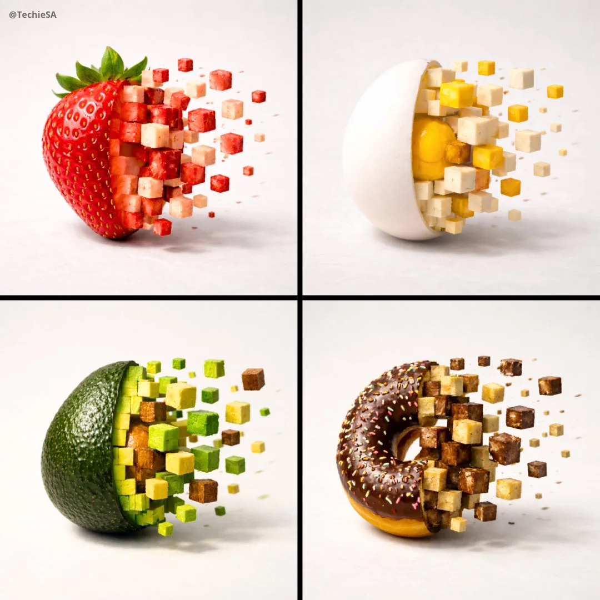</a> <a href="https://x.com/TechieBySA/status/2008127774750548155"><b>@TechieBySA</b></a> · <a href="prompts/x/x-01417.md">Prompt</a> GPT Image · via X</td><td width="33%" valign="top"> <a href="https://x.com/Strength04_X/status/2006679801256656925"><b>@Strength04_X</b></a> · <a href="prompts/x/x-01413.md">Prompt</a> GPT Image · via X</td></tr>
<tr><td width="33%" valign="top"><a href="prompts/x/x-01405.md">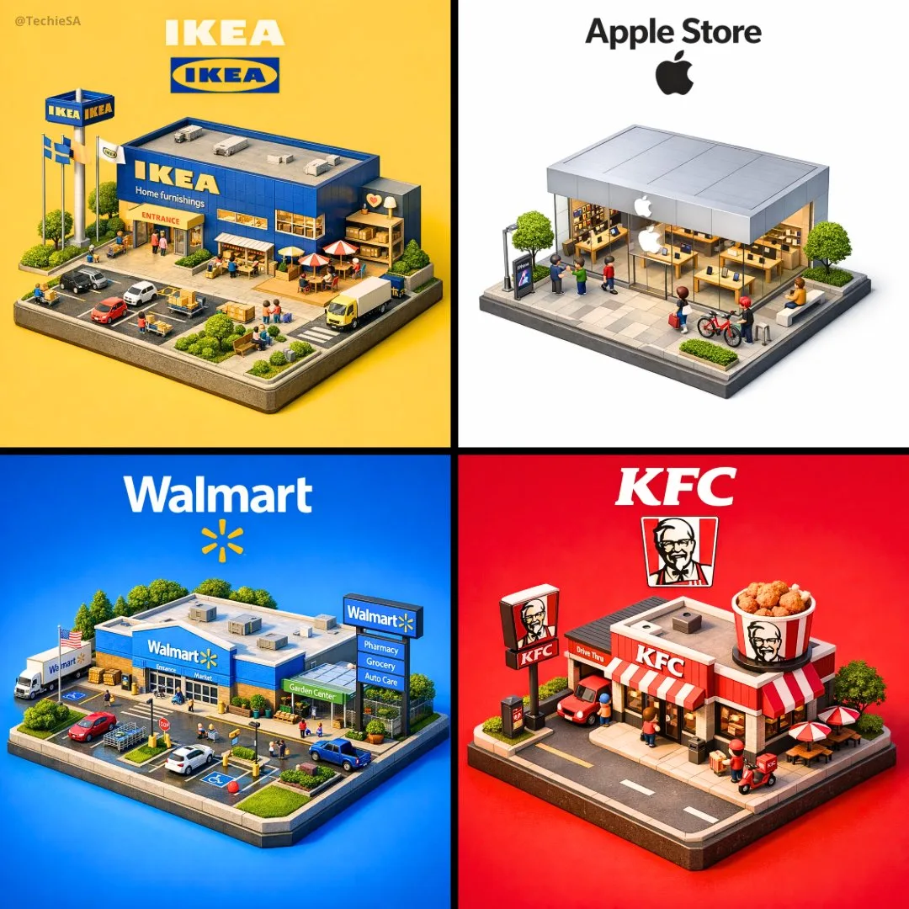</a> <a href="https://x.com/TechieBySA/status/2019376568834093542"><b>@TechieBySA</b></a> · <a href="prompts/x/x-01405.md">Prompt</a> GPT Image · via X</td><td width="33%" valign="top"> <a href="https://x.com/konmari_tweet/status/2048714101850071422"><b>@konmari_tweet</b></a> · <a href="prompts/x/x-01401.md">Prompt</a> GPT Image · via X</td><td width="33%" valign="top"> <a href="https://x.com/TechieBySA/status/2007777809712976297"><b>@TechieBySA</b></a> · <a href="prompts/x/x-01389.md">Prompt</a> GPT Image · via X</td></tr>
<tr><td width="33%" valign="top"><a href="prompts/x/x-01384.md">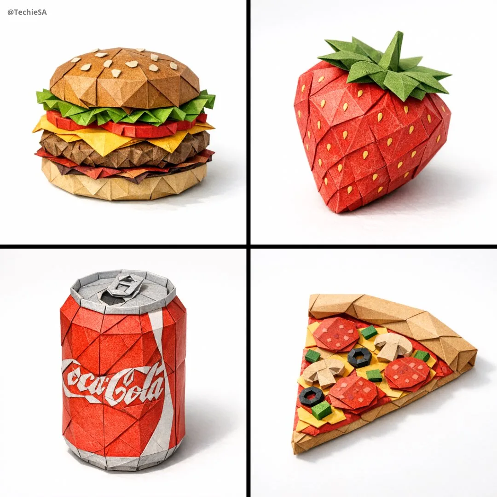</a> <a href="https://x.com/TechieBySA/status/2007809696334479420"><b>@TechieBySA</b></a> · <a href="prompts/x/x-01384.md">Prompt</a> GPT Image · via X</td><td width="33%" valign="top"> <a href="https://x.com/rovvmut_/status/2014987855517614460"><b>@rovvmut_</b></a> · <a href="prompts/x/x-01376.md">Prompt</a> GPT Image · via X</td><td width="33%" valign="top"> <a href="https://x.com/Naiknelofar788/status/2031741057105526932"><b>@Naiknelofar788</b></a> · <a href="prompts/x/x-01374.md">Prompt</a> GPT Image · via X</td></tr>
<tr><td width="33%" valign="top"> <a href="https://x.com/Samann_ai/status/2002751900337275167"><b>@Samann_ai</b></a> · <a href="prompts/x/x-01370.md">Prompt</a> GPT Image · via X</td><td width="33%" valign="top"> <a href="https://x.com/Naiknelofar788/status/2022606746343317544"><b>@Naiknelofar788</b></a> · <a href="prompts/x/x-01369.md">Prompt</a> GPT Image · via X</td><td width="33%" valign="top"> <a href="https://x.com/rovvmut_/status/2015648059771044000"><b>@rovvmut_</b></a> · <a href="prompts/x/x-01356.md">Prompt</a> GPT Image · via X</td></tr>
</table>

**[查看全部 364 个插画与 3D案例 →](gallery/x-illustration-3d.md)**

## 产品与品牌 · Product & Brand

<table>
<tr><td width="33%" valign="top"> <a href="https://x.com/mehvishs25/status/2017420332458774791"><b>@mehvishs25</b></a> · <a href="prompts/x/x-01447.md">Prompt</a> GPT Image · via X</td><td width="33%" valign="top"> <a href="https://x.com/riomadeit/status/2046682439985082441"><b>@riomadeit</b></a> · <a href="prompts/x/x-01433.md">Prompt</a> GPT Image · via X</td><td width="33%" valign="top"> <a href="https://x.com/oliverkenyon/status/2047064581051142166"><b>@oliverkenyon</b></a> · <a href="prompts/x/x-01412.md">Prompt</a> GPT Image · via X</td></tr>
<tr><td width="33%" valign="top"> <a href="https://x.com/Sheldon056/status/2021057289785053348"><b>@Sheldon056</b></a> · <a href="prompts/x/x-01409.md">Prompt</a> GPT Image · via X</td><td width="33%" valign="top"> <a href="https://x.com/Salmaaboukarr/status/2046717569013293231"><b>@Salmaaboukarr</b></a> · <a href="prompts/x/x-01400.md">Prompt</a> GPT Image · via X</td><td width="33%" valign="top"> <a href="https://x.com/aleenaamiir/status/2048667175112802778"><b>@aleenaamiir</b></a> · <a href="prompts/x/x-01397.md">Prompt</a> GPT Image · via X</td></tr>
<tr><td width="33%" valign="top"> <a href="https://x.com/TechieBySA/status/2009585651554116028"><b>@TechieBySA</b></a> · <a href="prompts/x/x-01387.md">Prompt</a> GPT Image · via X</td><td width="33%" valign="top"> <a href="https://x.com/mehvishs25/status/2018525109041135790"><b>@mehvishs25</b></a> · <a href="prompts/x/x-01386.md">Prompt</a> GPT Image · via X</td><td width="33%" valign="top"> <a href="https://x.com/harboriis/status/2018215856577360311"><b>@harboriis</b></a> · <a href="prompts/x/x-01385.md">Prompt</a> GPT Image · via X</td></tr>
<tr><td width="33%" valign="top"> <a href="https://x.com/mehvishs25/status/2025013736139096574"><b>@mehvishs25</b></a> · <a href="prompts/x/x-01378.md">Prompt</a> GPT Image · via X</td><td width="33%" valign="top"> <a href="https://x.com/Naiknelofar788/status/2018191168451043584"><b>@Naiknelofar788</b></a> · <a href="prompts/x/x-01373.md">Prompt</a> GPT Image · via X</td><td width="33%" valign="top"> <a href="https://x.com/harboriis/status/2018312144358703594"><b>@harboriis</b></a> · <a href="prompts/x/x-01366.md">Prompt</a> GPT Image · via X</td></tr>
<tr><td width="33%" valign="top"> <a href="https://x.com/john_my07/status/2024420826016338208"><b>@john_my07</b></a> · <a href="prompts/x/x-01363.md">Prompt</a> GPT Image · via X</td><td width="33%" valign="top"> <a href="https://x.com/meng_dagg695/status/2008878369107276184"><b>@meng_dagg695</b></a> · <a href="prompts/x/x-01354.md">Prompt</a> GPT Image · via X</td><td width="33%" valign="top"> <a href="https://x.com/mehvishs25/status/2025391098437529837"><b>@mehvishs25</b></a> · <a href="prompts/x/x-01337.md">Prompt</a> GPT Image · via X</td></tr>
</table>

**[查看全部 216 个产品与品牌案例 →](gallery/x-product-brand.md)**

## 美食饮品 · Food & Drink

<table>
<tr><td width="33%" valign="top"><a href="prompts/x/x-01442.md">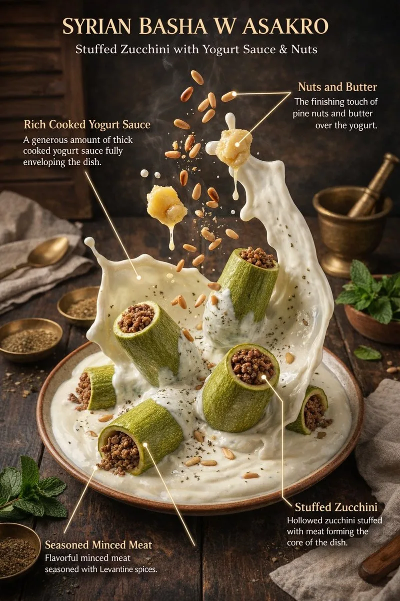</a> <a href="https://x.com/meng_dagg695/status/2011994819124752631"><b>@meng_dagg695</b></a> · <a href="prompts/x/x-01442.md">Prompt</a> GPT Image · via X</td><td width="33%" valign="top"> <a href="https://x.com/meng_dagg695/status/2009157208240755151"><b>@meng_dagg695</b></a> · <a href="prompts/x/x-01438.md">Prompt</a> GPT Image · via X</td><td width="33%" valign="top"> <a href="https://x.com/meng_dagg695/status/2009887009591226787"><b>@meng_dagg695</b></a> · <a href="prompts/x/x-01426.md">Prompt</a> GPT Image · via X</td></tr>
<tr><td width="33%" valign="top"><a href="prompts/x/x-01416.md">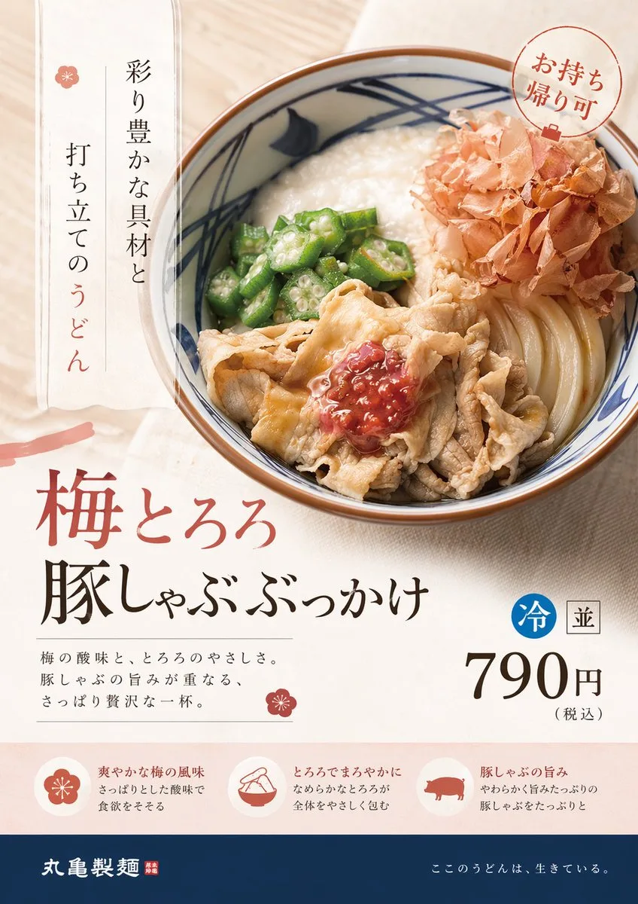</a> <a href="https://x.com/genel_ai/status/2046498264774791514"><b>@genel_ai</b></a> · <a href="prompts/x/x-01416.md">Prompt</a> GPT Image · via X</td><td width="33%" valign="top"><a href="prompts/x/x-01406.md">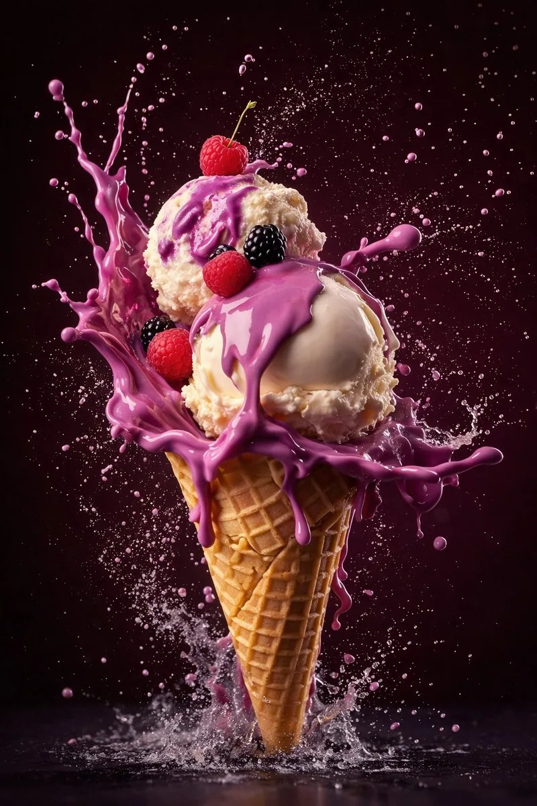</a> <a href="https://x.com/meng_dagg695/status/2010312584059351261"><b>@meng_dagg695</b></a> · <a href="prompts/x/x-01406.md">Prompt</a> GPT Image · via X</td><td width="33%" valign="top"> <a href="https://x.com/meng_dagg695/status/2009519057717088345"><b>@meng_dagg695</b></a> · <a href="prompts/x/x-01399.md">Prompt</a> GPT Image · via X</td></tr>
<tr><td width="33%" valign="top"> <a href="https://x.com/Sairah_0/status/2048725842096976020"><b>@Sairah_0</b></a> · <a href="prompts/x/x-01398.md">Prompt</a> GPT Image · via X</td><td width="33%" valign="top"> <a href="https://x.com/meng_dagg695/status/2009446363331973461"><b>@meng_dagg695</b></a> · <a href="prompts/x/x-01395.md">Prompt</a> GPT Image · via X</td><td width="33%" valign="top"><a href="prompts/x/x-01393.md">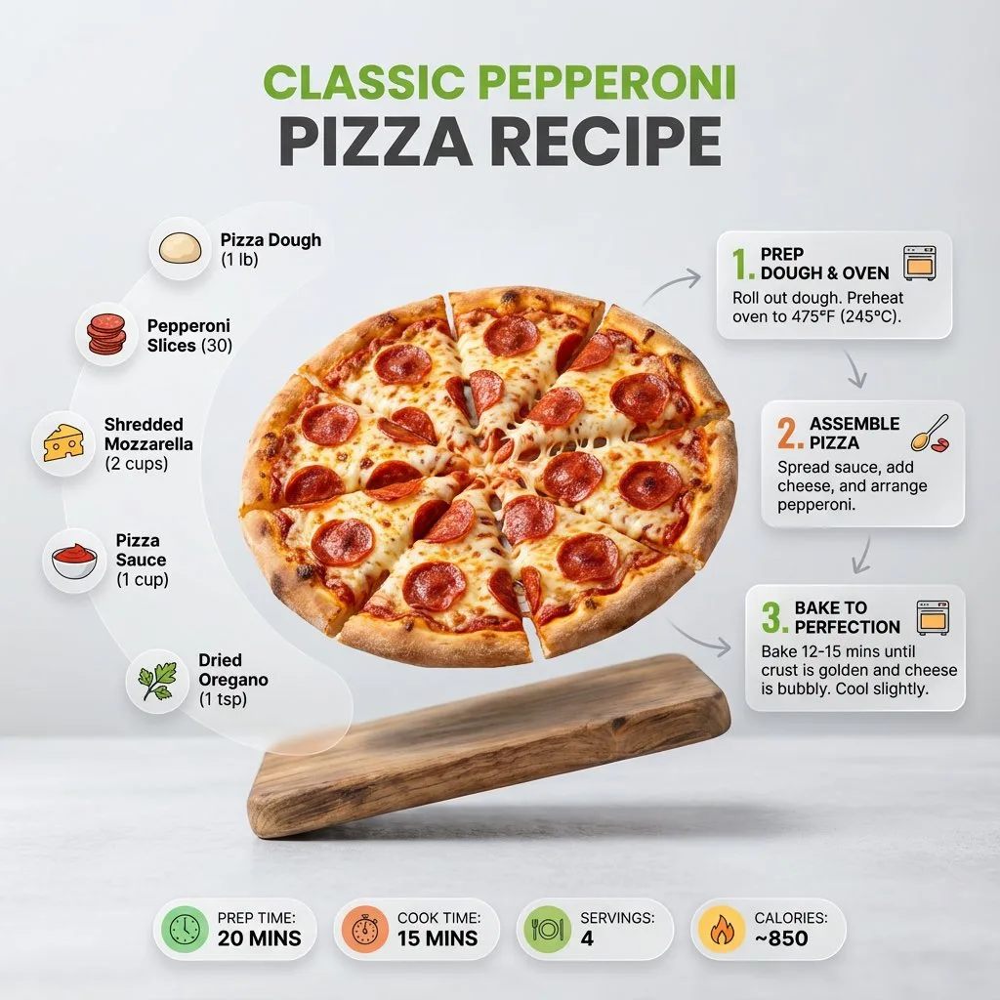</a> <a href="https://x.com/TechieBySA/status/2013233539706233086"><b>@TechieBySA</b></a> · <a href="prompts/x/x-01393.md">Prompt</a> GPT Image · via X</td></tr>
<tr><td width="33%" valign="top"> <a href="https://x.com/meng_dagg695/status/2012353813425144239"><b>@meng_dagg695</b></a> · <a href="prompts/x/x-01381.md">Prompt</a> GPT Image · via X</td><td width="33%" valign="top"> <a href="https://x.com/meng_dagg695/status/2010681413562155183"><b>@meng_dagg695</b></a> · <a href="prompts/x/x-01377.md">Prompt</a> GPT Image · via X</td><td width="33%" valign="top"> <a href="https://x.com/john_my07/status/2019431396885070327"><b>@john_my07</b></a> · <a href="prompts/x/x-01375.md">Prompt</a> GPT Image · via X</td></tr>
<tr><td width="33%" valign="top"> <a href="https://x.com/Strength04_X/status/2012780826715619644"><b>@Strength04_X</b></a> · <a href="prompts/x/x-01372.md">Prompt</a> GPT Image · via X</td><td width="33%" valign="top"> <a href="https://x.com/meng_dagg695/status/2010981812609434034"><b>@meng_dagg695</b></a> · <a href="prompts/x/x-01371.md">Prompt</a> GPT Image · via X</td><td width="33%" valign="top"><a href="prompts/x/x-01365.md">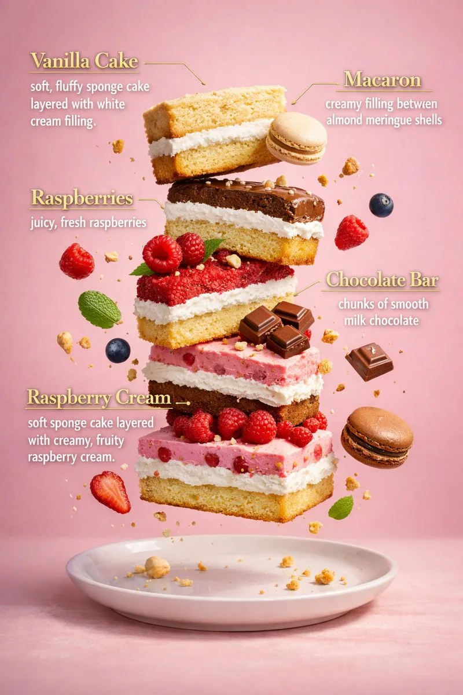</a> <a href="https://x.com/mehvishs25/status/2015252863333929304"><b>@mehvishs25</b></a> · <a href="prompts/x/x-01365.md">Prompt</a> GPT Image · via X</td></tr>
</table>

**[查看全部 154 个美食饮品案例 →](gallery/x-food-drink.md)**

## 海报设计 · Poster Design

<table>
<tr><td width="33%" valign="top"><a href="prompts/x/x-01446.md">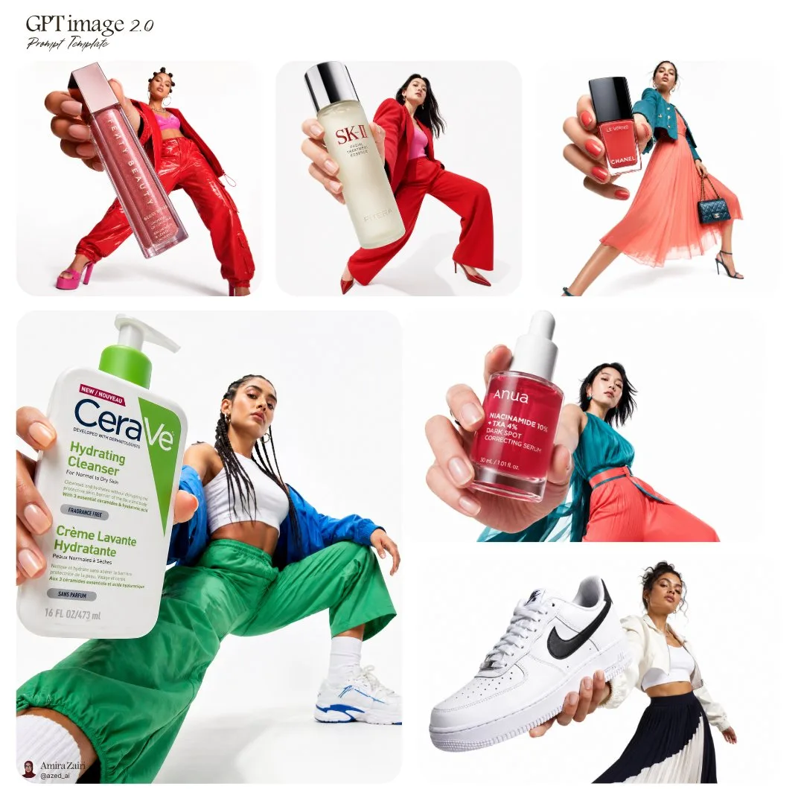</a> <a href="https://x.com/azed_ai/status/2048748266293190833"><b>@azed_ai</b></a> · <a href="prompts/x/x-01446.md">Prompt</a> GPT Image · via X</td><td width="33%" valign="top"> <a href="https://x.com/MrLarus/status/2045504669401653414"><b>@MrLarus</b></a> · <a href="prompts/x/x-01444.md">Prompt</a> GPT Image · via X</td><td width="33%" valign="top"> <a href="https://x.com/MrLarus/status/2048360321379701233"><b>@MrLarus</b></a> · <a href="prompts/x/x-01443.md">Prompt</a> GPT Image · via X</td></tr>
<tr><td width="33%" valign="top"> <a href="https://x.com/aleenaamiir/status/2046866168208916503"><b>@aleenaamiir</b></a> · <a href="prompts/x/x-01441.md">Prompt</a> GPT Image · via X</td><td width="33%" valign="top"> <a href="https://x.com/Samann_ai/status/2017598696678895882"><b>@Samann_ai</b></a> · <a href="prompts/x/x-01440.md">Prompt</a> GPT Image · via X</td><td width="33%" valign="top"> <a href="https://x.com/MrLarus/status/2046231542817497392"><b>@MrLarus</b></a> · <a href="prompts/x/x-01437.md">Prompt</a> GPT Image · via X</td></tr>
<tr><td width="33%" valign="top"> <a href="https://x.com/Diplomeme/status/2047986905896427670"><b>@Diplomeme</b></a> · <a href="prompts/x/x-01435.md">Prompt</a> GPT Image · via X</td><td width="33%" valign="top"> <a href="https://x.com/austinit/status/2046037688969769346"><b>@austinit</b></a> · <a href="prompts/x/x-01432.md">Prompt</a> GPT Image · via X</td><td width="33%" valign="top"> <a href="https://x.com/midori_tatsuta/status/2045378877363798279"><b>@midori_tatsuta</b></a> · <a href="prompts/x/x-01431.md">Prompt</a> GPT Image · via X</td></tr>
<tr><td width="33%" valign="top"><a href="prompts/x/x-01428.md">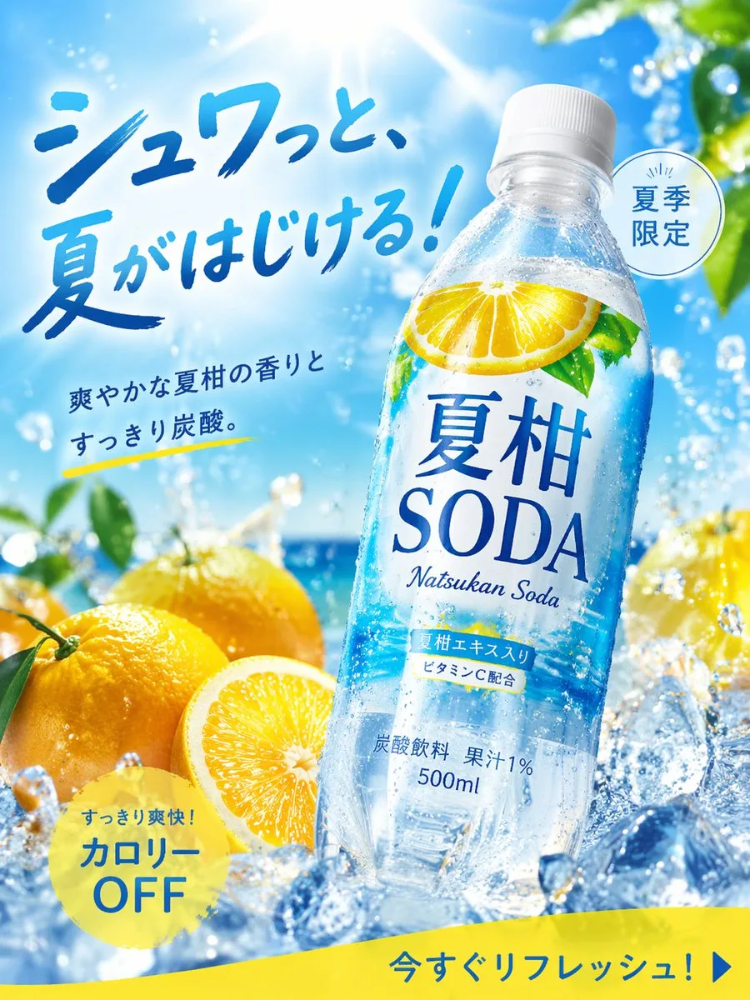</a> <a href="https://x.com/old_pgmrs_will/status/2045852114673635507"><b>@old_pgmrs_will</b></a> · <a href="prompts/x/x-01428.md">Prompt</a> GPT Image · via X</td><td width="33%" valign="top"> <a href="https://x.com/aleenaamiir/status/2047325329052823996"><b>@aleenaamiir</b></a> · <a href="prompts/x/x-01427.md">Prompt</a> GPT Image · via X</td><td width="33%" valign="top"> <a href="https://x.com/venturetwins/status/2046700418554851630"><b>@venturetwins</b></a> · <a href="prompts/x/x-01414.md">Prompt</a> GPT Image · via X</td></tr>
<tr><td width="33%" valign="top"> <a href="https://x.com/TechieBySA/status/2007190982408974659"><b>@TechieBySA</b></a> · <a href="prompts/x/x-01408.md">Prompt</a> GPT Image · via X</td><td width="33%" valign="top"><a href="prompts/x/x-01407.md">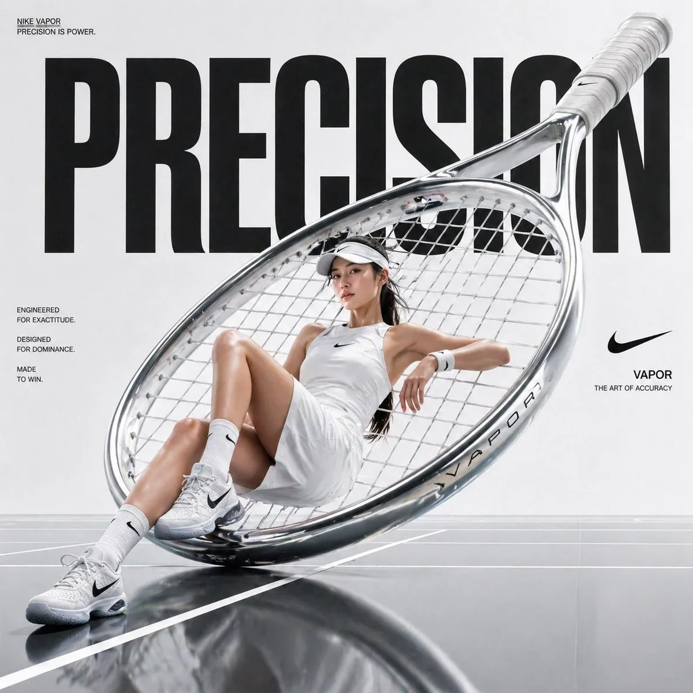</a> <a href="https://x.com/aronhouyu/status/2047989228274118901"><b>@aronhouyu</b></a> · <a href="prompts/x/x-01407.md">Prompt</a> GPT Image · via X</td><td width="33%" valign="top"> <a href="https://x.com/akiramenaiwoman/status/2046460259817210284"><b>@akiramenaiwoman</b></a> · <a href="prompts/x/x-01403.md">Prompt</a> GPT Image · via X</td></tr>
</table>

**[查看全部 133 个海报设计案例 →](gallery/x-poster-design.md)**

## UI 与平面 · UI & Graphic

<table>
<tr><td width="33%" valign="top"> <a href="https://x.com/TechieBySA/status/2017928823497453789"><b>@TechieBySA</b></a> · <a href="prompts/x/x-01448.md">Prompt</a> GPT Image · via X</td><td width="33%" valign="top"><a href="prompts/x/x-01420.md">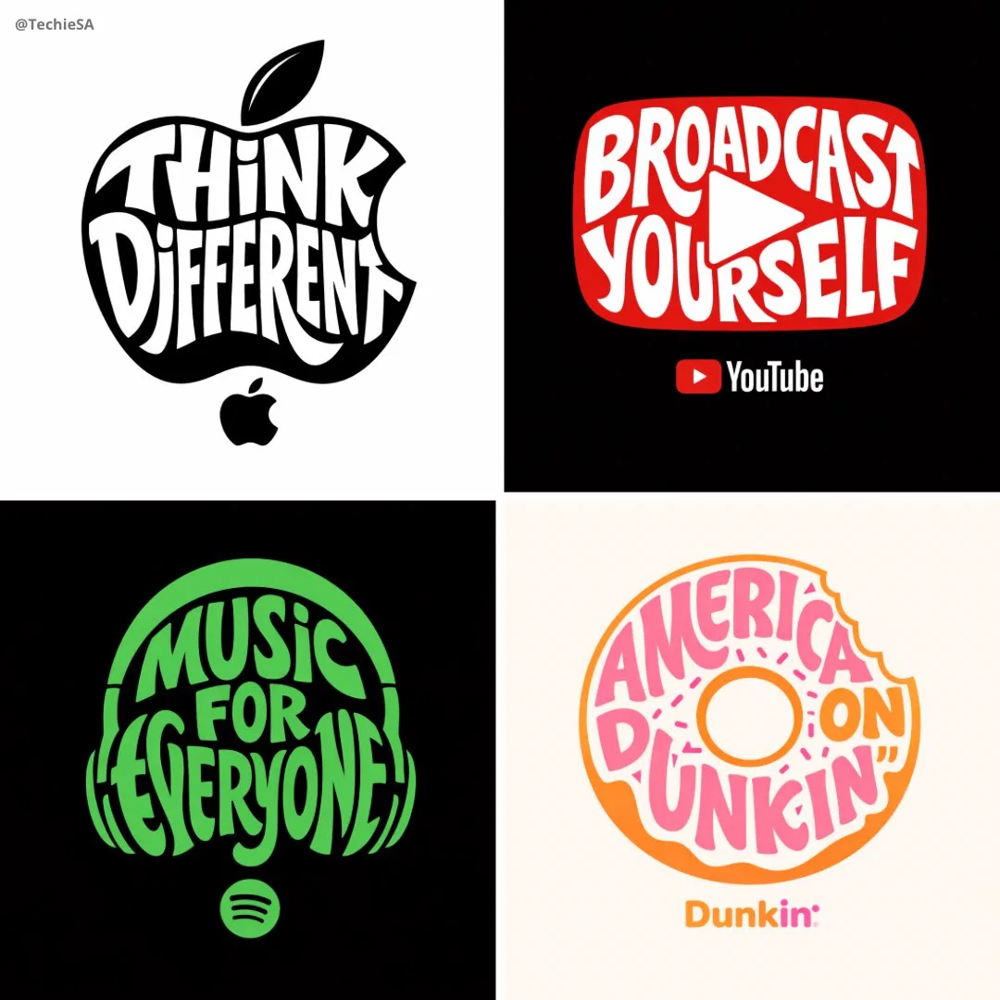</a> <a href="https://x.com/TechieBySA/status/2005620980891480567"><b>@TechieBySA</b></a> · <a href="prompts/x/x-01420.md">Prompt</a> GPT Image · via X</td><td width="33%" valign="top"><a href="prompts/x/x-01404.md">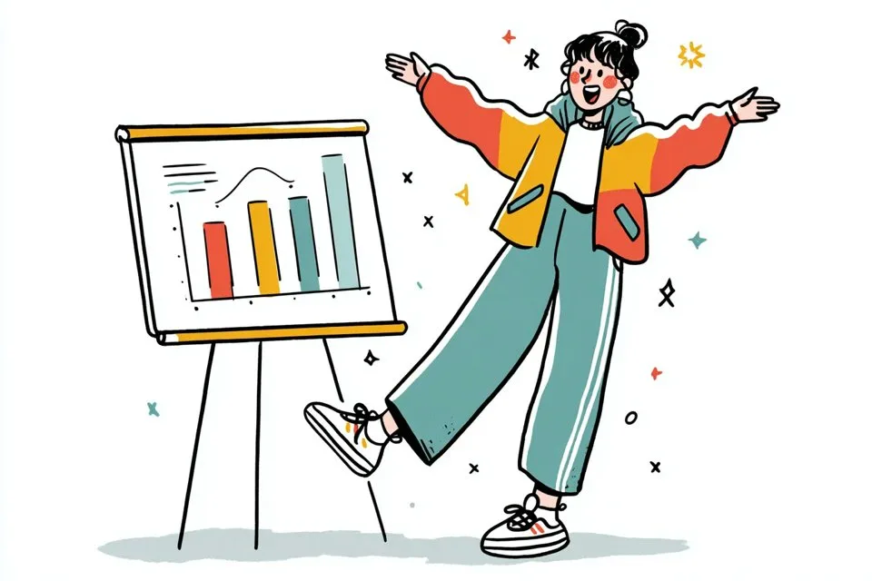</a> <a href="https://x.com/azed_ai/status/2047993289283133945"><b>@azed_ai</b></a> · <a href="prompts/x/x-01404.md">Prompt</a> GPT Image · via X</td></tr>
<tr><td width="33%" valign="top"> <a href="https://x.com/Sheldon056/status/2016088197714084320"><b>@Sheldon056</b></a> · <a href="prompts/x/x-01396.md">Prompt</a> GPT Image · via X</td><td width="33%" valign="top"><a href="prompts/x/x-01335.md">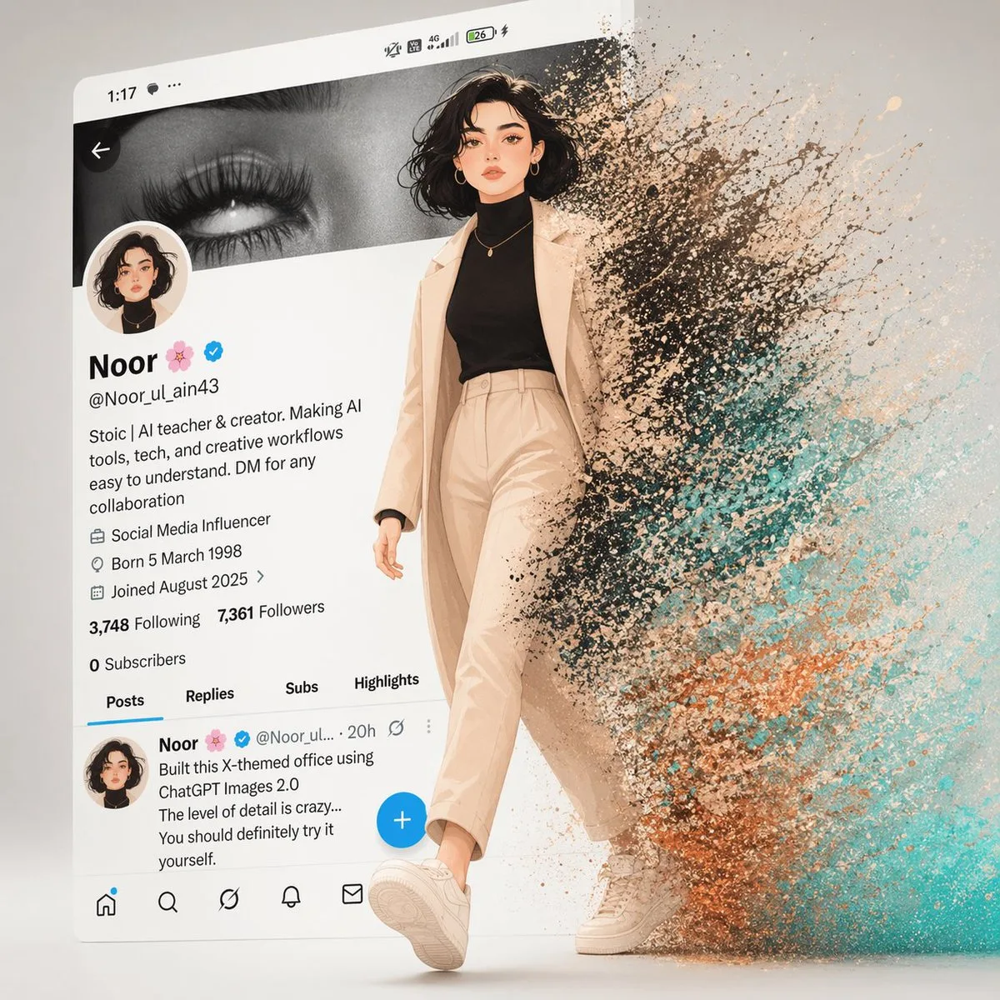</a> <a href="https://x.com/Noor_ul_ain43/status/2047227731839184901"><b>@Noor_ul_ain43</b></a> · <a href="prompts/x/x-01335.md">Prompt</a> GPT Image · via X</td><td width="33%" valign="top"> <a href="https://x.com/Naiknelofar788/status/2018668607966769212"><b>@Naiknelofar788</b></a> · <a href="prompts/x/x-01321.md">Prompt</a> GPT Image · via X</td></tr>
<tr><td width="33%" valign="top"> <a href="https://x.com/Noor_ul_ain43/status/2048088005836173316"><b>@Noor_ul_ain43</b></a> · <a href="prompts/x/x-01304.md">Prompt</a> GPT Image · via X</td><td width="33%" valign="top"> <a href="https://x.com/Jackywine/status/2046480096471765192"><b>@Jackywine</b></a> · <a href="prompts/x/x-01239.md">Prompt</a> GPT Image · via X</td><td width="33%" valign="top"> <a href="https://x.com/ecomchasedimond/status/2047172163313222013"><b>@ecomchasedimond</b></a> · <a href="prompts/x/x-01226.md">Prompt</a> GPT Image · via X</td></tr>
<tr><td width="33%" valign="top"> <a href="https://x.com/aleenaamiir/status/2047546614257221653"><b>@aleenaamiir</b></a> · <a href="prompts/x/x-01209.md">Prompt</a> GPT Image · via X</td><td width="33%" valign="top"> <a href="https://x.com/Naiknelofar788/status/2048746995465203876"><b>@Naiknelofar788</b></a> · <a href="prompts/x/x-01196.md">Prompt</a> GPT Image · via X</td><td width="33%" valign="top"> <a href="https://x.com/Mind_Boticni/status/2047550158427259188"><b>@Mind_Boticni</b></a> · <a href="prompts/x/x-01193.md">Prompt</a> GPT Image · via X</td></tr>
<tr><td width="33%" valign="top"> <a href="https://x.com/MrLarus/status/2048816632613453900"><b>@MrLarus</b></a> · <a href="prompts/x/x-01179.md">Prompt</a> GPT Image · via X</td><td width="33%" valign="top"> <a href="https://x.com/cellier_/status/2046615173411262959"><b>@cellier_</b></a> · <a href="prompts/x/x-01153.md">Prompt</a> GPT Image · via X</td><td width="33%" valign="top"><a href="prompts/x/x-01150.md">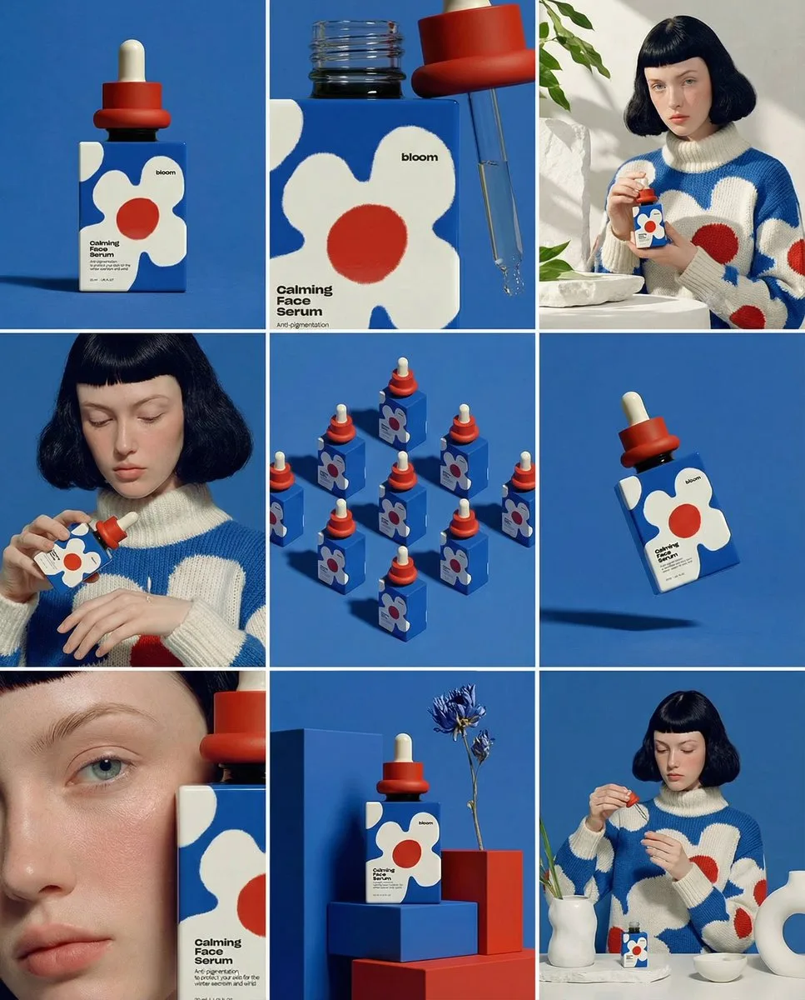</a> <a href="https://x.com/Dari_Designs/status/2013268963266904438"><b>@Dari_Designs</b></a> · <a href="prompts/x/x-01150.md">Prompt</a> Nano Banana · via X</td></tr>
</table>

**[查看全部 47 个UI 与平面案例 →](gallery/x-ui-graphic.md)**

> 作品和提示词归原作者所有，仅作参考展示。作者如需修改或删除，请提交 issue。
