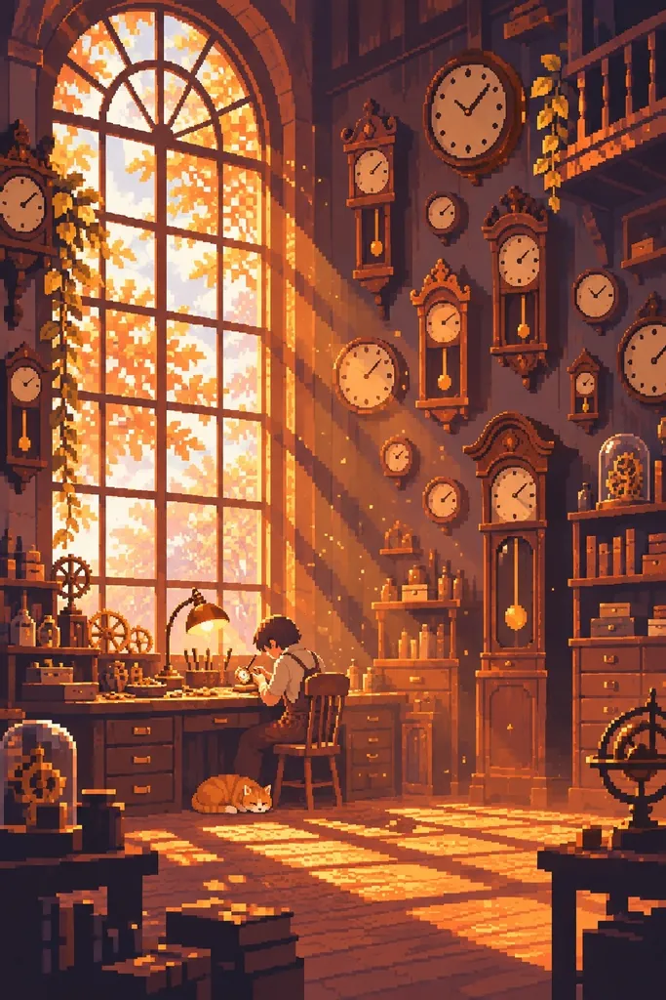
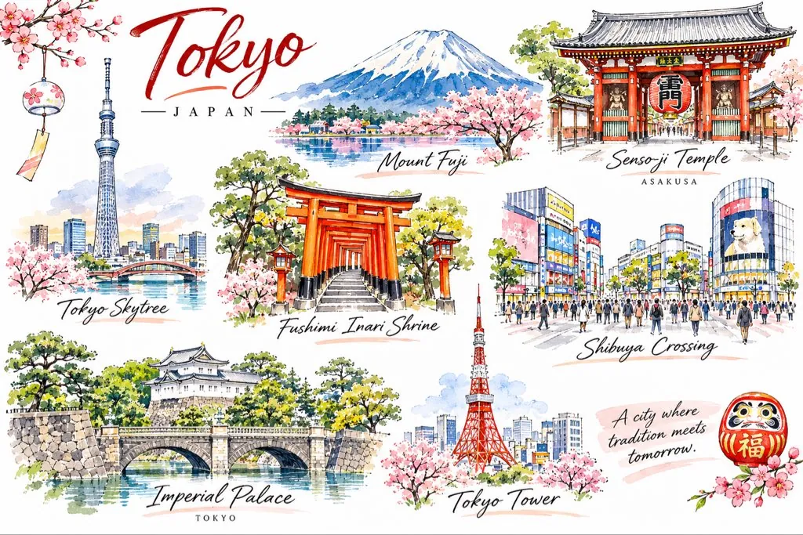
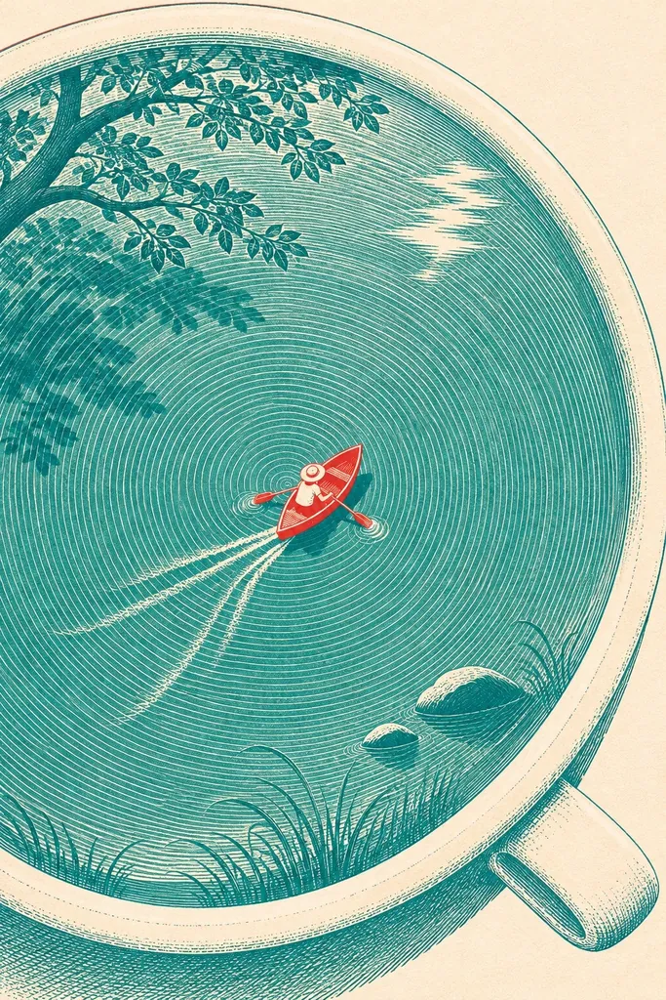
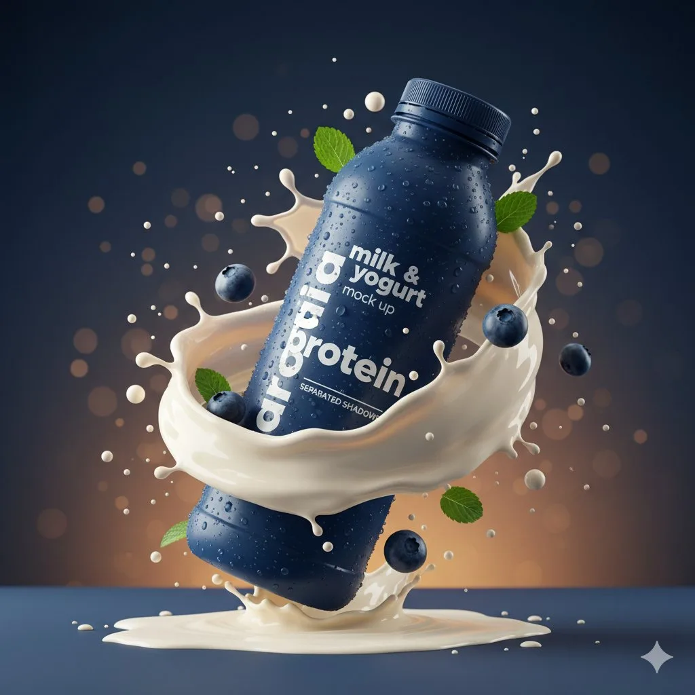
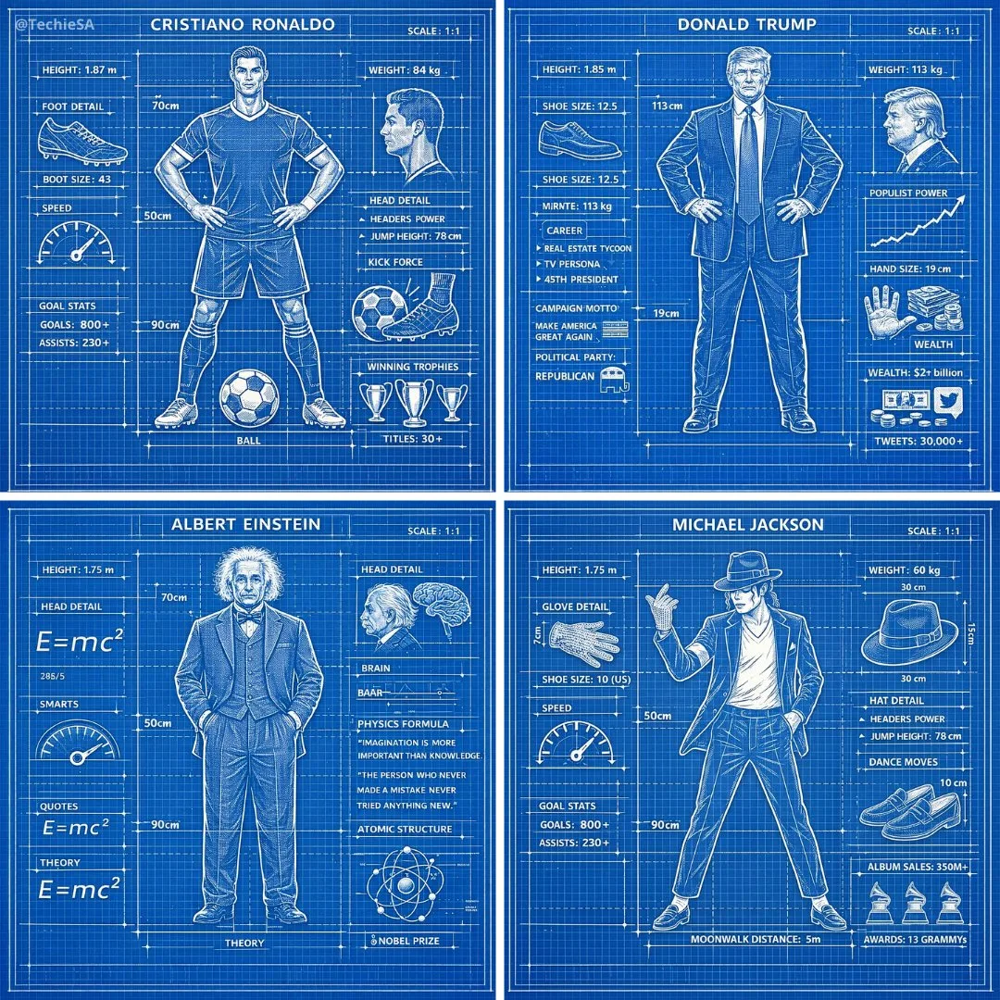
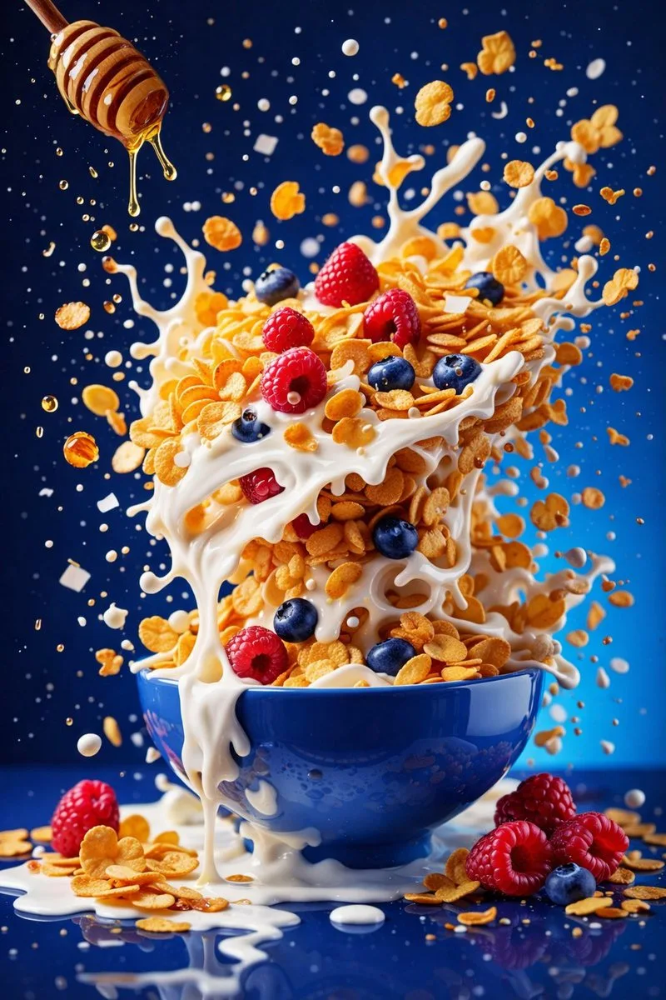
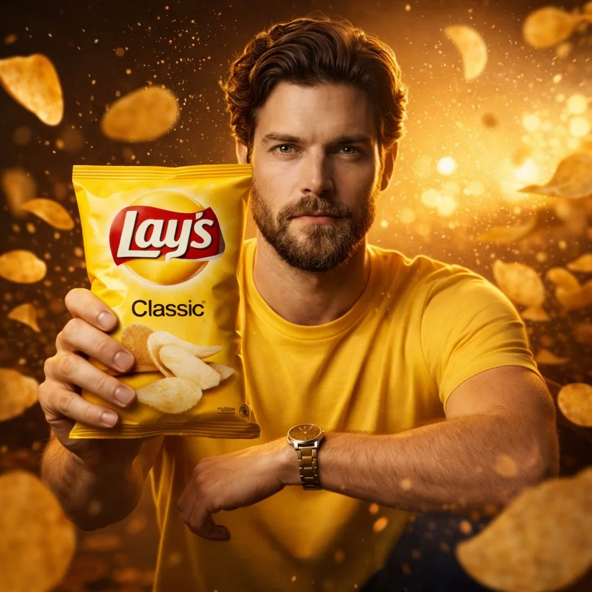
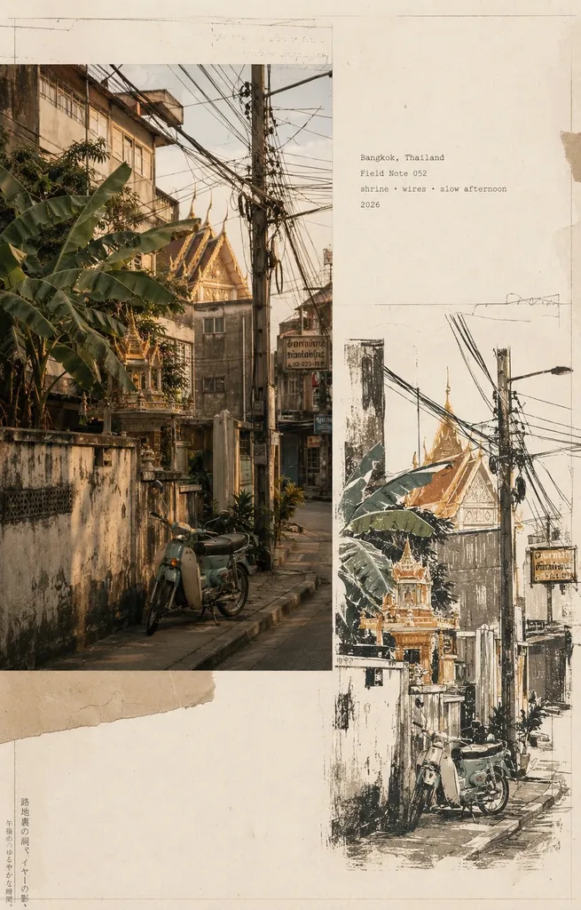
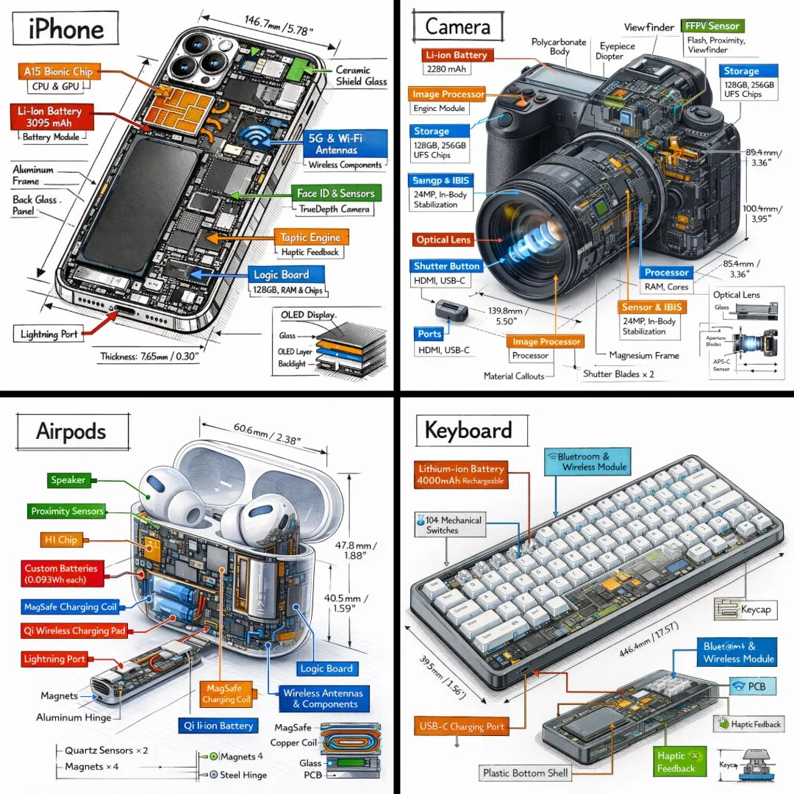

# 社区案例 · 1567

[English](EXAMPLES.md)

社区用户在 X 和其它网站分享的提示词和作品，按原样保留，每条都署名并链接到原帖。我们自己整理、用 vinano.ai 生成的合集见 [README](README.zh-CN.md)。

**[▶ 在 vinano.ai 上生成你自己的版本](https://vinano.ai?utm_source=github&utm_medium=readme&utm_campaign=awesome-image-video-prompts-updating&utm_content=examples-zh)**

## 目录

- [摄影写真 · Photography](#摄影写真-photography) (556)
- [插画与 3D · Illustration & 3D](#插画与-3d-illustration-3d) (393)
- [产品与品牌 · Product & Brand](#产品与品牌-product-brand) (216)
- [美食饮品 · Food & Drink](#美食饮品-food-drink) (154)
- [海报设计 · Poster Design](#海报设计-poster-design) (148)
- [UI 与平面 · UI & Graphic](#ui-与平面-ui-graphic) (49)
- [视频 · Video](#视频-video) (51)

## 摄影写真 · Photography

<table>
<tr><td width="33%" valign="top"> <a href="https://x.com/lrsoy_/status/2124381772314239384"><b>@lrsoy_</b></a> · <a href="prompts/x/x-01561.md">Prompt</a> Seedream 5.0 Pro · via X</td><td width="33%" valign="top"> <a href="https://x.com/Adam38363368936/status/2124865921491841350"><b>@Adam38363368936</b></a> · <a href="prompts/x/x-01557.md">Prompt</a> GPT Image 2.6 · via X</td><td width="33%" valign="top"> <a href="https://x.com/lrsoy_/status/2124417124622069772"><b>@lrsoy_</b></a> · <a href="prompts/x/x-01556.md">Prompt</a> Seedream 5.0 Pro · via X</td></tr>
<tr><td width="33%" valign="top"> <a href="https://x.com/static_stare/status/2124868443916865688"><b>@static_stare</b></a> · <a href="prompts/x/x-01550.md">Prompt</a> GPT Image 2.5 · via X</td><td width="33%" valign="top"> <a href="https://x.com/aiartalley/status/2124880820208914677"><b>@aiartalley</b></a> · <a href="prompts/x/x-01548.md">Prompt</a> Nano Banana 2.1 · via X</td><td width="33%" valign="top"> <a href="https://x.com/DavidLi36143625/status/2124707415811911699"><b>@DavidLi36143625</b></a> · <a href="prompts/x/x-01542.md">Prompt</a> GPT Image 2.6 Sunburst · via X</td></tr>
<tr><td width="33%" valign="top"> <a href="https://x.com/DavidLi36143625/status/2124791472793002466"><b>@DavidLi36143625</b></a> · <a href="prompts/x/x-01541.md">Prompt</a> GPT Image 2.6 Sunburst · via X</td><td width="33%" valign="top"> <a href="https://x.com/octopusaia/status/2124823021395595334"><b>@octopusaia</b></a> · <a href="prompts/x/x-01540.md">Prompt</a> GPT Image · via X</td><td width="33%" valign="top"> <a href="https://x.com/static_stare/status/2124407068438450466"><b>@static_stare</b></a> · <a href="prompts/x/x-01534.md">Prompt</a> GPT Image 2.5 · via X</td></tr>
<tr><td width="33%" valign="top"> <a href="https://x.com/lrsoy_/status/2124470864502763793"><b>@lrsoy_</b></a> · <a href="prompts/x/x-01527.md">Prompt</a> Seedream 5.0 Pro · via X</td><td width="33%" valign="top"> <a href="https://x.com/regmlar/status/2124573961497481665"><b>@regmlar</b></a> · <a href="prompts/x/x-01526.md">Prompt</a> GPT Image · via X</td><td width="33%" valign="top"> <a href="https://x.com/ksa8Turky/status/2124642834187784292"><b>@ksa8Turky</b></a> · <a href="prompts/x/x-01522.md">Prompt</a> GPT Image · via X</td></tr>
<tr><td width="33%" valign="top"> <a href="https://x.com/ksa8Turky/status/2124272644769915045"><b>@ksa8Turky</b></a> · <a href="prompts/x/x-01521.md">Prompt</a> GPT Image · via X</td><td width="33%" valign="top"> <a href="https://x.com/DeepBlueX0/status/2124676146642276799"><b>@DeepBlueX0</b></a> · <a href="prompts/x/x-01518.md">Prompt</a> GPT Image 2.6 · via X</td><td width="33%" valign="top"> <a href="https://x.com/DeepBlueX0/status/2124351549480866153"><b>@DeepBlueX0</b></a> · <a href="prompts/x/x-01517.md">Prompt</a> GPT Image 2.6 · via X</td></tr>
</table>

**[查看全部 556 个摄影写真案例 →](gallery/x-photography.md)**

## 插画与 3D · Illustration & 3D

<table>
<tr><td width="33%" valign="top"> <a href="https://x.com/Leviwoyun/status/2125060880778104908"><b>@Leviwoyun</b></a> · <a href="prompts/x/x-01555.md">Prompt</a> GPT Image 2.6 · via X</td><td width="33%" valign="top"> <a href="https://x.com/octopusaia/status/2124942135468466328"><b>@octopusaia</b></a> · <a href="prompts/x/x-01553.md">Prompt</a> GPT Image · via X</td><td width="33%" valign="top"> <a href="https://x.com/static_stare/status/2124768993529741761"><b>@static_stare</b></a> · <a href="prompts/x/x-01552.md">Prompt</a> GPT Image 2.5 · via X</td></tr>
<tr><td width="33%" valign="top"> <a href="https://x.com/static_stare/status/2124836246702985363"><b>@static_stare</b></a> · <a href="prompts/x/x-01551.md">Prompt</a> GPT Image 2.5 · via X</td><td width="33%" valign="top"> <a href="https://x.com/static_stare/status/2124724169980215638"><b>@static_stare</b></a> · <a href="prompts/x/x-01546.md">Prompt</a> GPT Image 2.5 · via X</td><td width="33%" valign="top"> <a href="https://x.com/Yeti_Images/status/2124657935980601356"><b>@Yeti_Images</b></a> · <a href="prompts/x/x-01544.md">Prompt</a> Grok Imagine Image · via X</td></tr>
<tr><td width="33%" valign="top"> <a href="https://x.com/Yeti_Images/status/2125024098094878909"><b>@Yeti_Images</b></a> · <a href="prompts/x/x-01543.md">Prompt</a> GPT Image 2.5 Flare · via X</td><td width="33%" valign="top"> <a href="https://x.com/TheCore1724808/status/2124959183628009874"><b>@TheCore1724808</b></a> · <a href="prompts/x/x-01539.md">Prompt</a> Unknown · via X</td><td width="33%" valign="top"> <a href="https://x.com/Naiknelofar788/status/2124843499841548545"><b>@Naiknelofar788</b></a> · <a href="prompts/x/x-01537.md">Prompt</a> GPT Image 2.6 · via X</td></tr>
<tr><td width="33%" valign="top"> <a href="https://x.com/Naiknelofar788/status/2124723328414048351"><b>@Naiknelofar788</b></a> · <a href="prompts/x/x-01536.md">Prompt</a> GPT Image 2.6 · via X</td><td width="33%" valign="top"> <a href="https://x.com/static_stare/status/2124142635577442667"><b>@static_stare</b></a> · <a href="prompts/x/x-01535.md">Prompt</a> GPT Image 2.5 · via X</td><td width="33%" valign="top"> <a href="https://x.com/static_stare/status/2124504580876837193"><b>@static_stare</b></a> · <a href="prompts/x/x-01532.md">Prompt</a> GPT Image 2.5 · via X</td></tr>
<tr><td width="33%" valign="top"> <a href="https://x.com/static_stare/status/2124044391329522044"><b>@static_stare</b></a> · <a href="prompts/x/x-01530.md">Prompt</a> GPT Image 2.5 · via X</td><td width="33%" valign="top"> <a href="https://x.com/static_stare/status/2124475198217007333"><b>@static_stare</b></a> · <a href="prompts/x/x-01529.md">Prompt</a> GPT Image 2.5 · via X</td><td width="33%" valign="top"> <a href="https://x.com/mseymari_/status/2124054959041794332"><b>@mseymari_</b></a> · <a href="prompts/x/x-01524.md">Prompt</a> Seedream 5.5 · via X</td></tr>
</table>

**[查看全部 393 个插画与 3D案例 →](gallery/x-illustration-3d.md)**

## 产品与品牌 · Product & Brand

<table>
<tr><td width="33%" valign="top"> <a href="https://x.com/mehvishs25/status/2017420332458774791"><b>@mehvishs25</b></a> · <a href="prompts/x/x-01447.md">Prompt</a> GPT Image · via X</td><td width="33%" valign="top"> <a href="https://x.com/riomadeit/status/2046682439985082441"><b>@riomadeit</b></a> · <a href="prompts/x/x-01433.md">Prompt</a> GPT Image · via X</td><td width="33%" valign="top"> <a href="https://x.com/oliverkenyon/status/2047064581051142166"><b>@oliverkenyon</b></a> · <a href="prompts/x/x-01412.md">Prompt</a> GPT Image · via X</td></tr>
<tr><td width="33%" valign="top"> <a href="https://x.com/Sheldon056/status/2021057289785053348"><b>@Sheldon056</b></a> · <a href="prompts/x/x-01409.md">Prompt</a> GPT Image · via X</td><td width="33%" valign="top"> <a href="https://x.com/Salmaaboukarr/status/2046717569013293231"><b>@Salmaaboukarr</b></a> · <a href="prompts/x/x-01400.md">Prompt</a> GPT Image · via X</td><td width="33%" valign="top"> <a href="https://x.com/aleenaamiir/status/2048667175112802778"><b>@aleenaamiir</b></a> · <a href="prompts/x/x-01397.md">Prompt</a> GPT Image · via X</td></tr>
<tr><td width="33%" valign="top"> <a href="https://x.com/TechieBySA/status/2009585651554116028"><b>@TechieBySA</b></a> · <a href="prompts/x/x-01387.md">Prompt</a> GPT Image · via X</td><td width="33%" valign="top"> <a href="https://x.com/mehvishs25/status/2018525109041135790"><b>@mehvishs25</b></a> · <a href="prompts/x/x-01386.md">Prompt</a> GPT Image · via X</td><td width="33%" valign="top"> <a href="https://x.com/harboriis/status/2018215856577360311"><b>@harboriis</b></a> · <a href="prompts/x/x-01385.md">Prompt</a> GPT Image · via X</td></tr>
<tr><td width="33%" valign="top"> <a href="https://x.com/mehvishs25/status/2025013736139096574"><b>@mehvishs25</b></a> · <a href="prompts/x/x-01378.md">Prompt</a> GPT Image · via X</td><td width="33%" valign="top"> <a href="https://x.com/Naiknelofar788/status/2018191168451043584"><b>@Naiknelofar788</b></a> · <a href="prompts/x/x-01373.md">Prompt</a> GPT Image · via X</td><td width="33%" valign="top"> <a href="https://x.com/harboriis/status/2018312144358703594"><b>@harboriis</b></a> · <a href="prompts/x/x-01366.md">Prompt</a> GPT Image · via X</td></tr>
<tr><td width="33%" valign="top"> <a href="https://x.com/john_my07/status/2024420826016338208"><b>@john_my07</b></a> · <a href="prompts/x/x-01363.md">Prompt</a> GPT Image · via X</td><td width="33%" valign="top"> <a href="https://x.com/meng_dagg695/status/2008878369107276184"><b>@meng_dagg695</b></a> · <a href="prompts/x/x-01354.md">Prompt</a> GPT Image · via X</td><td width="33%" valign="top"> <a href="https://x.com/mehvishs25/status/2025391098437529837"><b>@mehvishs25</b></a> · <a href="prompts/x/x-01337.md">Prompt</a> GPT Image · via X</td></tr>
</table>

**[查看全部 216 个产品与品牌案例 →](gallery/x-product-brand.md)**

## 美食饮品 · Food & Drink

<table>
<tr><td width="33%" valign="top"> <a href="https://x.com/meng_dagg695/status/2011994819124752631"><b>@meng_dagg695</b></a> · <a href="prompts/x/x-01442.md">Prompt</a> GPT Image · via X</td><td width="33%" valign="top"> <a href="https://x.com/meng_dagg695/status/2009157208240755151"><b>@meng_dagg695</b></a> · <a href="prompts/x/x-01438.md">Prompt</a> GPT Image · via X</td><td width="33%" valign="top"> <a href="https://x.com/meng_dagg695/status/2009887009591226787"><b>@meng_dagg695</b></a> · <a href="prompts/x/x-01426.md">Prompt</a> GPT Image · via X</td></tr>
<tr><td width="33%" valign="top"> <a href="https://x.com/genel_ai/status/2046498264774791514"><b>@genel_ai</b></a> · <a href="prompts/x/x-01416.md">Prompt</a> GPT Image · via X</td><td width="33%" valign="top"> <a href="https://x.com/meng_dagg695/status/2010312584059351261"><b>@meng_dagg695</b></a> · <a href="prompts/x/x-01406.md">Prompt</a> GPT Image · via X</td><td width="33%" valign="top"> <a href="https://x.com/meng_dagg695/status/2009519057717088345"><b>@meng_dagg695</b></a> · <a href="prompts/x/x-01399.md">Prompt</a> GPT Image · via X</td></tr>
<tr><td width="33%" valign="top"> <a href="https://x.com/Sairah_0/status/2048725842096976020"><b>@Sairah_0</b></a> · <a href="prompts/x/x-01398.md">Prompt</a> GPT Image · via X</td><td width="33%" valign="top"> <a href="https://x.com/meng_dagg695/status/2009446363331973461"><b>@meng_dagg695</b></a> · <a href="prompts/x/x-01395.md">Prompt</a> GPT Image · via X</td><td width="33%" valign="top"> <a href="https://x.com/TechieBySA/status/2013233539706233086"><b>@TechieBySA</b></a> · <a href="prompts/x/x-01393.md">Prompt</a> GPT Image · via X</td></tr>
<tr><td width="33%" valign="top"> <a href="https://x.com/meng_dagg695/status/2012353813425144239"><b>@meng_dagg695</b></a> · <a href="prompts/x/x-01381.md">Prompt</a> GPT Image · via X</td><td width="33%" valign="top"> <a href="https://x.com/meng_dagg695/status/2010681413562155183"><b>@meng_dagg695</b></a> · <a href="prompts/x/x-01377.md">Prompt</a> GPT Image · via X</td><td width="33%" valign="top"> <a href="https://x.com/john_my07/status/2019431396885070327"><b>@john_my07</b></a> · <a href="prompts/x/x-01375.md">Prompt</a> GPT Image · via X</td></tr>
<tr><td width="33%" valign="top"> <a href="https://x.com/Strength04_X/status/2012780826715619644"><b>@Strength04_X</b></a> · <a href="prompts/x/x-01372.md">Prompt</a> GPT Image · via X</td><td width="33%" valign="top"> <a href="https://x.com/meng_dagg695/status/2010981812609434034"><b>@meng_dagg695</b></a> · <a href="prompts/x/x-01371.md">Prompt</a> GPT Image · via X</td><td width="33%" valign="top"> <a href="https://x.com/mehvishs25/status/2015252863333929304"><b>@mehvishs25</b></a> · <a href="prompts/x/x-01365.md">Prompt</a> GPT Image · via X</td></tr>
</table>

**[查看全部 154 个美食饮品案例 →](gallery/x-food-drink.md)**

## 海报设计 · Poster Design

<table>
<tr><td width="33%" valign="top"> <a href="https://x.com/CoopandKCmom/status/2124727709351715301"><b>@CoopandKCmom</b></a> · <a href="prompts/x/x-01578.md">Prompt</a> Nano Banana 2.1 · via X</td><td width="33%" valign="top"> <a href="https://x.com/heathergreen/status/2124684359680630949"><b>@heathergreen</b></a> · <a href="prompts/x/x-01559.md">Prompt</a> Nano Banana 2.1 · via X</td><td width="33%" valign="top"> <a href="https://x.com/heathergreen/status/2124321978911711493"><b>@heathergreen</b></a> · <a href="prompts/x/x-01558.md">Prompt</a> Nano Banana 2.1 · via X</td></tr>
<tr><td width="33%" valign="top"> <a href="https://x.com/Andy4aicreate/status/2124934011592085845"><b>@Andy4aicreate</b></a> · <a href="prompts/x/x-01554.md">Prompt</a> GPT Image 2.5 Flare · via X</td><td width="33%" valign="top"> <a href="https://x.com/static_stare/status/2124799205839606209"><b>@static_stare</b></a> · <a href="prompts/x/x-01549.md">Prompt</a> GPT Image 2.5 · via X</td><td width="33%" valign="top"> <a href="https://x.com/ZDuo_MoreAi/status/2124764888480543222"><b>@ZDuo_MoreAi</b></a> · <a href="prompts/x/x-01547.md">Prompt</a> GPT Image 2.6 · via X</td></tr>
<tr><td width="33%" valign="top"> <a href="https://x.com/Goodmanprotocol/status/2124756790143488011"><b>@Goodmanprotocol</b></a> · <a href="prompts/x/x-01538.md">Prompt</a> GPT Image 2.6 · via X</td><td width="33%" valign="top"> <a href="https://x.com/static_stare/status/2124437182425518275"><b>@static_stare</b></a> · <a href="prompts/x/x-01533.md">Prompt</a> GPT Image 2.5 · via X</td><td width="33%" valign="top"> <a href="https://x.com/static_stare/status/2123998701295489519"><b>@static_stare</b></a> · <a href="prompts/x/x-01531.md">Prompt</a> GPT Image 2.5 · via X</td></tr>
<tr><td width="33%" valign="top"> <a href="https://x.com/static_stare/status/2124075903554928681"><b>@static_stare</b></a> · <a href="prompts/x/x-01528.md">Prompt</a> GPT Image 2.5 · via X</td><td width="33%" valign="top"> <a href="https://x.com/Alyssa4aicreate/status/2124252164352610526"><b>@Alyssa4aicreate</b></a> · <a href="prompts/x/x-01525.md">Prompt</a> GPT Image 2.6 Flare · via X</td><td width="33%" valign="top"> <a href="https://x.com/churvikv/status/2123819465796206817"><b>@churvikv</b></a> · <a href="prompts/x/x-01505.md">Prompt</a> GPT Image 2.6 Sunburst · via X</td></tr>
<tr><td width="33%" valign="top"> <a href="https://x.com/Aiwithkami/status/2124401464932184540"><b>@Aiwithkami</b></a> · <a href="prompts/x/x-01504.md">Prompt</a> GPT Image 2.6 · via X</td><td width="33%" valign="top"> <a href="https://x.com/AllaAisling/status/2004212035333365763"><b>@AllaAisling</b></a> · <a href="prompts/x/x-01484.md">Prompt</a> Nano Banana · via X</td><td width="33%" valign="top"> <a href="https://x.com/aniyaintel/status/2093658819427741802"><b>@aniyaintel</b></a> · <a href="prompts/x/x-01478.md">Prompt</a> Nano Banana Pro · via X</td></tr>
</table>

**[查看全部 148 个海报设计案例 →](gallery/x-poster-design.md)**

## UI 与平面 · UI & Graphic

<table>
<tr><td width="33%" valign="top"> <a href="https://x.com/DavidLi36143625/status/2123941784585990611"><b>@DavidLi36143625</b></a> · <a href="prompts/x/x-01523.md">Prompt</a> GPT Image 2.6 Sunburst · via X</td><td width="33%" valign="top"> <a href="https://x.com/heathergreen/status/2091812770274492604"><b>@heathergreen</b></a> · <a href="prompts/x/x-01476.md">Prompt</a> Nano Banana 2 · via X</td><td width="33%" valign="top"> <a href="https://x.com/TechieBySA/status/2017928823497453789"><b>@TechieBySA</b></a> · <a href="prompts/x/x-01448.md">Prompt</a> GPT Image · via X</td></tr>
<tr><td width="33%" valign="top"> <a href="https://x.com/TechieBySA/status/2005620980891480567"><b>@TechieBySA</b></a> · <a href="prompts/x/x-01420.md">Prompt</a> GPT Image · via X</td><td width="33%" valign="top"> <a href="https://x.com/azed_ai/status/2047993289283133945"><b>@azed_ai</b></a> · <a href="prompts/x/x-01404.md">Prompt</a> GPT Image · via X</td><td width="33%" valign="top"> <a href="https://x.com/Sheldon056/status/2016088197714084320"><b>@Sheldon056</b></a> · <a href="prompts/x/x-01396.md">Prompt</a> GPT Image · via X</td></tr>
<tr><td width="33%" valign="top"> <a href="https://x.com/Noor_ul_ain43/status/2047227731839184901"><b>@Noor_ul_ain43</b></a> · <a href="prompts/x/x-01335.md">Prompt</a> GPT Image · via X</td><td width="33%" valign="top"> <a href="https://x.com/Naiknelofar788/status/2018668607966769212"><b>@Naiknelofar788</b></a> · <a href="prompts/x/x-01321.md">Prompt</a> GPT Image · via X</td><td width="33%" valign="top"> <a href="https://x.com/Noor_ul_ain43/status/2048088005836173316"><b>@Noor_ul_ain43</b></a> · <a href="prompts/x/x-01304.md">Prompt</a> GPT Image · via X</td></tr>
<tr><td width="33%" valign="top"> <a href="https://x.com/Jackywine/status/2046480096471765192"><b>@Jackywine</b></a> · <a href="prompts/x/x-01239.md">Prompt</a> GPT Image · via X</td><td width="33%" valign="top"> <a href="https://x.com/ecomchasedimond/status/2047172163313222013"><b>@ecomchasedimond</b></a> · <a href="prompts/x/x-01226.md">Prompt</a> GPT Image · via X</td><td width="33%" valign="top"> <a href="https://x.com/aleenaamiir/status/2047546614257221653"><b>@aleenaamiir</b></a> · <a href="prompts/x/x-01209.md">Prompt</a> GPT Image · via X</td></tr>
<tr><td width="33%" valign="top"> <a href="https://x.com/Naiknelofar788/status/2048746995465203876"><b>@Naiknelofar788</b></a> · <a href="prompts/x/x-01196.md">Prompt</a> GPT Image · via X</td><td width="33%" valign="top"> <a href="https://x.com/Mind_Boticni/status/2047550158427259188"><b>@Mind_Boticni</b></a> · <a href="prompts/x/x-01193.md">Prompt</a> GPT Image · via X</td><td width="33%" valign="top"> <a href="https://x.com/MrLarus/status/2048816632613453900"><b>@MrLarus</b></a> · <a href="prompts/x/x-01179.md">Prompt</a> GPT Image · via X</td></tr>
</table>

**[查看全部 49 个UI 与平面案例 →](gallery/x-ui-graphic.md)**

## 视频 · Video

<table>
<tr><td width="33%" valign="top"> <a href="https://x.com/draavenai/status/2123635495976788233"><b>@draavenai</b></a> · <a href="prompts/x/x-01579.md">Prompt</a> ▶ Video · Seedance 2.0 · via X</td><td width="33%" valign="top"> <a href="https://x.com/Alin_Reaper05/status/2124845322430189718"><b>@Alin_Reaper05</b></a> · <a href="prompts/x/x-01577.md">Prompt</a> ▶ Video · Kling 4.0 · via X</td><td width="33%" valign="top"> <a href="https://x.com/Alin_Reaper05/status/2124425737499496926"><b>@Alin_Reaper05</b></a> · <a href="prompts/x/x-01576.md">Prompt</a> ▶ Video · Kling 4.0 · via X</td></tr>
<tr><td width="33%" valign="top"> <a href="https://x.com/DeCat2025/status/2124347784614609262"><b>@DeCat2025</b></a> · <a href="prompts/x/x-01575.md">Prompt</a> ▶ Video · Unknown · via X</td><td width="33%" valign="top"> <a href="https://x.com/AIwithWania/status/2123028132223688868"><b>@AIwithWania</b></a> · <a href="prompts/x/x-01573.md">Prompt</a> ▶ Video · Seedance 2.5 · via X</td><td width="33%" valign="top"> <a href="https://x.com/navi_Ai2/status/2123049897717035263"><b>@navi_Ai2</b></a> · <a href="prompts/x/x-01572.md">Prompt</a> ▶ Video · Seedance 2.5 · via X</td></tr>
<tr><td width="33%" valign="top"> <a href="https://x.com/Aiwithtuseef/status/2122942272350409192"><b>@Aiwithtuseef</b></a> · <a href="prompts/x/x-01571.md">Prompt</a> ▶ Video · Seedance 2.5 · via X</td><td width="33%" valign="top"> <a href="https://x.com/CodesWithAli/status/2123125816213299296"><b>@CodesWithAli</b></a> · <a href="prompts/x/x-01570.md">Prompt</a> ▶ Video · Seedance 2.0 · via X</td><td width="33%" valign="top"> <a href="https://x.com/Adam38363368936/status/2123082060323754024"><b>@Adam38363368936</b></a> · <a href="prompts/x/x-01569.md">Prompt</a> ▶ Video · Seedance 2.0 · via X</td></tr>
<tr><td width="33%" valign="top"> <a href="https://x.com/Adam38363368936/status/2123742353709998574"><b>@Adam38363368936</b></a> · <a href="prompts/x/x-01568.md">Prompt</a> ▶ Video · Seedance 2.0 · via X</td><td width="33%" valign="top"> <a href="https://x.com/DavidLi36143625/status/2124706881923060021"><b>@DavidLi36143625</b></a> · <a href="prompts/x/x-01567.md">Prompt</a> ▶ Video · Grok Imagine · via X</td><td width="33%" valign="top"> <a href="https://x.com/draavenai/status/2123036871651704840"><b>@draavenai</b></a> · <a href="prompts/x/x-01566.md">Prompt</a> ▶ Video · Seedance 2.0 · via X</td></tr>
<tr><td width="33%" valign="top"> <a href="https://x.com/draavenai/status/2123786562139984156"><b>@draavenai</b></a> · <a href="prompts/x/x-01565.md">Prompt</a> ▶ Video · Seedance 2.0 · via X</td><td width="33%" valign="top"> <a href="https://x.com/draavenai/status/2125058589333295234"><b>@draavenai</b></a> · <a href="prompts/x/x-01564.md">Prompt</a> ▶ Video · Seedance 2.0 · via X</td><td width="33%" valign="top"> <a href="https://x.com/draavenai/status/2124796323593424900"><b>@draavenai</b></a> · <a href="prompts/x/x-01563.md">Prompt</a> ▶ Video · Seedance 2.0 · via X</td></tr>
</table>

**[查看全部 51 个视频案例 →](gallery/x-video.md)**

> 作品和提示词归原作者所有，仅作参考展示。作者如需修改或删除，请提交 issue。
