# 社区案例 · 1526

[English](EXAMPLES.md)

社区用户在 X 和其它网站分享的提示词和作品，按原样保留，每条都署名并链接到原帖。我们自己整理、用 vinano.ai 生成的合集见 [README](README.zh-CN.md)。

**[▶ 在 vinano.ai 上生成你自己的版本](https://vinano.ai?utm_source=github&utm_medium=readme&utm_campaign=awesome-image-video-prompts-updating&utm_content=examples-zh)**

## 目录

- [摄影写真 · Photography](#摄影写真-photography) (548)
- [插画与 3D · Illustration & 3D](#插画与-3d-illustration-3d) (383)
- [产品与品牌 · Product & Brand](#产品与品牌-product-brand) (216)
- [美食饮品 · Food & Drink](#美食饮品-food-drink) (154)
- [海报设计 · Poster Design](#海报设计-poster-design) (141)
- [UI 与平面 · UI & Graphic](#ui-与平面-ui-graphic) (49)
- [视频 · Video](#视频-video) (35)

## 摄影写真 · Photography

<table>
<tr><td width="33%" valign="top"> <a href="https://x.com/static_stare/status/2124407068438450466"><b>@static_stare</b></a> · <a href="prompts/x/x-01534.md">Prompt</a> GPT Image 2.5 · via X</td><td width="33%" valign="top"> <a href="https://x.com/lrsoy_/status/2124470864502763793"><b>@lrsoy_</b></a> · <a href="prompts/x/x-01527.md">Prompt</a> Seedream 5.0 Pro · via X</td><td width="33%" valign="top"> <a href="https://x.com/regmlar/status/2124573961497481665"><b>@regmlar</b></a> · <a href="prompts/x/x-01526.md">Prompt</a> GPT Image · via X</td></tr>
<tr><td width="33%" valign="top"> <a href="https://x.com/ksa8Turky/status/2124642834187784292"><b>@ksa8Turky</b></a> · <a href="prompts/x/x-01522.md">Prompt</a> GPT Image · via X</td><td width="33%" valign="top"> <a href="https://x.com/ksa8Turky/status/2124272644769915045"><b>@ksa8Turky</b></a> · <a href="prompts/x/x-01521.md">Prompt</a> GPT Image · via X</td><td width="33%" valign="top"><a href="prompts/x/x-01518.md">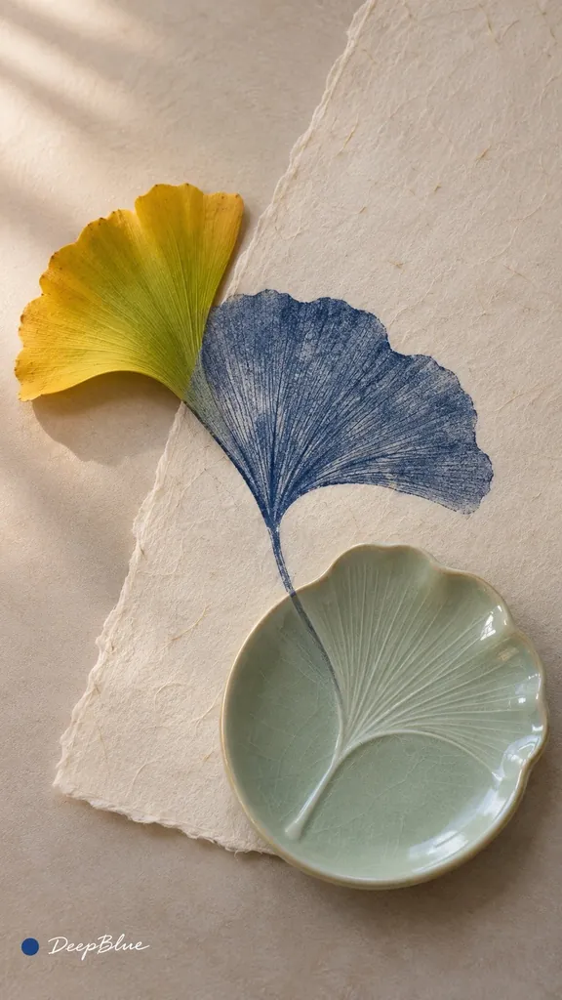</a> <a href="https://x.com/DeepBlueX0/status/2124676146642276799"><b>@DeepBlueX0</b></a> · <a href="prompts/x/x-01518.md">Prompt</a> GPT Image 2.6 · via X</td></tr>
<tr><td width="33%" valign="top"><a href="prompts/x/x-01517.md">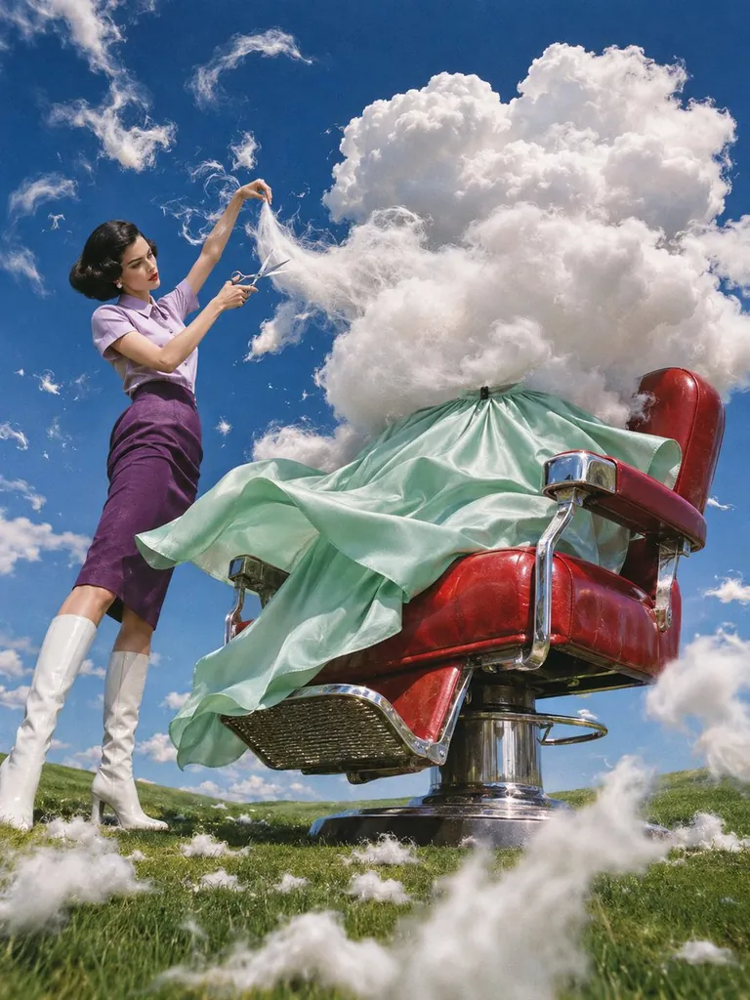</a> <a href="https://x.com/DeepBlueX0/status/2124351549480866153"><b>@DeepBlueX0</b></a> · <a href="prompts/x/x-01517.md">Prompt</a> GPT Image 2.6 · via X</td><td width="33%" valign="top"> <a href="https://x.com/dreamydigiarts/status/2124495614482473235"><b>@dreamydigiarts</b></a> · <a href="prompts/x/x-01516.md">Prompt</a> Nano Banana 2 · via X</td><td width="33%" valign="top"> <a href="https://x.com/dreamydigiarts/status/2124133231779832177"><b>@dreamydigiarts</b></a> · <a href="prompts/x/x-01515.md">Prompt</a> Nano Banana 2 · via X</td></tr>
<tr><td width="33%" valign="top"><a href="prompts/x/x-01513.md">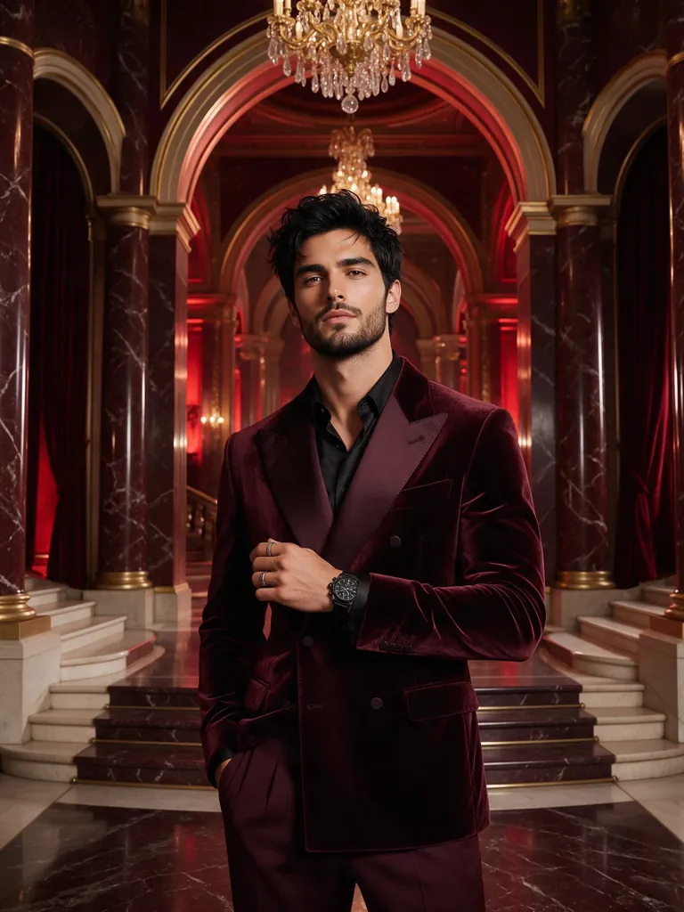</a> <a href="https://x.com/AaqibVx/status/2124491385902657815"><b>@AaqibVx</b></a> · <a href="prompts/x/x-01513.md">Prompt</a> Seedream 5.0 Pro · via X</td><td width="33%" valign="top"><a href="prompts/x/x-01512.md">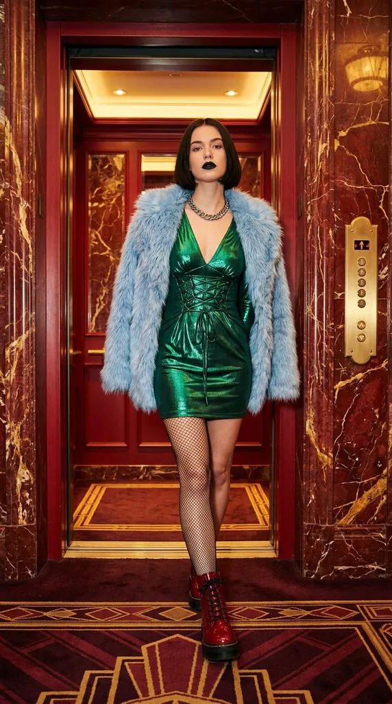</a> <a href="https://x.com/dreamydigiarts/status/2124359718840021220"><b>@dreamydigiarts</b></a> · <a href="prompts/x/x-01512.md">Prompt</a> Nano Banana 2 · via X</td><td width="33%" valign="top"> <a href="https://x.com/dreamydigiarts/status/2124525816759677391"><b>@dreamydigiarts</b></a> · <a href="prompts/x/x-01511.md">Prompt</a> Nano Banana 2 · via X</td></tr>
<tr><td width="33%" valign="top"> <a href="https://x.com/dreamydigiarts/status/2124337084575932832"><b>@dreamydigiarts</b></a> · <a href="prompts/x/x-01510.md">Prompt</a> Nano Banana 2 · via X</td><td width="33%" valign="top"> <a href="https://x.com/dreamydigiarts/status/2123997330747850918"><b>@dreamydigiarts</b></a> · <a href="prompts/x/x-01509.md">Prompt</a> Nano Banana 2 · via X</td><td width="33%" valign="top"> <a href="https://x.com/SheBuildsAI_/status/2096282220931822061"><b>@SheBuildsAI_</b></a> · <a href="prompts/x/x-01490.md">Prompt</a> Nano Banana Pro · via X</td></tr>
</table>

**[查看全部 548 个摄影写真案例 →](gallery/x-photography.md)**

## 插画与 3D · Illustration & 3D

<table>
<tr><td width="33%" valign="top"> <a href="https://x.com/static_stare/status/2124142635577442667"><b>@static_stare</b></a> · <a href="prompts/x/x-01535.md">Prompt</a> GPT Image 2.5 · via X</td><td width="33%" valign="top"> <a href="https://x.com/static_stare/status/2124504580876837193"><b>@static_stare</b></a> · <a href="prompts/x/x-01532.md">Prompt</a> GPT Image 2.5 · via X</td><td width="33%" valign="top"> <a href="https://x.com/static_stare/status/2124044391329522044"><b>@static_stare</b></a> · <a href="prompts/x/x-01530.md">Prompt</a> GPT Image 2.5 · via X</td></tr>
<tr><td width="33%" valign="top"><a href="prompts/x/x-01529.md">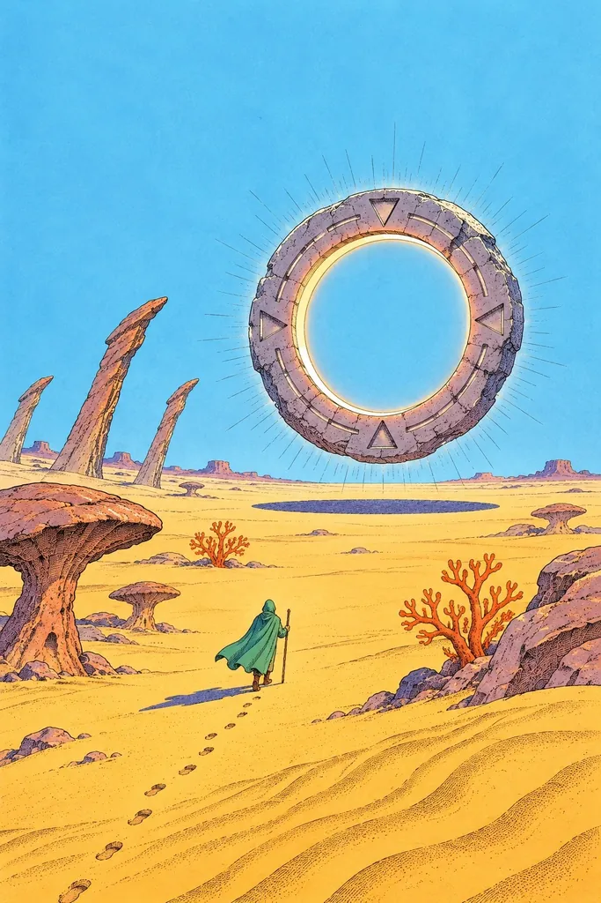</a> <a href="https://x.com/static_stare/status/2124475198217007333"><b>@static_stare</b></a> · <a href="prompts/x/x-01529.md">Prompt</a> GPT Image 2.5 · via X</td><td width="33%" valign="top"> <a href="https://x.com/mseymari_/status/2124054959041794332"><b>@mseymari_</b></a> · <a href="prompts/x/x-01524.md">Prompt</a> Seedream 5.5 · via X</td><td width="33%" valign="top"> <a href="https://x.com/DeepBlueX0/status/2124381286584422423"><b>@DeepBlueX0</b></a> · <a href="prompts/x/x-01520.md">Prompt</a> GPT Image 2.6 · via X</td></tr>
<tr><td width="33%" valign="top"> <a href="https://x.com/heathergreen/status/2124488074713260248"><b>@heathergreen</b></a> · <a href="prompts/x/x-01519.md">Prompt</a> Seedream 5.5 · via X</td><td width="33%" valign="top"><a href="prompts/x/x-01514.md">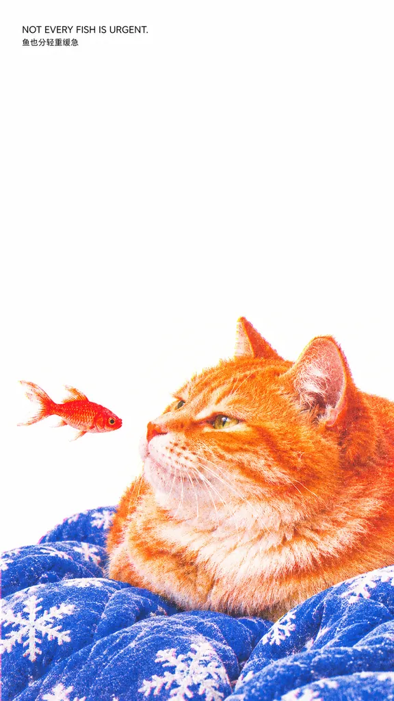</a> <a href="https://x.com/hx831126/status/2124477388608164286"><b>@hx831126</b></a> · <a href="prompts/x/x-01514.md">Prompt</a>  · via X</td><td width="33%" valign="top"><a href="prompts/x/x-01508.md">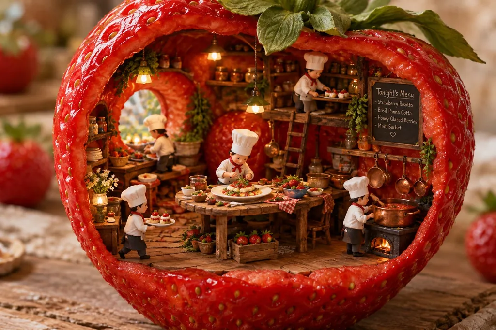</a> <a href="https://x.com/AllaAisling/status/2124477494719881479"><b>@AllaAisling</b></a> · <a href="prompts/x/x-01508.md">Prompt</a> GPT Image 2.6 Flare · via X</td></tr>
<tr><td width="33%" valign="top"><a href="prompts/x/x-01507.md">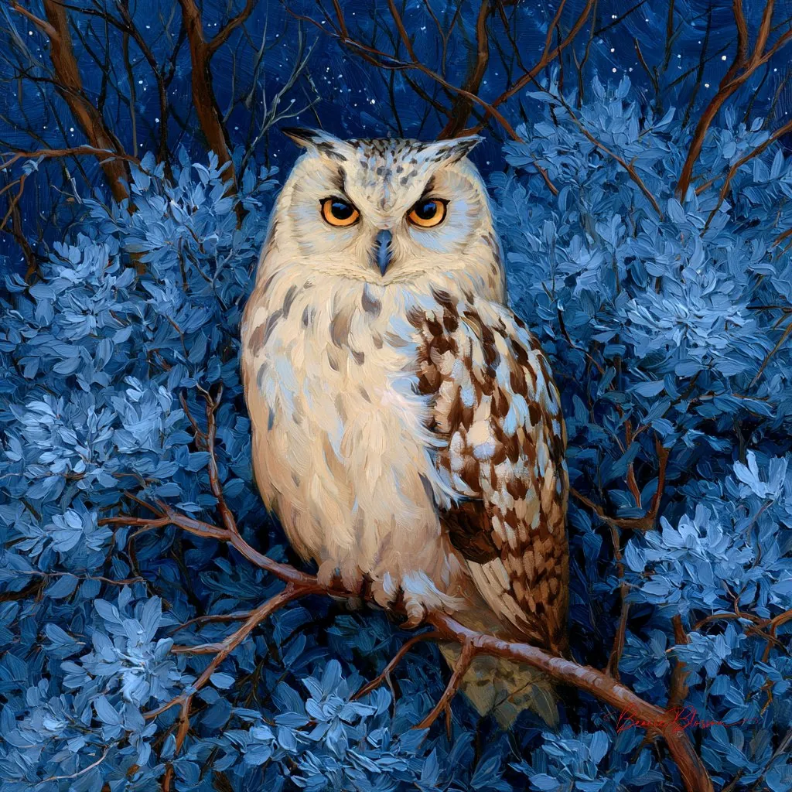</a> <a href="https://x.com/BeanieBlossom/status/2124427686403854735"><b>@BeanieBlossom</b></a> · <a href="prompts/x/x-01507.md">Prompt</a>  · via X</td><td width="33%" valign="top"><a href="prompts/x/x-01506.md">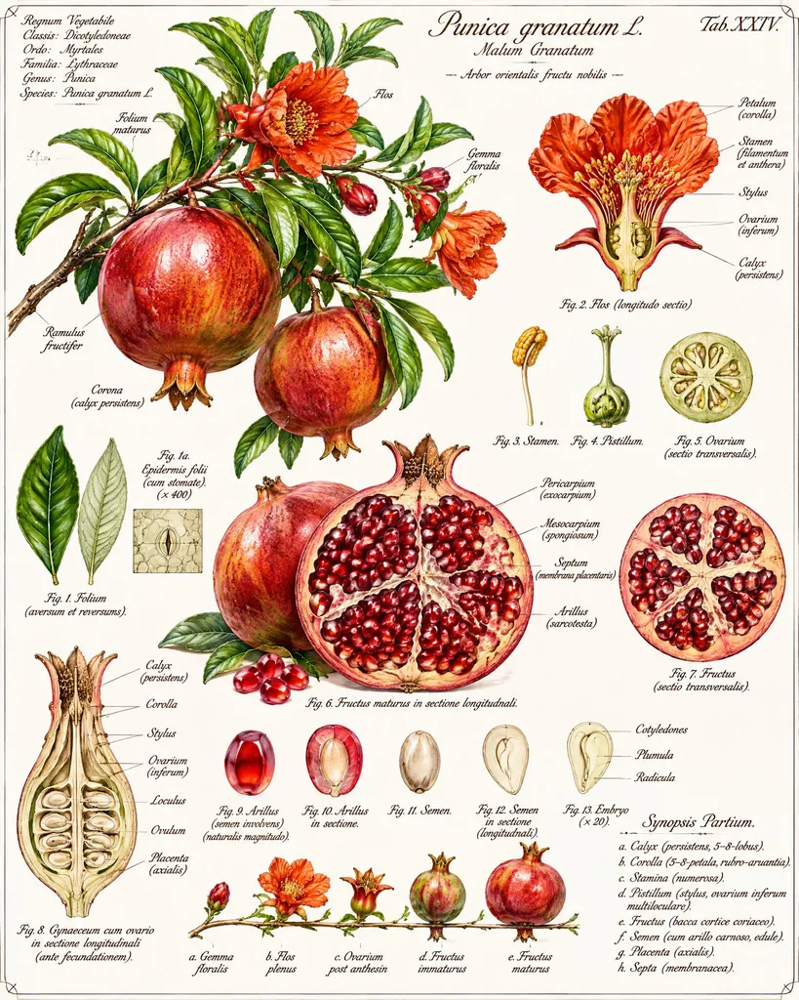</a> <a href="https://x.com/sipteaandcoffee/status/2123882892279349442"><b>@sipteaandcoffee</b></a> · <a href="prompts/x/x-01506.md">Prompt</a> GPT Image 2.6 · via X</td><td width="33%" valign="top"> <a href="https://x.com/lovimg_com/status/2096954809534570766"><b>@lovimg_com</b></a> · <a href="prompts/x/x-01486.md">Prompt</a> Nano Banana Pro · via X</td></tr>
<tr><td width="33%" valign="top"><a href="prompts/x/x-01485.md">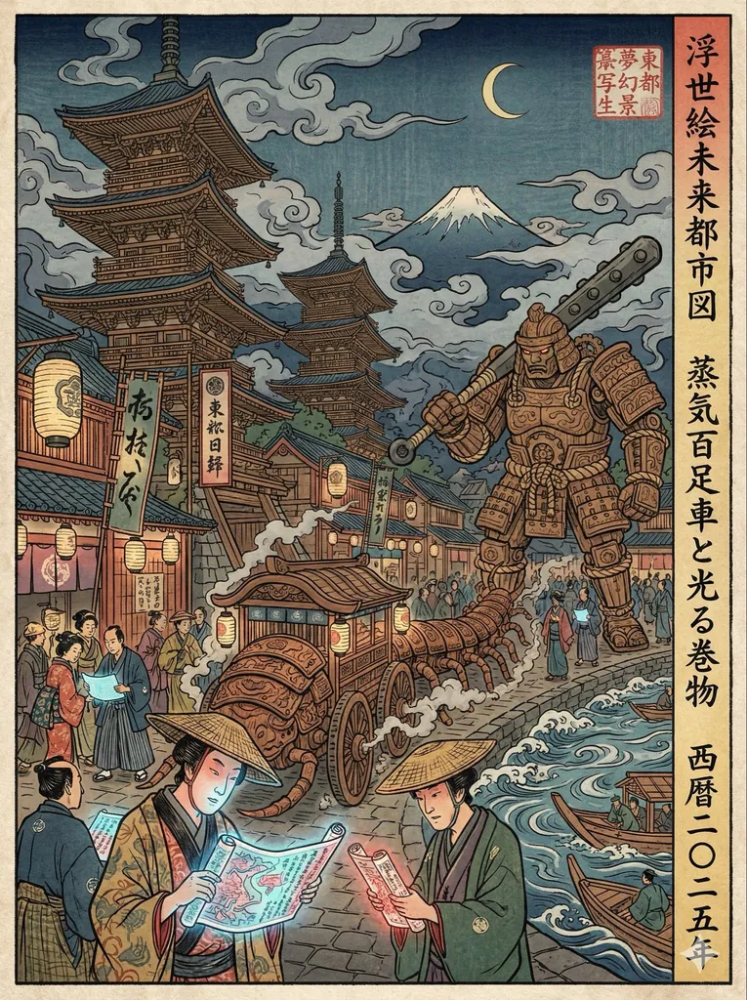</a> <a href="https://x.com/VoxcatAI/status/1995497350543110411"><b>@VoxcatAI</b></a> · <a href="prompts/x/x-01485.md">Prompt</a> Unknown · via X</td><td width="33%" valign="top"> <a href="https://x.com/Gdgtify/status/2095854642882019392"><b>@Gdgtify</b></a> · <a href="prompts/x/x-01483.md">Prompt</a> Nano Banana · via X</td><td width="33%" valign="top"><a href="prompts/x/x-01482.md">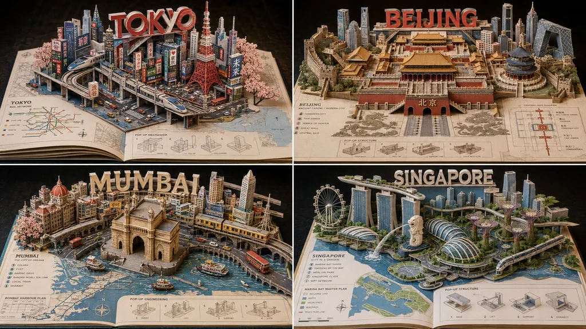</a> <a href="https://x.com/Gdgtify/status/2082221056652443680"><b>@Gdgtify</b></a> · <a href="prompts/x/x-01482.md">Prompt</a> Nano Banana · via X</td></tr>
</table>

**[查看全部 383 个插画与 3D案例 →](gallery/x-illustration-3d.md)**

## 产品与品牌 · Product & Brand

<table>
<tr><td width="33%" valign="top"> <a href="https://x.com/mehvishs25/status/2017420332458774791"><b>@mehvishs25</b></a> · <a href="prompts/x/x-01447.md">Prompt</a> GPT Image · via X</td><td width="33%" valign="top"><a href="prompts/x/x-01433.md">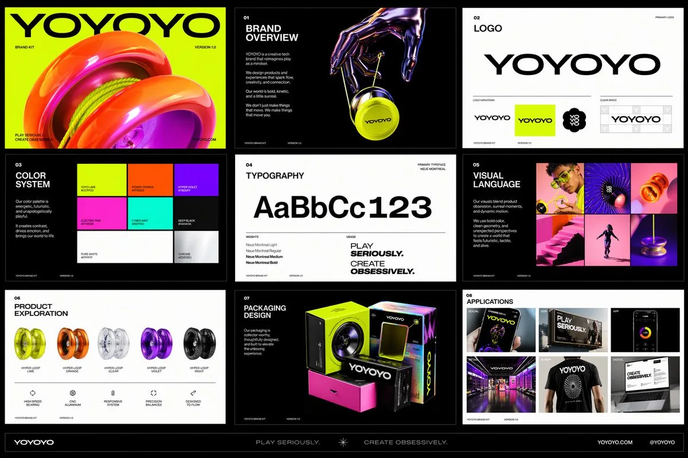</a> <a href="https://x.com/riomadeit/status/2046682439985082441"><b>@riomadeit</b></a> · <a href="prompts/x/x-01433.md">Prompt</a> GPT Image · via X</td><td width="33%" valign="top"><a href="prompts/x/x-01412.md">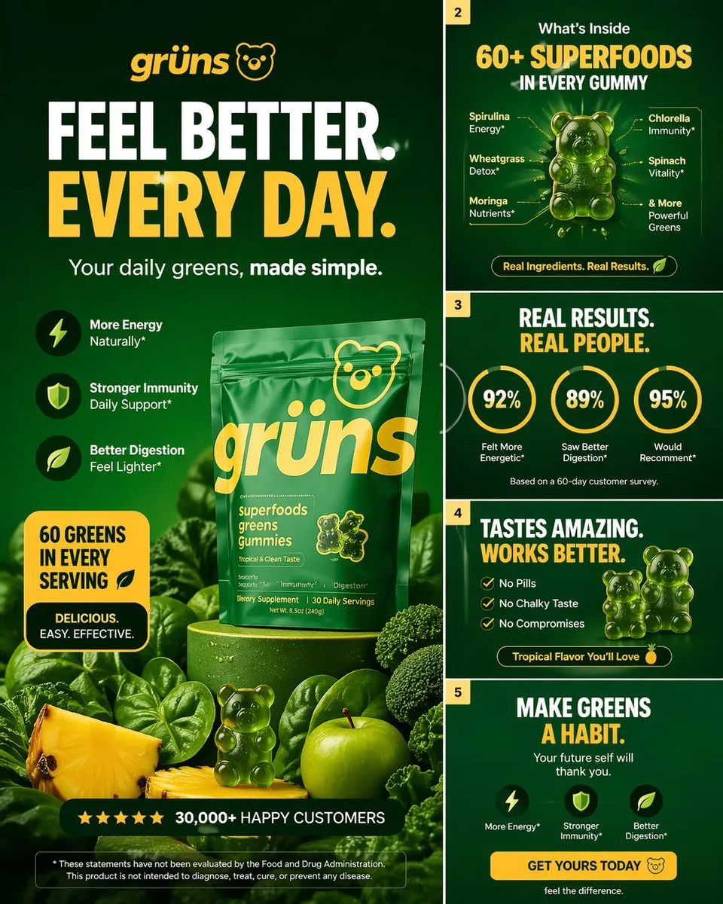</a> <a href="https://x.com/oliverkenyon/status/2047064581051142166"><b>@oliverkenyon</b></a> · <a href="prompts/x/x-01412.md">Prompt</a> GPT Image · via X</td></tr>
<tr><td width="33%" valign="top"><a href="prompts/x/x-01409.md">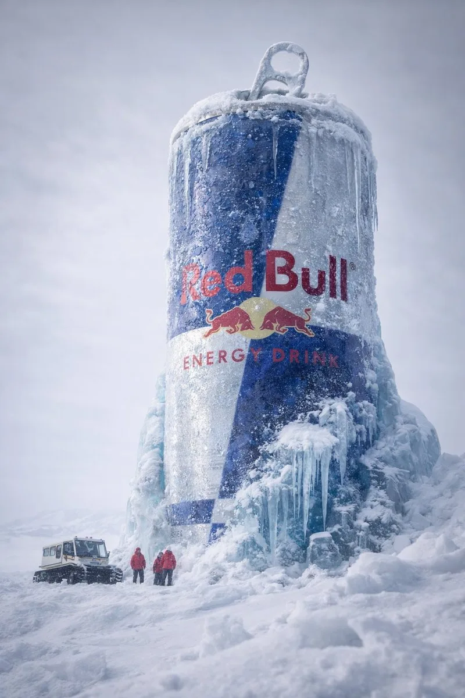</a> <a href="https://x.com/Sheldon056/status/2021057289785053348"><b>@Sheldon056</b></a> · <a href="prompts/x/x-01409.md">Prompt</a> GPT Image · via X</td><td width="33%" valign="top"> <a href="https://x.com/Salmaaboukarr/status/2046717569013293231"><b>@Salmaaboukarr</b></a> · <a href="prompts/x/x-01400.md">Prompt</a> GPT Image · via X</td><td width="33%" valign="top"><a href="prompts/x/x-01397.md">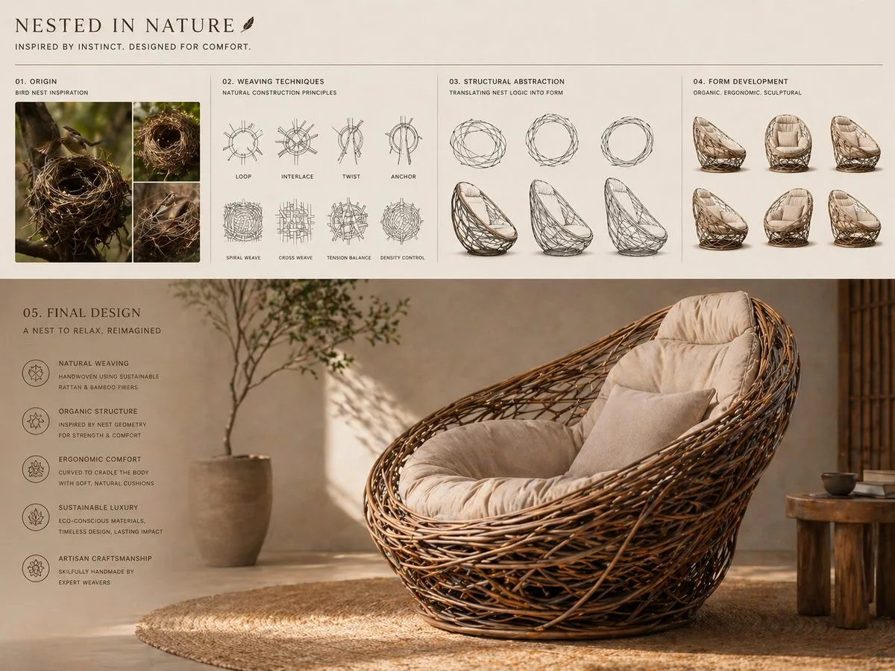</a> <a href="https://x.com/aleenaamiir/status/2048667175112802778"><b>@aleenaamiir</b></a> · <a href="prompts/x/x-01397.md">Prompt</a> GPT Image · via X</td></tr>
<tr><td width="33%" valign="top"> <a href="https://x.com/TechieBySA/status/2009585651554116028"><b>@TechieBySA</b></a> · <a href="prompts/x/x-01387.md">Prompt</a> GPT Image · via X</td><td width="33%" valign="top"><a href="prompts/x/x-01386.md">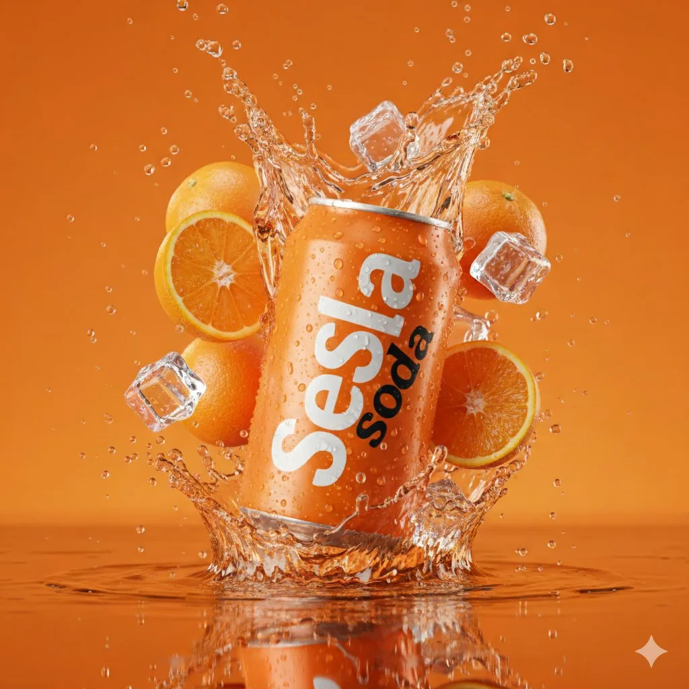</a> <a href="https://x.com/mehvishs25/status/2018525109041135790"><b>@mehvishs25</b></a> · <a href="prompts/x/x-01386.md">Prompt</a> GPT Image · via X</td><td width="33%" valign="top"><a href="prompts/x/x-01385.md">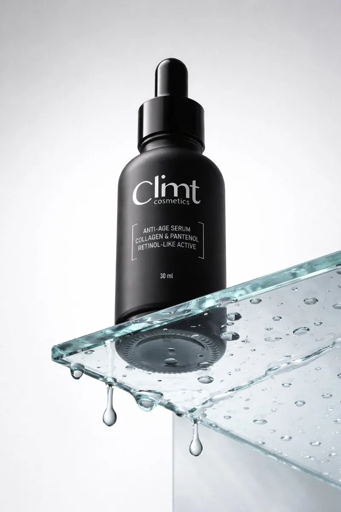</a> <a href="https://x.com/harboriis/status/2018215856577360311"><b>@harboriis</b></a> · <a href="prompts/x/x-01385.md">Prompt</a> GPT Image · via X</td></tr>
<tr><td width="33%" valign="top"><a href="prompts/x/x-01378.md">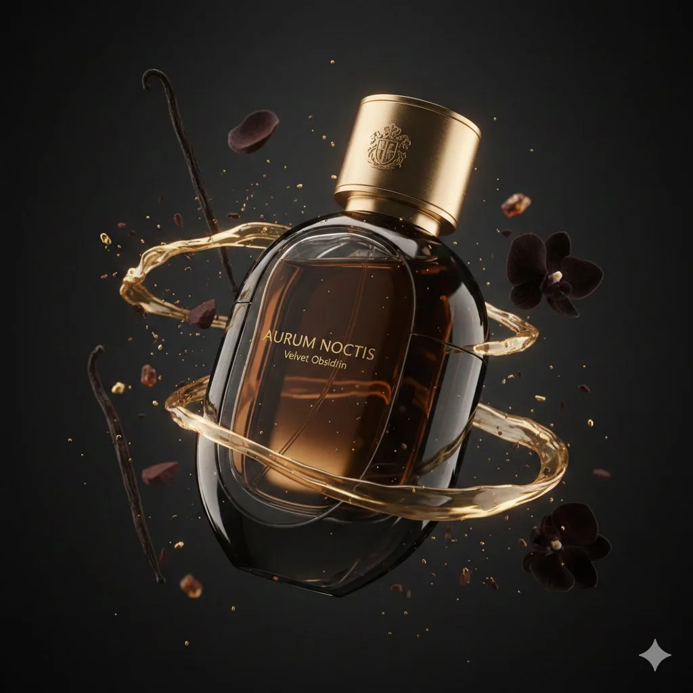</a> <a href="https://x.com/mehvishs25/status/2025013736139096574"><b>@mehvishs25</b></a> · <a href="prompts/x/x-01378.md">Prompt</a> GPT Image · via X</td><td width="33%" valign="top"><a href="prompts/x/x-01373.md">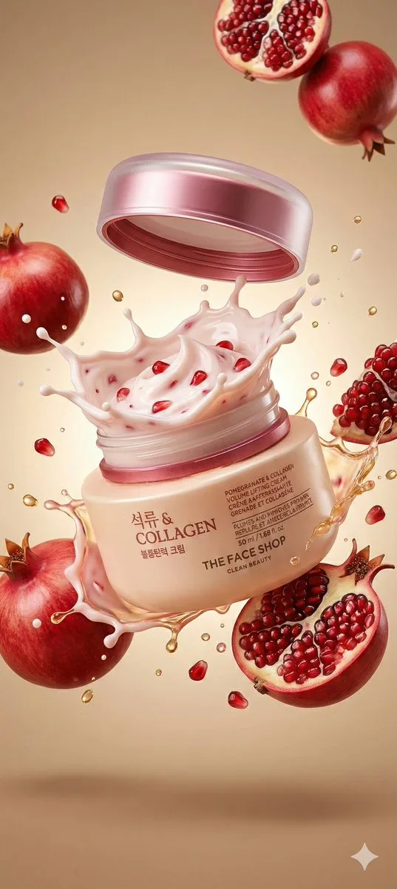</a> <a href="https://x.com/Naiknelofar788/status/2018191168451043584"><b>@Naiknelofar788</b></a> · <a href="prompts/x/x-01373.md">Prompt</a> GPT Image · via X</td><td width="33%" valign="top"> <a href="https://x.com/harboriis/status/2018312144358703594"><b>@harboriis</b></a> · <a href="prompts/x/x-01366.md">Prompt</a> GPT Image · via X</td></tr>
<tr><td width="33%" valign="top"> <a href="https://x.com/john_my07/status/2024420826016338208"><b>@john_my07</b></a> · <a href="prompts/x/x-01363.md">Prompt</a> GPT Image · via X</td><td width="33%" valign="top"><a href="prompts/x/x-01354.md">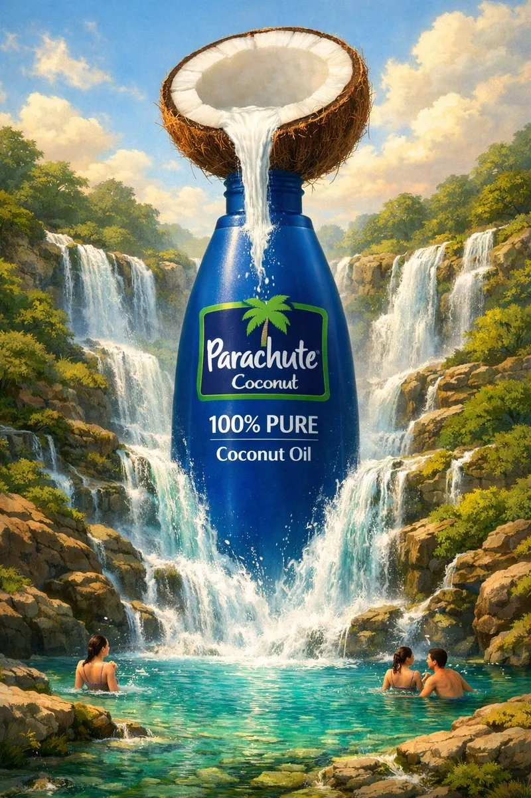</a> <a href="https://x.com/meng_dagg695/status/2008878369107276184"><b>@meng_dagg695</b></a> · <a href="prompts/x/x-01354.md">Prompt</a> GPT Image · via X</td><td width="33%" valign="top"> <a href="https://x.com/mehvishs25/status/2025391098437529837"><b>@mehvishs25</b></a> · <a href="prompts/x/x-01337.md">Prompt</a> GPT Image · via X</td></tr>
</table>

**[查看全部 216 个产品与品牌案例 →](gallery/x-product-brand.md)**

## 美食饮品 · Food & Drink

<table>
<tr><td width="33%" valign="top"> <a href="https://x.com/meng_dagg695/status/2011994819124752631"><b>@meng_dagg695</b></a> · <a href="prompts/x/x-01442.md">Prompt</a> GPT Image · via X</td><td width="33%" valign="top"> <a href="https://x.com/meng_dagg695/status/2009157208240755151"><b>@meng_dagg695</b></a> · <a href="prompts/x/x-01438.md">Prompt</a> GPT Image · via X</td><td width="33%" valign="top"><a href="prompts/x/x-01426.md">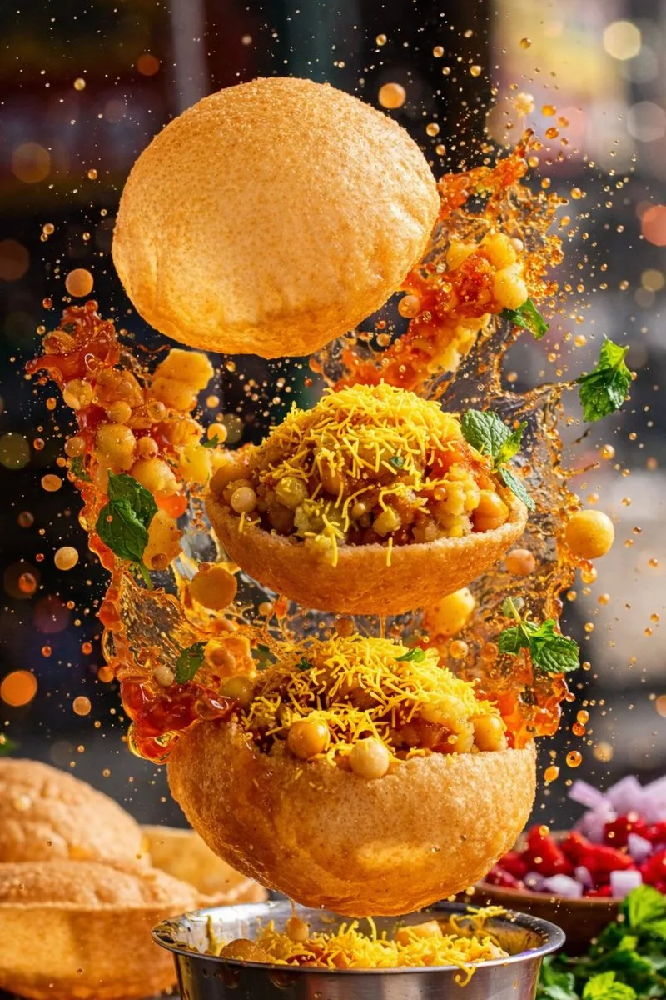</a> <a href="https://x.com/meng_dagg695/status/2009887009591226787"><b>@meng_dagg695</b></a> · <a href="prompts/x/x-01426.md">Prompt</a> GPT Image · via X</td></tr>
<tr><td width="33%" valign="top"> <a href="https://x.com/genel_ai/status/2046498264774791514"><b>@genel_ai</b></a> · <a href="prompts/x/x-01416.md">Prompt</a> GPT Image · via X</td><td width="33%" valign="top"> <a href="https://x.com/meng_dagg695/status/2010312584059351261"><b>@meng_dagg695</b></a> · <a href="prompts/x/x-01406.md">Prompt</a> GPT Image · via X</td><td width="33%" valign="top"><a href="prompts/x/x-01399.md">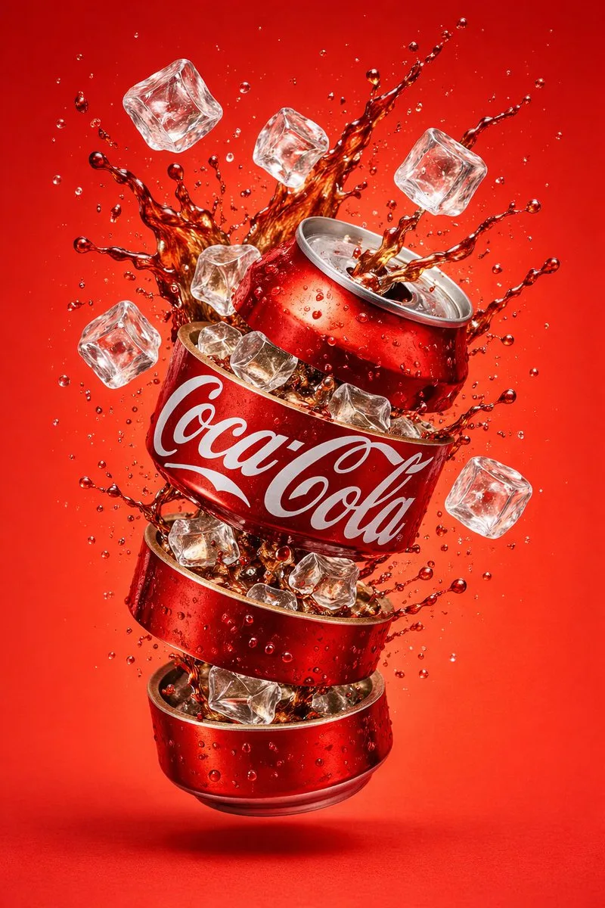</a> <a href="https://x.com/meng_dagg695/status/2009519057717088345"><b>@meng_dagg695</b></a> · <a href="prompts/x/x-01399.md">Prompt</a> GPT Image · via X</td></tr>
<tr><td width="33%" valign="top"><a href="prompts/x/x-01398.md">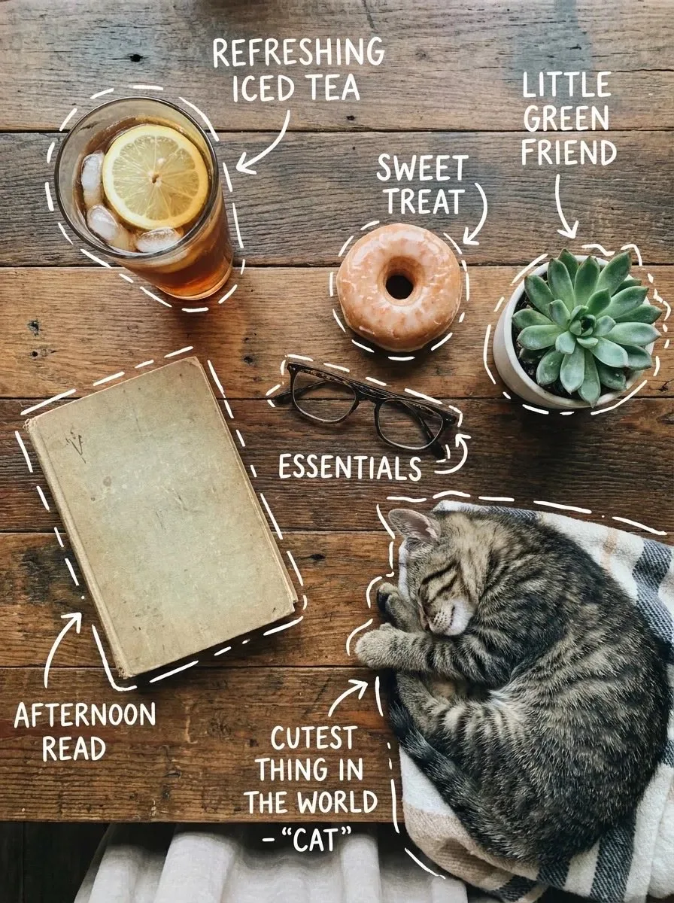</a> <a href="https://x.com/Sairah_0/status/2048725842096976020"><b>@Sairah_0</b></a> · <a href="prompts/x/x-01398.md">Prompt</a> GPT Image · via X</td><td width="33%" valign="top"> <a href="https://x.com/meng_dagg695/status/2009446363331973461"><b>@meng_dagg695</b></a> · <a href="prompts/x/x-01395.md">Prompt</a> GPT Image · via X</td><td width="33%" valign="top"> <a href="https://x.com/TechieBySA/status/2013233539706233086"><b>@TechieBySA</b></a> · <a href="prompts/x/x-01393.md">Prompt</a> GPT Image · via X</td></tr>
<tr><td width="33%" valign="top"><a href="prompts/x/x-01381.md">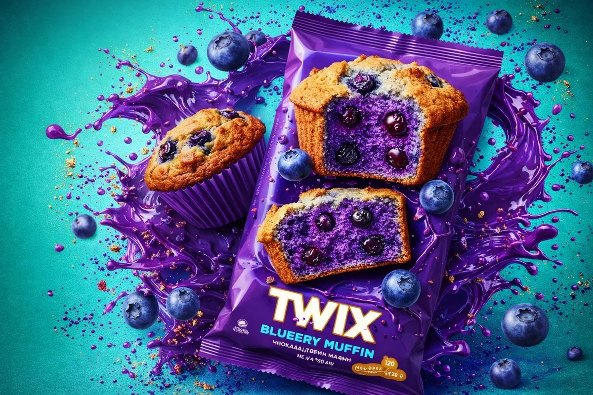</a> <a href="https://x.com/meng_dagg695/status/2012353813425144239"><b>@meng_dagg695</b></a> · <a href="prompts/x/x-01381.md">Prompt</a> GPT Image · via X</td><td width="33%" valign="top"><a href="prompts/x/x-01377.md">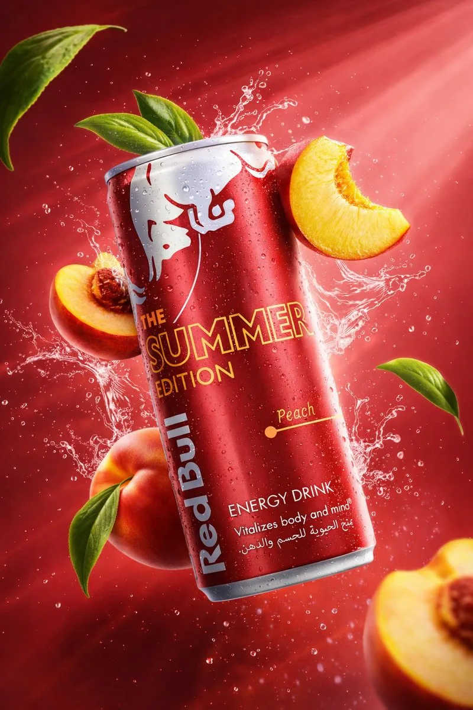</a> <a href="https://x.com/meng_dagg695/status/2010681413562155183"><b>@meng_dagg695</b></a> · <a href="prompts/x/x-01377.md">Prompt</a> GPT Image · via X</td><td width="33%" valign="top"> <a href="https://x.com/john_my07/status/2019431396885070327"><b>@john_my07</b></a> · <a href="prompts/x/x-01375.md">Prompt</a> GPT Image · via X</td></tr>
<tr><td width="33%" valign="top"> <a href="https://x.com/Strength04_X/status/2012780826715619644"><b>@Strength04_X</b></a> · <a href="prompts/x/x-01372.md">Prompt</a> GPT Image · via X</td><td width="33%" valign="top"> <a href="https://x.com/meng_dagg695/status/2010981812609434034"><b>@meng_dagg695</b></a> · <a href="prompts/x/x-01371.md">Prompt</a> GPT Image · via X</td><td width="33%" valign="top"> <a href="https://x.com/mehvishs25/status/2015252863333929304"><b>@mehvishs25</b></a> · <a href="prompts/x/x-01365.md">Prompt</a> GPT Image · via X</td></tr>
</table>

**[查看全部 154 个美食饮品案例 →](gallery/x-food-drink.md)**

## 海报设计 · Poster Design

<table>
<tr><td width="33%" valign="top"> <a href="https://x.com/static_stare/status/2124437182425518275"><b>@static_stare</b></a> · <a href="prompts/x/x-01533.md">Prompt</a> GPT Image 2.5 · via X</td><td width="33%" valign="top"><a href="prompts/x/x-01531.md">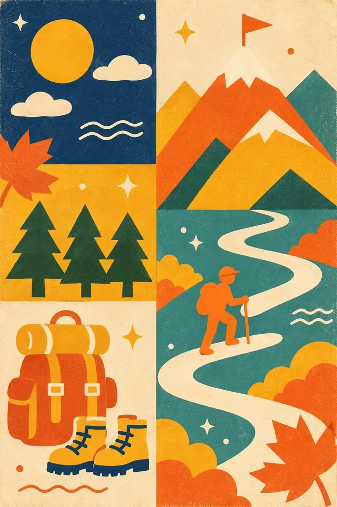</a> <a href="https://x.com/static_stare/status/2123998701295489519"><b>@static_stare</b></a> · <a href="prompts/x/x-01531.md">Prompt</a> GPT Image 2.5 · via X</td><td width="33%" valign="top"> <a href="https://x.com/static_stare/status/2124075903554928681"><b>@static_stare</b></a> · <a href="prompts/x/x-01528.md">Prompt</a> GPT Image 2.5 · via X</td></tr>
<tr><td width="33%" valign="top"> <a href="https://x.com/Alyssa4aicreate/status/2124252164352610526"><b>@Alyssa4aicreate</b></a> · <a href="prompts/x/x-01525.md">Prompt</a> GPT Image 2.6 Flare · via X</td><td width="33%" valign="top"> <a href="https://x.com/churvikv/status/2123819465796206817"><b>@churvikv</b></a> · <a href="prompts/x/x-01505.md">Prompt</a> GPT Image 2.6 Sunburst · via X</td><td width="33%" valign="top"> <a href="https://x.com/Aiwithkami/status/2124401464932184540"><b>@Aiwithkami</b></a> · <a href="prompts/x/x-01504.md">Prompt</a> GPT Image 2.6 · via X</td></tr>
<tr><td width="33%" valign="top"> <a href="https://x.com/AllaAisling/status/2004212035333365763"><b>@AllaAisling</b></a> · <a href="prompts/x/x-01484.md">Prompt</a> Nano Banana · via X</td><td width="33%" valign="top"> <a href="https://x.com/aniyaintel/status/2093658819427741802"><b>@aniyaintel</b></a> · <a href="prompts/x/x-01478.md">Prompt</a> Nano Banana Pro · via X</td><td width="33%" valign="top"> <a href="https://x.com/azed_ai/status/2048748266293190833"><b>@azed_ai</b></a> · <a href="prompts/x/x-01446.md">Prompt</a> GPT Image · via X</td></tr>
<tr><td width="33%" valign="top"> <a href="https://x.com/MrLarus/status/2045504669401653414"><b>@MrLarus</b></a> · <a href="prompts/x/x-01444.md">Prompt</a> GPT Image · via X</td><td width="33%" valign="top"> <a href="https://x.com/MrLarus/status/2048360321379701233"><b>@MrLarus</b></a> · <a href="prompts/x/x-01443.md">Prompt</a> GPT Image · via X</td><td width="33%" valign="top"><a href="prompts/x/x-01441.md">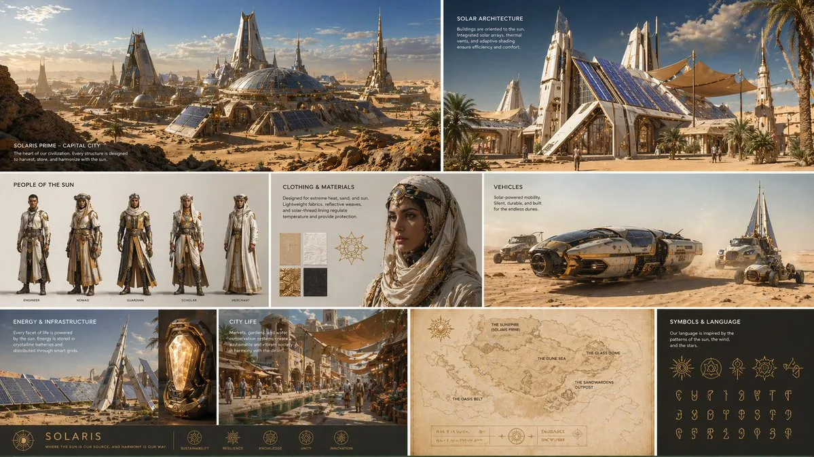</a> <a href="https://x.com/aleenaamiir/status/2046866168208916503"><b>@aleenaamiir</b></a> · <a href="prompts/x/x-01441.md">Prompt</a> GPT Image · via X</td></tr>
<tr><td width="33%" valign="top"><a href="prompts/x/x-01440.md">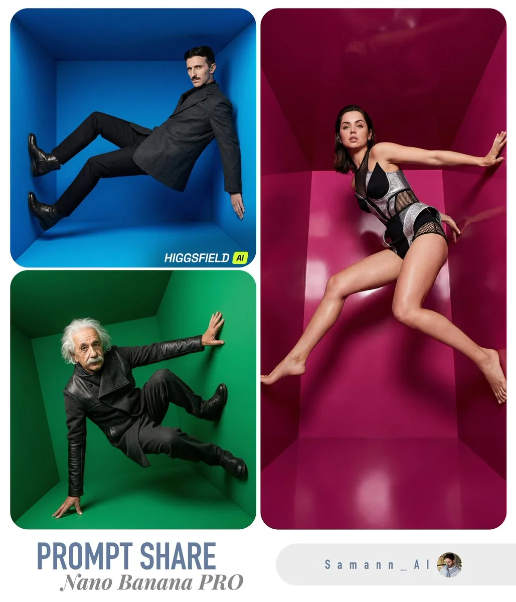</a> <a href="https://x.com/Samann_ai/status/2017598696678895882"><b>@Samann_ai</b></a> · <a href="prompts/x/x-01440.md">Prompt</a> GPT Image · via X</td><td width="33%" valign="top"><a href="prompts/x/x-01437.md">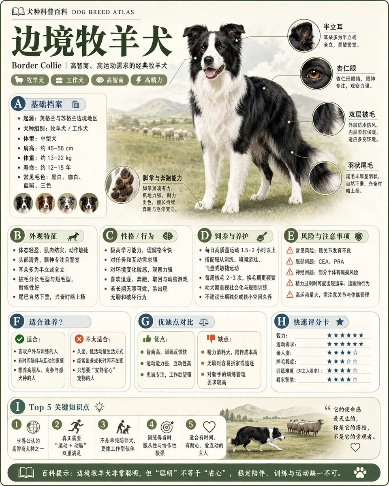</a> <a href="https://x.com/MrLarus/status/2046231542817497392"><b>@MrLarus</b></a> · <a href="prompts/x/x-01437.md">Prompt</a> GPT Image · via X</td><td width="33%" valign="top"><a href="prompts/x/x-01435.md">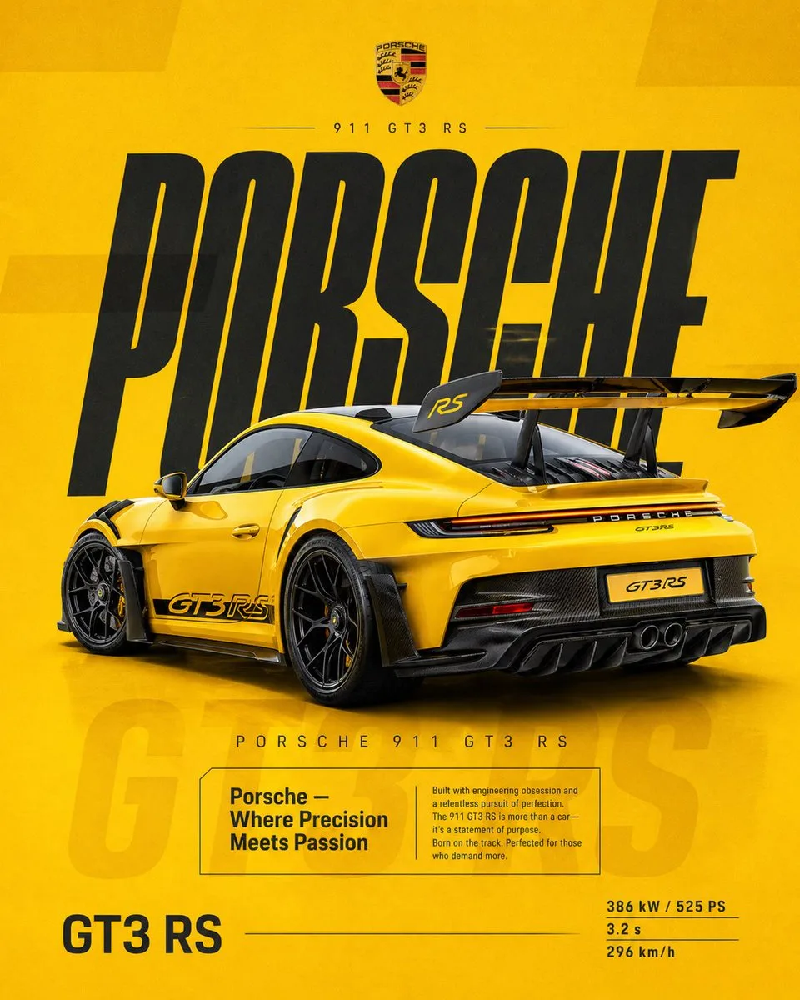</a> <a href="https://x.com/Diplomeme/status/2047986905896427670"><b>@Diplomeme</b></a> · <a href="prompts/x/x-01435.md">Prompt</a> GPT Image · via X</td></tr>
</table>

**[查看全部 141 个海报设计案例 →](gallery/x-poster-design.md)**

## UI 与平面 · UI & Graphic

<table>
<tr><td width="33%" valign="top"><a href="prompts/x/x-01523.md">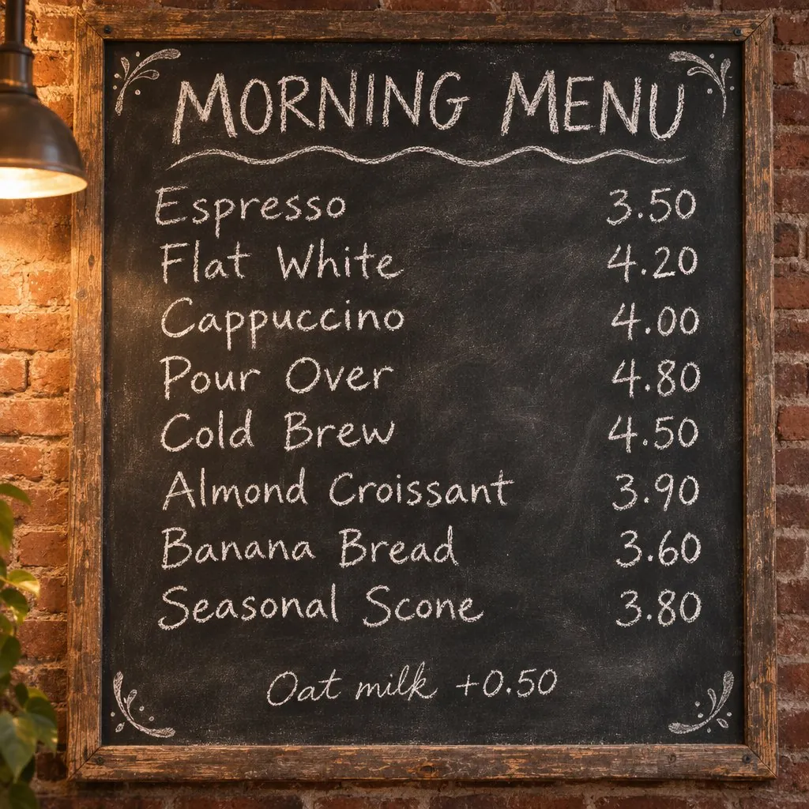</a> <a href="https://x.com/DavidLi36143625/status/2123941784585990611"><b>@DavidLi36143625</b></a> · <a href="prompts/x/x-01523.md">Prompt</a> GPT Image 2.6 Sunburst · via X</td><td width="33%" valign="top"><a href="prompts/x/x-01476.md">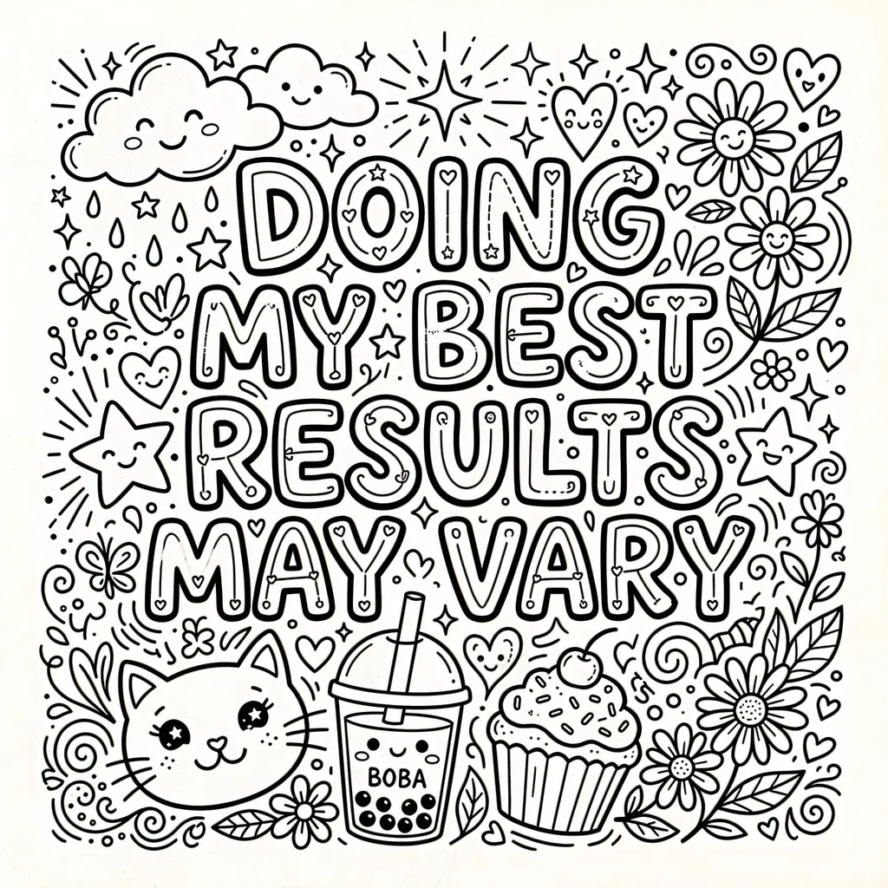</a> <a href="https://x.com/heathergreen/status/2091812770274492604"><b>@heathergreen</b></a> · <a href="prompts/x/x-01476.md">Prompt</a> Nano Banana 2 · via X</td><td width="33%" valign="top"> <a href="https://x.com/TechieBySA/status/2017928823497453789"><b>@TechieBySA</b></a> · <a href="prompts/x/x-01448.md">Prompt</a> GPT Image · via X</td></tr>
<tr><td width="33%" valign="top"> <a href="https://x.com/TechieBySA/status/2005620980891480567"><b>@TechieBySA</b></a> · <a href="prompts/x/x-01420.md">Prompt</a> GPT Image · via X</td><td width="33%" valign="top"> <a href="https://x.com/azed_ai/status/2047993289283133945"><b>@azed_ai</b></a> · <a href="prompts/x/x-01404.md">Prompt</a> GPT Image · via X</td><td width="33%" valign="top"> <a href="https://x.com/Sheldon056/status/2016088197714084320"><b>@Sheldon056</b></a> · <a href="prompts/x/x-01396.md">Prompt</a> GPT Image · via X</td></tr>
<tr><td width="33%" valign="top"> <a href="https://x.com/Noor_ul_ain43/status/2047227731839184901"><b>@Noor_ul_ain43</b></a> · <a href="prompts/x/x-01335.md">Prompt</a> GPT Image · via X</td><td width="33%" valign="top"><a href="prompts/x/x-01321.md">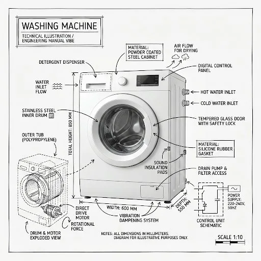</a> <a href="https://x.com/Naiknelofar788/status/2018668607966769212"><b>@Naiknelofar788</b></a> · <a href="prompts/x/x-01321.md">Prompt</a> GPT Image · via X</td><td width="33%" valign="top"><a href="prompts/x/x-01304.md">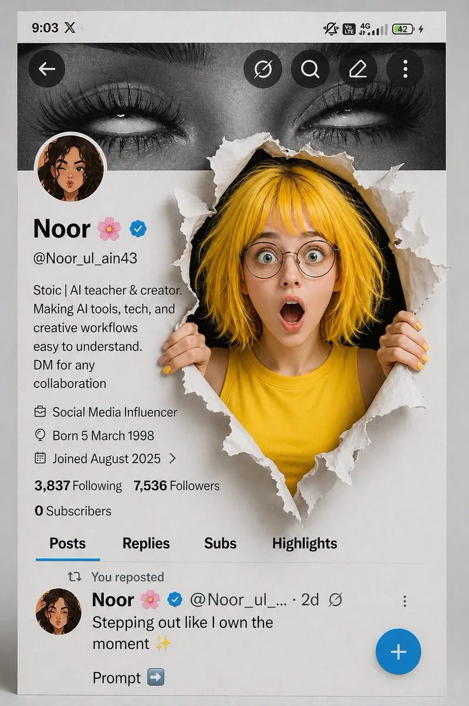</a> <a href="https://x.com/Noor_ul_ain43/status/2048088005836173316"><b>@Noor_ul_ain43</b></a> · <a href="prompts/x/x-01304.md">Prompt</a> GPT Image · via X</td></tr>
<tr><td width="33%" valign="top"><a href="prompts/x/x-01239.md">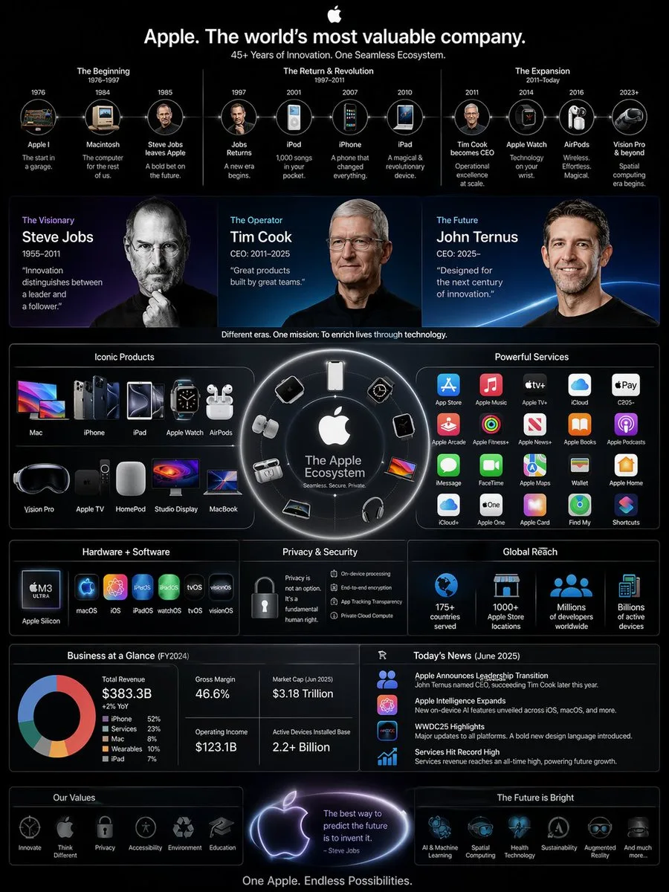</a> <a href="https://x.com/Jackywine/status/2046480096471765192"><b>@Jackywine</b></a> · <a href="prompts/x/x-01239.md">Prompt</a> GPT Image · via X</td><td width="33%" valign="top"> <a href="https://x.com/ecomchasedimond/status/2047172163313222013"><b>@ecomchasedimond</b></a> · <a href="prompts/x/x-01226.md">Prompt</a> GPT Image · via X</td><td width="33%" valign="top"><a href="prompts/x/x-01209.md">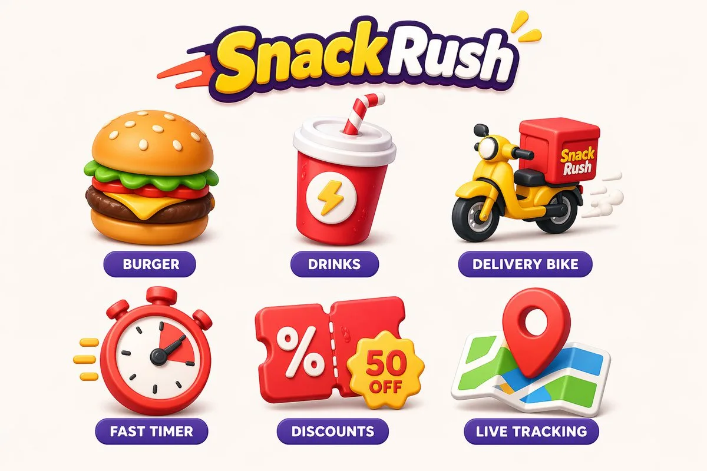</a> <a href="https://x.com/aleenaamiir/status/2047546614257221653"><b>@aleenaamiir</b></a> · <a href="prompts/x/x-01209.md">Prompt</a> GPT Image · via X</td></tr>
<tr><td width="33%" valign="top"><a href="prompts/x/x-01196.md">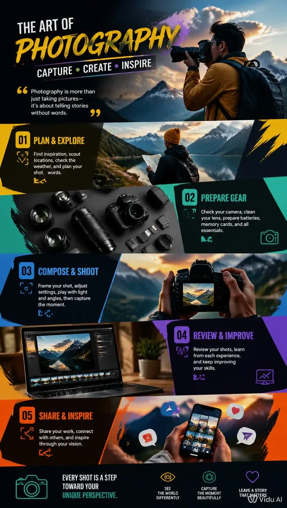</a> <a href="https://x.com/Naiknelofar788/status/2048746995465203876"><b>@Naiknelofar788</b></a> · <a href="prompts/x/x-01196.md">Prompt</a> GPT Image · via X</td><td width="33%" valign="top"> <a href="https://x.com/Mind_Boticni/status/2047550158427259188"><b>@Mind_Boticni</b></a> · <a href="prompts/x/x-01193.md">Prompt</a> GPT Image · via X</td><td width="33%" valign="top"><a href="prompts/x/x-01179.md">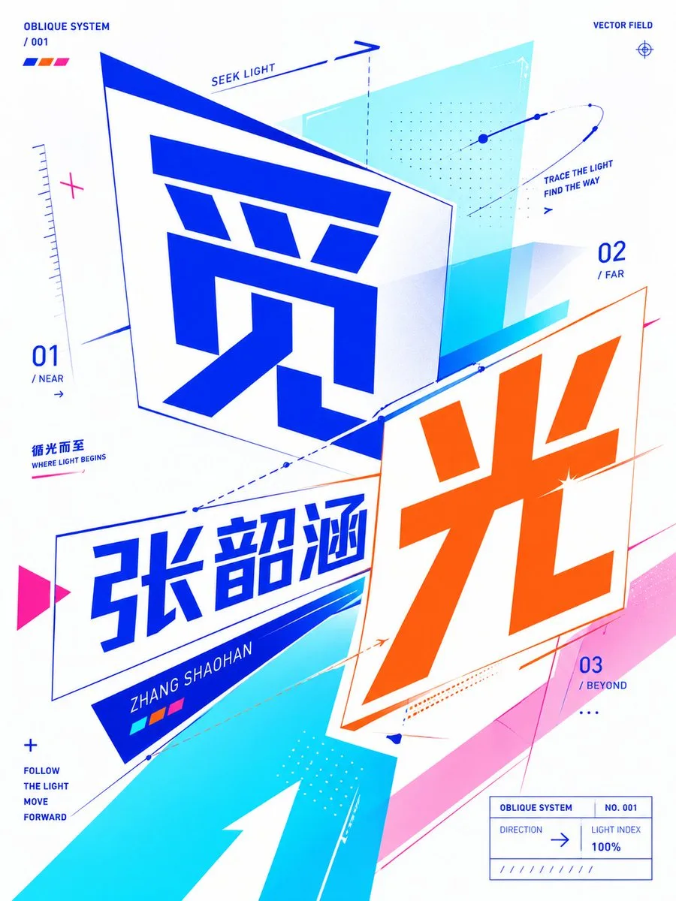</a> <a href="https://x.com/MrLarus/status/2048816632613453900"><b>@MrLarus</b></a> · <a href="prompts/x/x-01179.md">Prompt</a> GPT Image · via X</td></tr>
</table>

**[查看全部 49 个UI 与平面案例 →](gallery/x-ui-graphic.md)**

## 视频 · Video

<table>
<tr><td width="33%" valign="top"> <a href="https://x.com/draavenai/status/2124487194203304080"><b>@draavenai</b></a> · <a href="prompts/x/x-01503.md">Prompt</a> ▶ Video · Seedance 2.0 · via X</td><td width="33%" valign="top"> <a href="https://x.com/DeCat2025/status/2124446289387802965"><b>@DeCat2025</b></a> · <a href="prompts/x/x-01502.md">Prompt</a> ▶ Video · Wan 3.0 · via X</td><td width="33%" valign="top"> <a href="https://x.com/draavenai/status/2124165725124182182"><b>@draavenai</b></a> · <a href="prompts/x/x-01501.md">Prompt</a> ▶ Video · Seedance 2.0 · via X</td></tr>
<tr><td width="33%" valign="top"> <a href="https://x.com/DeCat2025/status/2123994151016443982"><b>@DeCat2025</b></a> · <a href="prompts/x/x-01500.md">Prompt</a> ▶ Video · PixVerse 6.0 · via X</td><td width="33%" valign="top"> <a href="https://x.com/OliviaRose10un/status/2124168538713940303"><b>@OliviaRose10un</b></a> · <a href="prompts/x/x-01499.md">Prompt</a> ▶ Video · Seedance 2.0 · via X</td><td width="33%" valign="top"><a href="prompts/x/x-01498.md">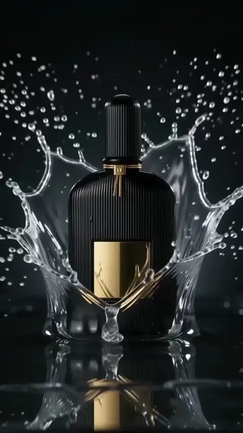</a> <a href="https://x.com/AIwithRubii/status/2123825895358279903"><b>@AIwithRubii</b></a> · <a href="prompts/x/x-01498.md">Prompt</a> ▶ Video · Seedance 2.0 · via X</td></tr>
<tr><td width="33%" valign="top"> <a href="https://x.com/draavenai/status/2124003994762903950"><b>@draavenai</b></a> · <a href="prompts/x/x-01497.md">Prompt</a> ▶ Video · Seedance 2.0 · via X</td><td width="33%" valign="top"> <a href="https://x.com/AIwithRubii/status/2124412528348586165"><b>@AIwithRubii</b></a> · <a href="prompts/x/x-01496.md">Prompt</a> ▶ Video · Seedance 2.0 · via X</td><td width="33%" valign="top"><a href="prompts/x/x-01495.md">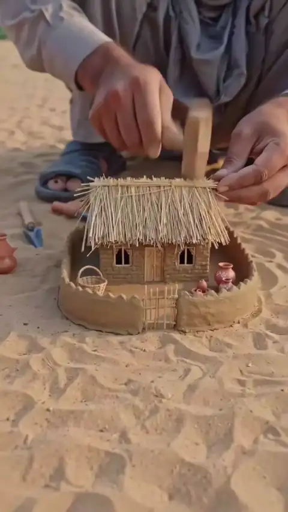</a> <a href="https://x.com/OliviaRose10un/status/2124073828410429573"><b>@OliviaRose10un</b></a> · <a href="prompts/x/x-01495.md">Prompt</a> ▶ Video · Seedance 2.0 · via X</td></tr>
<tr><td width="33%" valign="top"> <a href="https://x.com/draavenai/status/2124422089490973066"><b>@draavenai</b></a> · <a href="prompts/x/x-01494.md">Prompt</a> ▶ Video · Seedance 2.0 · via X</td><td width="33%" valign="top"> <a href="https://x.com/AllaAisling/status/2124278684710482420"><b>@AllaAisling</b></a> · <a href="prompts/x/x-01493.md">Prompt</a> ▶ Video · Seedance 2.0 · via X</td><td width="33%" valign="top"> <a href="https://x.com/CodesWithAli/status/2124166885826871631"><b>@CodesWithAli</b></a> · <a href="prompts/x/x-01492.md">Prompt</a> ▶ Video · Seedance 2.0 · via X</td></tr>
<tr><td width="33%" valign="top"> <a href="https://x.com/iamahmedfaraz66/status/2124518482918486393"><b>@iamahmedfaraz66</b></a> · <a href="prompts/x/x-01491.md">Prompt</a> ▶ Video · Seedance 2.0 · via X</td><td width="33%" valign="top"><a href="prompts/x/x-01470.md">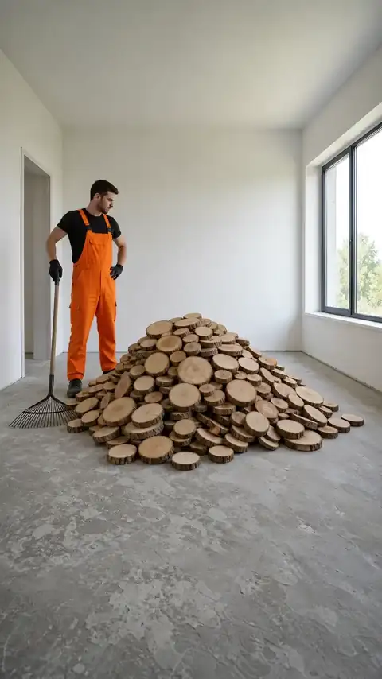</a> <a href="https://x.com/Ruslanchain/status/2117620262606614546"><b>@Ruslanchain</b></a> · <a href="prompts/x/x-01470.md">Prompt</a> ▶ Video · Seedance 2.0 · via X</td><td width="33%" valign="top"><a href="prompts/x/x-01469.md">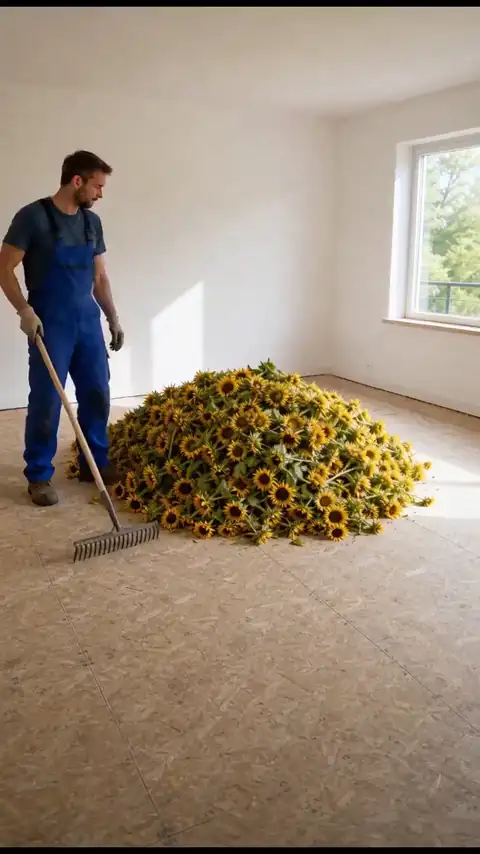</a> <a href="https://x.com/Ruslanchain/status/2116426434025504817"><b>@Ruslanchain</b></a> · <a href="prompts/x/x-01469.md">Prompt</a> ▶ Video · Seedance 2.0 · via X</td></tr>
</table>

**[查看全部 35 个视频案例 →](gallery/x-video.md)**

> 作品和提示词归原作者所有，仅作参考展示。作者如需修改或删除，请提交 issue。
