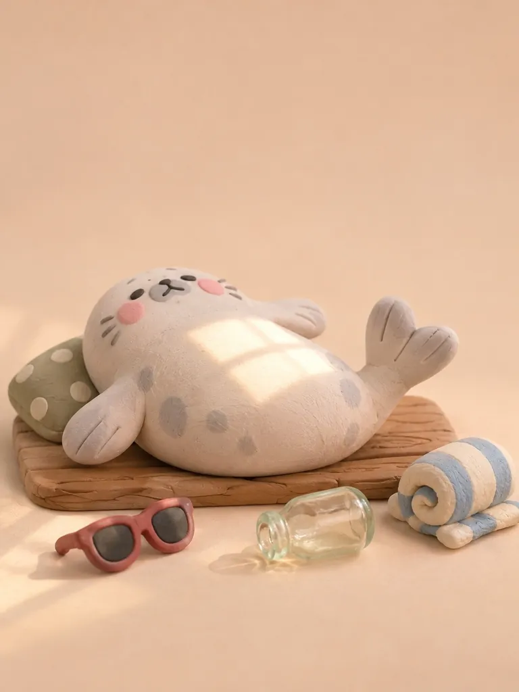
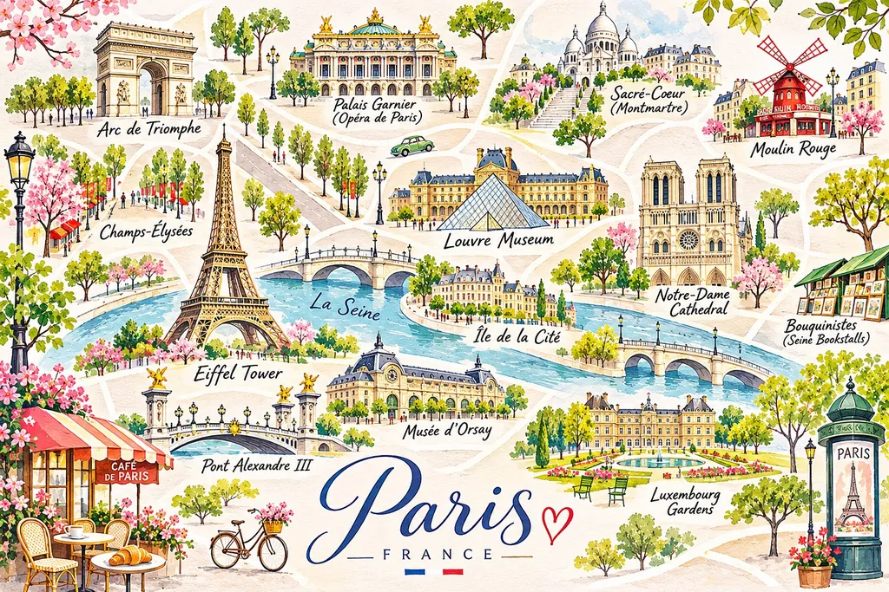
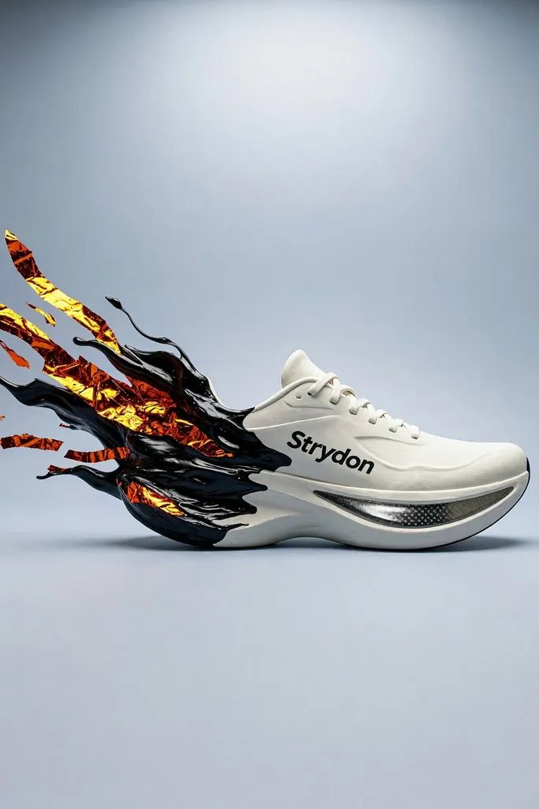
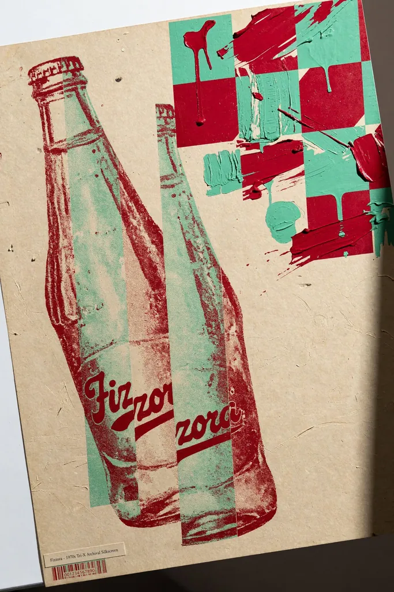
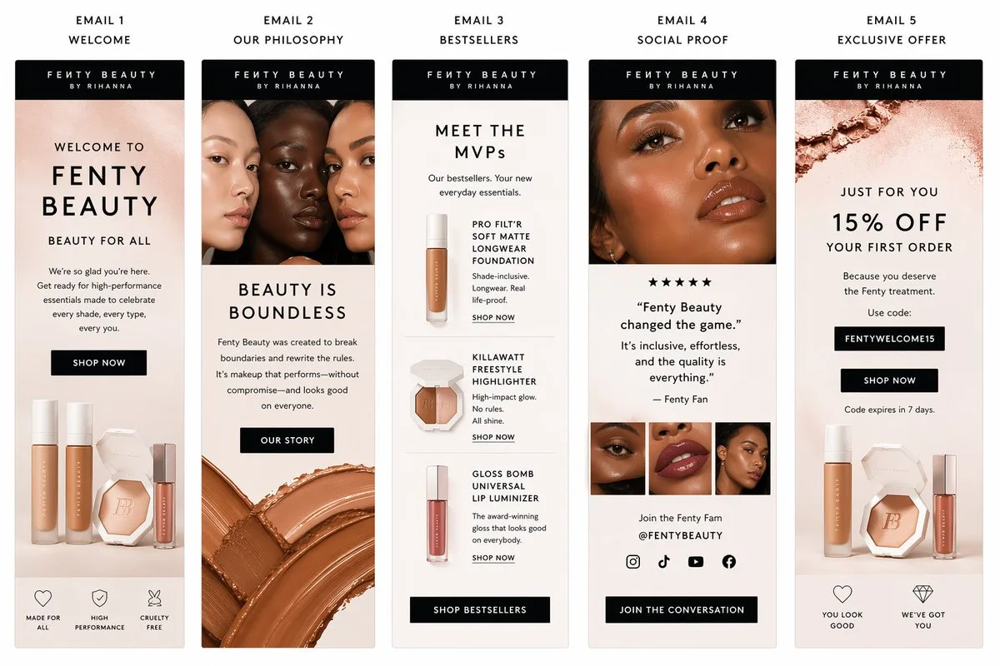
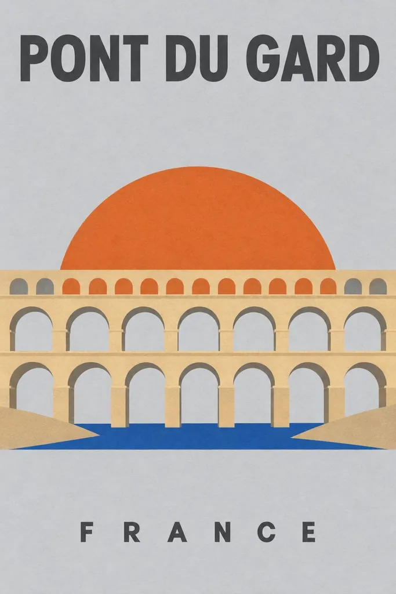
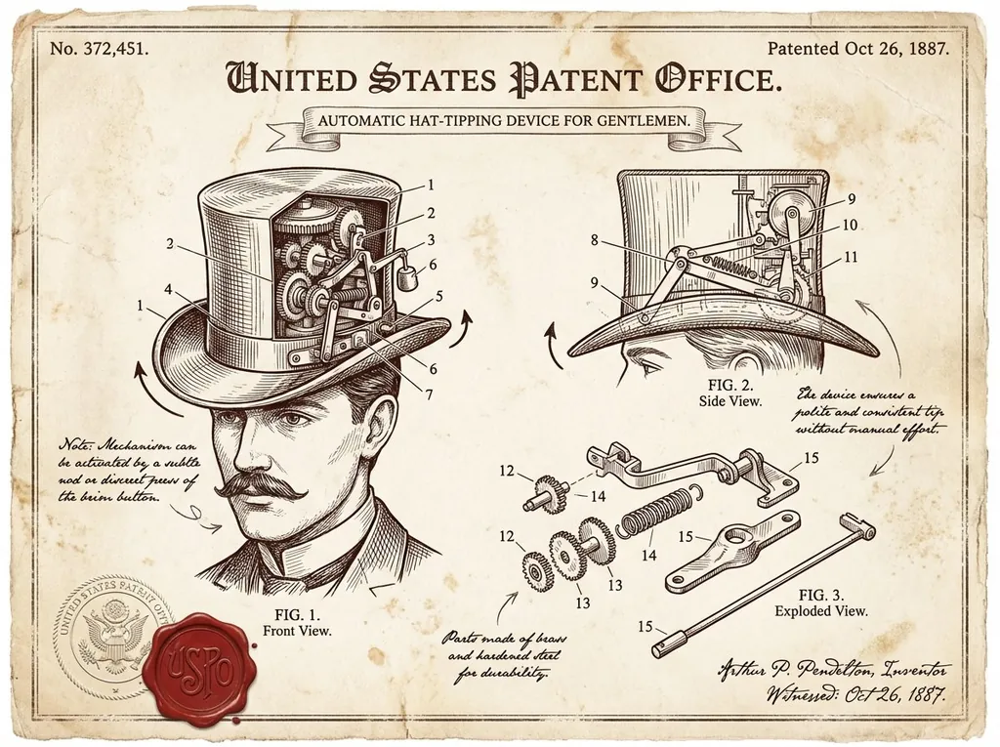
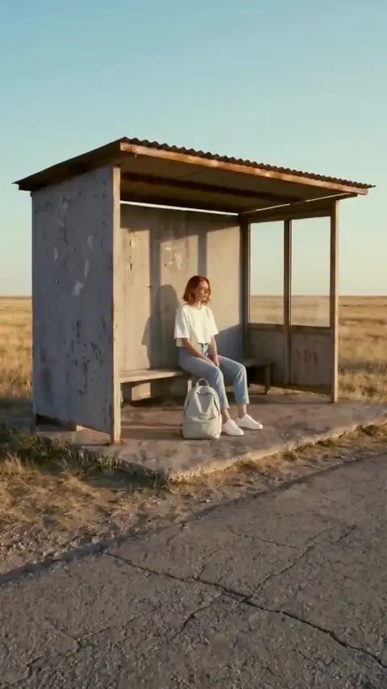

# 社区案例 · 1613

[English](EXAMPLES.md)

社区用户在 X 和其它网站分享的提示词和作品，按原样保留，每条都署名并链接到原帖。我们自己整理、用 vinano.ai 生成的合集见 [README](README.zh-CN.md)。

**[▶ 在 vinano.ai 上生成你自己的版本](https://vinano.ai?utm_source=github&utm_medium=readme&utm_campaign=awesome-image-video-prompts-updating&utm_content=examples-zh)**

## 目录

- [摄影写真 · Photography](#摄影写真-photography) (567)
- [插画与 3D · Illustration & 3D](#插画与-3d-illustration-3d) (404)
- [产品与品牌 · Product & Brand](#产品与品牌-product-brand) (220)
- [美食饮品 · Food & Drink](#美食饮品-food-drink) (154)
- [海报设计 · Poster Design](#海报设计-poster-design) (149)
- [UI 与平面 · UI & Graphic](#ui-与平面-ui-graphic) (50)
- [视频 · Video](#视频-video) (69)

## 摄影写真 · Photography

<table>
<tr><td width="33%" valign="top"> <a href="https://x.com/zencreator_io/status/2125326075798442232"><b>@zencreator_io</b></a> · <a href="prompts/x/x-01621.md">Prompt</a> Seedream 5.5 · via X</td><td width="33%" valign="top"> <a href="https://x.com/WanderingC76/status/2125139350984036387"><b>@WanderingC76</b></a> · <a href="prompts/x/x-01620.md">Prompt</a> GPT Image 2.6 · via X</td><td width="33%" valign="top"> <a href="https://x.com/ZDuo_MoreAi/status/2125393911040655857"><b>@ZDuo_MoreAi</b></a> · <a href="prompts/x/x-01619.md">Prompt</a> GPT Image 2.6 · via X</td></tr>
<tr><td width="33%" valign="top"> <a href="https://x.com/cheoneusin/status/2125369304082485724"><b>@cheoneusin</b></a> · <a href="prompts/x/x-01617.md">Prompt</a> GPT Image 2.6 · via X</td><td width="33%" valign="top"> <a href="https://x.com/StarStoryX/status/2125143310587081208"><b>@StarStoryX</b></a> · <a href="prompts/x/x-01602.md">Prompt</a> Unknown · via X</td><td width="33%" valign="top"> <a href="https://x.com/StarStoryX/status/2125200598572130416"><b>@StarStoryX</b></a> · <a href="prompts/x/x-01601.md">Prompt</a> Unknown · via X</td></tr>
<tr><td width="33%" valign="top"> <a href="https://x.com/Faeiz4Ai/status/2125124006202200455"><b>@Faeiz4Ai</b></a> · <a href="prompts/x/x-01600.md">Prompt</a> Nano Banana 2.1 · via X</td><td width="33%" valign="top"> <a href="https://x.com/pictsbyai/status/2125141872859631950"><b>@pictsbyai</b></a> · <a href="prompts/x/x-01599.md">Prompt</a> Nano Banana 2.1 · via X</td><td width="33%" valign="top"> <a href="https://x.com/chandrapie/status/2125116002061193365"><b>@chandrapie</b></a> · <a href="prompts/x/x-01591.md">Prompt</a> GPT Image 2.6 · via X</td></tr>
<tr><td width="33%" valign="top"> <a href="https://x.com/dreamydigiarts/status/2125182660406550918"><b>@dreamydigiarts</b></a> · <a href="prompts/x/x-01590.md">Prompt</a> Nano Banana 2 · via X</td><td width="33%" valign="top"> <a href="https://x.com/xnouraya/status/2125216502999904585"><b>@xnouraya</b></a> · <a href="prompts/x/x-01589.md">Prompt</a> Nano Banana Pro · via X</td><td width="33%" valign="top"> <a href="https://x.com/lrsoy_/status/2124381772314239384"><b>@lrsoy_</b></a> · <a href="prompts/x/x-01561.md">Prompt</a> Seedream 5.0 Pro · via X</td></tr>
<tr><td width="33%" valign="top"> <a href="https://x.com/Adam38363368936/status/2124865921491841350"><b>@Adam38363368936</b></a> · <a href="prompts/x/x-01557.md">Prompt</a> GPT Image 2.6 · via X</td><td width="33%" valign="top"> <a href="https://x.com/lrsoy_/status/2124417124622069772"><b>@lrsoy_</b></a> · <a href="prompts/x/x-01556.md">Prompt</a> Seedream 5.0 Pro · via X</td><td width="33%" valign="top"> <a href="https://x.com/static_stare/status/2124868443916865688"><b>@static_stare</b></a> · <a href="prompts/x/x-01550.md">Prompt</a> GPT Image 2.5 · via X</td></tr>
</table>

**[查看全部 567 个摄影写真案例 →](gallery/x-photography.md)**

## 插画与 3D · Illustration & 3D

<table>
<tr><td width="33%" valign="top"> <a href="https://x.com/heathergreen/status/2125212858132615239"><b>@heathergreen</b></a> · <a href="prompts/x/x-01595.md">Prompt</a> Nano Banana 2.1 · via X</td><td width="33%" valign="top"> <a href="https://x.com/heathergreen/status/2125363850060951662"><b>@heathergreen</b></a> · <a href="prompts/x/x-01594.md">Prompt</a> Midjourney · via X</td><td width="33%" valign="top"> <a href="https://x.com/heathergreen/status/2125243046078136352"><b>@heathergreen</b></a> · <a href="prompts/x/x-01593.md">Prompt</a> Midjourney · via X</td></tr>
<tr><td width="33%" valign="top"> <a href="https://x.com/BeanieBlossom/status/2124851469019144342"><b>@BeanieBlossom</b></a> · <a href="prompts/x/x-01592.md">Prompt</a> Unknown · via X</td><td width="33%" valign="top"> <a href="https://x.com/Andy4aicreate/status/2125383268895752541"><b>@Andy4aicreate</b></a> · <a href="prompts/x/x-01588.md">Prompt</a> GPT Image 2.6 Flare · via X</td><td width="33%" valign="top"> <a href="https://x.com/static_stare/status/2125228980681032024"><b>@static_stare</b></a> · <a href="prompts/x/x-01586.md">Prompt</a> GPT Image 2.5 · via X</td></tr>
<tr><td width="33%" valign="top"> <a href="https://x.com/static_stare/status/2125087899591041227"><b>@static_stare</b></a> · <a href="prompts/x/x-01585.md">Prompt</a> GPT Image 2.5 · via X</td><td width="33%" valign="top"> <a href="https://x.com/static_stare/status/2125131194853720297"><b>@static_stare</b></a> · <a href="prompts/x/x-01584.md">Prompt</a> GPT Image 2.5 · via X</td><td width="33%" valign="top"> <a href="https://x.com/static_stare/status/2125199785145909730"><b>@static_stare</b></a> · <a href="prompts/x/x-01583.md">Prompt</a> GPT Image 2.5 · via X</td></tr>
<tr><td width="33%" valign="top"> <a href="https://x.com/DeepBlueX0/status/2125228695396766184"><b>@DeepBlueX0</b></a> · <a href="prompts/x/x-01581.md">Prompt</a> GPT Image 2.6 · via X</td><td width="33%" valign="top"> <a href="https://x.com/Naiknelofar788/status/2125072697982091620"><b>@Naiknelofar788</b></a> · <a href="prompts/x/x-01580.md">Prompt</a> GPT Image 2.6 · via X</td><td width="33%" valign="top"> <a href="https://x.com/Leviwoyun/status/2125060880778104908"><b>@Leviwoyun</b></a> · <a href="prompts/x/x-01555.md">Prompt</a> GPT Image 2.6 · via X</td></tr>
<tr><td width="33%" valign="top"> <a href="https://x.com/octopusaia/status/2124942135468466328"><b>@octopusaia</b></a> · <a href="prompts/x/x-01553.md">Prompt</a> GPT Image · via X</td><td width="33%" valign="top"> <a href="https://x.com/static_stare/status/2124768993529741761"><b>@static_stare</b></a> · <a href="prompts/x/x-01552.md">Prompt</a> GPT Image 2.5 · via X</td><td width="33%" valign="top"> <a href="https://x.com/static_stare/status/2124836246702985363"><b>@static_stare</b></a> · <a href="prompts/x/x-01551.md">Prompt</a> GPT Image 2.5 · via X</td></tr>
</table>

**[查看全部 404 个插画与 3D案例 →](gallery/x-illustration-3d.md)**

## 产品与品牌 · Product & Brand

<table>
<tr><td width="33%" valign="top"> <a href="https://x.com/seirdotmk/status/2125318285260644519"><b>@seirdotmk</b></a> · <a href="prompts/x/x-01598.md">Prompt</a> MiniMax H3 Image · via X</td><td width="33%" valign="top"> <a href="https://x.com/seirdotmk/status/2125122247815786746"><b>@seirdotmk</b></a> · <a href="prompts/x/x-01597.md">Prompt</a> MiniMax H3 Image · via X</td><td width="33%" valign="top"> <a href="https://x.com/seirdotmk/status/2124941050326499351"><b>@seirdotmk</b></a> · <a href="prompts/x/x-01596.md">Prompt</a> MiniMax H3 Image · via X</td></tr>
<tr><td width="33%" valign="top"> <a href="https://x.com/ksa8Turky/status/2125349490970476560"><b>@ksa8Turky</b></a> · <a href="prompts/x/x-01587.md">Prompt</a> GPT Image · via X</td><td width="33%" valign="top"> <a href="https://x.com/mehvishs25/status/2017420332458774791"><b>@mehvishs25</b></a> · <a href="prompts/x/x-01447.md">Prompt</a> GPT Image · via X</td><td width="33%" valign="top"> <a href="https://x.com/riomadeit/status/2046682439985082441"><b>@riomadeit</b></a> · <a href="prompts/x/x-01433.md">Prompt</a> GPT Image · via X</td></tr>
<tr><td width="33%" valign="top"> <a href="https://x.com/oliverkenyon/status/2047064581051142166"><b>@oliverkenyon</b></a> · <a href="prompts/x/x-01412.md">Prompt</a> GPT Image · via X</td><td width="33%" valign="top"> <a href="https://x.com/Sheldon056/status/2021057289785053348"><b>@Sheldon056</b></a> · <a href="prompts/x/x-01409.md">Prompt</a> GPT Image · via X</td><td width="33%" valign="top"> <a href="https://x.com/Salmaaboukarr/status/2046717569013293231"><b>@Salmaaboukarr</b></a> · <a href="prompts/x/x-01400.md">Prompt</a> GPT Image · via X</td></tr>
<tr><td width="33%" valign="top"> <a href="https://x.com/aleenaamiir/status/2048667175112802778"><b>@aleenaamiir</b></a> · <a href="prompts/x/x-01397.md">Prompt</a> GPT Image · via X</td><td width="33%" valign="top"> <a href="https://x.com/TechieBySA/status/2009585651554116028"><b>@TechieBySA</b></a> · <a href="prompts/x/x-01387.md">Prompt</a> GPT Image · via X</td><td width="33%" valign="top"> <a href="https://x.com/mehvishs25/status/2018525109041135790"><b>@mehvishs25</b></a> · <a href="prompts/x/x-01386.md">Prompt</a> GPT Image · via X</td></tr>
<tr><td width="33%" valign="top"> <a href="https://x.com/harboriis/status/2018215856577360311"><b>@harboriis</b></a> · <a href="prompts/x/x-01385.md">Prompt</a> GPT Image · via X</td><td width="33%" valign="top"> <a href="https://x.com/mehvishs25/status/2025013736139096574"><b>@mehvishs25</b></a> · <a href="prompts/x/x-01378.md">Prompt</a> GPT Image · via X</td><td width="33%" valign="top"> <a href="https://x.com/Naiknelofar788/status/2018191168451043584"><b>@Naiknelofar788</b></a> · <a href="prompts/x/x-01373.md">Prompt</a> GPT Image · via X</td></tr>
</table>

**[查看全部 220 个产品与品牌案例 →](gallery/x-product-brand.md)**

## 美食饮品 · Food & Drink

<table>
<tr><td width="33%" valign="top"> <a href="https://x.com/meng_dagg695/status/2011994819124752631"><b>@meng_dagg695</b></a> · <a href="prompts/x/x-01442.md">Prompt</a> GPT Image · via X</td><td width="33%" valign="top"> <a href="https://x.com/meng_dagg695/status/2009157208240755151"><b>@meng_dagg695</b></a> · <a href="prompts/x/x-01438.md">Prompt</a> GPT Image · via X</td><td width="33%" valign="top"> <a href="https://x.com/meng_dagg695/status/2009887009591226787"><b>@meng_dagg695</b></a> · <a href="prompts/x/x-01426.md">Prompt</a> GPT Image · via X</td></tr>
<tr><td width="33%" valign="top"> <a href="https://x.com/genel_ai/status/2046498264774791514"><b>@genel_ai</b></a> · <a href="prompts/x/x-01416.md">Prompt</a> GPT Image · via X</td><td width="33%" valign="top"> <a href="https://x.com/meng_dagg695/status/2010312584059351261"><b>@meng_dagg695</b></a> · <a href="prompts/x/x-01406.md">Prompt</a> GPT Image · via X</td><td width="33%" valign="top"> <a href="https://x.com/meng_dagg695/status/2009519057717088345"><b>@meng_dagg695</b></a> · <a href="prompts/x/x-01399.md">Prompt</a> GPT Image · via X</td></tr>
<tr><td width="33%" valign="top"> <a href="https://x.com/Sairah_0/status/2048725842096976020"><b>@Sairah_0</b></a> · <a href="prompts/x/x-01398.md">Prompt</a> GPT Image · via X</td><td width="33%" valign="top"> <a href="https://x.com/meng_dagg695/status/2009446363331973461"><b>@meng_dagg695</b></a> · <a href="prompts/x/x-01395.md">Prompt</a> GPT Image · via X</td><td width="33%" valign="top"> <a href="https://x.com/TechieBySA/status/2013233539706233086"><b>@TechieBySA</b></a> · <a href="prompts/x/x-01393.md">Prompt</a> GPT Image · via X</td></tr>
<tr><td width="33%" valign="top"> <a href="https://x.com/meng_dagg695/status/2012353813425144239"><b>@meng_dagg695</b></a> · <a href="prompts/x/x-01381.md">Prompt</a> GPT Image · via X</td><td width="33%" valign="top"> <a href="https://x.com/meng_dagg695/status/2010681413562155183"><b>@meng_dagg695</b></a> · <a href="prompts/x/x-01377.md">Prompt</a> GPT Image · via X</td><td width="33%" valign="top"> <a href="https://x.com/john_my07/status/2019431396885070327"><b>@john_my07</b></a> · <a href="prompts/x/x-01375.md">Prompt</a> GPT Image · via X</td></tr>
<tr><td width="33%" valign="top"> <a href="https://x.com/Strength04_X/status/2012780826715619644"><b>@Strength04_X</b></a> · <a href="prompts/x/x-01372.md">Prompt</a> GPT Image · via X</td><td width="33%" valign="top"> <a href="https://x.com/meng_dagg695/status/2010981812609434034"><b>@meng_dagg695</b></a> · <a href="prompts/x/x-01371.md">Prompt</a> GPT Image · via X</td><td width="33%" valign="top"> <a href="https://x.com/mehvishs25/status/2015252863333929304"><b>@mehvishs25</b></a> · <a href="prompts/x/x-01365.md">Prompt</a> GPT Image · via X</td></tr>
</table>

**[查看全部 154 个美食饮品案例 →](gallery/x-food-drink.md)**

## 海报设计 · Poster Design

<table>
<tr><td width="33%" valign="top"> <a href="https://x.com/MrLarus/status/2125257923131773007"><b>@MrLarus</b></a> · <a href="prompts/x/x-01618.md">Prompt</a> GPT Image 2.6 · via X</td><td width="33%" valign="top"> <a href="https://x.com/CoopandKCmom/status/2124727709351715301"><b>@CoopandKCmom</b></a> · <a href="prompts/x/x-01578.md">Prompt</a> Nano Banana 2.1 · via X</td><td width="33%" valign="top"> <a href="https://x.com/heathergreen/status/2124684359680630949"><b>@heathergreen</b></a> · <a href="prompts/x/x-01559.md">Prompt</a> Nano Banana 2.1 · via X</td></tr>
<tr><td width="33%" valign="top"> <a href="https://x.com/heathergreen/status/2124321978911711493"><b>@heathergreen</b></a> · <a href="prompts/x/x-01558.md">Prompt</a> Nano Banana 2.1 · via X</td><td width="33%" valign="top"> <a href="https://x.com/Andy4aicreate/status/2124934011592085845"><b>@Andy4aicreate</b></a> · <a href="prompts/x/x-01554.md">Prompt</a> GPT Image 2.5 Flare · via X</td><td width="33%" valign="top"> <a href="https://x.com/static_stare/status/2124799205839606209"><b>@static_stare</b></a> · <a href="prompts/x/x-01549.md">Prompt</a> GPT Image 2.5 · via X</td></tr>
<tr><td width="33%" valign="top"> <a href="https://x.com/ZDuo_MoreAi/status/2124764888480543222"><b>@ZDuo_MoreAi</b></a> · <a href="prompts/x/x-01547.md">Prompt</a> GPT Image 2.6 · via X</td><td width="33%" valign="top"> <a href="https://x.com/Goodmanprotocol/status/2124756790143488011"><b>@Goodmanprotocol</b></a> · <a href="prompts/x/x-01538.md">Prompt</a> GPT Image 2.6 · via X</td><td width="33%" valign="top"> <a href="https://x.com/static_stare/status/2124437182425518275"><b>@static_stare</b></a> · <a href="prompts/x/x-01533.md">Prompt</a> GPT Image 2.5 · via X</td></tr>
<tr><td width="33%" valign="top"> <a href="https://x.com/static_stare/status/2123998701295489519"><b>@static_stare</b></a> · <a href="prompts/x/x-01531.md">Prompt</a> GPT Image 2.5 · via X</td><td width="33%" valign="top"> <a href="https://x.com/static_stare/status/2124075903554928681"><b>@static_stare</b></a> · <a href="prompts/x/x-01528.md">Prompt</a> GPT Image 2.5 · via X</td><td width="33%" valign="top"> <a href="https://x.com/Alyssa4aicreate/status/2124252164352610526"><b>@Alyssa4aicreate</b></a> · <a href="prompts/x/x-01525.md">Prompt</a> GPT Image 2.6 Flare · via X</td></tr>
<tr><td width="33%" valign="top"> <a href="https://x.com/churvikv/status/2123819465796206817"><b>@churvikv</b></a> · <a href="prompts/x/x-01505.md">Prompt</a> GPT Image 2.6 Sunburst · via X</td><td width="33%" valign="top"> <a href="https://x.com/Aiwithkami/status/2124401464932184540"><b>@Aiwithkami</b></a> · <a href="prompts/x/x-01504.md">Prompt</a> GPT Image 2.6 · via X</td><td width="33%" valign="top"> <a href="https://x.com/AllaAisling/status/2004212035333365763"><b>@AllaAisling</b></a> · <a href="prompts/x/x-01484.md">Prompt</a> Nano Banana · via X</td></tr>
</table>

**[查看全部 149 个海报设计案例 →](gallery/x-poster-design.md)**

## UI 与平面 · UI & Graphic

<table>
<tr><td width="33%" valign="top"> <a href="https://x.com/static_stare/status/2125161133804015882"><b>@static_stare</b></a> · <a href="prompts/x/x-01582.md">Prompt</a> GPT Image 2.5 · via X</td><td width="33%" valign="top"> <a href="https://x.com/DavidLi36143625/status/2123941784585990611"><b>@DavidLi36143625</b></a> · <a href="prompts/x/x-01523.md">Prompt</a> GPT Image 2.6 Sunburst · via X</td><td width="33%" valign="top"> <a href="https://x.com/heathergreen/status/2091812770274492604"><b>@heathergreen</b></a> · <a href="prompts/x/x-01476.md">Prompt</a> Nano Banana 2 · via X</td></tr>
<tr><td width="33%" valign="top"> <a href="https://x.com/TechieBySA/status/2017928823497453789"><b>@TechieBySA</b></a> · <a href="prompts/x/x-01448.md">Prompt</a> GPT Image · via X</td><td width="33%" valign="top"> <a href="https://x.com/TechieBySA/status/2005620980891480567"><b>@TechieBySA</b></a> · <a href="prompts/x/x-01420.md">Prompt</a> GPT Image · via X</td><td width="33%" valign="top"> <a href="https://x.com/azed_ai/status/2047993289283133945"><b>@azed_ai</b></a> · <a href="prompts/x/x-01404.md">Prompt</a> GPT Image · via X</td></tr>
<tr><td width="33%" valign="top"> <a href="https://x.com/Sheldon056/status/2016088197714084320"><b>@Sheldon056</b></a> · <a href="prompts/x/x-01396.md">Prompt</a> GPT Image · via X</td><td width="33%" valign="top"> <a href="https://x.com/Noor_ul_ain43/status/2047227731839184901"><b>@Noor_ul_ain43</b></a> · <a href="prompts/x/x-01335.md">Prompt</a> GPT Image · via X</td><td width="33%" valign="top"> <a href="https://x.com/Naiknelofar788/status/2018668607966769212"><b>@Naiknelofar788</b></a> · <a href="prompts/x/x-01321.md">Prompt</a> GPT Image · via X</td></tr>
<tr><td width="33%" valign="top"> <a href="https://x.com/Noor_ul_ain43/status/2048088005836173316"><b>@Noor_ul_ain43</b></a> · <a href="prompts/x/x-01304.md">Prompt</a> GPT Image · via X</td><td width="33%" valign="top"> <a href="https://x.com/Jackywine/status/2046480096471765192"><b>@Jackywine</b></a> · <a href="prompts/x/x-01239.md">Prompt</a> GPT Image · via X</td><td width="33%" valign="top"> <a href="https://x.com/ecomchasedimond/status/2047172163313222013"><b>@ecomchasedimond</b></a> · <a href="prompts/x/x-01226.md">Prompt</a> GPT Image · via X</td></tr>
<tr><td width="33%" valign="top"> <a href="https://x.com/aleenaamiir/status/2047546614257221653"><b>@aleenaamiir</b></a> · <a href="prompts/x/x-01209.md">Prompt</a> GPT Image · via X</td><td width="33%" valign="top"> <a href="https://x.com/Naiknelofar788/status/2048746995465203876"><b>@Naiknelofar788</b></a> · <a href="prompts/x/x-01196.md">Prompt</a> GPT Image · via X</td><td width="33%" valign="top"> <a href="https://x.com/Mind_Boticni/status/2047550158427259188"><b>@Mind_Boticni</b></a> · <a href="prompts/x/x-01193.md">Prompt</a> GPT Image · via X</td></tr>
</table>

**[查看全部 50 个UI 与平面案例 →](gallery/x-ui-graphic.md)**

## 视频 · Video

<table>
<tr><td width="33%" valign="top"> <a href="https://x.com/aymducking/status/2124585905902018757"><b>@aymducking</b></a> · <a href="prompts/x/x-01625.md">Prompt</a> ▶ Video · Unknown · via X</td><td width="33%" valign="top"> <a href="https://x.com/Viniai_/status/2124695713238139200"><b>@Viniai_</b></a> · <a href="prompts/x/x-01624.md">Prompt</a> ▶ Video · Seedance 2.5 · via X</td><td width="33%" valign="top"> <a href="https://x.com/Viniai_/status/2125422309116879008"><b>@Viniai_</b></a> · <a href="prompts/x/x-01623.md">Prompt</a> ▶ Video · Seedance 2.5 · via X</td></tr>
<tr><td width="33%" valign="top"> <a href="https://x.com/Viniai_/status/2125068089830347155"><b>@Viniai_</b></a> · <a href="prompts/x/x-01622.md">Prompt</a> ▶ Video · Seedance 2.5 · via X</td><td width="33%" valign="top"> <a href="https://x.com/CharaspowerAI/status/2124835432126927006"><b>@CharaspowerAI</b></a> · <a href="prompts/x/x-01616.md">Prompt</a> ▶ Video · MiniMax H3 · via X</td><td width="33%" valign="top"> <a href="https://x.com/AIwithRubii/status/2125273931812925647"><b>@AIwithRubii</b></a> · <a href="prompts/x/x-01615.md">Prompt</a> ▶ Video · MiniMax H3 · via X</td></tr>
<tr><td width="33%" valign="top"> <a href="https://x.com/Zoyavelle/status/2124730552133763350"><b>@Zoyavelle</b></a> · <a href="prompts/x/x-01614.md">Prompt</a> ▶ Video · Wan 3.0 · via X</td><td width="33%" valign="top"> <a href="https://x.com/Zyrellix/status/2125178147096408158"><b>@Zyrellix</b></a> · <a href="prompts/x/x-01613.md">Prompt</a> ▶ Video · Wan 3.0 · via X</td><td width="33%" valign="top"> <a href="https://x.com/Gundys69/status/2125352434570567771"><b>@Gundys69</b></a> · <a href="prompts/x/x-01612.md">Prompt</a> ▶ Video · Grok Imagine · via X</td></tr>
<tr><td width="33%" valign="top"> <a href="https://x.com/msksmiss/status/2125380493004988749"><b>@msksmiss</b></a> · <a href="prompts/x/x-01611.md">Prompt</a> ▶ Video · Grok Imagine · via X</td><td width="33%" valign="top"> <a href="https://x.com/OliviaRose10un/status/2125255192878919990"><b>@OliviaRose10un</b></a> · <a href="prompts/x/x-01610.md">Prompt</a> ▶ Video · Seedance 2.0 · via X</td><td width="33%" valign="top"> <a href="https://x.com/Adam38363368936/status/2125242014468075906"><b>@Adam38363368936</b></a> · <a href="prompts/x/x-01609.md">Prompt</a> ▶ Video · Seedance 2.0 · via X</td></tr>
<tr><td width="33%" valign="top"> <a href="https://x.com/ZDuo_MoreAi/status/2125388245756526610"><b>@ZDuo_MoreAi</b></a> · <a href="prompts/x/x-01608.md">Prompt</a> ▶ Video · Seedance 2.0 · via X</td><td width="33%" valign="top"> <a href="https://x.com/draavenai/status/2125228862774669606"><b>@draavenai</b></a> · <a href="prompts/x/x-01607.md">Prompt</a> ▶ Video · Seedance 2.0 · via X</td><td width="33%" valign="top"> <a href="https://x.com/Lianaalane/status/2125089432965632262"><b>@Lianaalane</b></a> · <a href="prompts/x/x-01606.md">Prompt</a> ▶ Video · Seedance 2.0 · via X</td></tr>
</table>

**[查看全部 69 个视频案例 →](gallery/x-video.md)**

> 作品和提示词归原作者所有，仅作参考展示。作者如需修改或删除，请提交 issue。
