# Photography prompts — 628 with previews

[← Back to README](../README.md) · Page 6 / 6: [1](./photography.md) · [2](./photography-2.md) · [3](./photography-3.md) · [4](./photography-4.md) · [5](./photography-5.md) · **6**

Every preview below was generated with **[vinano.ai](https://vinano.ai?utm_source=github&utm_medium=readme&utm_campaign=awesome-image-video-prompts-updating&utm_content=gallery-top)**. Click a card to open its full prompt.

<table>
<tr><td width="33%" valign="top"> <a href="../prompts/photography/vn-01904.md"><b>AI generated image by Render with rich micro-detail while</b></a> Vinano Image Pro · <a href="https://vinano.ai?utm_source=github&utm_medium=readme&utm_campaign=awesome-image-video-prompts-updating&utm_content=card">Try on vinano.ai</a></td><td width="33%" valign="top"><a href="../prompts/photography/vn-01909.md">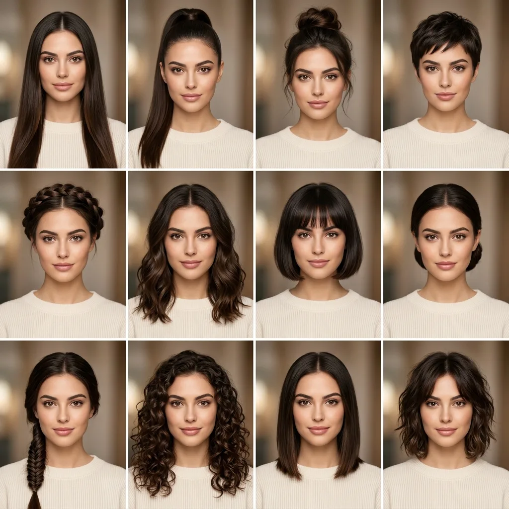</a> <a href="../prompts/photography/vn-01909.md"><b>Realistic, Portrait</b></a> Vinano Image Pro · <a href="https://vinano.ai?utm_source=github&utm_medium=readme&utm_campaign=awesome-image-video-prompts-updating&utm_content=card">Try on vinano.ai</a></td><td width="33%" valign="top"> <a href="../prompts/photography/vn-01915.md"><b>Portrait, Cinematic</b></a> Vinano Image Pro · <a href="https://vinano.ai?utm_source=github&utm_medium=readme&utm_campaign=awesome-image-video-prompts-updating&utm_content=card">Try on vinano.ai</a></td></tr>
<tr><td width="33%" valign="top"><a href="../prompts/photography/vn-01917.md">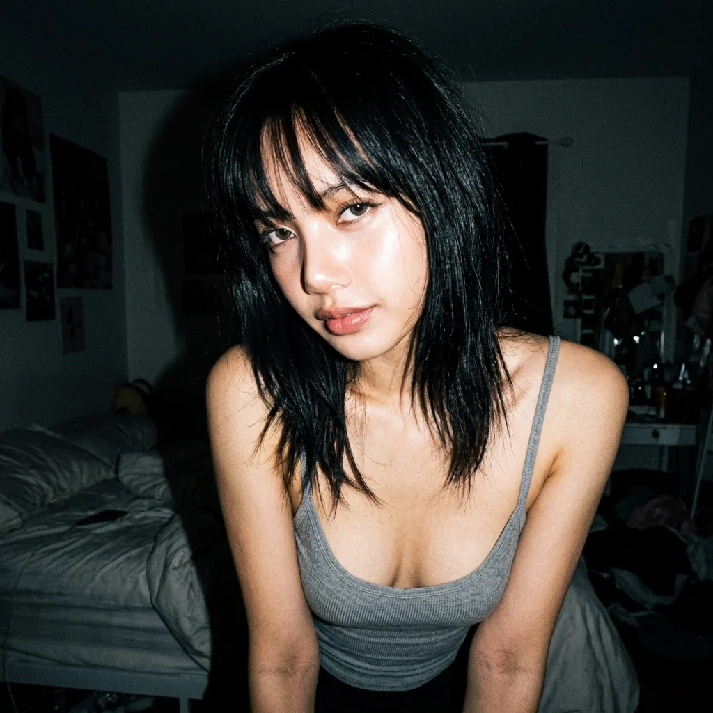</a> <a href="../prompts/photography/vn-01917.md"><b>IPhone 17 Pro , lens</b></a> Vinano Image Pro · <a href="https://vinano.ai?utm_source=github&utm_medium=readme&utm_campaign=awesome-image-video-prompts-updating&utm_content=card">Try on vinano.ai</a></td><td width="33%" valign="top"> <a href="../prompts/photography/vn-01918.md"><b>AI generated image by Preserve realistic proportions and depth</b></a> Vinano Image Pro · <a href="https://vinano.ai?utm_source=github&utm_medium=readme&utm_campaign=awesome-image-video-prompts-updating&utm_content=card">Try on vinano.ai</a></td><td width="33%" valign="top"><a href="../prompts/photography/vn-01922.md">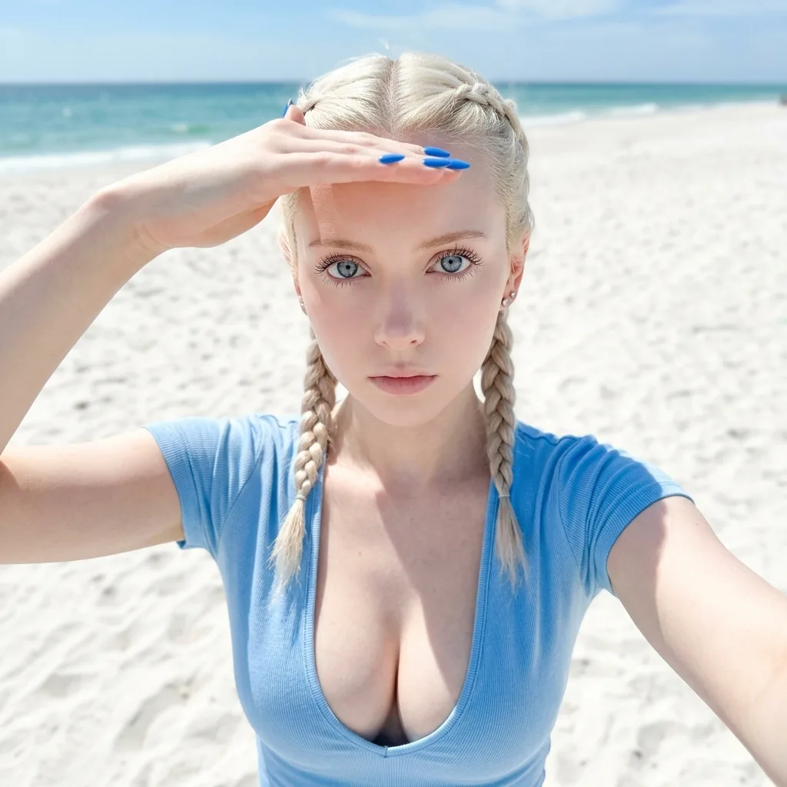</a> <a href="../prompts/photography/vn-01922.md"><b>Photography prompt #1922</b></a> Vinano Image Pro · <a href="https://vinano.ai?utm_source=github&utm_medium=readme&utm_campaign=awesome-image-video-prompts-updating&utm_content=card">Try on vinano.ai</a></td></tr>
<tr><td width="33%" valign="top"><a href="../prompts/photography/vn-01926.md">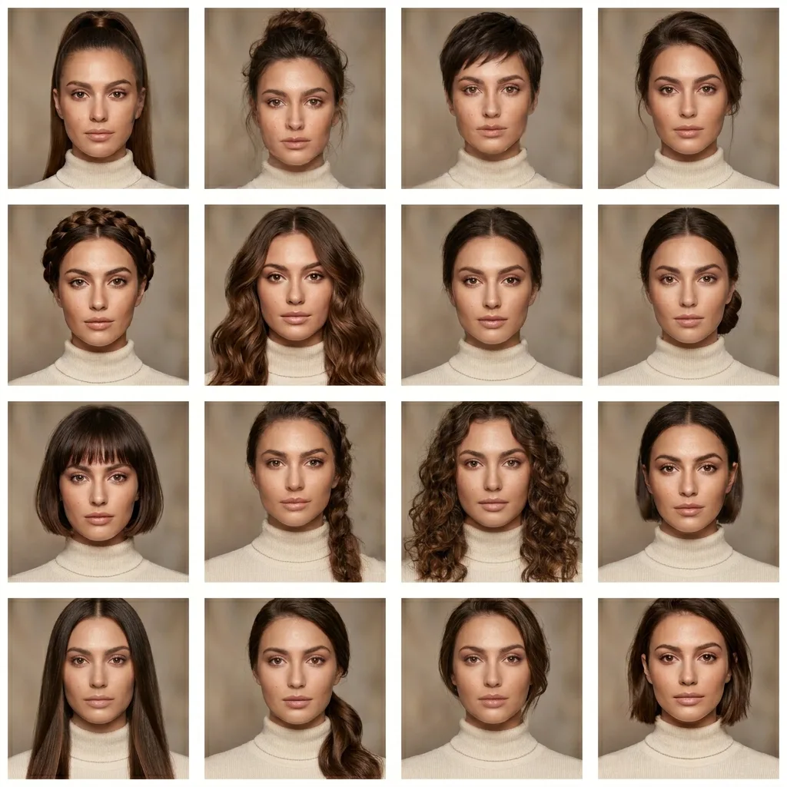</a> <a href="../prompts/photography/vn-01926.md"><b>Realistic, Portrait</b></a> Vinano Image Pro · <a href="https://vinano.ai?utm_source=github&utm_medium=readme&utm_campaign=awesome-image-video-prompts-updating&utm_content=card">Try on vinano.ai</a></td><td width="33%" valign="top"> <a href="../prompts/photography/vn-01929.md"><b>Realistic, Portrait</b></a> Vinano Image Pro · <a href="https://vinano.ai?utm_source=github&utm_medium=readme&utm_campaign=awesome-image-video-prompts-updating&utm_content=card">Try on vinano.ai</a></td><td width="33%" valign="top"><a href="../prompts/photography/vn-01930.md">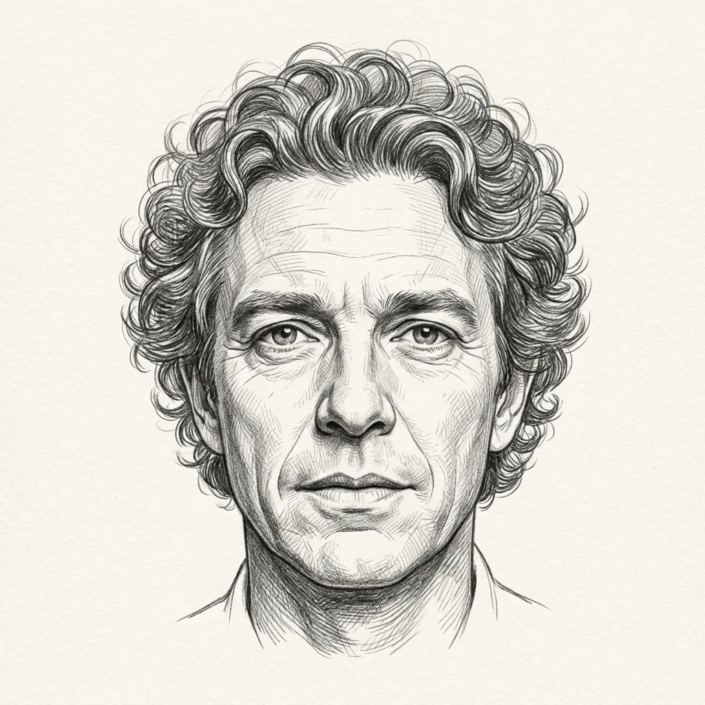</a> <a href="../prompts/photography/vn-01930.md"><b>Realistic, Portrait</b></a> Vinano Image Pro · <a href="https://vinano.ai?utm_source=github&utm_medium=readme&utm_campaign=awesome-image-video-prompts-updating&utm_content=card">Try on vinano.ai</a></td></tr>
<tr><td width="33%" valign="top"><a href="../prompts/photography/vn-01932.md">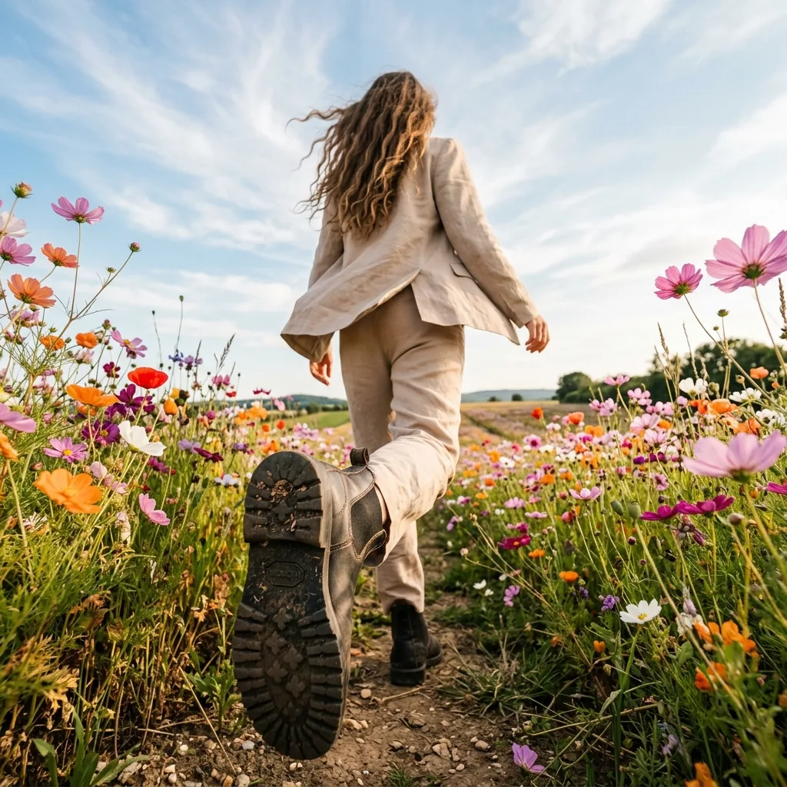</a> <a href="../prompts/photography/vn-01932.md"><b>Realistic, Cinematic</b></a> Vinano Image Pro · <a href="https://vinano.ai?utm_source=github&utm_medium=readme&utm_campaign=awesome-image-video-prompts-updating&utm_content=card">Try on vinano.ai</a></td><td width="33%" valign="top"> <a href="../prompts/photography/vn-01937.md"><b>AI generated image by Keep edges clean</b></a> Vinano Image Pro · <a href="https://vinano.ai?utm_source=github&utm_medium=readme&utm_campaign=awesome-image-video-prompts-updating&utm_content=card">Try on vinano.ai</a></td><td width="33%" valign="top"> <a href="../prompts/photography/vn-01945.md"><b>AI generated image by Maintain consistent colour harmony</b></a> Vinano Image Pro · <a href="https://vinano.ai?utm_source=github&utm_medium=readme&utm_campaign=awesome-image-video-prompts-updating&utm_content=card">Try on vinano.ai</a></td></tr>
<tr><td width="33%" valign="top"><a href="../prompts/photography/vn-01948.md">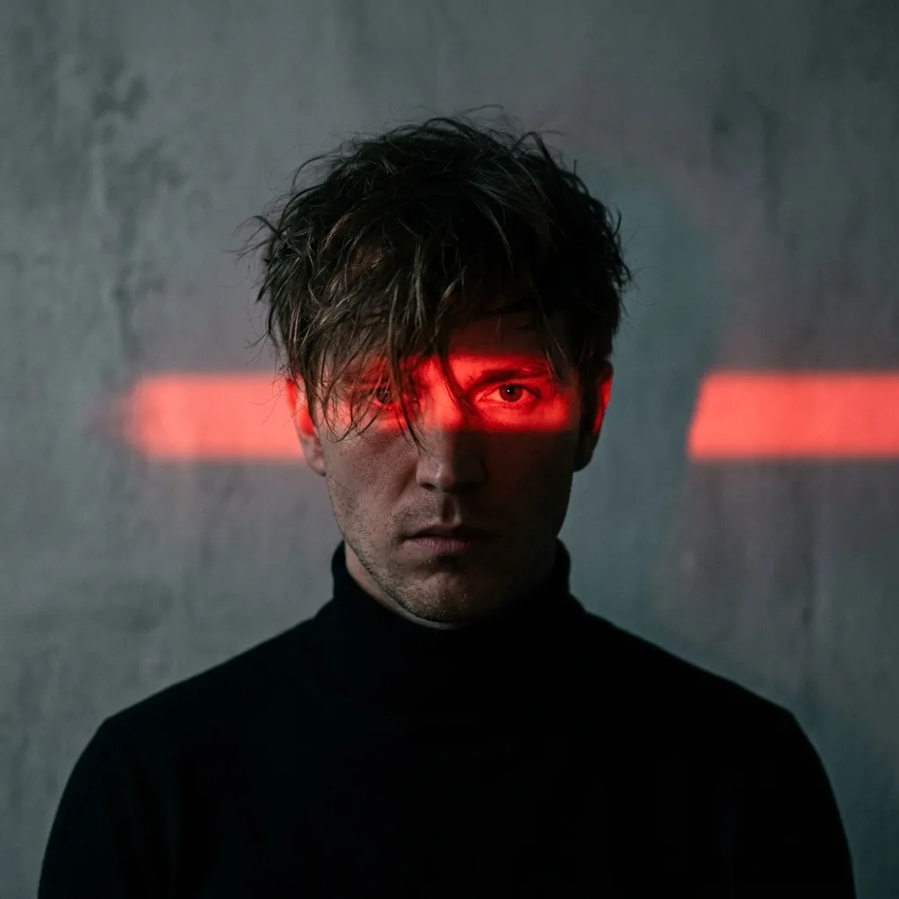</a> <a href="../prompts/photography/vn-01948.md"><b>Realistic, Portrait</b></a> Vinano Image v2 · <a href="https://vinano.ai?utm_source=github&utm_medium=readme&utm_campaign=awesome-image-video-prompts-updating&utm_content=card">Try on vinano.ai</a></td><td width="33%" valign="top"><a href="../prompts/photography/vn-01954.md">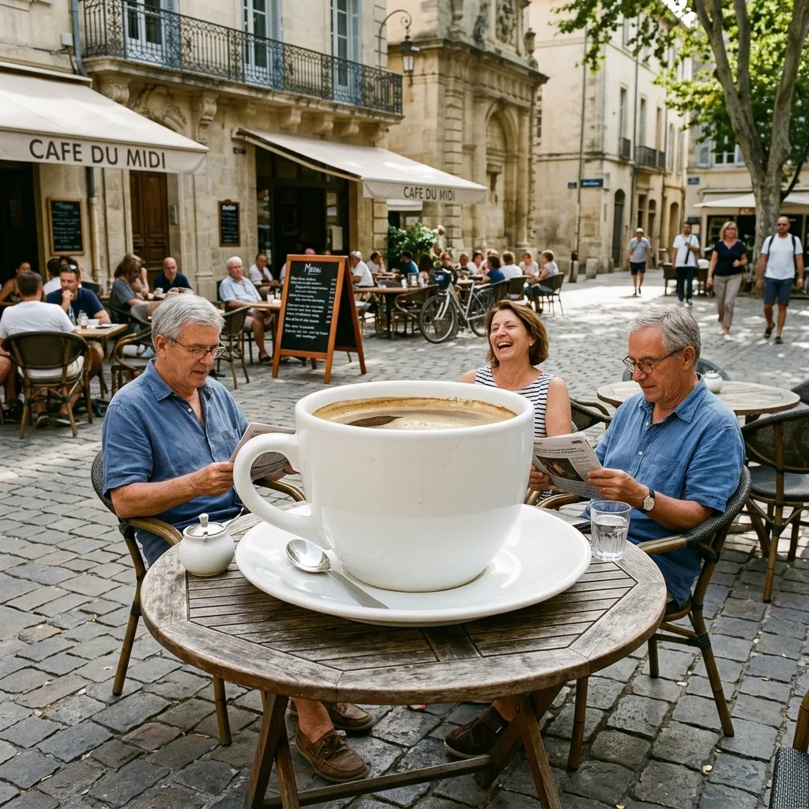</a> <a href="../prompts/photography/vn-01954.md"><b>Realistic, Ai Art</b></a> Vinano Image Pro · <a href="https://vinano.ai?utm_source=github&utm_medium=readme&utm_campaign=awesome-image-video-prompts-updating&utm_content=card">Try on vinano.ai</a></td><td width="33%" valign="top"> <a href="../prompts/photography/vn-01955.md"><b>Realistic, Ai Art</b></a> Vinano Image Pro · <a href="https://vinano.ai?utm_source=github&utm_medium=readme&utm_campaign=awesome-image-video-prompts-updating&utm_content=card">Try on vinano.ai</a></td></tr>
<tr><td width="33%" valign="top"> <a href="../prompts/photography/vn-01957.md"><b>Girl long hair in beige knit vest</b></a> Vinano Image Pro · <a href="https://vinano.ai?utm_source=github&utm_medium=readme&utm_campaign=awesome-image-video-prompts-updating&utm_content=card">Try on vinano.ai</a></td><td width="33%" valign="top"><a href="../prompts/photography/vn-01958.md">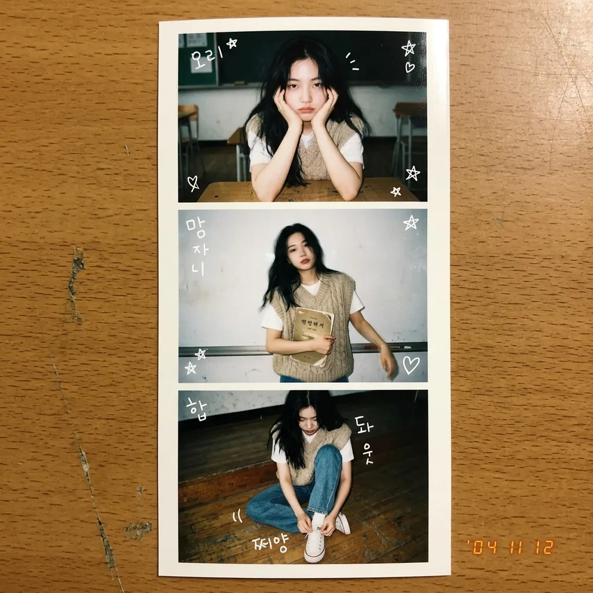</a> <a href="../prompts/photography/vn-01958.md"><b>Girl long hair in beige knit vest</b></a> Vinano Image Pro · <a href="https://vinano.ai?utm_source=github&utm_medium=readme&utm_campaign=awesome-image-video-prompts-updating&utm_content=card">Try on vinano.ai</a></td><td width="33%" valign="top"><a href="../prompts/photography/vn-01959.md">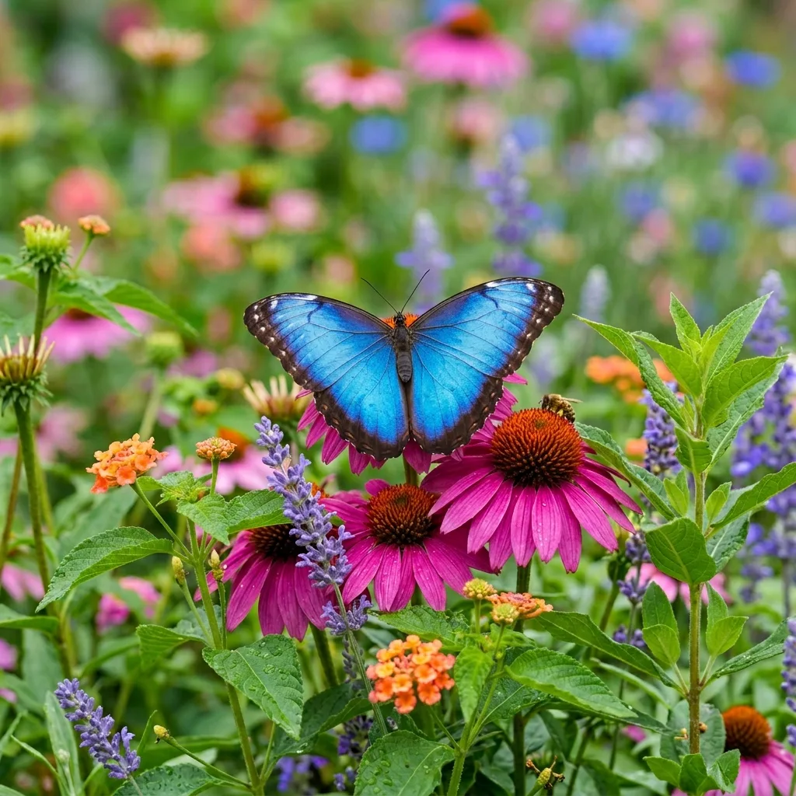</a> <a href="../prompts/photography/vn-01959.md"><b>AI generated image by Maintain consistent colour harmony</b></a> Vinano Image Pro · <a href="https://vinano.ai?utm_source=github&utm_medium=readme&utm_campaign=awesome-image-video-prompts-updating&utm_content=card">Try on vinano.ai</a></td></tr>
<tr><td width="33%" valign="top"> <a href="../prompts/photography/vn-01964.md"><b>Realistic, Portrait</b></a> Vinano Image v2 · <a href="https://vinano.ai?utm_source=github&utm_medium=readme&utm_campaign=awesome-image-video-prompts-updating&utm_content=card">Try on vinano.ai</a></td><td width="33%" valign="top"><a href="../prompts/photography/vn-01965.md">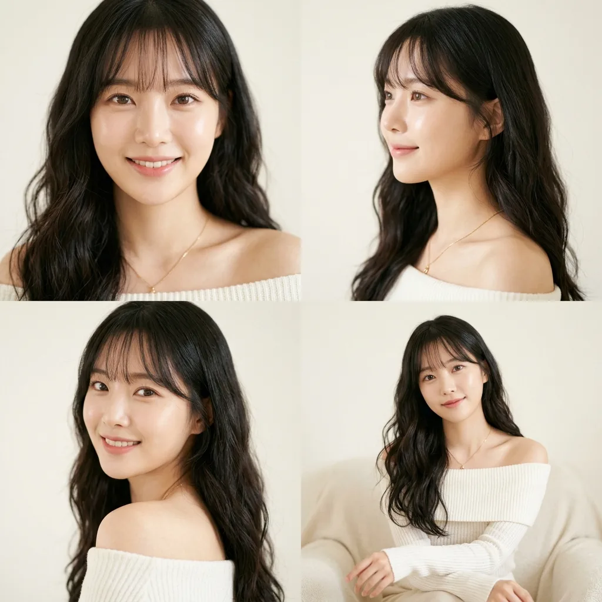</a> <a href="../prompts/photography/vn-01965.md"><b>Realistic, Portrait</b></a> Vinano Image v2 · <a href="https://vinano.ai?utm_source=github&utm_medium=readme&utm_campaign=awesome-image-video-prompts-updating&utm_content=card">Try on vinano.ai</a></td><td width="33%" valign="top"><a href="../prompts/photography/vn-01979.md">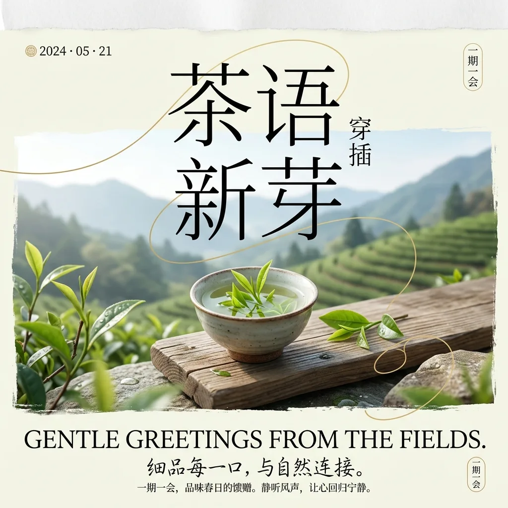</a> <a href="../prompts/photography/vn-01979.md"><b>围绕 主题 生成一张清透明亮的图文视</b></a> Vinano Image v2 · <a href="https://vinano.ai?utm_source=github&utm_medium=readme&utm_campaign=awesome-image-video-prompts-updating&utm_content=card">Try on vinano.ai</a></td></tr>
<tr><td width="33%" valign="top"> <a href="../prompts/photography/vn-01980.md"><b>围绕 主题 生成一张清透明亮的图文视</b></a> Vinano Image v2 · <a href="https://vinano.ai?utm_source=github&utm_medium=readme&utm_campaign=awesome-image-video-prompts-updating&utm_content=card">Try on vinano.ai</a></td><td width="33%" valign="top"> <a href="../prompts/photography/vn-01993.md"><b>Realistic, Portrait</b></a> Vinano Image v2 · <a href="https://vinano.ai?utm_source=github&utm_medium=readme&utm_campaign=awesome-image-video-prompts-updating&utm_content=card">Try on vinano.ai</a></td><td width="33%" valign="top"><a href="../prompts/photography/vn-01994.md">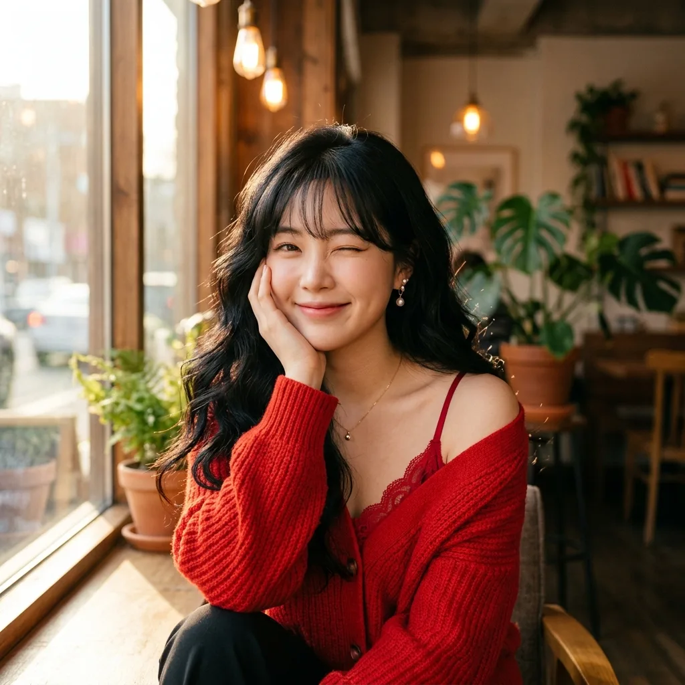</a> <a href="../prompts/photography/vn-01994.md"><b>Realistic, Portrait</b></a> Vinano Image v2 · <a href="https://vinano.ai?utm_source=github&utm_medium=readme&utm_campaign=awesome-image-video-prompts-updating&utm_content=card">Try on vinano.ai</a></td></tr>
<tr><td width="33%" valign="top"> <a href="../prompts/photography/vn-02007.md"><b>Realistic, Cinematic</b></a> Vinano Image v2 · <a href="https://vinano.ai?utm_source=github&utm_medium=readme&utm_campaign=awesome-image-video-prompts-updating&utm_content=card">Try on vinano.ai</a></td><td width="33%" valign="top"> <a href="../prompts/photography/vn-02008.md"><b>Realistic, Cinematic</b></a> Vinano Image v2 · <a href="https://vinano.ai?utm_source=github&utm_medium=readme&utm_campaign=awesome-image-video-prompts-updating&utm_content=card">Try on vinano.ai</a></td><td width="33%" valign="top"><a href="../prompts/photography/vn-02017.md">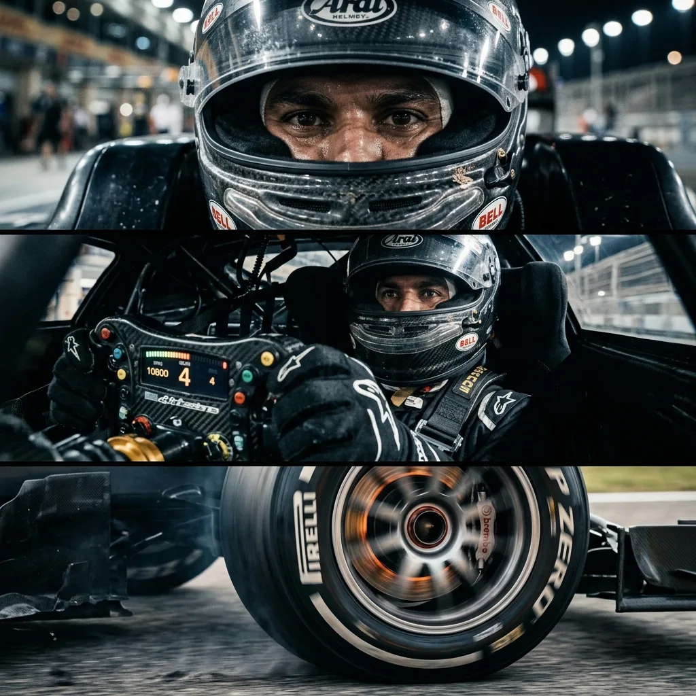</a> <a href="../prompts/photography/vn-02017.md"><b>Cinematic, Ai Art</b></a> Vinano Image Pro · <a href="https://vinano.ai?utm_source=github&utm_medium=readme&utm_campaign=awesome-image-video-prompts-updating&utm_content=card">Try on vinano.ai</a></td></tr>
<tr><td width="33%" valign="top"><a href="../prompts/photography/vn-02018.md">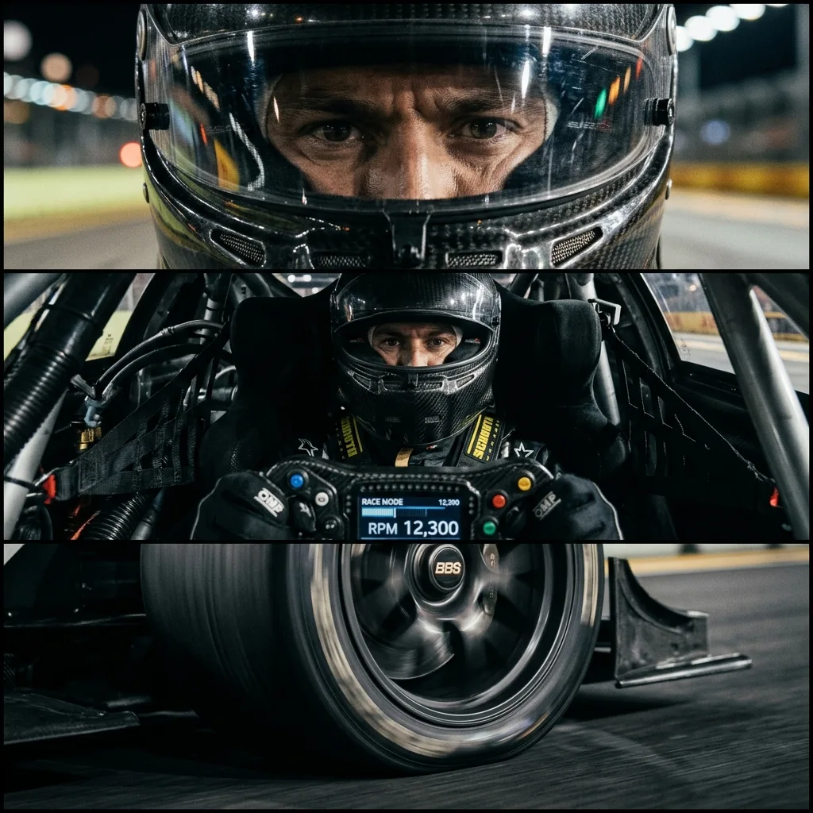</a> <a href="../prompts/photography/vn-02018.md"><b>Cinematic, Ai Art</b></a> Vinano Image Pro · <a href="https://vinano.ai?utm_source=github&utm_medium=readme&utm_campaign=awesome-image-video-prompts-updating&utm_content=card">Try on vinano.ai</a></td><td width="33%"></td><td width="33%"></td></tr>
</table>

**[▶ Generate your own on vinano.ai](https://vinano.ai?utm_source=github&utm_medium=readme&utm_campaign=awesome-image-video-prompts-updating&utm_content=gallery-bottom)**
