# Poster Design prompts — 252 with previews

[← Back to README](../README.md) · Page 3 / 3: [1](./poster-design.md) · [2](./poster-design-2.md) · **3**

Every preview below was generated with **[vinano.ai](https://vinano.ai?utm_source=github&utm_medium=readme&utm_campaign=awesome-image-video-prompts-updating&utm_content=gallery-top)**. Click a card to open its full prompt.

<table>
<tr><td width="33%" valign="top"><a href="../prompts/poster-design/vn-02109.md">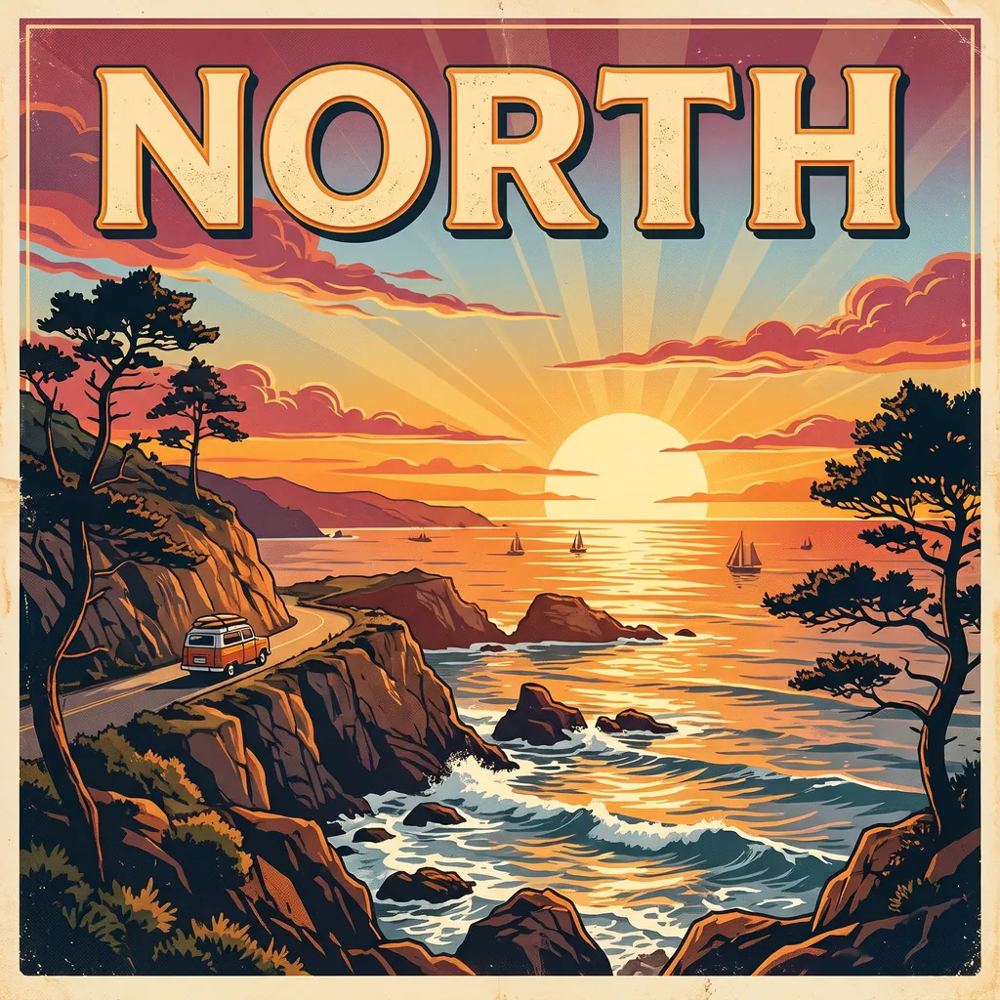</a> <a href="../prompts/poster-design/vn-02109.md"><b>Vintage travel poster: NORTH</b></a> Nano Banana 2 · <a href="https://vinano.ai?utm_source=github&utm_medium=readme&utm_campaign=awesome-image-video-prompts-updating&utm_content=card">Try on vinano.ai</a></td><td width="33%" valign="top"><a href="../prompts/poster-design/vn-02110.md">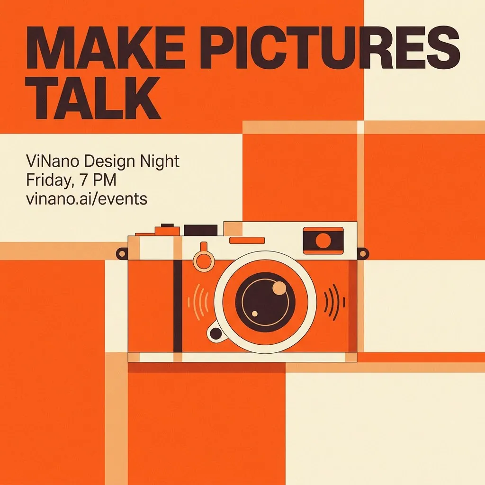</a> <a href="../prompts/poster-design/vn-02110.md"><b>Minimalist event poster for a design meetup</b></a> Nano Banana 2 · <a href="https://vinano.ai?utm_source=github&utm_medium=readme&utm_campaign=awesome-image-video-prompts-updating&utm_content=card">Try on vinano.ai</a></td><td width="33%" valign="top"><a href="../prompts/poster-design/vn-02111.md">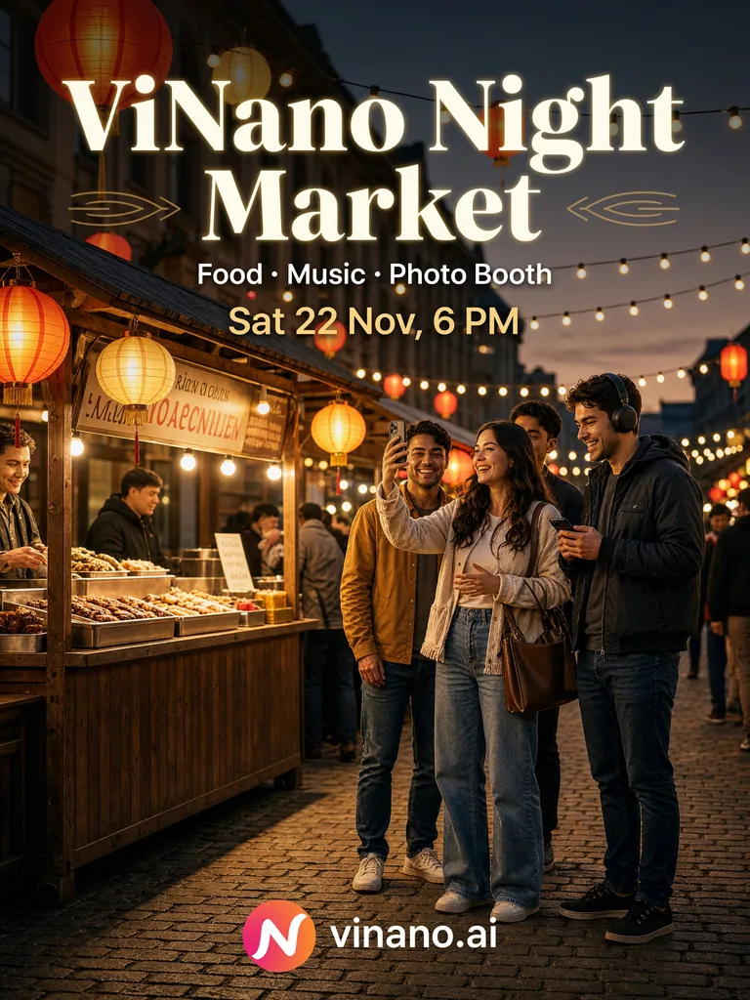</a> <a href="../prompts/poster-design/vn-02111.md"><b>Vertical event poster for a night market</b></a> MiniMax H3 Image · <a href="https://vinano.ai?utm_source=github&utm_medium=readme&utm_campaign=awesome-image-video-prompts-updating&utm_content=card">Try on vinano.ai</a></td></tr>
<tr><td width="33%" valign="top"><a href="../prompts/poster-design/vn-02112.md">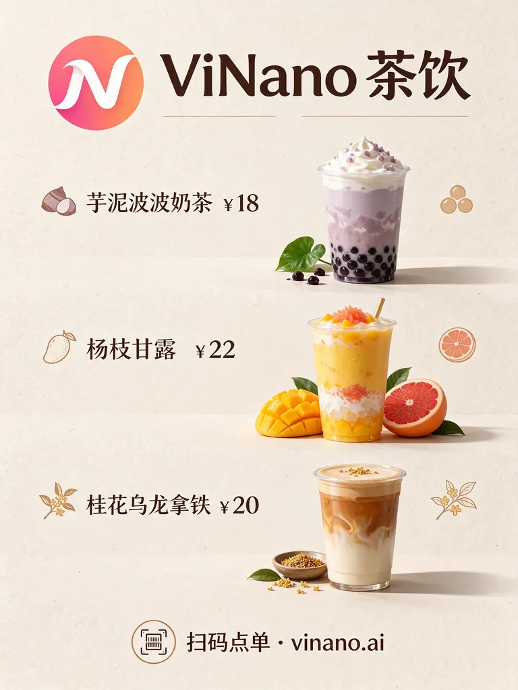</a> <a href="../prompts/poster-design/vn-02112.md"><b>一张奶茶店的竖版菜单海报</b></a> Seedream 5.5 · <a href="https://vinano.ai?utm_source=github&utm_medium=readme&utm_campaign=awesome-image-video-prompts-updating&utm_content=card">Try on vinano.ai</a></td><td width="33%" valign="top"><a href="../prompts/poster-design/vn-02113.md">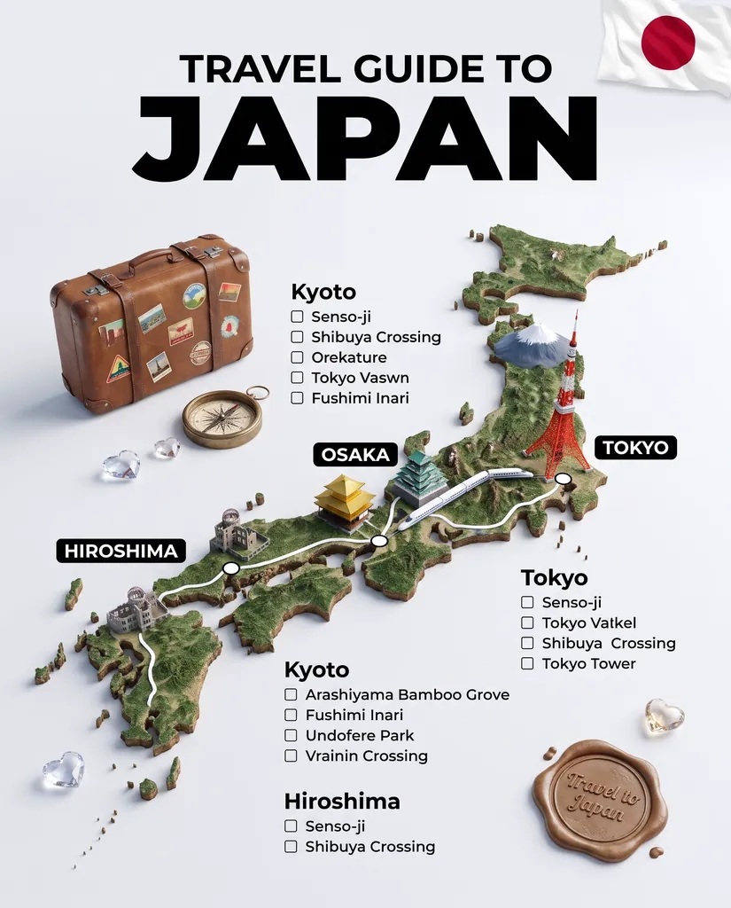</a> <a href="../prompts/poster-design/vn-02113.md"><b>3D travel guide poster for Japan</b></a> Nano Banana Pro · <a href="https://vinano.ai?utm_source=github&utm_medium=readme&utm_campaign=awesome-image-video-prompts-updating&utm_content=card">Try on vinano.ai</a></td><td width="33%" valign="top"> <a href="../prompts/poster-design/vn-02114.md"><b>3D metallic typography: GREECE</b></a> Nano Banana Pro · <a href="https://vinano.ai?utm_source=github&utm_medium=readme&utm_campaign=awesome-image-video-prompts-updating&utm_content=card">Try on vinano.ai</a></td></tr>
<tr><td width="33%" valign="top"><a href="../prompts/poster-design/vn-02115.md">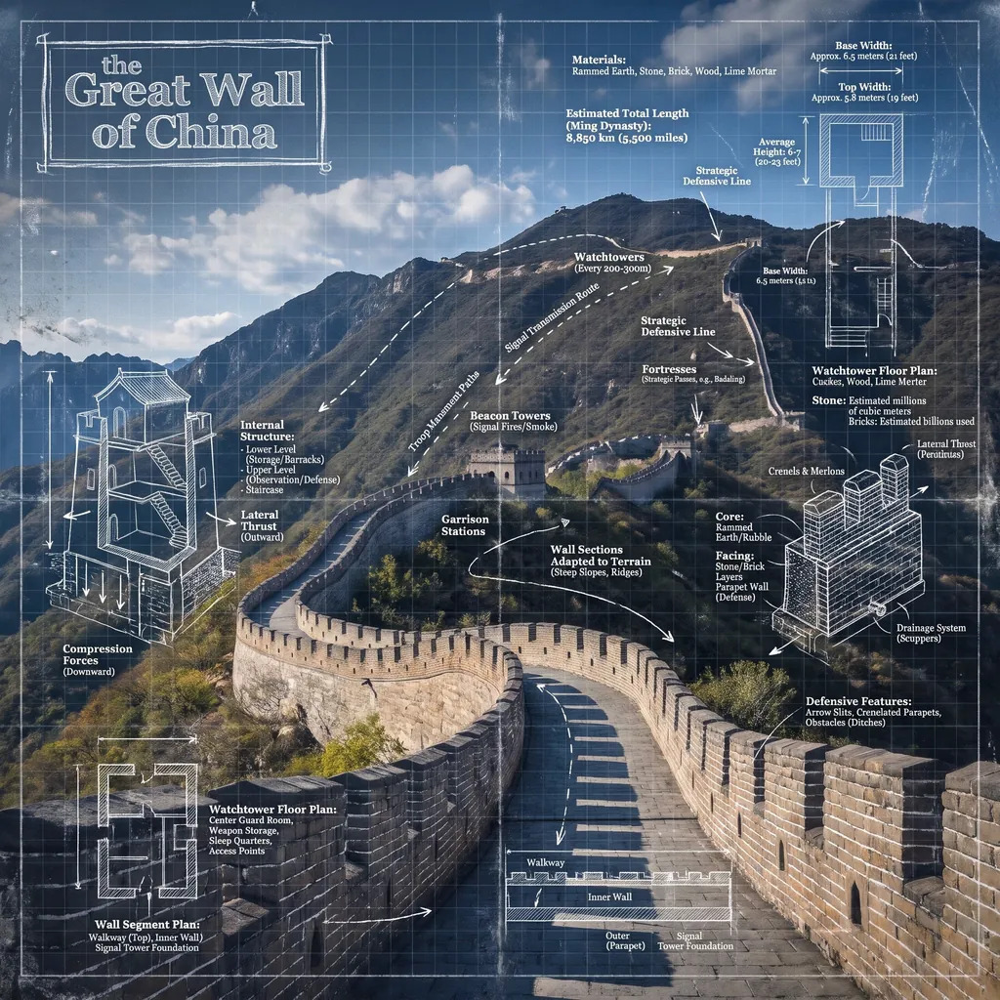</a> <a href="../prompts/poster-design/vn-02115.md"><b>Great Wall of China blueprint infographic</b></a> Nano Banana Pro · <a href="https://vinano.ai?utm_source=github&utm_medium=readme&utm_campaign=awesome-image-video-prompts-updating&utm_content=card">Try on vinano.ai</a></td><td width="33%" valign="top"><a href="../prompts/poster-design/vn-02140.md">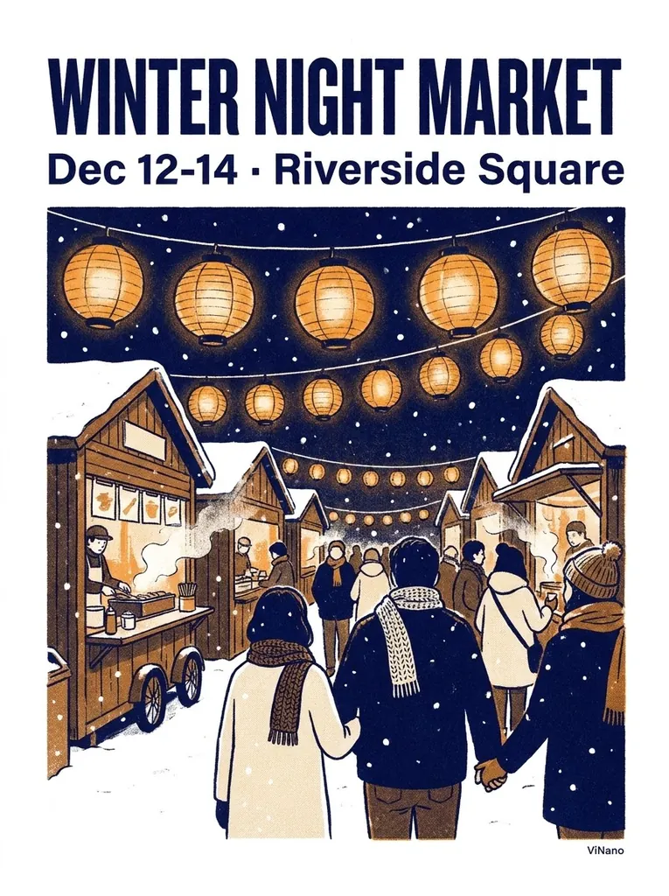</a> <a href="../prompts/poster-design/vn-02140.md"><b>Winter Night Market Poster</b></a> Nano Banana Pro · <a href="https://vinano.ai?utm_source=github&utm_medium=readme&utm_campaign=awesome-image-video-prompts-updating&utm_content=card">Try on vinano.ai</a></td><td width="33%" valign="top"><a href="../prompts/poster-design/vn-02147.md">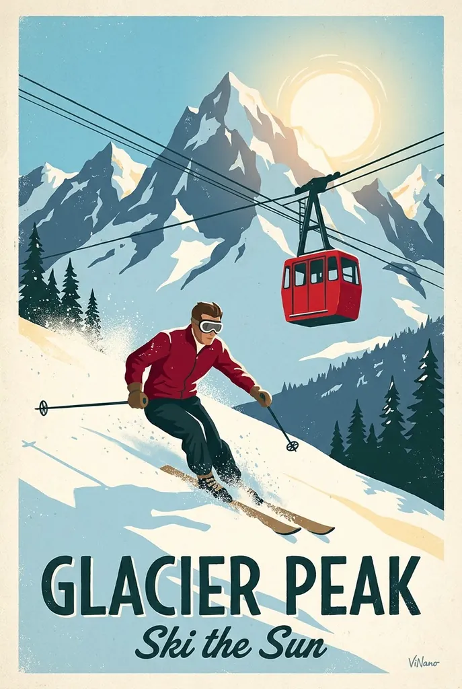</a> <a href="../prompts/poster-design/vn-02147.md"><b>Retro Ski Resort Travel Poster</b></a> Nano Banana 2.1 · <a href="https://vinano.ai?utm_source=github&utm_medium=readme&utm_campaign=awesome-image-video-prompts-updating&utm_content=card">Try on vinano.ai</a></td></tr>
<tr><td width="33%" valign="top"><a href="../prompts/poster-design/vn-02151.md">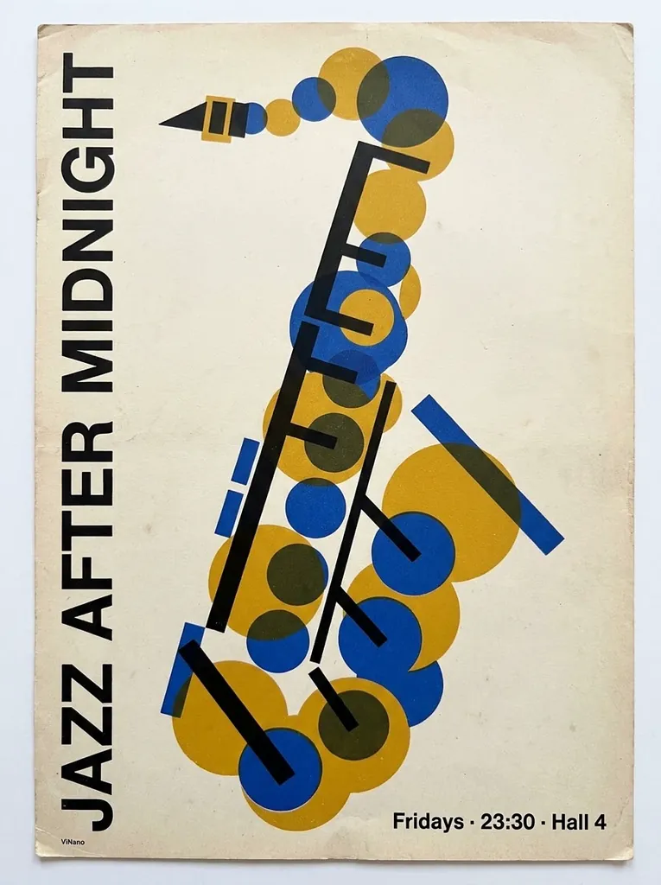</a> <a href="../prompts/poster-design/vn-02151.md"><b>Swiss-Style Jazz Night Poster</b></a> Nano Banana Pro · <a href="https://vinano.ai?utm_source=github&utm_medium=readme&utm_campaign=awesome-image-video-prompts-updating&utm_content=card">Try on vinano.ai</a></td><td width="33%" valign="top"><a href="../prompts/poster-design/vn-02163.md">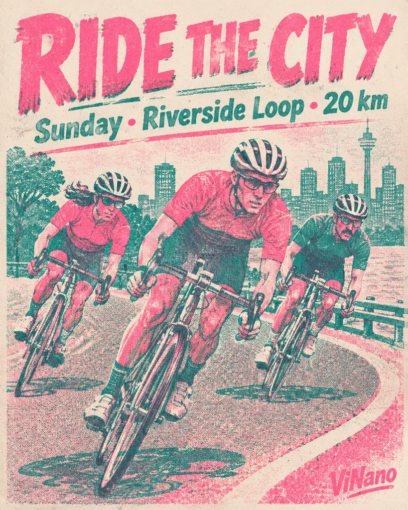</a> <a href="../prompts/poster-design/vn-02163.md"><b>Risograph Bike Festival Poster</b></a> GPT Image 2.6 Flare · <a href="https://vinano.ai?utm_source=github&utm_medium=readme&utm_campaign=awesome-image-video-prompts-updating&utm_content=card">Try on vinano.ai</a></td><td width="33%" valign="top"><a href="../prompts/poster-design/vn-02173.md">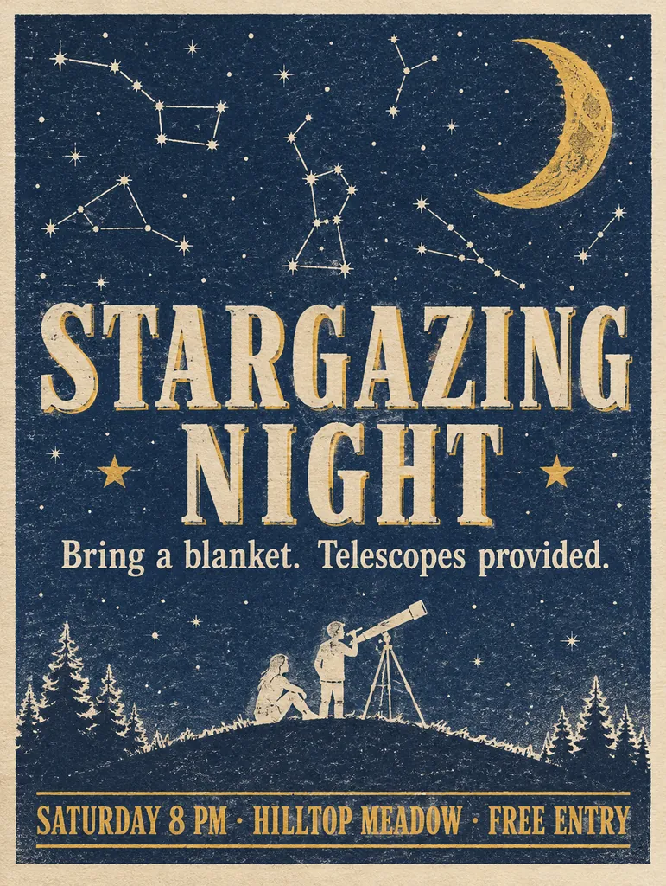</a> <a href="../prompts/poster-design/vn-02173.md"><b>Letterpress Stargazing Night Poster</b></a> GPT Image 2.6 Flare · <a href="https://vinano.ai?utm_source=github&utm_medium=readme&utm_campaign=awesome-image-video-prompts-updating&utm_content=card">Try on vinano.ai</a></td></tr>
</table>

**[▶ Generate your own on vinano.ai](https://vinano.ai?utm_source=github&utm_medium=readme&utm_campaign=awesome-image-video-prompts-updating&utm_content=gallery-bottom)**
