# UI & Graphic prompts — 181 with previews

[← Back to README](../README.md) · Page 2 / 2: [1](./ui-graphic.md) · **2**

Every preview below was generated with **[vinano.ai](https://vinano.ai?utm_source=github&utm_medium=readme&utm_campaign=awesome-image-video-prompts-updating&utm_content=gallery-top)**. Click a card to open its full prompt.

<table>
<tr><td width="33%" valign="top"><a href="../prompts/ui-graphic/vn-01757.md">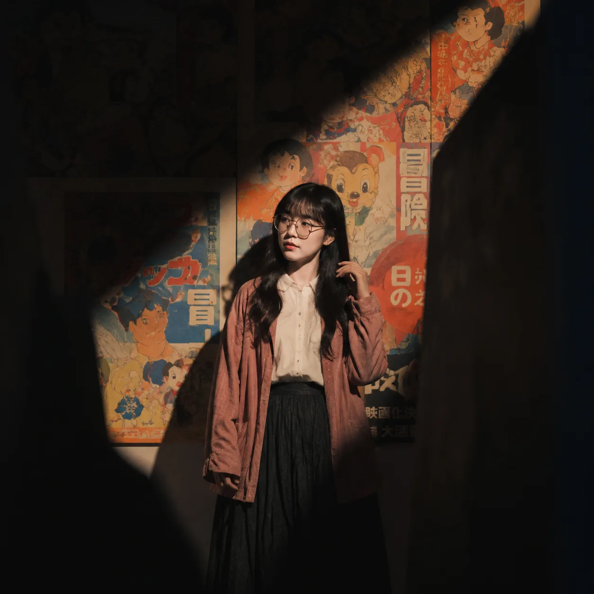</a> <a href="../prompts/ui-graphic/vn-01757.md"><b>Anime, Realistic</b></a> Vinano Studio · <a href="https://vinano.ai?utm_source=github&utm_medium=readme&utm_campaign=awesome-image-video-prompts-updating&utm_content=card">Try on vinano.ai</a></td><td width="33%" valign="top"><a href="../prompts/ui-graphic/vn-01761.md">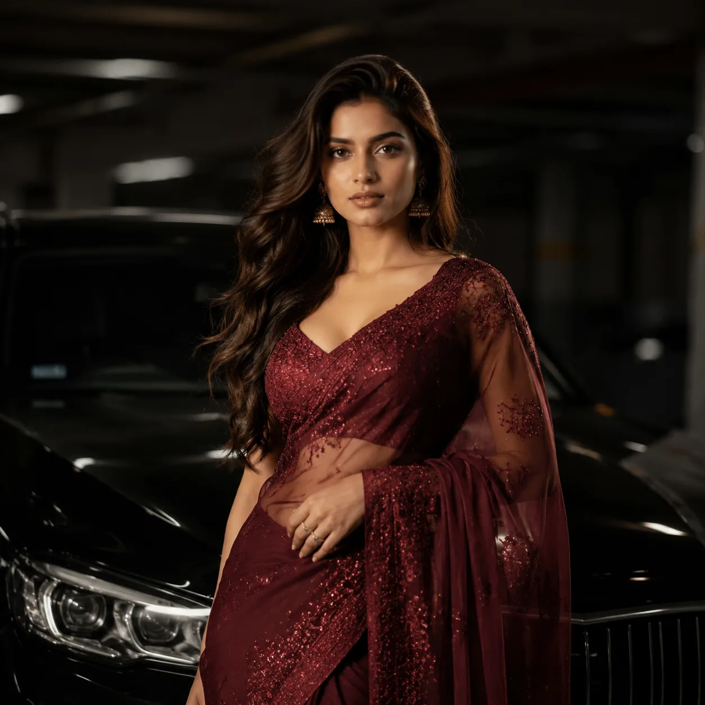</a> <a href="../prompts/ui-graphic/vn-01761.md"><b>Realistic, Portrait</b></a> Vinano Studio · <a href="https://vinano.ai?utm_source=github&utm_medium=readme&utm_campaign=awesome-image-video-prompts-updating&utm_content=card">Try on vinano.ai</a></td><td width="33%" valign="top"> <a href="../prompts/ui-graphic/vn-01764.md"><b>Realistic, Character</b></a> Vinano Image Pro · <a href="https://vinano.ai?utm_source=github&utm_medium=readme&utm_campaign=awesome-image-video-prompts-updating&utm_content=card">Try on vinano.ai</a></td></tr>
<tr><td width="33%" valign="top"> <a href="../prompts/ui-graphic/vn-01768.md"><b>Realistic, Cinematic</b></a> Vinano Studio · <a href="https://vinano.ai?utm_source=github&utm_medium=readme&utm_campaign=awesome-image-video-prompts-updating&utm_content=card">Try on vinano.ai</a></td><td width="33%" valign="top"><a href="../prompts/ui-graphic/vn-01775.md">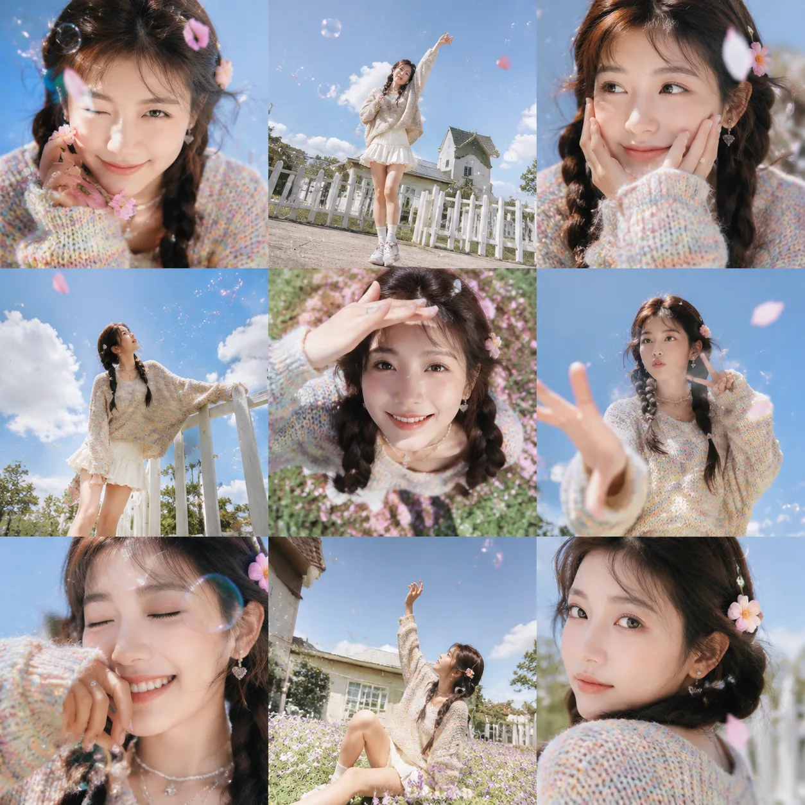</a> <a href="../prompts/ui-graphic/vn-01775.md"><b>Realistic, Portrait</b></a> Vinano Studio · <a href="https://vinano.ai?utm_source=github&utm_medium=readme&utm_campaign=awesome-image-video-prompts-updating&utm_content=card">Try on vinano.ai</a></td><td width="33%" valign="top"><a href="../prompts/ui-graphic/vn-01777.md">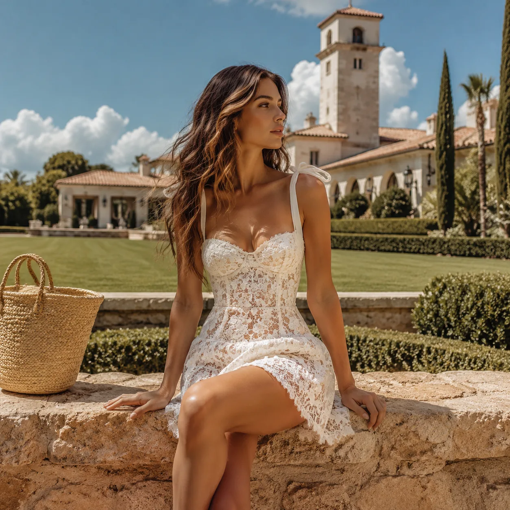</a> <a href="../prompts/ui-graphic/vn-01777.md"><b>Realistic, Portrait</b></a> Vinano Studio · <a href="https://vinano.ai?utm_source=github&utm_medium=readme&utm_campaign=awesome-image-video-prompts-updating&utm_content=card">Try on vinano.ai</a></td></tr>
<tr><td width="33%" valign="top"><a href="../prompts/ui-graphic/vn-01778.md">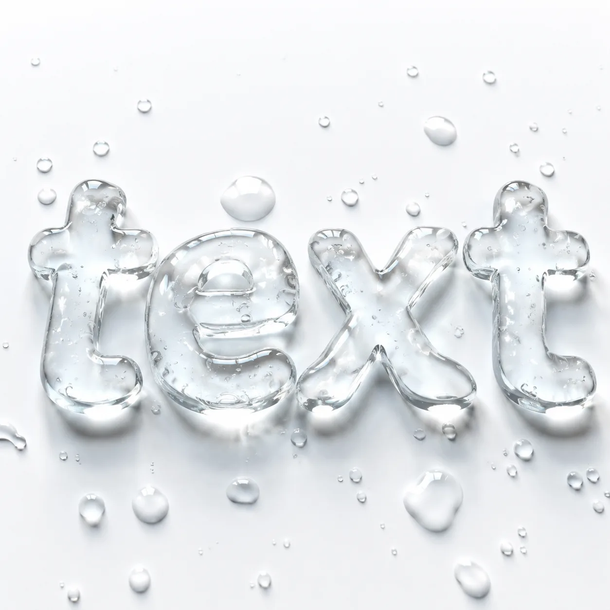</a> <a href="../prompts/ui-graphic/vn-01778.md"><b>Realistic, Ai Art</b></a> Vinano Studio · <a href="https://vinano.ai?utm_source=github&utm_medium=readme&utm_campaign=awesome-image-video-prompts-updating&utm_content=card">Try on vinano.ai</a></td><td width="33%" valign="top"><a href="../prompts/ui-graphic/vn-01785.md">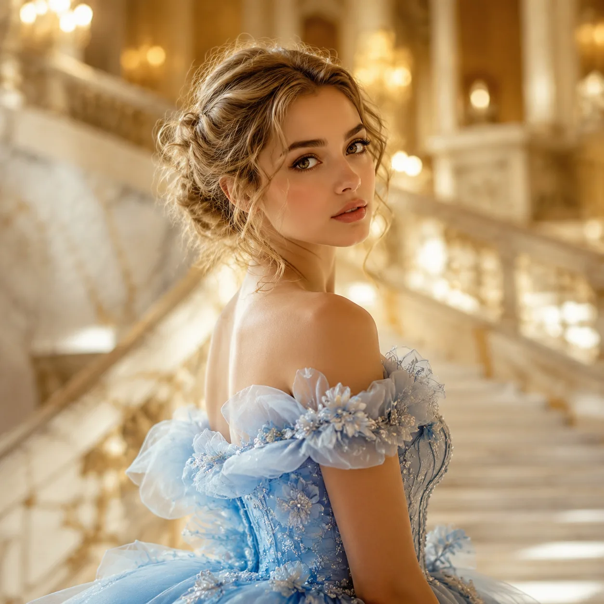</a> <a href="../prompts/ui-graphic/vn-01785.md"><b>Realistic, Portrait</b></a> Vinano Studio · <a href="https://vinano.ai?utm_source=github&utm_medium=readme&utm_campaign=awesome-image-video-prompts-updating&utm_content=card">Try on vinano.ai</a></td><td width="33%" valign="top"><a href="../prompts/ui-graphic/vn-01787.md">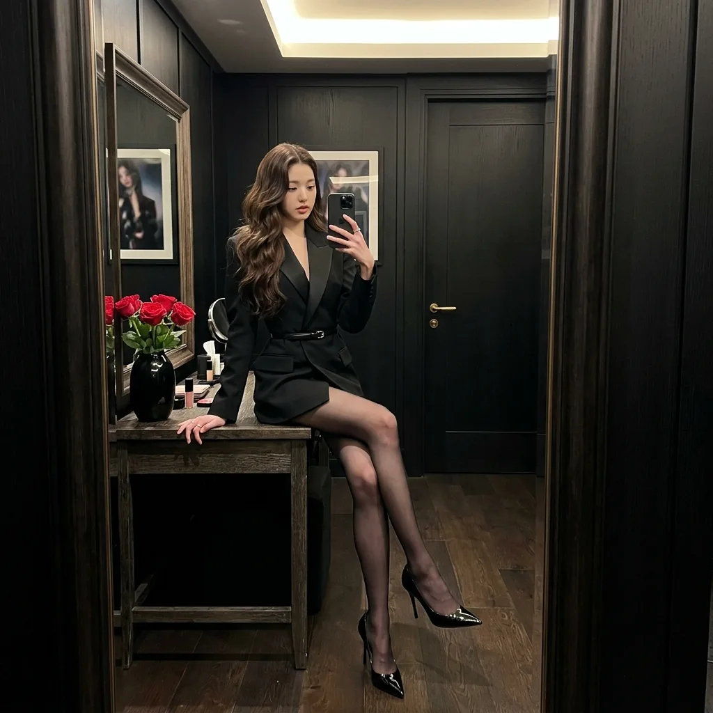</a> <a href="../prompts/ui-graphic/vn-01787.md"><b>Realistic, Minimalist</b></a> Vinano Image Pro · <a href="https://vinano.ai?utm_source=github&utm_medium=readme&utm_campaign=awesome-image-video-prompts-updating&utm_content=card">Try on vinano.ai</a></td></tr>
<tr><td width="33%" valign="top"><a href="../prompts/ui-graphic/vn-01789.md">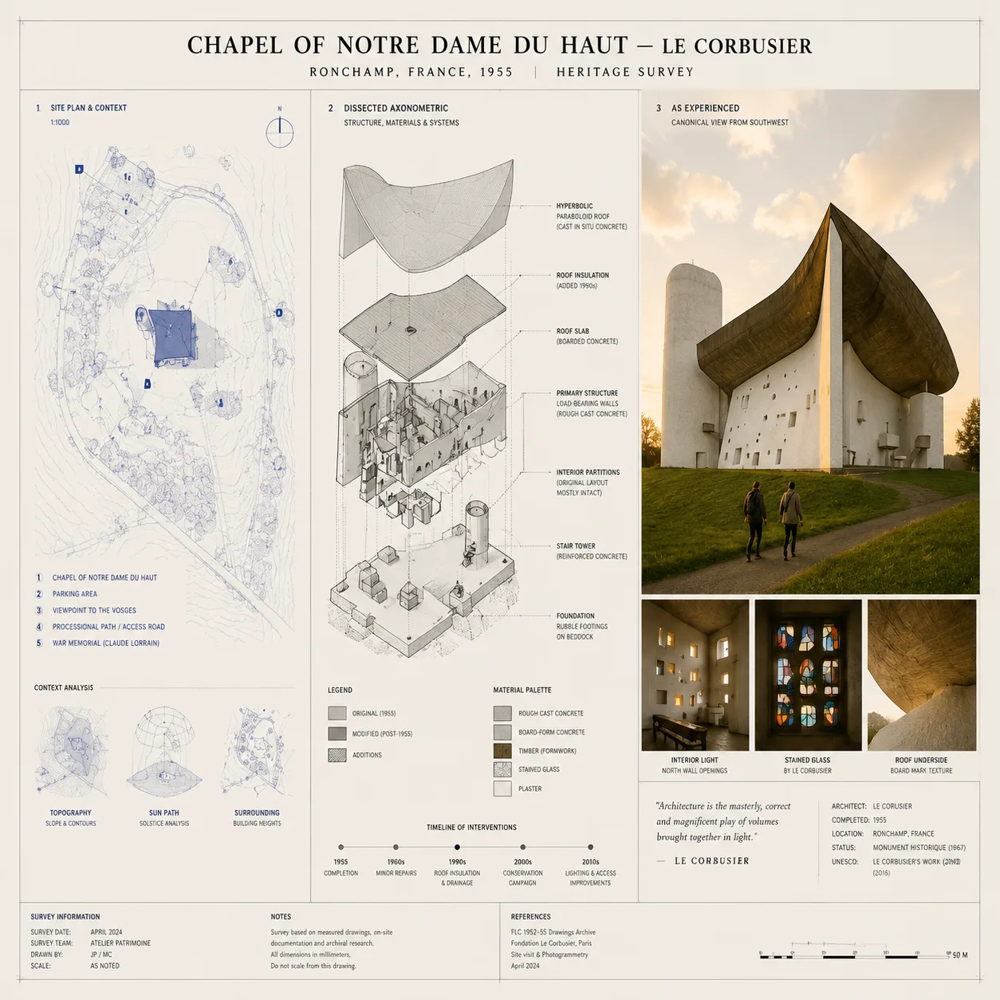</a> <a href="../prompts/ui-graphic/vn-01789.md"><b>Landscape, Ai Art</b></a> Vinano Studio · <a href="https://vinano.ai?utm_source=github&utm_medium=readme&utm_campaign=awesome-image-video-prompts-updating&utm_content=card">Try on vinano.ai</a></td><td width="33%" valign="top"> <a href="../prompts/ui-graphic/vn-01790.md"><b>Realistic, Cinematic</b></a> Vinano Studio · <a href="https://vinano.ai?utm_source=github&utm_medium=readme&utm_campaign=awesome-image-video-prompts-updating&utm_content=card">Try on vinano.ai</a></td><td width="33%" valign="top"> <a href="../prompts/ui-graphic/vn-01791.md"><b>Anime, Character</b></a> Vinano Studio · <a href="https://vinano.ai?utm_source=github&utm_medium=readme&utm_campaign=awesome-image-video-prompts-updating&utm_content=card">Try on vinano.ai</a></td></tr>
<tr><td width="33%" valign="top"><a href="../prompts/ui-graphic/vn-01794.md">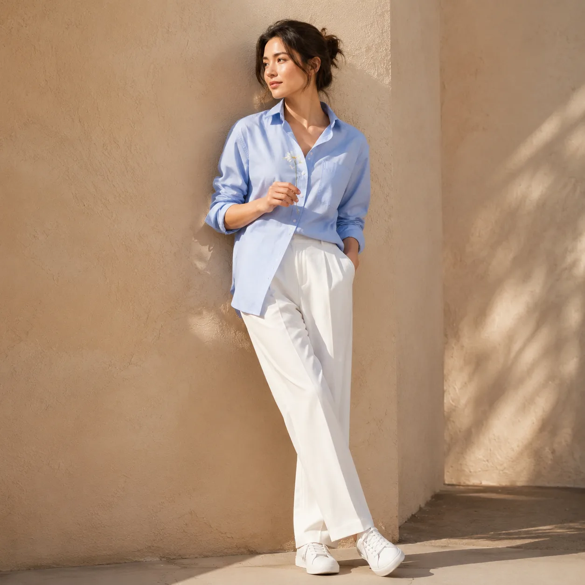</a> <a href="../prompts/ui-graphic/vn-01794.md"><b>Realistic, Cinematic</b></a> Vinano Studio · <a href="https://vinano.ai?utm_source=github&utm_medium=readme&utm_campaign=awesome-image-video-prompts-updating&utm_content=card">Try on vinano.ai</a></td><td width="33%" valign="top"><a href="../prompts/ui-graphic/vn-01795.md">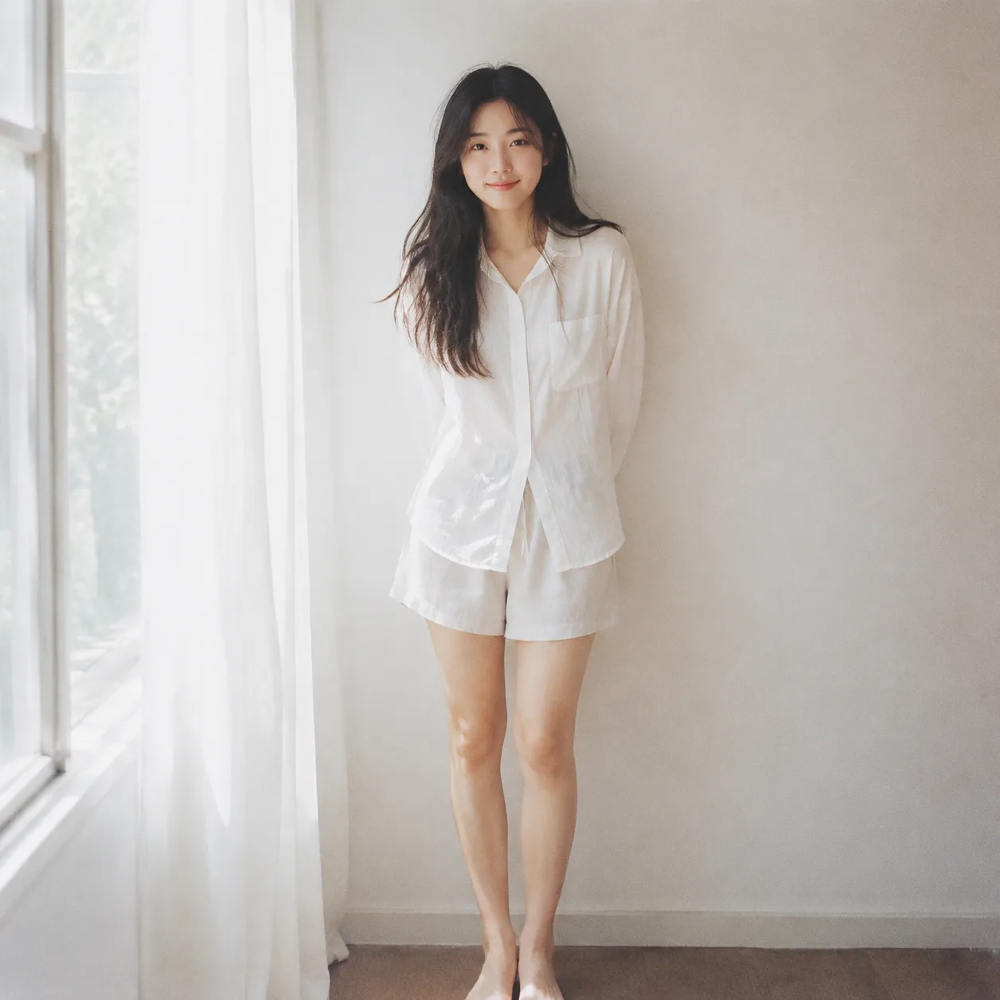</a> <a href="../prompts/ui-graphic/vn-01795.md"><b>Realistic, Ai Art</b></a> Vinano Studio · <a href="https://vinano.ai?utm_source=github&utm_medium=readme&utm_campaign=awesome-image-video-prompts-updating&utm_content=card">Try on vinano.ai</a></td><td width="33%" valign="top"> <a href="../prompts/ui-graphic/vn-01800.md"><b>Realistic, Cinematic</b></a> Vinano Studio · <a href="https://vinano.ai?utm_source=github&utm_medium=readme&utm_campaign=awesome-image-video-prompts-updating&utm_content=card">Try on vinano.ai</a></td></tr>
<tr><td width="33%" valign="top"> <a href="../prompts/ui-graphic/vn-01808.md"><b>Portrait, Cinematic</b></a> Vinano Studio · <a href="https://vinano.ai?utm_source=github&utm_medium=readme&utm_campaign=awesome-image-video-prompts-updating&utm_content=card">Try on vinano.ai</a></td><td width="33%" valign="top"> <a href="../prompts/ui-graphic/vn-01814.md"><b>Realistic, Portrait</b></a> Vinano Studio · <a href="https://vinano.ai?utm_source=github&utm_medium=readme&utm_campaign=awesome-image-video-prompts-updating&utm_content=card">Try on vinano.ai</a></td><td width="33%" valign="top"><a href="../prompts/ui-graphic/vn-01818.md">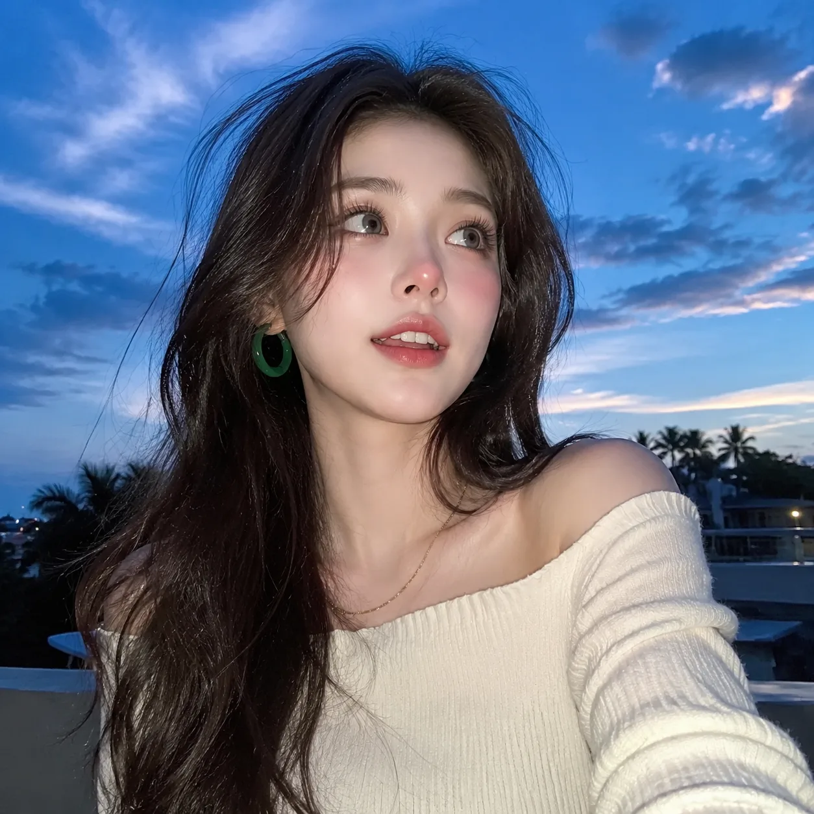</a> <a href="../prompts/ui-graphic/vn-01818.md"><b>Realistic, Portrait</b></a> Vinano Studio · <a href="https://vinano.ai?utm_source=github&utm_medium=readme&utm_campaign=awesome-image-video-prompts-updating&utm_content=card">Try on vinano.ai</a></td></tr>
<tr><td width="33%" valign="top"><a href="../prompts/ui-graphic/vn-01819.md">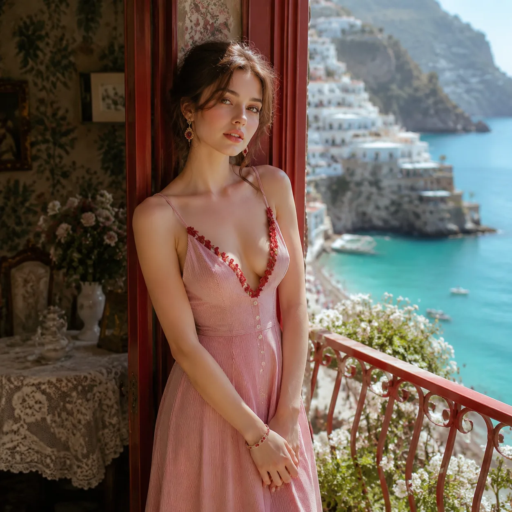</a> <a href="../prompts/ui-graphic/vn-01819.md"><b>Realistic, Portrait</b></a> Vinano Studio · <a href="https://vinano.ai?utm_source=github&utm_medium=readme&utm_campaign=awesome-image-video-prompts-updating&utm_content=card">Try on vinano.ai</a></td><td width="33%" valign="top"><a href="../prompts/ui-graphic/vn-01820.md">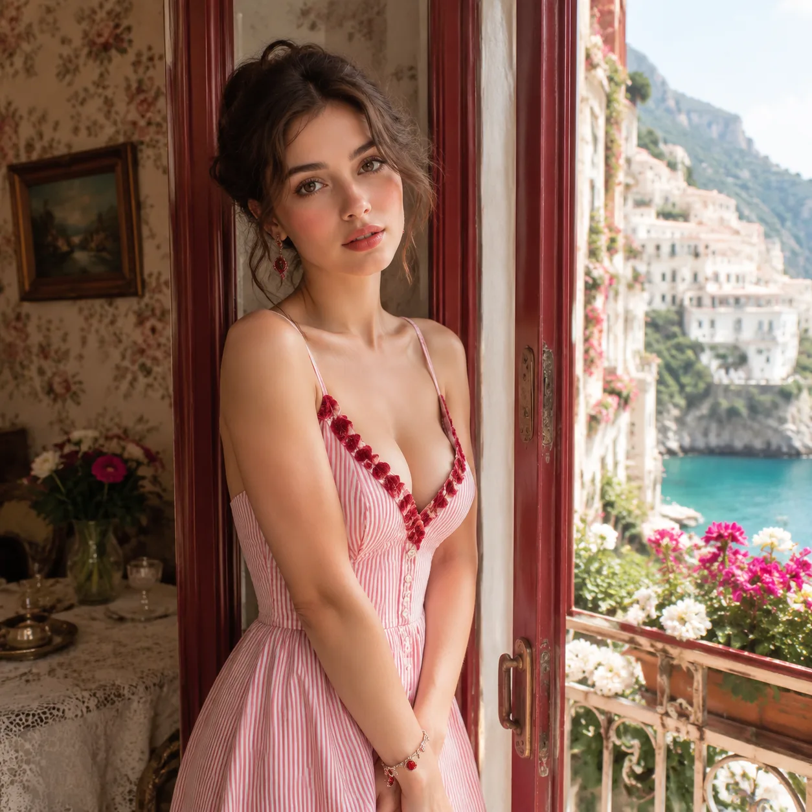</a> <a href="../prompts/ui-graphic/vn-01820.md"><b>Realistic, Portrait</b></a> Vinano Studio · <a href="https://vinano.ai?utm_source=github&utm_medium=readme&utm_campaign=awesome-image-video-prompts-updating&utm_content=card">Try on vinano.ai</a></td><td width="33%" valign="top"><a href="../prompts/ui-graphic/vn-01821.md">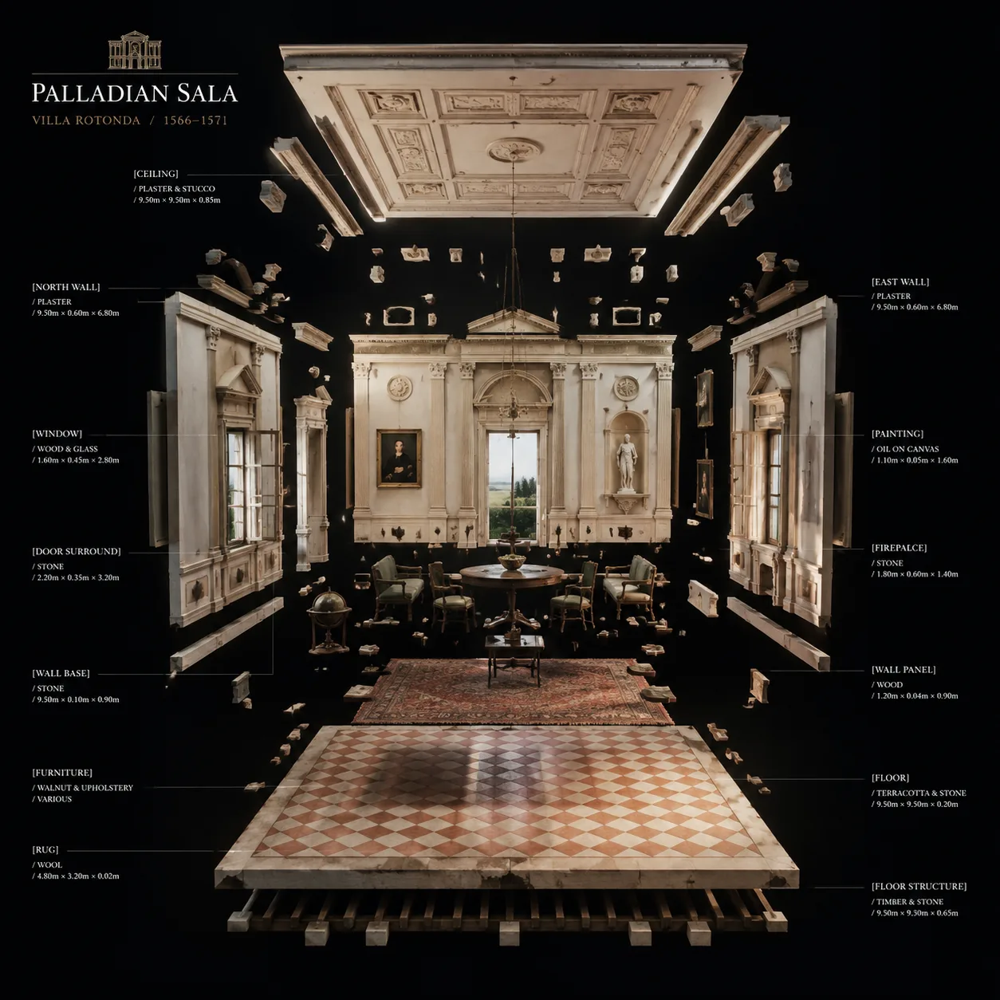</a> <a href="../prompts/ui-graphic/vn-01821.md"><b>ROOM TYPE pulled apart in 3D, every surface</b></a> Vinano Studio · <a href="https://vinano.ai?utm_source=github&utm_medium=readme&utm_campaign=awesome-image-video-prompts-updating&utm_content=card">Try on vinano.ai</a></td></tr>
<tr><td width="33%" valign="top"> <a href="../prompts/ui-graphic/vn-01831.md"><b>Character, Ai Art</b></a> Vinano Studio · <a href="https://vinano.ai?utm_source=github&utm_medium=readme&utm_campaign=awesome-image-video-prompts-updating&utm_content=card">Try on vinano.ai</a></td><td width="33%" valign="top"><a href="../prompts/ui-graphic/vn-01833.md">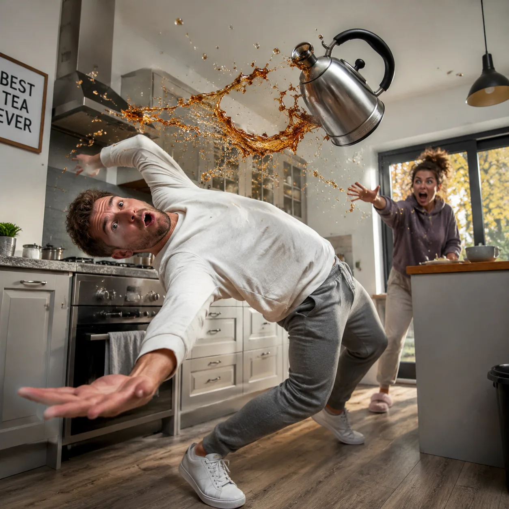</a> <a href="../prompts/ui-graphic/vn-01833.md"><b>Realistic, Cinematic</b></a> Vinano Studio · <a href="https://vinano.ai?utm_source=github&utm_medium=readme&utm_campaign=awesome-image-video-prompts-updating&utm_content=card">Try on vinano.ai</a></td><td width="33%" valign="top"> <a href="../prompts/ui-graphic/vn-01834.md"><b>Realistic, Portrait</b></a> Vinano Image Pro · <a href="https://vinano.ai?utm_source=github&utm_medium=readme&utm_campaign=awesome-image-video-prompts-updating&utm_content=card">Try on vinano.ai</a></td></tr>
<tr><td width="33%" valign="top"><a href="../prompts/ui-graphic/vn-01838.md">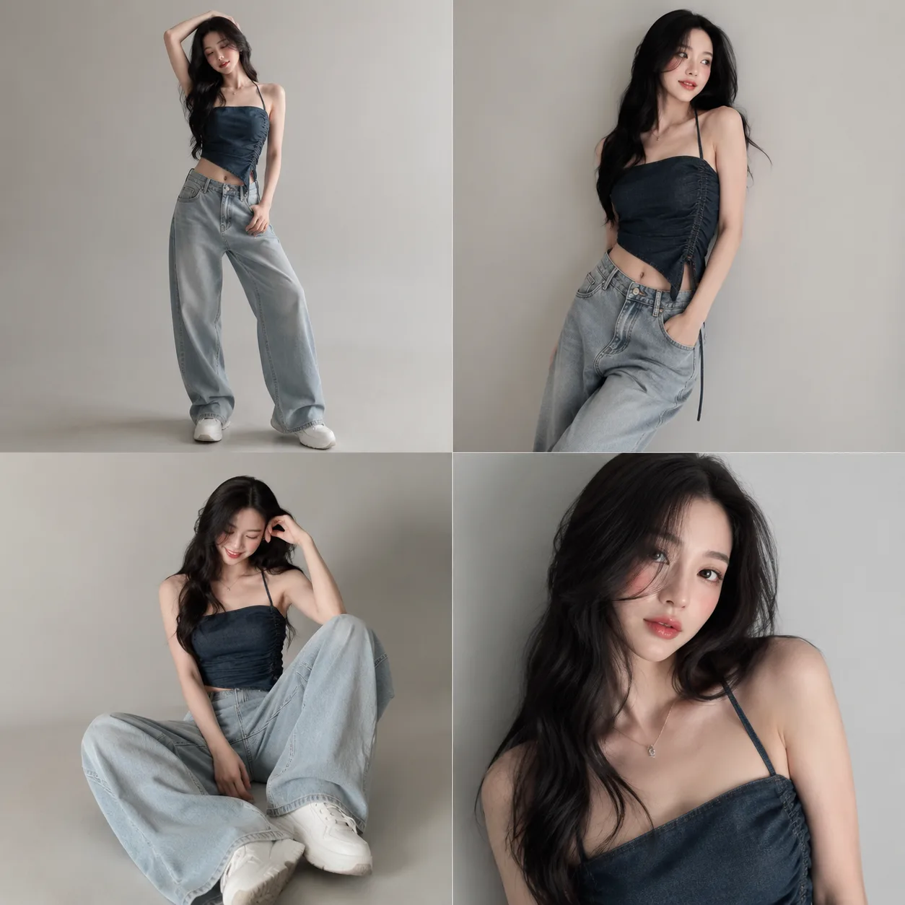</a> <a href="../prompts/ui-graphic/vn-01838.md"><b>Realistic, Portrait</b></a> Vinano Studio · <a href="https://vinano.ai?utm_source=github&utm_medium=readme&utm_campaign=awesome-image-video-prompts-updating&utm_content=card">Try on vinano.ai</a></td><td width="33%" valign="top"> <a href="../prompts/ui-graphic/vn-01843.md"><b>Realistic, Portrait</b></a> Vinano Studio · <a href="https://vinano.ai?utm_source=github&utm_medium=readme&utm_campaign=awesome-image-video-prompts-updating&utm_content=card">Try on vinano.ai</a></td><td width="33%" valign="top"><a href="../prompts/ui-graphic/vn-01851.md">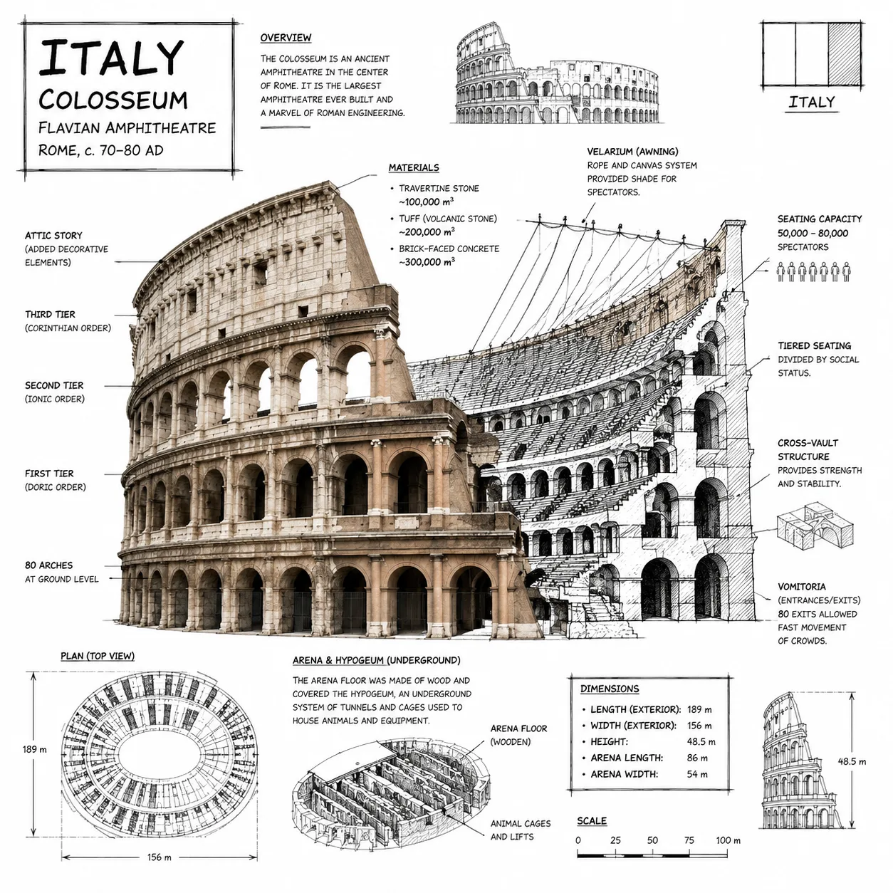</a> <a href="../prompts/ui-graphic/vn-01851.md"><b>Realistic, Infographic</b></a> Vinano Studio · <a href="https://vinano.ai?utm_source=github&utm_medium=readme&utm_campaign=awesome-image-video-prompts-updating&utm_content=card">Try on vinano.ai</a></td></tr>
<tr><td width="33%" valign="top"> <a href="../prompts/ui-graphic/vn-01853.md"><b>Realistic, Portrait</b></a> Vinano Studio · <a href="https://vinano.ai?utm_source=github&utm_medium=readme&utm_campaign=awesome-image-video-prompts-updating&utm_content=card">Try on vinano.ai</a></td><td width="33%" valign="top"> <a href="../prompts/ui-graphic/vn-01856.md"><b>Realistic, Portrait</b></a> Vinano Studio · <a href="https://vinano.ai?utm_source=github&utm_medium=readme&utm_campaign=awesome-image-video-prompts-updating&utm_content=card">Try on vinano.ai</a></td><td width="33%" valign="top"><a href="../prompts/ui-graphic/vn-01861.md">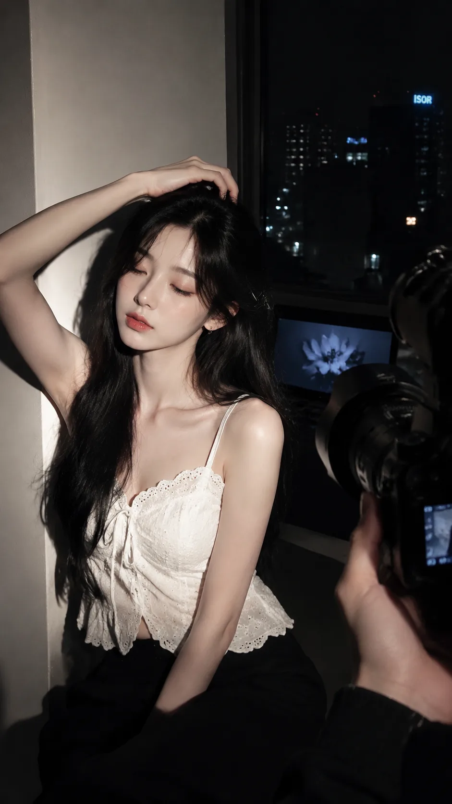</a> <a href="../prompts/ui-graphic/vn-01861.md"><b>Behind-the-scenes indoor photography at night, high-contrast</b></a> Vinano Studio · <a href="https://vinano.ai?utm_source=github&utm_medium=readme&utm_campaign=awesome-image-video-prompts-updating&utm_content=card">Try on vinano.ai</a></td></tr>
<tr><td width="33%" valign="top"> <a href="../prompts/ui-graphic/vn-01868.md"><b>Realistic, Portrait</b></a> Vinano Studio · <a href="https://vinano.ai?utm_source=github&utm_medium=readme&utm_campaign=awesome-image-video-prompts-updating&utm_content=card">Try on vinano.ai</a></td><td width="33%" valign="top"><a href="../prompts/ui-graphic/vn-01878.md">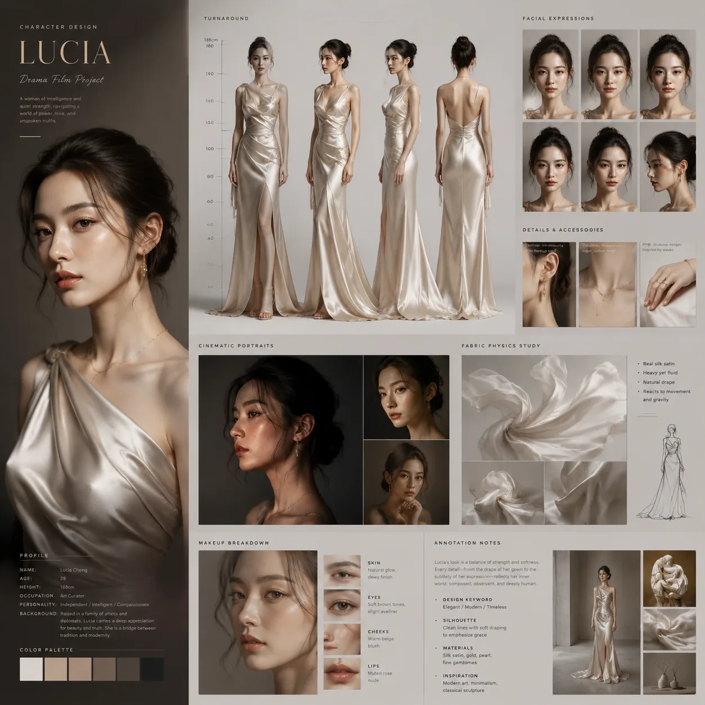</a> <a href="../prompts/ui-graphic/vn-01878.md"><b>Portrait, Character</b></a> Vinano Studio · <a href="https://vinano.ai?utm_source=github&utm_medium=readme&utm_campaign=awesome-image-video-prompts-updating&utm_content=card">Try on vinano.ai</a></td><td width="33%" valign="top"> <a href="../prompts/ui-graphic/vn-01879.md"><b>Realistic, Portrait</b></a> Vinano Studio · <a href="https://vinano.ai?utm_source=github&utm_medium=readme&utm_campaign=awesome-image-video-prompts-updating&utm_content=card">Try on vinano.ai</a></td></tr>
<tr><td width="33%" valign="top"><a href="../prompts/ui-graphic/vn-01880.md">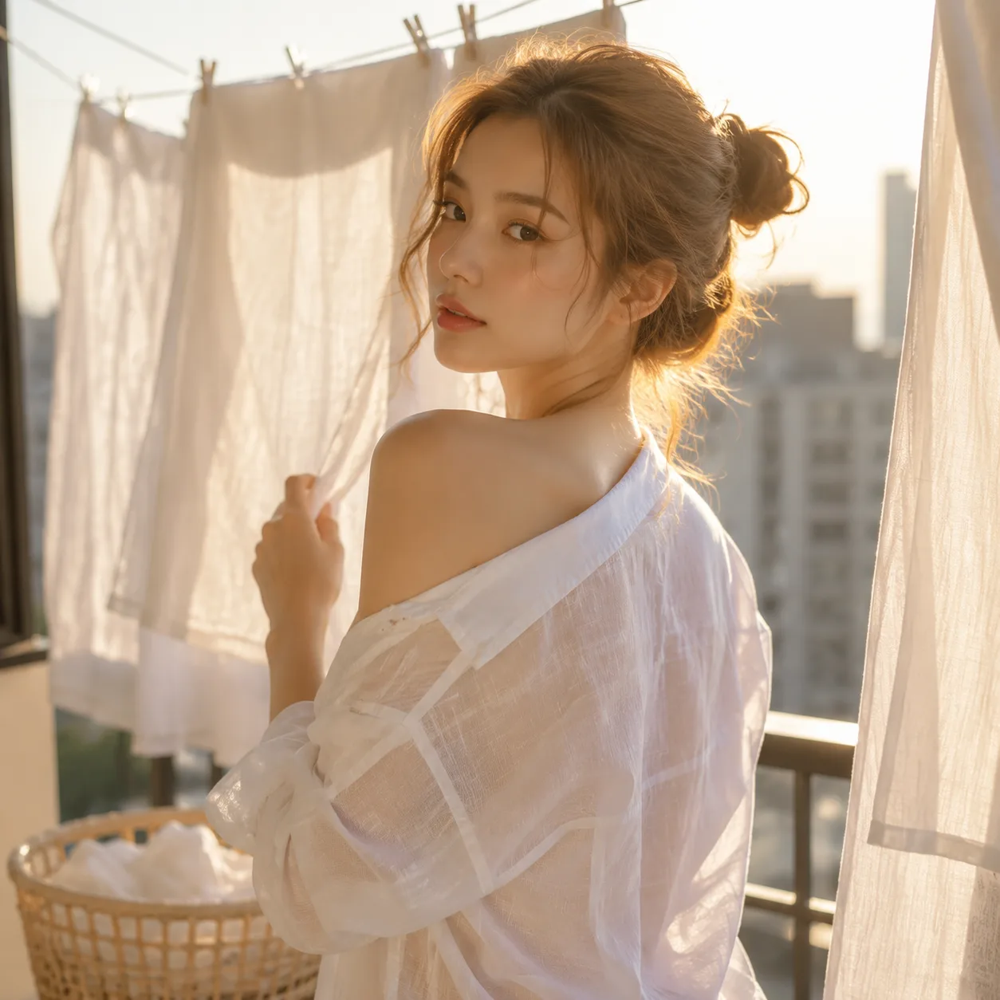</a> <a href="../prompts/ui-graphic/vn-01880.md"><b>Cinematic, Ai Art</b></a> Vinano Studio · <a href="https://vinano.ai?utm_source=github&utm_medium=readme&utm_campaign=awesome-image-video-prompts-updating&utm_content=card">Try on vinano.ai</a></td><td width="33%" valign="top"> <a href="../prompts/ui-graphic/vn-01884.md"><b>Realistic, Portrait</b></a> Vinano Studio · <a href="https://vinano.ai?utm_source=github&utm_medium=readme&utm_campaign=awesome-image-video-prompts-updating&utm_content=card">Try on vinano.ai</a></td><td width="33%" valign="top"> <a href="../prompts/ui-graphic/vn-01885.md"><b>Realistic, Portrait</b></a> Vinano Image Pro · <a href="https://vinano.ai?utm_source=github&utm_medium=readme&utm_campaign=awesome-image-video-prompts-updating&utm_content=card">Try on vinano.ai</a></td></tr>
<tr><td width="33%" valign="top"><a href="../prompts/ui-graphic/vn-01888.md">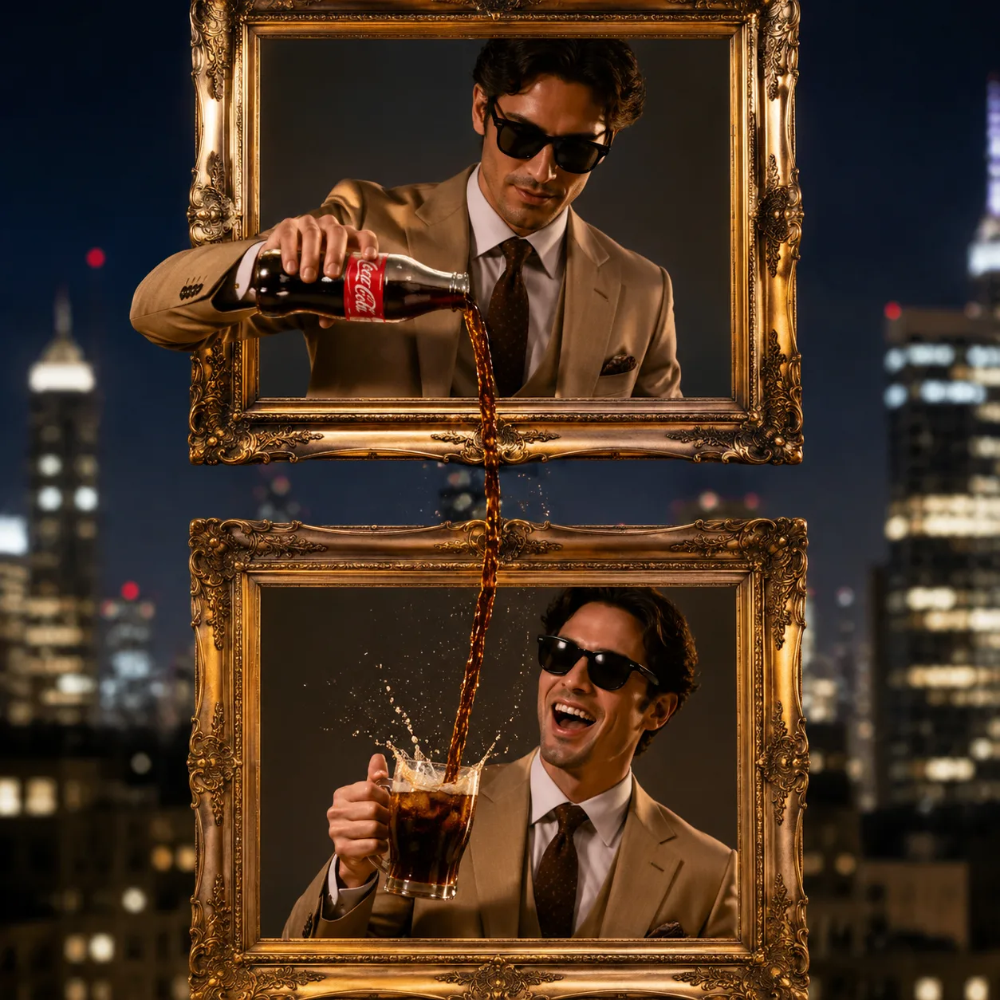</a> <a href="../prompts/ui-graphic/vn-01888.md"><b>Stylish man wearing a tan suit and sunglasses is</b></a> Vinano Studio · <a href="https://vinano.ai?utm_source=github&utm_medium=readme&utm_campaign=awesome-image-video-prompts-updating&utm_content=card">Try on vinano.ai</a></td><td width="33%" valign="top"> <a href="../prompts/ui-graphic/vn-01891.md"><b>Realistic, Cinematic</b></a> Vinano Studio · <a href="https://vinano.ai?utm_source=github&utm_medium=readme&utm_campaign=awesome-image-video-prompts-updating&utm_content=card">Try on vinano.ai</a></td><td width="33%" valign="top"><a href="../prompts/ui-graphic/vn-01896.md">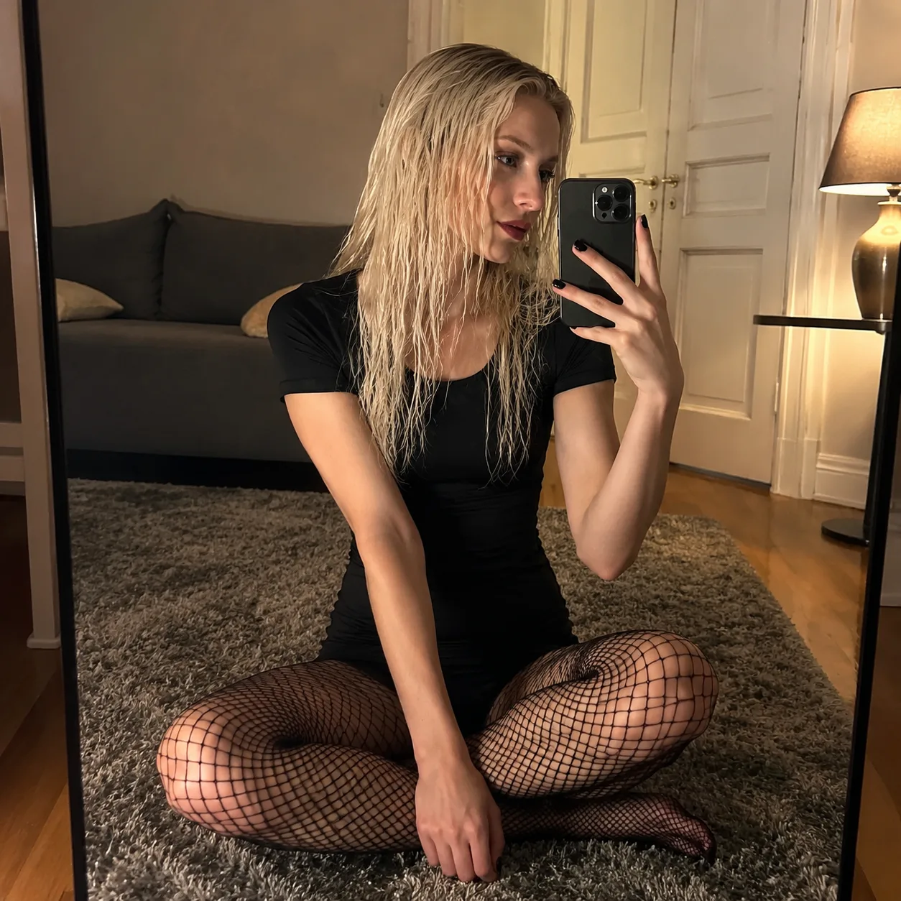</a> <a href="../prompts/ui-graphic/vn-01896.md"><b>Realistic, Ai Art</b></a> Vinano Studio · <a href="https://vinano.ai?utm_source=github&utm_medium=readme&utm_campaign=awesome-image-video-prompts-updating&utm_content=card">Try on vinano.ai</a></td></tr>
<tr><td width="33%" valign="top"> <a href="../prompts/ui-graphic/vn-01902.md"><b>Realistic, Cinematic</b></a> Vinano Studio · <a href="https://vinano.ai?utm_source=github&utm_medium=readme&utm_campaign=awesome-image-video-prompts-updating&utm_content=card">Try on vinano.ai</a></td><td width="33%" valign="top"><a href="../prompts/ui-graphic/vn-01903.md">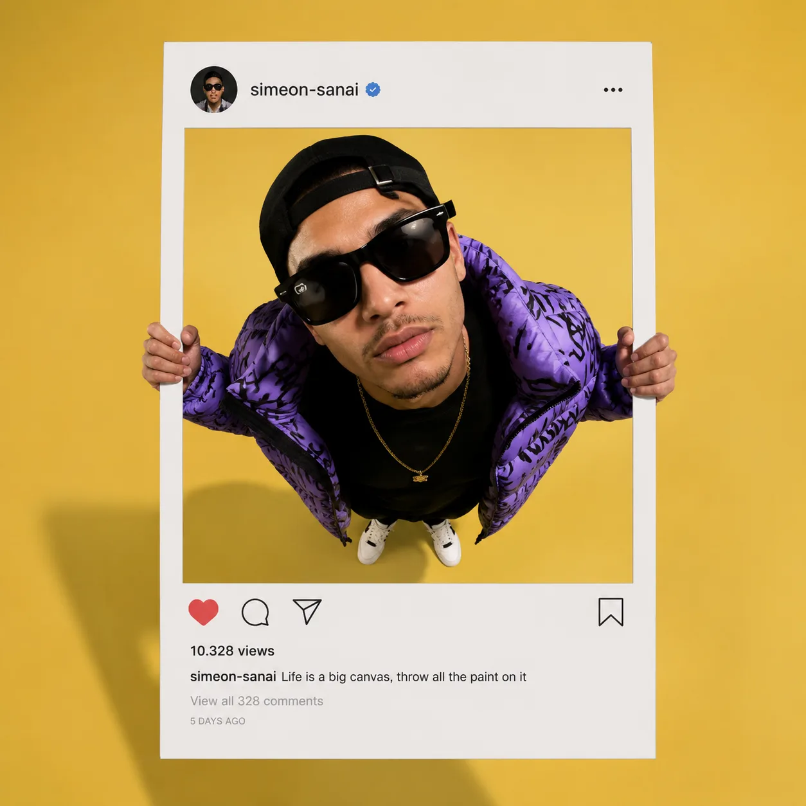</a> <a href="../prompts/ui-graphic/vn-01903.md"><b>Realistic, Ai Art</b></a> Vinano Studio · <a href="https://vinano.ai?utm_source=github&utm_medium=readme&utm_campaign=awesome-image-video-prompts-updating&utm_content=card">Try on vinano.ai</a></td><td width="33%" valign="top"><a href="../prompts/ui-graphic/vn-01911.md">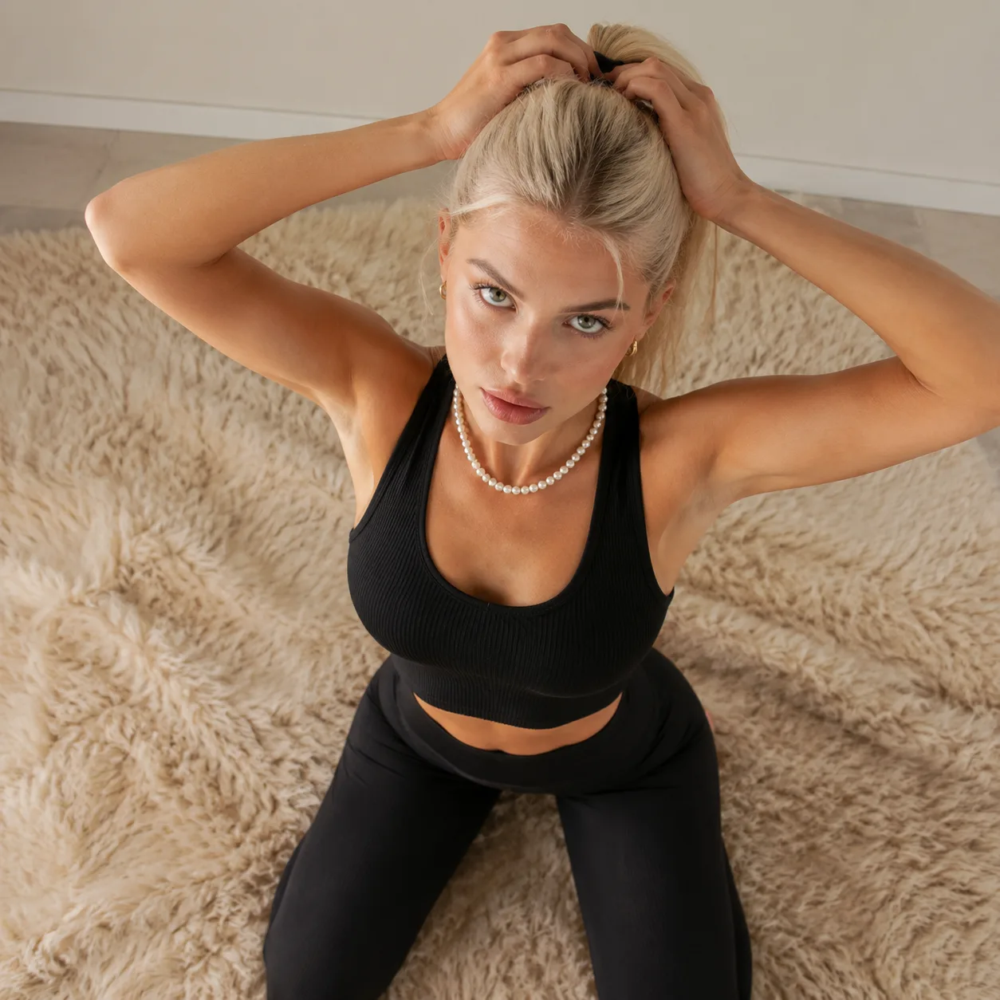</a> <a href="../prompts/ui-graphic/vn-01911.md"><b>Realistic, Minimalist</b></a> Vinano Studio · <a href="https://vinano.ai?utm_source=github&utm_medium=readme&utm_campaign=awesome-image-video-prompts-updating&utm_content=card">Try on vinano.ai</a></td></tr>
<tr><td width="33%" valign="top"><a href="../prompts/ui-graphic/vn-01928.md">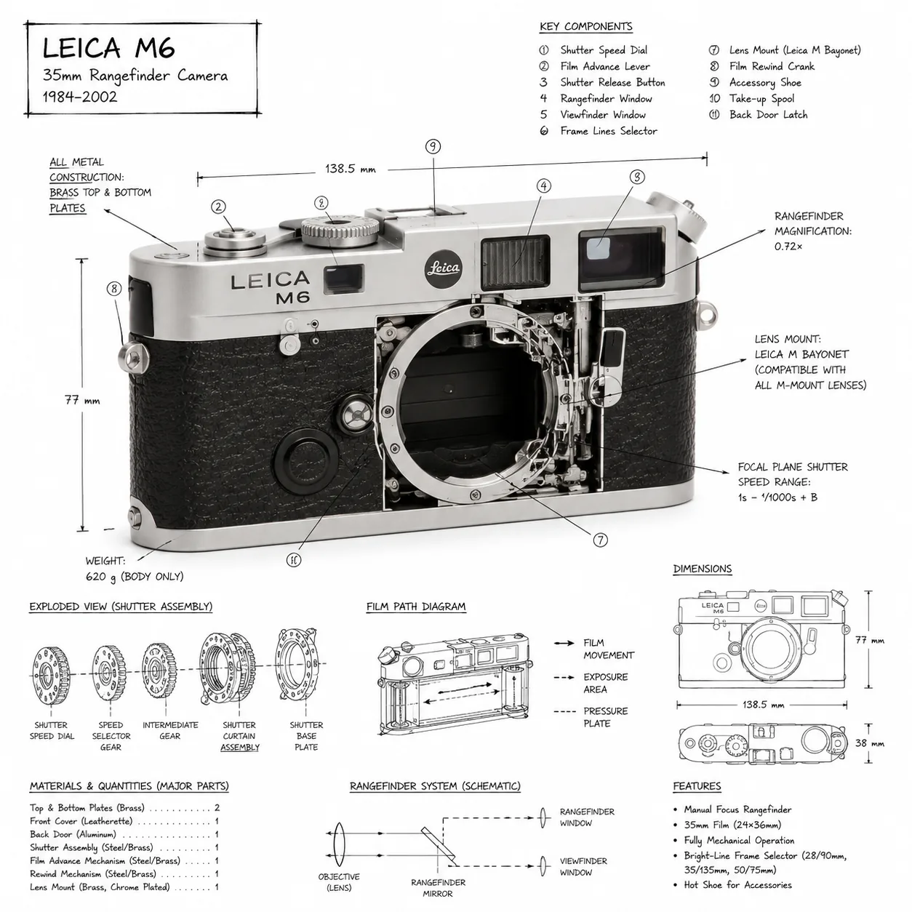</a> <a href="../prompts/ui-graphic/vn-01928.md"><b>Realistic, Infographic</b></a> Vinano Studio · <a href="https://vinano.ai?utm_source=github&utm_medium=readme&utm_campaign=awesome-image-video-prompts-updating&utm_content=card">Try on vinano.ai</a></td><td width="33%" valign="top"> <a href="../prompts/ui-graphic/vn-01933.md"><b>Cinematic, Ai Art</b></a> Vinano Studio · <a href="https://vinano.ai?utm_source=github&utm_medium=readme&utm_campaign=awesome-image-video-prompts-updating&utm_content=card">Try on vinano.ai</a></td><td width="33%" valign="top"> <a href="../prompts/ui-graphic/vn-01944.md"><b>Anime, Realistic</b></a> Vinano Studio · <a href="https://vinano.ai?utm_source=github&utm_medium=readme&utm_campaign=awesome-image-video-prompts-updating&utm_content=card">Try on vinano.ai</a></td></tr>
<tr><td width="33%" valign="top"><a href="../prompts/ui-graphic/vn-01947.md">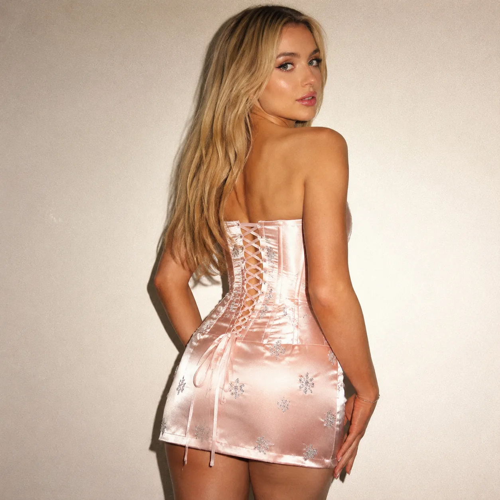</a> <a href="../prompts/ui-graphic/vn-01947.md"><b>Realistic, Portrait</b></a> Vinano Studio · <a href="https://vinano.ai?utm_source=github&utm_medium=readme&utm_campaign=awesome-image-video-prompts-updating&utm_content=card">Try on vinano.ai</a></td><td width="33%" valign="top"><a href="../prompts/ui-graphic/vn-01949.md">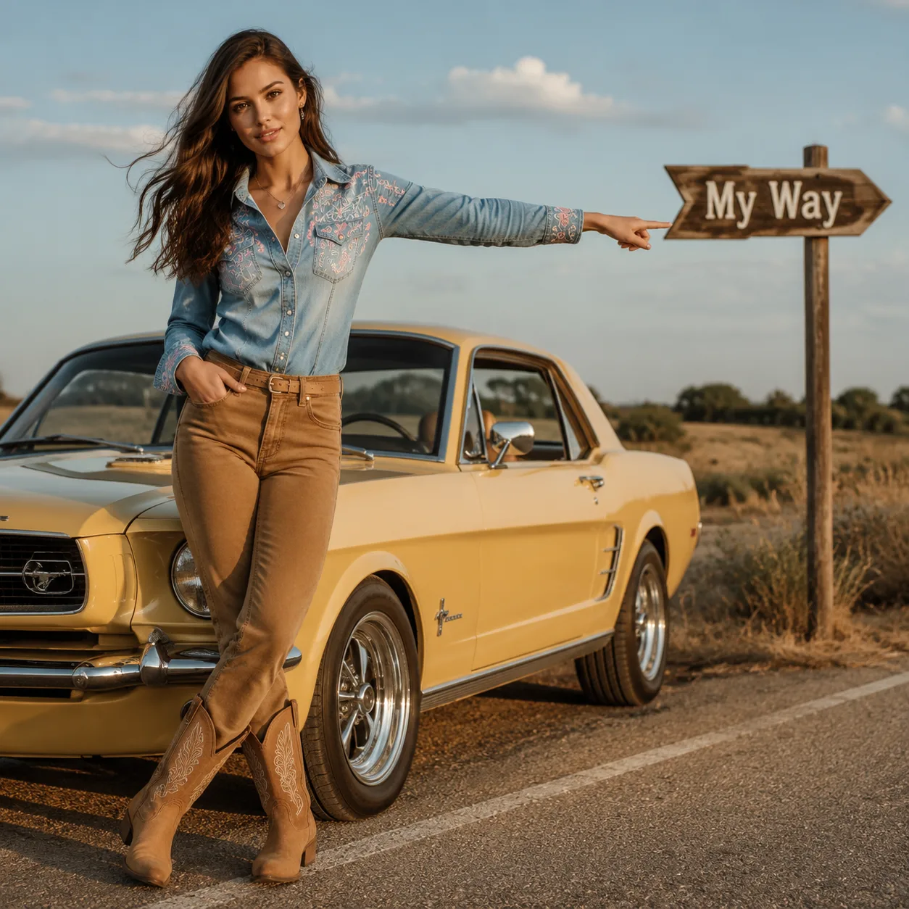</a> <a href="../prompts/ui-graphic/vn-01949.md"><b>Realistic, Portrait</b></a> Vinano Studio · <a href="https://vinano.ai?utm_source=github&utm_medium=readme&utm_campaign=awesome-image-video-prompts-updating&utm_content=card">Try on vinano.ai</a></td><td width="33%" valign="top"><a href="../prompts/ui-graphic/vn-01953.md">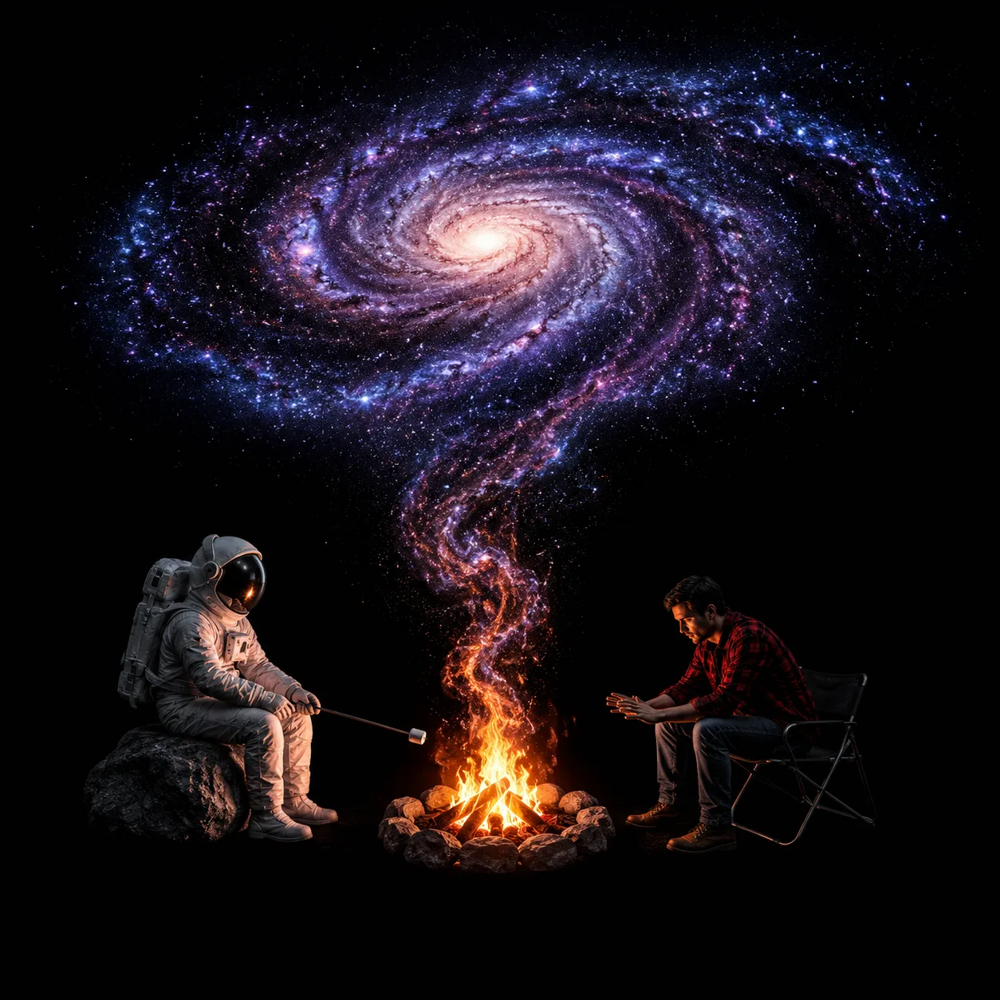</a> <a href="../prompts/ui-graphic/vn-01953.md"><b>Realistic, Character</b></a> Vinano Studio · <a href="https://vinano.ai?utm_source=github&utm_medium=readme&utm_campaign=awesome-image-video-prompts-updating&utm_content=card">Try on vinano.ai</a></td></tr>
<tr><td width="33%" valign="top"> <a href="../prompts/ui-graphic/vn-01960.md"><b>Realistic, Portrait</b></a> Vinano Studio · <a href="https://vinano.ai?utm_source=github&utm_medium=readme&utm_campaign=awesome-image-video-prompts-updating&utm_content=card">Try on vinano.ai</a></td><td width="33%" valign="top"><a href="../prompts/ui-graphic/vn-01961.md">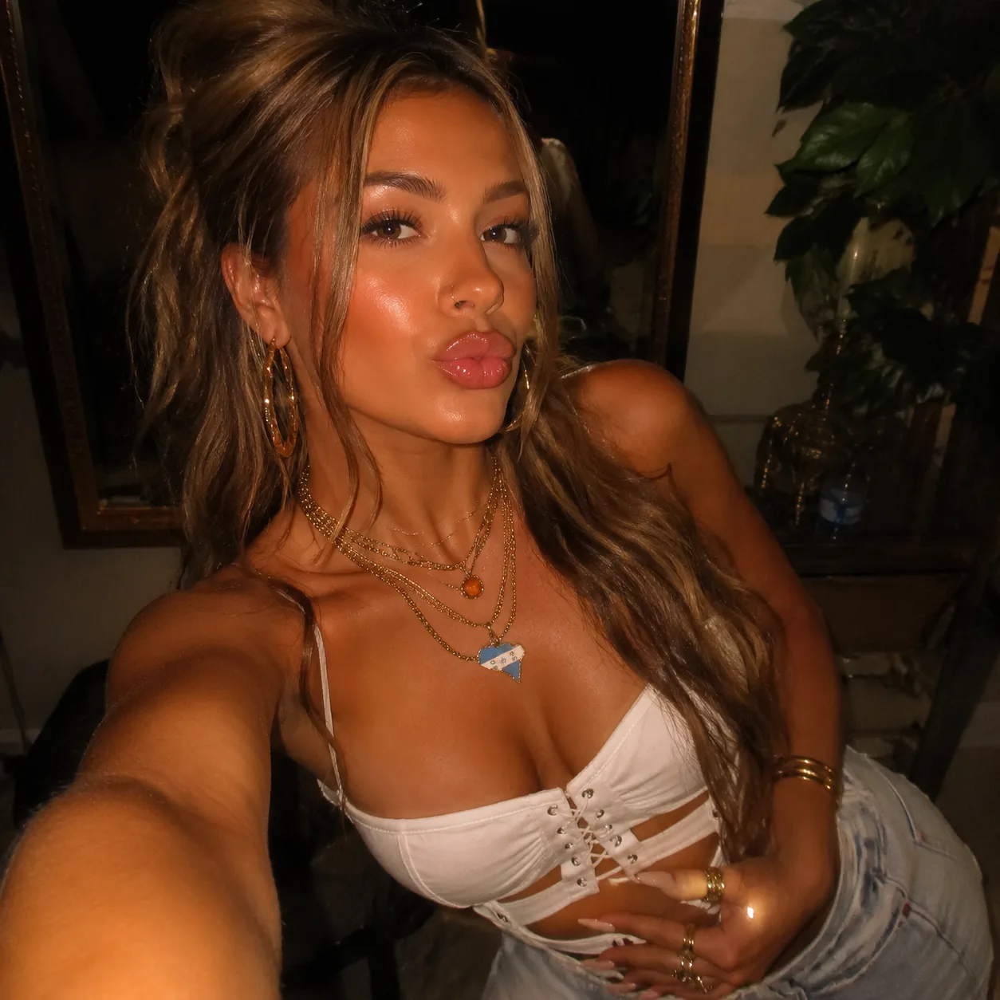</a> <a href="../prompts/ui-graphic/vn-01961.md"><b>Use the uploaded photo as inspiration for the woman’s</b></a> Vinano Studio · <a href="https://vinano.ai?utm_source=github&utm_medium=readme&utm_campaign=awesome-image-video-prompts-updating&utm_content=card">Try on vinano.ai</a></td><td width="33%" valign="top"><a href="../prompts/ui-graphic/vn-01968.md">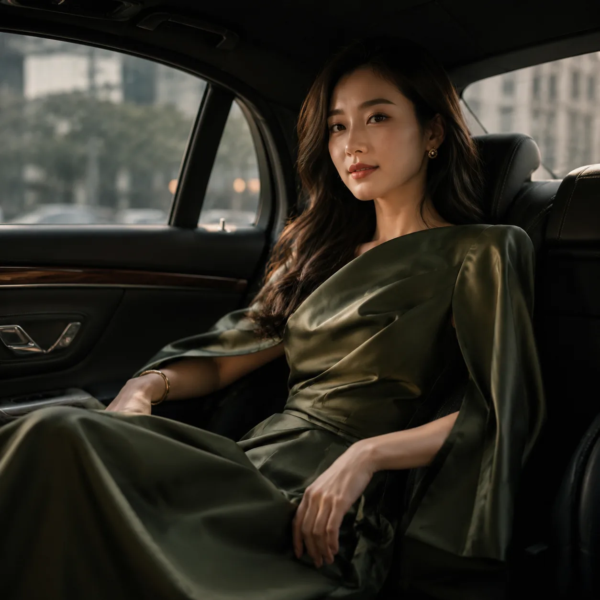</a> <a href="../prompts/ui-graphic/vn-01968.md"><b>Portrait, Cinematic</b></a> Vinano Studio · <a href="https://vinano.ai?utm_source=github&utm_medium=readme&utm_campaign=awesome-image-video-prompts-updating&utm_content=card">Try on vinano.ai</a></td></tr>
<tr><td width="33%" valign="top"><a href="../prompts/ui-graphic/vn-01972.md">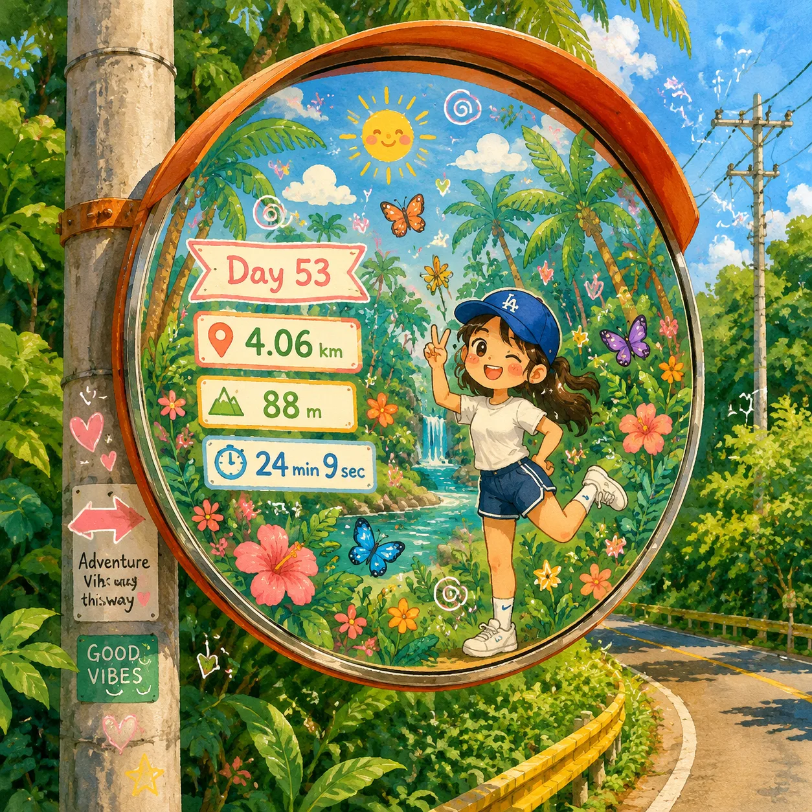</a> <a href="../prompts/ui-graphic/vn-01972.md"><b>Character, Infographic</b></a> Vinano Studio · <a href="https://vinano.ai?utm_source=github&utm_medium=readme&utm_campaign=awesome-image-video-prompts-updating&utm_content=card">Try on vinano.ai</a></td><td width="33%" valign="top"><a href="../prompts/ui-graphic/vn-01973.md">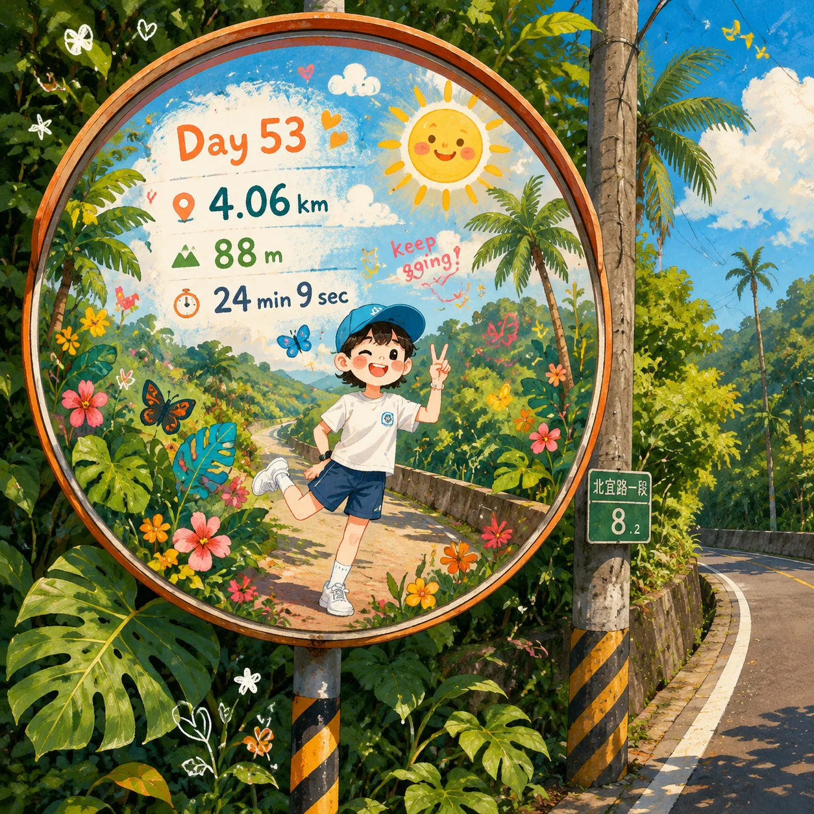</a> <a href="../prompts/ui-graphic/vn-01973.md"><b>Character, Infographic</b></a> Vinano Studio · <a href="https://vinano.ai?utm_source=github&utm_medium=readme&utm_campaign=awesome-image-video-prompts-updating&utm_content=card">Try on vinano.ai</a></td><td width="33%" valign="top"><a href="../prompts/ui-graphic/vn-01988.md">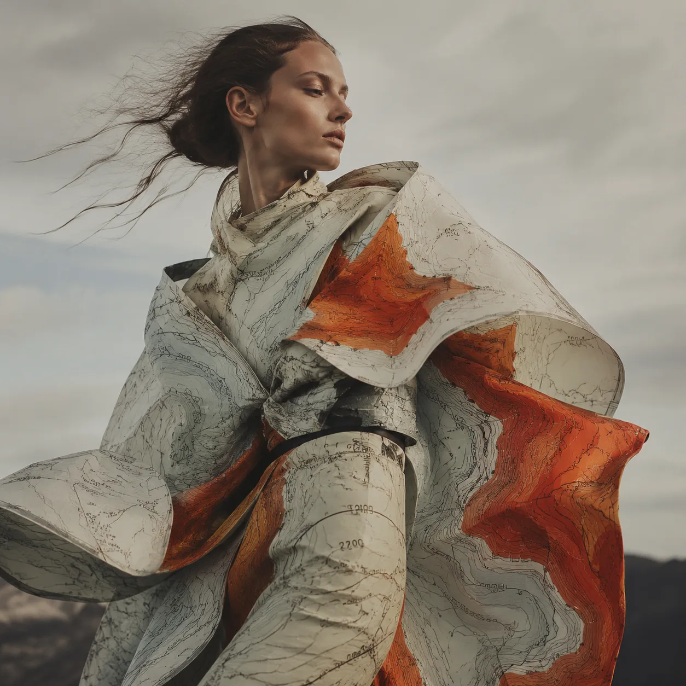</a> <a href="../prompts/ui-graphic/vn-01988.md"><b>Portrait, Cinematic</b></a> Vinano Studio · <a href="https://vinano.ai?utm_source=github&utm_medium=readme&utm_campaign=awesome-image-video-prompts-updating&utm_content=card">Try on vinano.ai</a></td></tr>
<tr><td width="33%" valign="top"><a href="../prompts/ui-graphic/vn-01989.md">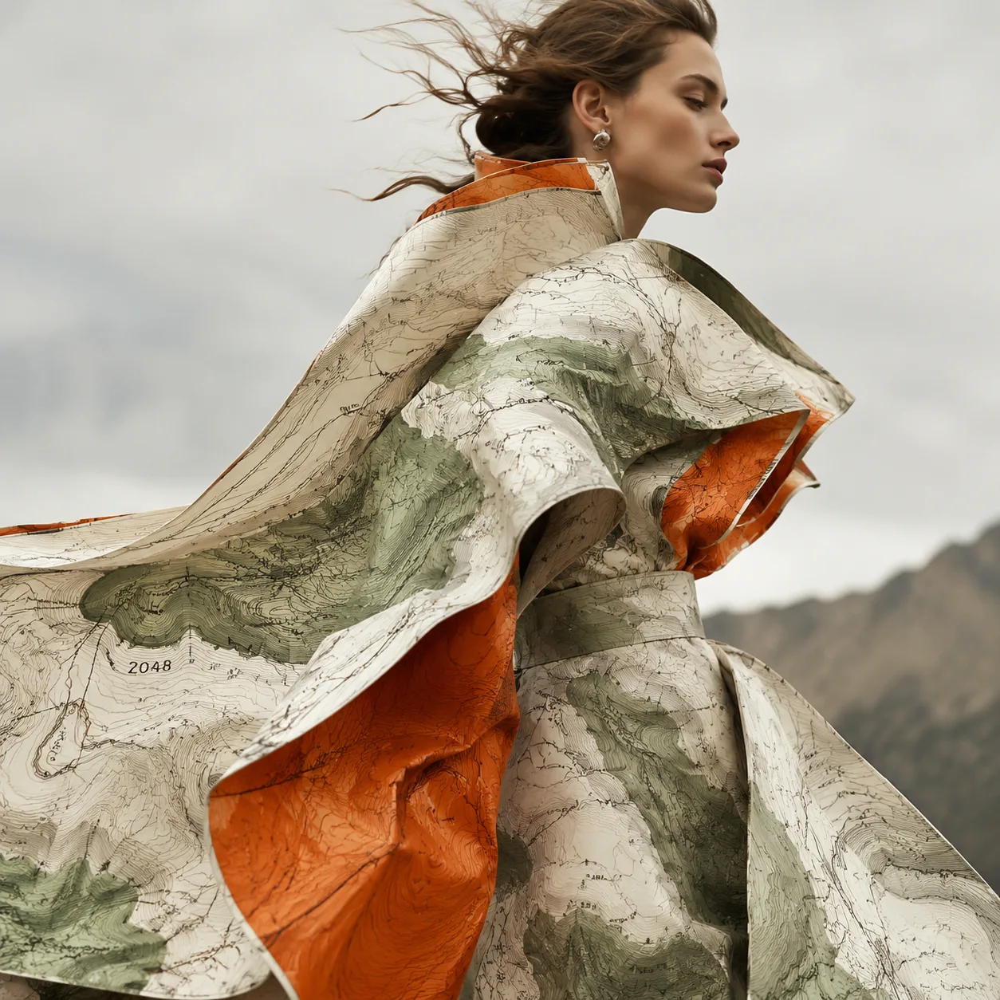</a> <a href="../prompts/ui-graphic/vn-01989.md"><b>Portrait, Cinematic</b></a> Vinano Studio · <a href="https://vinano.ai?utm_source=github&utm_medium=readme&utm_campaign=awesome-image-video-prompts-updating&utm_content=card">Try on vinano.ai</a></td><td width="33%" valign="top"><a href="../prompts/ui-graphic/vn-02116.md">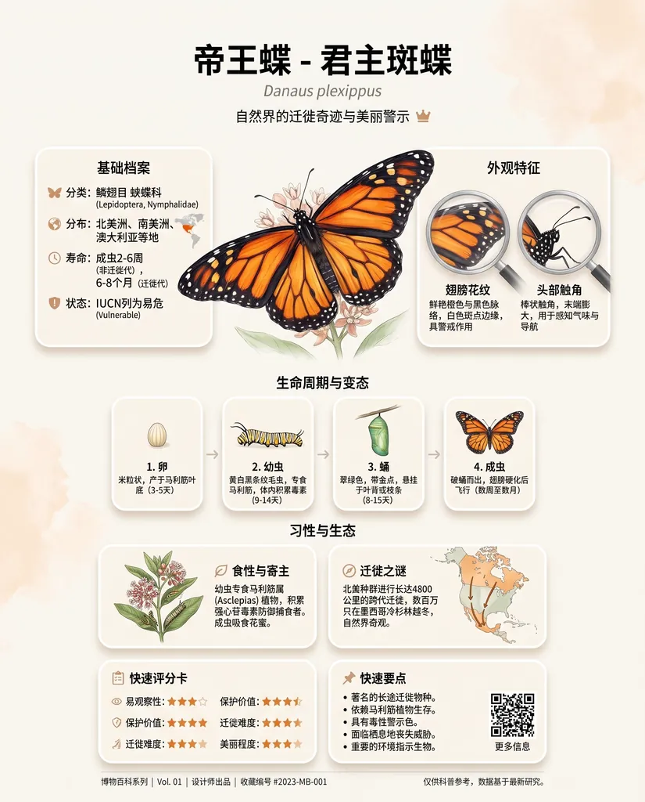</a> <a href="../prompts/ui-graphic/vn-02116.md"><b>帝王蝶科普百科图</b></a> Nano Banana Pro · <a href="https://vinano.ai?utm_source=github&utm_medium=readme&utm_campaign=awesome-image-video-prompts-updating&utm_content=card">Try on vinano.ai</a></td><td width="33%" valign="top"><a href="../prompts/ui-graphic/vn-02117.md">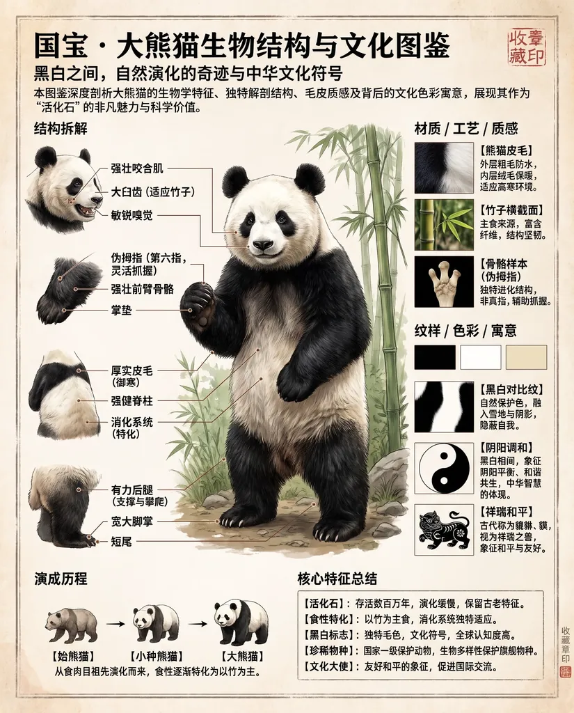</a> <a href="../prompts/ui-graphic/vn-02117.md"><b>大熊猫博物馆图鉴信息图</b></a> Nano Banana Pro · <a href="https://vinano.ai?utm_source=github&utm_medium=readme&utm_campaign=awesome-image-video-prompts-updating&utm_content=card">Try on vinano.ai</a></td></tr>
<tr><td width="33%" valign="top"><a href="../prompts/ui-graphic/vn-02118.md">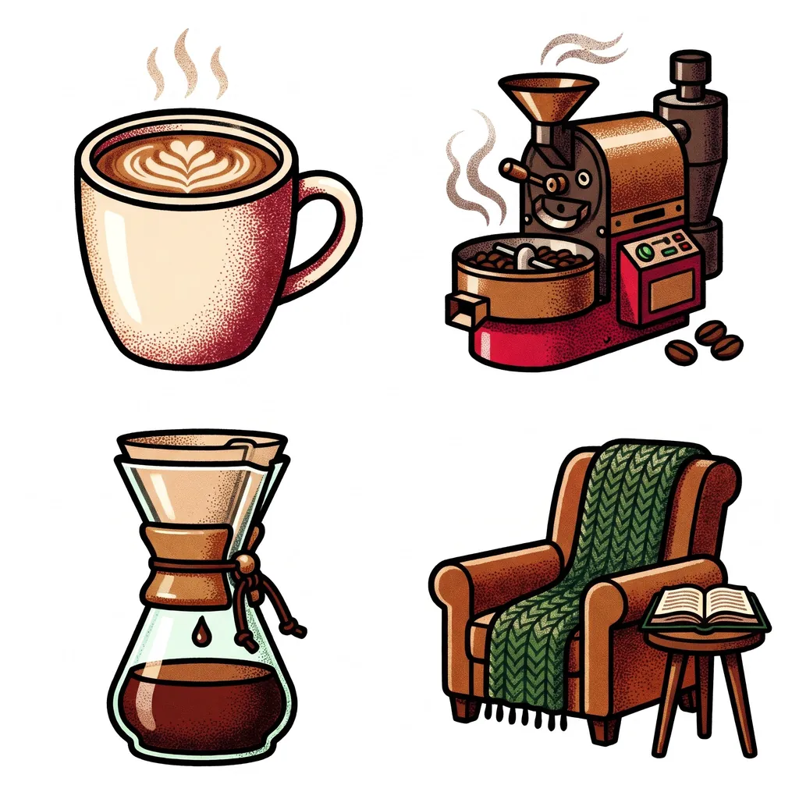</a> <a href="../prompts/ui-graphic/vn-02118.md"><b>Cozy coffee shop icon set</b></a> Nano Banana Pro · <a href="https://vinano.ai?utm_source=github&utm_medium=readme&utm_campaign=awesome-image-video-prompts-updating&utm_content=card">Try on vinano.ai</a></td><td width="33%" valign="top"><a href="../prompts/ui-graphic/vn-02119.md">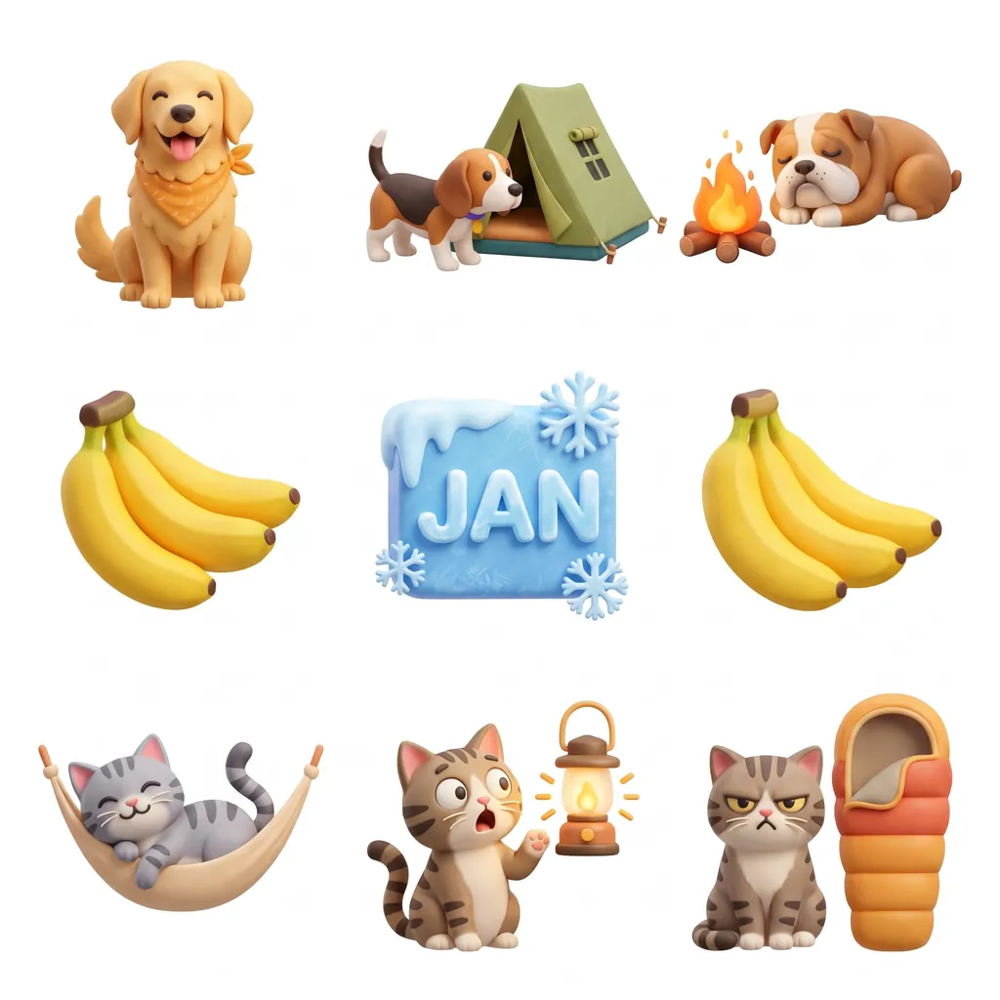</a> <a href="../prompts/ui-graphic/vn-02119.md"><b>Camping icon set</b></a> Nano Banana Pro · <a href="https://vinano.ai?utm_source=github&utm_medium=readme&utm_campaign=awesome-image-video-prompts-updating&utm_content=card">Try on vinano.ai</a></td><td width="33%" valign="top"><a href="../prompts/ui-graphic/vn-02141.md">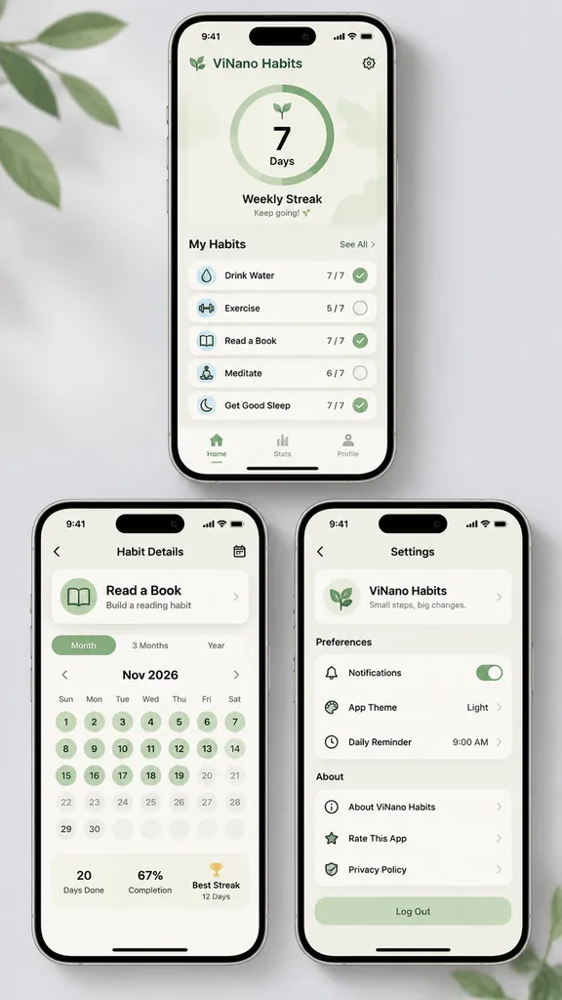</a> <a href="../prompts/ui-graphic/vn-02141.md"><b>Habit Tracker App Screens</b></a> GPT Image 2.6 Flare · <a href="https://vinano.ai?utm_source=github&utm_medium=readme&utm_campaign=awesome-image-video-prompts-updating&utm_content=card">Try on vinano.ai</a></td></tr>
<tr><td width="33%" valign="top"><a href="../prompts/ui-graphic/vn-02146.md">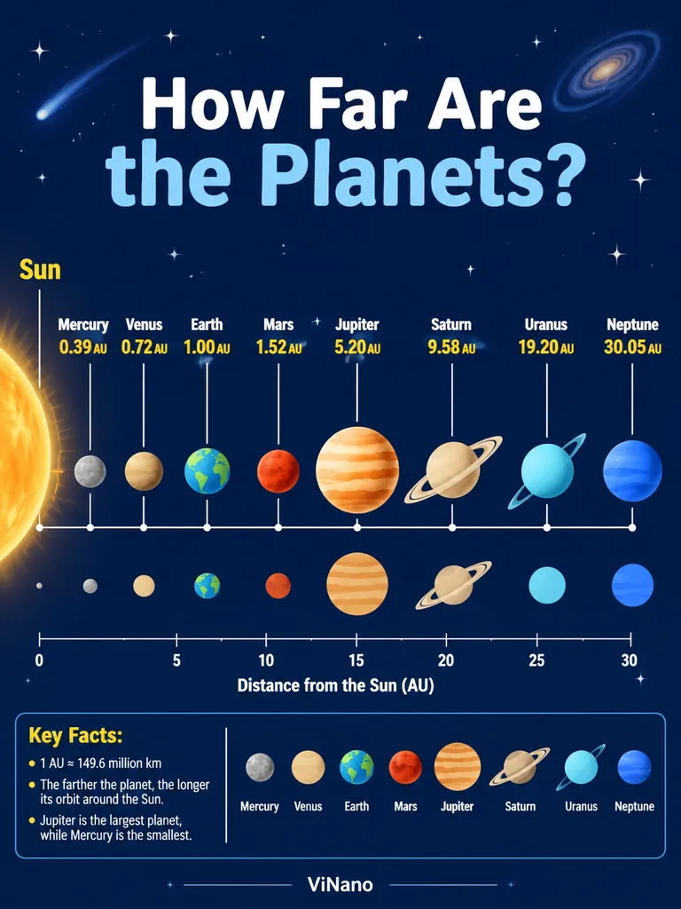</a> <a href="../prompts/ui-graphic/vn-02146.md"><b>Solar System Infographic</b></a> GPT Image 2.6 Flare · <a href="https://vinano.ai?utm_source=github&utm_medium=readme&utm_campaign=awesome-image-video-prompts-updating&utm_content=card">Try on vinano.ai</a></td><td width="33%"></td><td width="33%"></td></tr>
</table>

**[▶ Generate your own on vinano.ai](https://vinano.ai?utm_source=github&utm_medium=readme&utm_campaign=awesome-image-video-prompts-updating&utm_content=gallery-bottom)**
