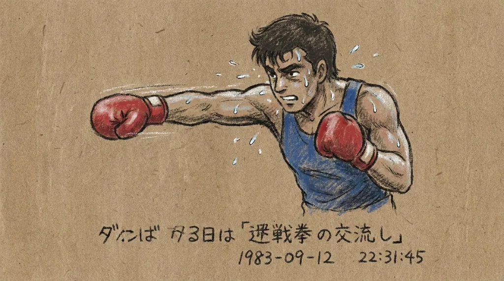
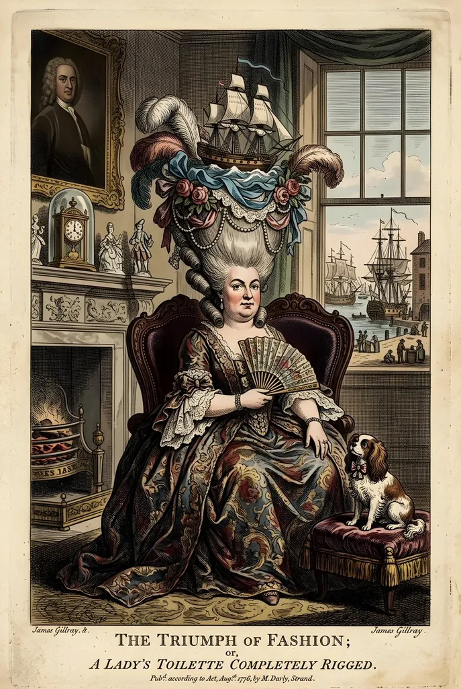
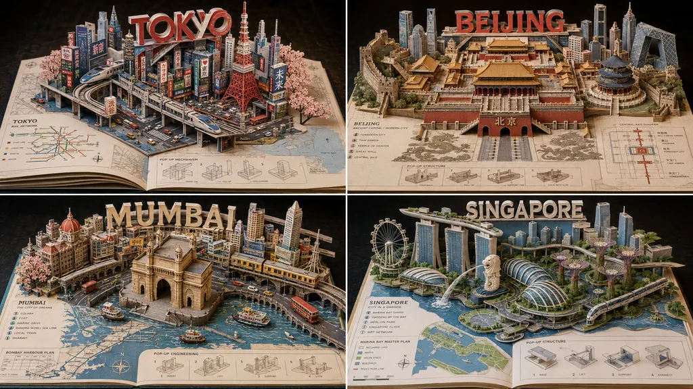

# Illustration & 3D — 372 community examples

[← Back to Community Examples](../EXAMPLES.md) · Page 4 / 4: [1](./x-illustration-3d.md) · [2](./x-illustration-3d-2.md) · [3](./x-illustration-3d-3.md) · **4**

Community results kept as posted. Each card credits its creator and links to the original post.

<table>
<tr><td width="33%" valign="top"> <a href="https://x.com/Naiknelofar788/status/2024277162652815403"><b>@Naiknelofar788</b></a> · <a href="../prompts/x/x-01422.md">Prompt</a> GPT Image · via X</td><td width="33%" valign="top"> <a href="https://x.com/Naiknelofar788/status/2024636606272229577"><b>@Naiknelofar788</b></a> · <a href="../prompts/x/x-01425.md">Prompt</a> GPT Image · via X</td><td width="33%" valign="top"> <a href="https://x.com/Sheldon056/status/2011634592810438835"><b>@Sheldon056</b></a> · <a href="../prompts/x/x-01434.md">Prompt</a> GPT Image · via X</td></tr>
<tr><td width="33%" valign="top"> <a href="https://x.com/meng_dagg695/status/2012437899955097836"><b>@meng_dagg695</b></a> · <a href="../prompts/x/x-01436.md">Prompt</a> GPT Image · via X</td><td width="33%" valign="top"> <a href="https://x.com/thierrybezier/status/2118769805587054692"><b>@thierrybezier</b></a> · <a href="../prompts/x/x-01471.md">Prompt</a> Nano Banana · via X</td><td width="33%" valign="top"> <a href="https://x.com/heathergreen/status/2108120225119973526"><b>@heathergreen</b></a> · <a href="../prompts/x/x-01473.md">Prompt</a> Nano Banana Pro · via X</td></tr>
<tr><td width="33%" valign="top"> <a href="https://x.com/heathergreen/status/2097112687675117974"><b>@heathergreen</b></a> · <a href="../prompts/x/x-01474.md">Prompt</a> Nano Banana 2 · via X</td><td width="33%" valign="top"> <a href="https://x.com/heathergreen/status/2096750301134881054"><b>@heathergreen</b></a> · <a href="../prompts/x/x-01475.md">Prompt</a> Nano Banana 2 · via X</td><td width="33%" valign="top"> <a href="https://x.com/Gdgtify/status/2082221056652443680"><b>@Gdgtify</b></a> · <a href="../prompts/x/x-01482.md">Prompt</a> Nano Banana · via X</td></tr>
<tr><td width="33%" valign="top"> <a href="https://x.com/Gdgtify/status/2095854642882019392"><b>@Gdgtify</b></a> · <a href="../prompts/x/x-01483.md">Prompt</a> Nano Banana · via X</td><td width="33%" valign="top"> <a href="https://x.com/VoxcatAI/status/1995497350543110411"><b>@VoxcatAI</b></a> · <a href="../prompts/x/x-01485.md">Prompt</a> Unknown · via X</td><td width="33%" valign="top"> <a href="https://x.com/lovimg_com/status/2096954809534570766"><b>@lovimg_com</b></a> · <a href="../prompts/x/x-01486.md">Prompt</a> Nano Banana Pro · via X</td></tr>
</table>

**[▶ Generate your own version on vinano.ai](https://vinano.ai?utm_source=github&utm_medium=readme&utm_campaign=awesome-image-video-prompts-updating&utm_content=x-gallery-bottom)**
