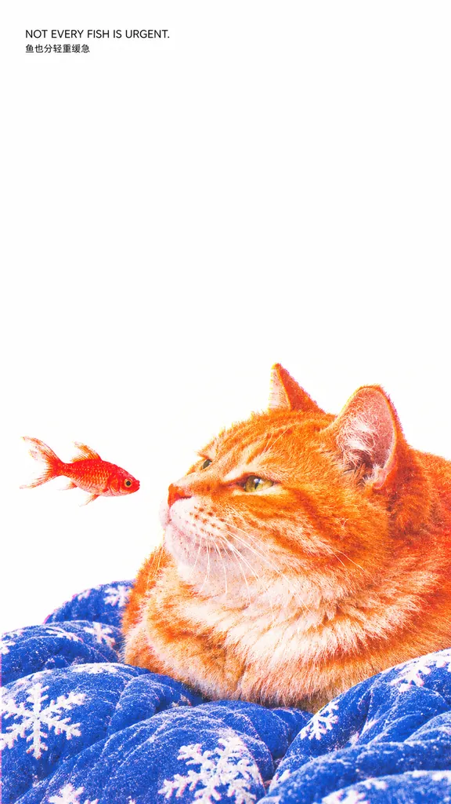
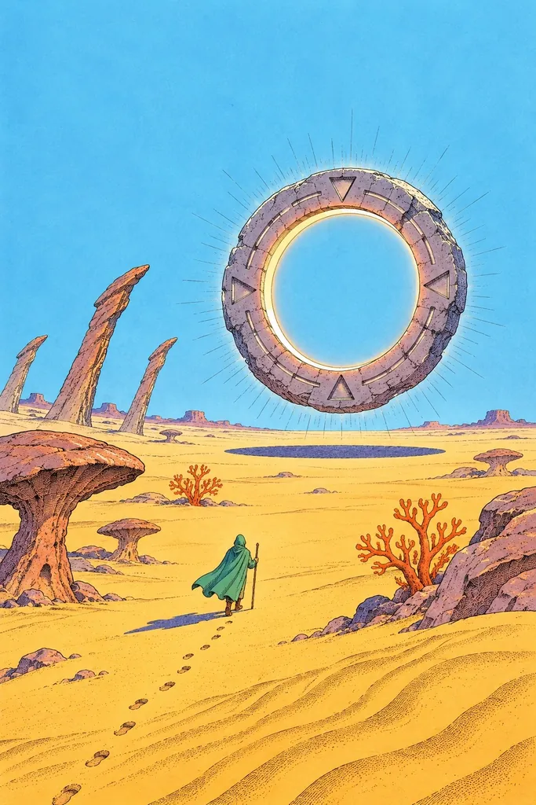
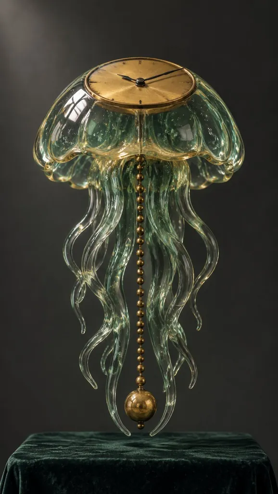
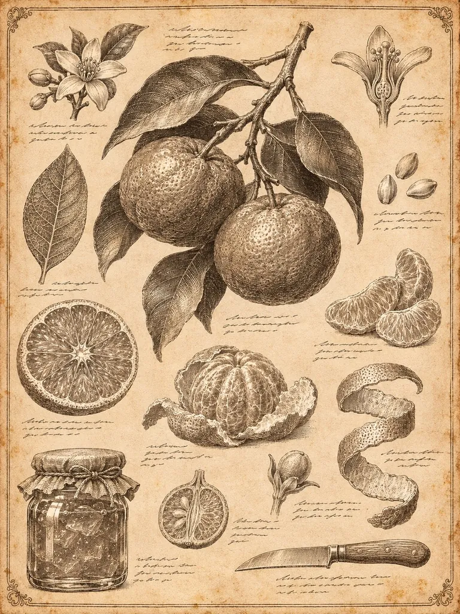

# Illustration & 3D — 438 community examples

[← Back to Community Examples](../EXAMPLES.md) · Page 4 / 4: [1](./x-illustration-3d.md) · [2](./x-illustration-3d-2.md) · [3](./x-illustration-3d-3.md) · **4**

Community results kept as posted. Each card credits its creator and links to the original post.

<table>
<tr><td width="33%" valign="top"> <a href="https://x.com/Naiknelofar788/status/2024277162652815403"><b>@Naiknelofar788</b></a> · <a href="../prompts/x/x-01422.md">Prompt</a> GPT Image · via X</td><td width="33%" valign="top"> <a href="https://x.com/Naiknelofar788/status/2024636606272229577"><b>@Naiknelofar788</b></a> · <a href="../prompts/x/x-01425.md">Prompt</a> GPT Image · via X</td><td width="33%" valign="top"> <a href="https://x.com/Sheldon056/status/2011634592810438835"><b>@Sheldon056</b></a> · <a href="../prompts/x/x-01434.md">Prompt</a> GPT Image · via X</td></tr>
<tr><td width="33%" valign="top"> <a href="https://x.com/meng_dagg695/status/2012437899955097836"><b>@meng_dagg695</b></a> · <a href="../prompts/x/x-01436.md">Prompt</a> GPT Image · via X</td><td width="33%" valign="top"> <a href="https://x.com/thierrybezier/status/2118769805587054692"><b>@thierrybezier</b></a> · <a href="../prompts/x/x-01471.md">Prompt</a> Nano Banana · via X</td><td width="33%" valign="top"> <a href="https://x.com/heathergreen/status/2108120225119973526"><b>@heathergreen</b></a> · <a href="../prompts/x/x-01473.md">Prompt</a> Nano Banana Pro · via X</td></tr>
<tr><td width="33%" valign="top"> <a href="https://x.com/heathergreen/status/2097112687675117974"><b>@heathergreen</b></a> · <a href="../prompts/x/x-01474.md">Prompt</a> Nano Banana 2 · via X</td><td width="33%" valign="top"> <a href="https://x.com/heathergreen/status/2096750301134881054"><b>@heathergreen</b></a> · <a href="../prompts/x/x-01475.md">Prompt</a> Nano Banana 2 · via X</td><td width="33%" valign="top"> <a href="https://x.com/Gdgtify/status/2082221056652443680"><b>@Gdgtify</b></a> · <a href="../prompts/x/x-01482.md">Prompt</a> Nano Banana · via X</td></tr>
<tr><td width="33%" valign="top"> <a href="https://x.com/Gdgtify/status/2095854642882019392"><b>@Gdgtify</b></a> · <a href="../prompts/x/x-01483.md">Prompt</a> Nano Banana · via X</td><td width="33%" valign="top"> <a href="https://x.com/VoxcatAI/status/1995497350543110411"><b>@VoxcatAI</b></a> · <a href="../prompts/x/x-01485.md">Prompt</a> Unknown · via X</td><td width="33%" valign="top"> <a href="https://x.com/lovimg_com/status/2096954809534570766"><b>@lovimg_com</b></a> · <a href="../prompts/x/x-01486.md">Prompt</a> Nano Banana Pro · via X</td></tr>
<tr><td width="33%" valign="top"> <a href="https://x.com/sipteaandcoffee/status/2123882892279349442"><b>@sipteaandcoffee</b></a> · <a href="../prompts/x/x-01506.md">Prompt</a> GPT Image 2.6 · via X</td><td width="33%" valign="top"> <a href="https://x.com/BeanieBlossom/status/2124427686403854735"><b>@BeanieBlossom</b></a> · <a href="../prompts/x/x-01507.md">Prompt</a>  · via X</td><td width="33%" valign="top"> <a href="https://x.com/AllaAisling/status/2124477494719881479"><b>@AllaAisling</b></a> · <a href="../prompts/x/x-01508.md">Prompt</a> GPT Image 2.6 Flare · via X</td></tr>
<tr><td width="33%" valign="top"> <a href="https://x.com/hx831126/status/2124477388608164286"><b>@hx831126</b></a> · <a href="../prompts/x/x-01514.md">Prompt</a>  · via X</td><td width="33%" valign="top"> <a href="https://x.com/heathergreen/status/2124488074713260248"><b>@heathergreen</b></a> · <a href="../prompts/x/x-01519.md">Prompt</a> Seedream 5.5 · via X</td><td width="33%" valign="top"> <a href="https://x.com/DeepBlueX0/status/2124381286584422423"><b>@DeepBlueX0</b></a> · <a href="../prompts/x/x-01520.md">Prompt</a> GPT Image 2.6 · via X</td></tr>
<tr><td width="33%" valign="top"> <a href="https://x.com/mseymari_/status/2124054959041794332"><b>@mseymari_</b></a> · <a href="../prompts/x/x-01524.md">Prompt</a> Seedream 5.5 · via X</td><td width="33%" valign="top"> <a href="https://x.com/static_stare/status/2124475198217007333"><b>@static_stare</b></a> · <a href="../prompts/x/x-01529.md">Prompt</a> GPT Image 2.5 · via X</td><td width="33%" valign="top"> <a href="https://x.com/static_stare/status/2124044391329522044"><b>@static_stare</b></a> · <a href="../prompts/x/x-01530.md">Prompt</a> GPT Image 2.5 · via X</td></tr>
<tr><td width="33%" valign="top"> <a href="https://x.com/static_stare/status/2124504580876837193"><b>@static_stare</b></a> · <a href="../prompts/x/x-01532.md">Prompt</a> GPT Image 2.5 · via X</td><td width="33%" valign="top"> <a href="https://x.com/static_stare/status/2124142635577442667"><b>@static_stare</b></a> · <a href="../prompts/x/x-01535.md">Prompt</a> GPT Image 2.5 · via X</td><td width="33%" valign="top"> <a href="https://x.com/Naiknelofar788/status/2124723328414048351"><b>@Naiknelofar788</b></a> · <a href="../prompts/x/x-01536.md">Prompt</a> GPT Image 2.6 · via X</td></tr>
<tr><td width="33%" valign="top"> <a href="https://x.com/Naiknelofar788/status/2124843499841548545"><b>@Naiknelofar788</b></a> · <a href="../prompts/x/x-01537.md">Prompt</a> GPT Image 2.6 · via X</td><td width="33%" valign="top"> <a href="https://x.com/TheCore1724808/status/2124959183628009874"><b>@TheCore1724808</b></a> · <a href="../prompts/x/x-01539.md">Prompt</a> Unknown · via X</td><td width="33%" valign="top"> <a href="https://x.com/Yeti_Images/status/2125024098094878909"><b>@Yeti_Images</b></a> · <a href="../prompts/x/x-01543.md">Prompt</a> GPT Image 2.5 Flare · via X</td></tr>
<tr><td width="33%" valign="top"> <a href="https://x.com/Yeti_Images/status/2124657935980601356"><b>@Yeti_Images</b></a> · <a href="../prompts/x/x-01544.md">Prompt</a> Grok Imagine Image · via X</td><td width="33%" valign="top"> <a href="https://x.com/static_stare/status/2124724169980215638"><b>@static_stare</b></a> · <a href="../prompts/x/x-01546.md">Prompt</a> GPT Image 2.5 · via X</td><td width="33%" valign="top"> <a href="https://x.com/static_stare/status/2124836246702985363"><b>@static_stare</b></a> · <a href="../prompts/x/x-01551.md">Prompt</a> GPT Image 2.5 · via X</td></tr>
<tr><td width="33%" valign="top"> <a href="https://x.com/static_stare/status/2124768993529741761"><b>@static_stare</b></a> · <a href="../prompts/x/x-01552.md">Prompt</a> GPT Image 2.5 · via X</td><td width="33%" valign="top"> <a href="https://x.com/octopusaia/status/2124942135468466328"><b>@octopusaia</b></a> · <a href="../prompts/x/x-01553.md">Prompt</a> GPT Image · via X</td><td width="33%" valign="top"> <a href="https://x.com/Leviwoyun/status/2125060880778104908"><b>@Leviwoyun</b></a> · <a href="../prompts/x/x-01555.md">Prompt</a> GPT Image 2.6 · via X</td></tr>
<tr><td width="33%" valign="top"> <a href="https://x.com/Naiknelofar788/status/2125072697982091620"><b>@Naiknelofar788</b></a> · <a href="../prompts/x/x-01580.md">Prompt</a> GPT Image 2.6 · via X</td><td width="33%" valign="top"> <a href="https://x.com/DeepBlueX0/status/2125228695396766184"><b>@DeepBlueX0</b></a> · <a href="../prompts/x/x-01581.md">Prompt</a> GPT Image 2.6 · via X</td><td width="33%" valign="top"> <a href="https://x.com/static_stare/status/2125199785145909730"><b>@static_stare</b></a> · <a href="../prompts/x/x-01583.md">Prompt</a> GPT Image 2.5 · via X</td></tr>
<tr><td width="33%" valign="top"> <a href="https://x.com/static_stare/status/2125131194853720297"><b>@static_stare</b></a> · <a href="../prompts/x/x-01584.md">Prompt</a> GPT Image 2.5 · via X</td><td width="33%" valign="top"> <a href="https://x.com/static_stare/status/2125087899591041227"><b>@static_stare</b></a> · <a href="../prompts/x/x-01585.md">Prompt</a> GPT Image 2.5 · via X</td><td width="33%" valign="top"> <a href="https://x.com/static_stare/status/2125228980681032024"><b>@static_stare</b></a> · <a href="../prompts/x/x-01586.md">Prompt</a> GPT Image 2.5 · via X</td></tr>
<tr><td width="33%" valign="top"> <a href="https://x.com/Andy4aicreate/status/2125383268895752541"><b>@Andy4aicreate</b></a> · <a href="../prompts/x/x-01588.md">Prompt</a> GPT Image 2.6 Flare · via X</td><td width="33%" valign="top"> <a href="https://x.com/BeanieBlossom/status/2124851469019144342"><b>@BeanieBlossom</b></a> · <a href="../prompts/x/x-01592.md">Prompt</a> Unknown · via X</td><td width="33%" valign="top"> <a href="https://x.com/heathergreen/status/2125243046078136352"><b>@heathergreen</b></a> · <a href="../prompts/x/x-01593.md">Prompt</a> Midjourney · via X</td></tr>
<tr><td width="33%" valign="top"> <a href="https://x.com/heathergreen/status/2125363850060951662"><b>@heathergreen</b></a> · <a href="../prompts/x/x-01594.md">Prompt</a> Midjourney · via X</td><td width="33%" valign="top"> <a href="https://x.com/heathergreen/status/2125212858132615239"><b>@heathergreen</b></a> · <a href="../prompts/x/x-01595.md">Prompt</a> Nano Banana 2.1 · via X</td><td width="33%" valign="top"> <a href="https://x.com/Just_Anika_Here/status/2125609318192132433"><b>@Just_Anika_Here</b></a> · <a href="../prompts/x/x-01628.md">Prompt</a> GPT Image 2.5 · via X</td></tr>
<tr><td width="33%" valign="top"> <a href="https://x.com/yeshanghui/status/2125176141216710837"><b>@yeshanghui</b></a> · <a href="../prompts/x/x-01632.md">Prompt</a> GPT Image · via X</td><td width="33%" valign="top"> <a href="https://x.com/DeepBlueX0/status/2125511278970257598"><b>@DeepBlueX0</b></a> · <a href="../prompts/x/x-01633.md">Prompt</a> GPT Image 2.6 · via X</td><td width="33%" valign="top"> <a href="https://x.com/Goodmanprotocol/status/2125586366348345532"><b>@Goodmanprotocol</b></a> · <a href="../prompts/x/x-01634.md">Prompt</a> GPT Image 2.6 · via X</td></tr>
<tr><td width="33%" valign="top"> <a href="https://x.com/Just_Anika_Here/status/2125779071837585465"><b>@Just_Anika_Here</b></a> · <a href="../prompts/x/x-01635.md">Prompt</a> GPT Image 2.5 · via X</td><td width="33%" valign="top"> <a href="https://x.com/JasonHeatony7/status/2125609829150450164"><b>@JasonHeatony7</b></a> · <a href="../prompts/x/x-01636.md">Prompt</a> Seedream 5.5 · via X</td><td width="33%" valign="top"> <a href="https://x.com/heathergreen/status/2125575233457226095"><b>@heathergreen</b></a> · <a href="../prompts/x/x-01637.md">Prompt</a> Seedream 5.5 · via X</td></tr>
<tr><td width="33%" valign="top"> <a href="https://x.com/static_stare/status/2125449581110698375"><b>@static_stare</b></a> · <a href="../prompts/x/x-01640.md">Prompt</a> GPT Image 2.5 · via X</td><td width="33%" valign="top"> <a href="https://x.com/MoescapeAi/status/2125683890270417056"><b>@MoescapeAi</b></a> · <a href="../prompts/x/x-01642.md">Prompt</a> Seedream 5.0 · via X</td><td width="33%" valign="top"> <a href="https://x.com/static_stare/status/2125494094453715091"><b>@static_stare</b></a> · <a href="../prompts/x/x-01643.md">Prompt</a> GPT Image 2.5 · via X</td></tr>
<tr><td width="33%" valign="top"> <a href="https://x.com/static_stare/status/2125591906835185851"><b>@static_stare</b></a> · <a href="../prompts/x/x-01645.md">Prompt</a> GPT Image 2.5 · via X</td><td width="33%" valign="top"> <a href="https://x.com/static_stare/status/2125560967375556838"><b>@static_stare</b></a> · <a href="../prompts/x/x-01646.md">Prompt</a> GPT Image 2.5 · via X</td><td width="33%" valign="top"> <a href="https://x.com/static_stare/status/2125524950857695275"><b>@static_stare</b></a> · <a href="../prompts/x/x-01647.md">Prompt</a> GPT Image 2.5 · via X</td></tr>
<tr><td width="33%" valign="top"> <a href="https://x.com/SethCritchley/status/2125582394224976258"><b>@SethCritchley</b></a> · <a href="../prompts/x/x-01649.md">Prompt</a> Midjourney · via X</td><td width="33%" valign="top"> <a href="https://x.com/heathergreen/status/2124986851488301412"><b>@heathergreen</b></a> · <a href="../prompts/x/x-01652.md">Prompt</a> Midjourney · via X</td><td width="33%" valign="top"> <a href="https://x.com/heathergreen/status/2125605434635800800"><b>@heathergreen</b></a> · <a href="../prompts/x/x-01653.md">Prompt</a> Midjourney · via X</td></tr>
<tr><td width="33%" valign="top"> <a href="https://x.com/DavidLi36143625/status/2125518722869952620"><b>@DavidLi36143625</b></a> · <a href="../prompts/x/x-01658.md">Prompt</a> Grok Imagine · via X</td><td width="33%" valign="top"> <a href="https://x.com/Goodmanprotocol/status/2126005633980014821"><b>@Goodmanprotocol</b></a> · <a href="../prompts/x/x-01676.md">Prompt</a> GPT Image 2.6 · via X</td><td width="33%" valign="top"> <a href="https://x.com/heathergreen/status/2126133910136639559"><b>@heathergreen</b></a> · <a href="../prompts/x/x-01681.md">Prompt</a> Seedream 5.5 · via X</td></tr>
<tr><td width="33%" valign="top"> <a href="https://x.com/heathergreen/status/2126088624311554353"><b>@heathergreen</b></a> · <a href="../prompts/x/x-01682.md">Prompt</a> GPT Image 2.6 · via X</td><td width="33%" valign="top"> <a href="https://x.com/static_stare/status/2125939195445379237"><b>@static_stare</b></a> · <a href="../prompts/x/x-01689.md">Prompt</a> GPT Image 2.5 · via X</td><td width="33%" valign="top"> <a href="https://x.com/static_stare/status/2125812239039095076"><b>@static_stare</b></a> · <a href="../prompts/x/x-01690.md">Prompt</a> GPT Image 2.5 · via X</td></tr>
<tr><td width="33%" valign="top"> <a href="https://x.com/static_stare/status/2125855378323960059"><b>@static_stare</b></a> · <a href="../prompts/x/x-01691.md">Prompt</a> GPT Image 2.5 · via X</td><td width="33%" valign="top"> <a href="https://x.com/static_stare/status/2125954639401230445"><b>@static_stare</b></a> · <a href="../prompts/x/x-01692.md">Prompt</a> GPT Image 2.5 · via X</td><td width="33%" valign="top"> <a href="https://x.com/static_stare/status/2125924762904105073"><b>@static_stare</b></a> · <a href="../prompts/x/x-01693.md">Prompt</a> GPT Image 2.5 · via X</td></tr>
<tr><td width="33%" valign="top"> <a href="https://x.com/Naiknelofar788/status/2126290527549317468"><b>@Naiknelofar788</b></a> · <a href="../prompts/x/x-01715.md">Prompt</a> GPT Image 2.6 · via X</td><td width="33%" valign="top"> <a href="https://x.com/MoescapeAi/status/2126407957113917626"><b>@MoescapeAi</b></a> · <a href="../prompts/x/x-01720.md">Prompt</a> Seedream 5.0 · via X</td><td width="33%" valign="top"> <a href="https://x.com/static_stare/status/2126286783608717535"><b>@static_stare</b></a> · <a href="../prompts/x/x-01721.md">Prompt</a> GPT Image 2.5 · via X</td></tr>
<tr><td width="33%" valign="top"> <a href="https://x.com/static_stare/status/2126316495194210399"><b>@static_stare</b></a> · <a href="../prompts/x/x-01722.md">Prompt</a> GPT Image 2.5 · via X</td><td width="33%" valign="top"> <a href="https://x.com/static_stare/status/2126249100412920269"><b>@static_stare</b></a> · <a href="../prompts/x/x-01724.md">Prompt</a> GPT Image 2.5 · via X</td><td width="33%" valign="top"> <a href="https://x.com/Sairah_0/status/2125831976070611123"><b>@Sairah_0</b></a> · <a href="../prompts/x/x-01731.md">Prompt</a> GPT Image 2 · via X</td></tr>
<tr><td width="33%" valign="top"> <a href="https://x.com/ukrroot/status/2125773186482549203"><b>@ukrroot</b></a> · <a href="../prompts/x/x-01732.md">Prompt</a> Flux 2 · via X</td><td width="33%" valign="top"> <a href="https://x.com/ukrroot/status/2126000283155325385"><b>@ukrroot</b></a> · <a href="../prompts/x/x-01734.md">Prompt</a> Flux 2 · via X</td><td width="33%" valign="top"> <a href="https://x.com/JackieLiu_13/status/2120182176390037876"><b>@JackieLiu_13</b></a> · <a href="../prompts/x/x-01743.md">Prompt</a> GPT Image · via X</td></tr>
</table>

**[▶ Generate your own version on vinano.ai](https://vinano.ai?utm_source=github&utm_medium=readme&utm_campaign=awesome-image-video-prompts-updating&utm_content=x-gallery-bottom)**
