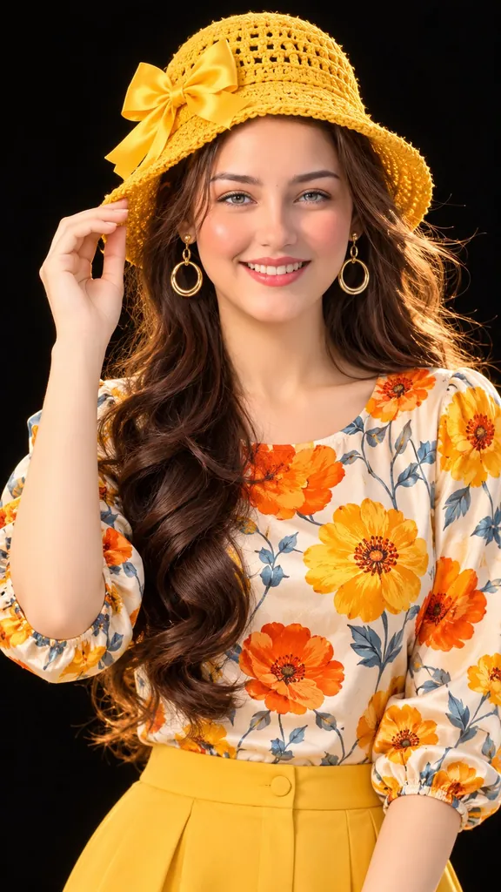
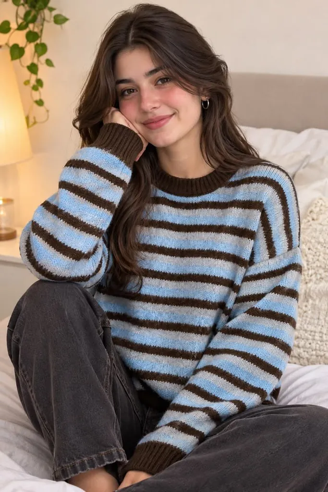
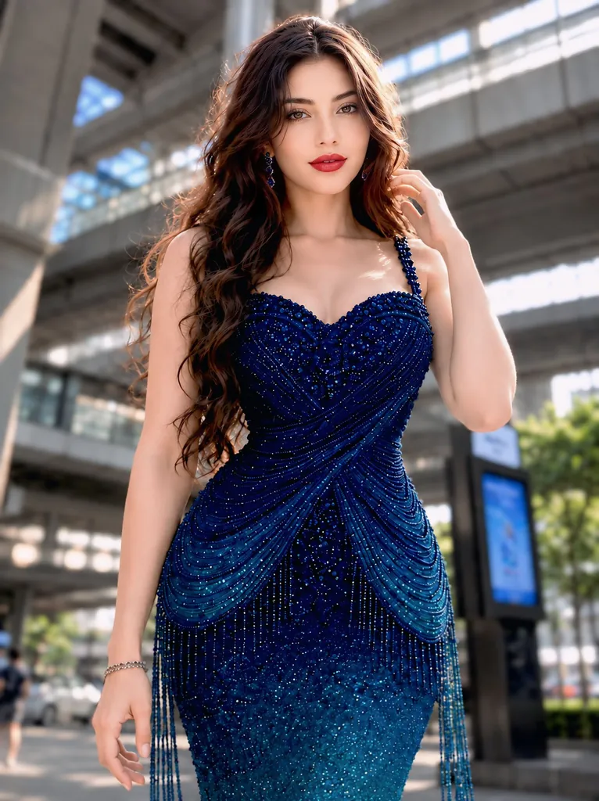
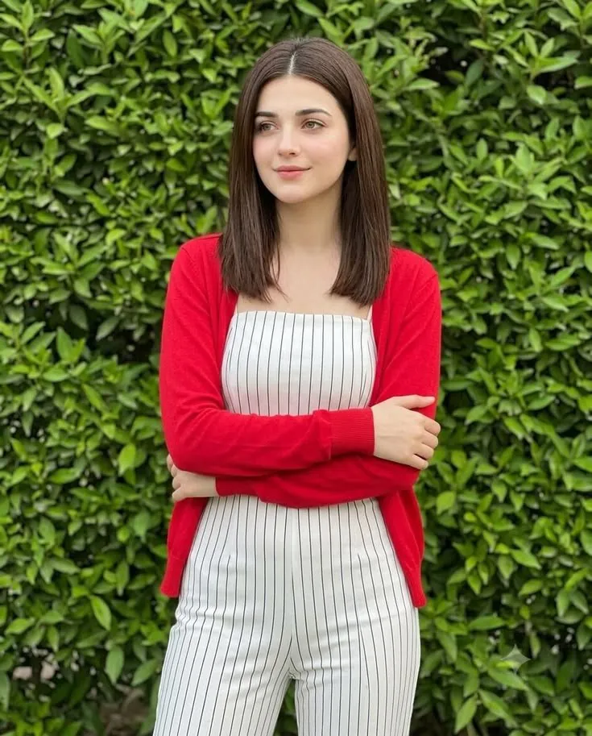
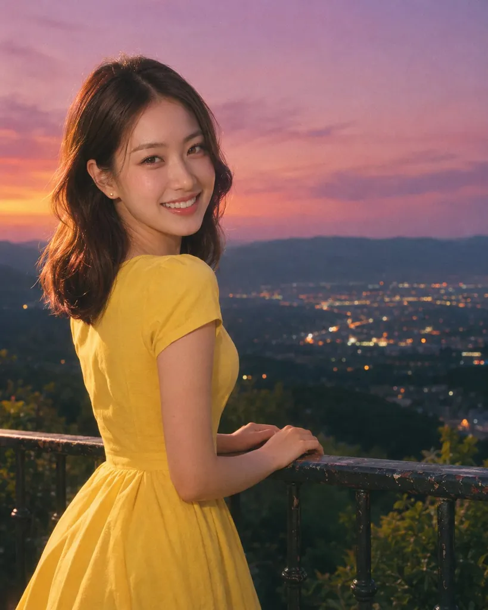

# Photography — 609 community examples

[← Back to Community Examples](../EXAMPLES.md) · Page 6 / 6: [1](./x-photography.md) · [2](./x-photography-2.md) · [3](./x-photography-3.md) · [4](./x-photography-4.md) · [5](./x-photography-5.md) · **6**

Community results kept as posted. Each card credits its creator and links to the original post.

<table>
<tr><td width="33%" valign="top"> <a href="https://x.com/HaniaAi12/status/2122886883994746946"><b>@HaniaAi12</b></a> · <a href="../prompts/x/x-01745.md">Prompt</a> GPT Image 2 · via X</td><td width="33%" valign="top"> <a href="https://x.com/AIwithRubii/status/2121522846048678162"><b>@AIwithRubii</b></a> · <a href="../prompts/x/x-01746.md">Prompt</a> GPT Image · via X</td><td width="33%" valign="top"> <a href="https://x.com/AizaAi12/status/2123380215317676180"><b>@AizaAi12</b></a> · <a href="../prompts/x/x-01747.md">Prompt</a> GPT Image 2 · via X</td></tr>
<tr><td width="33%" valign="top"> <a href="https://x.com/AIwithRubii/status/2122742391270723825"><b>@AIwithRubii</b></a> · <a href="../prompts/x/x-01748.md">Prompt</a> GPT Image 2 · via X</td><td width="33%" valign="top"> <a href="https://x.com/AyeshaEvie/status/2123411037718462564"><b>@AyeshaEvie</b></a> · <a href="../prompts/x/x-01749.md">Prompt</a> GPT Image 2 · via X</td><td width="33%" valign="top"> <a href="https://x.com/AIwithRubii/status/2124136460114956664"><b>@AIwithRubii</b></a> · <a href="../prompts/x/x-01750.md">Prompt</a> GPT Image 2 · via X</td></tr>
<tr><td width="33%" valign="top"> <a href="https://x.com/ai_fengshou/status/2122703052746453315"><b>@ai_fengshou</b></a> · <a href="../prompts/x/x-01751.md">Prompt</a> GPT Image 2 · via X</td><td width="33%" valign="top"> <a href="https://x.com/cheoneusin/status/2126455681884831940"><b>@cheoneusin</b></a> · <a href="../prompts/x/x-01752.md">Prompt</a> GPT Image 2.6 · via X</td><td width="33%" valign="top"> <a href="https://x.com/cheoneusin/status/2126172980468404341"><b>@cheoneusin</b></a> · <a href="../prompts/x/x-01753.md">Prompt</a> GPT Image 2.6 · via X</td></tr>
</table>

**[▶ Generate your own version on vinano.ai](https://vinano.ai?utm_source=github&utm_medium=readme&utm_campaign=awesome-image-video-prompts-updating&utm_content=x-gallery-bottom)**
