# Poster Design — 159 community examples

[← Back to Community Examples](../EXAMPLES.md) · Page 2 / 2: [1](./x-poster-design.md) · **2**

Community results kept as posted. Each card credits its creator and links to the original post.

<table>
<tr><td width="33%" valign="top"><a href="../prompts/x/x-01408.md">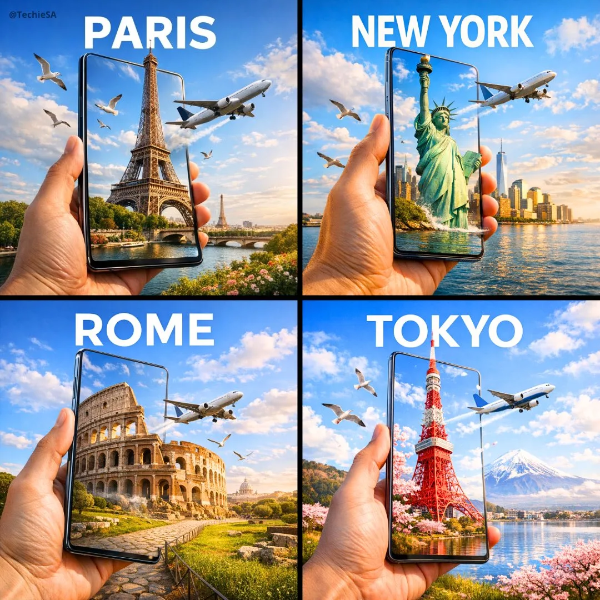</a> <a href="https://x.com/TechieBySA/status/2007190982408974659"><b>@TechieBySA</b></a> · <a href="../prompts/x/x-01408.md">Prompt</a> GPT Image · via X</td><td width="33%" valign="top"><a href="../prompts/x/x-01414.md">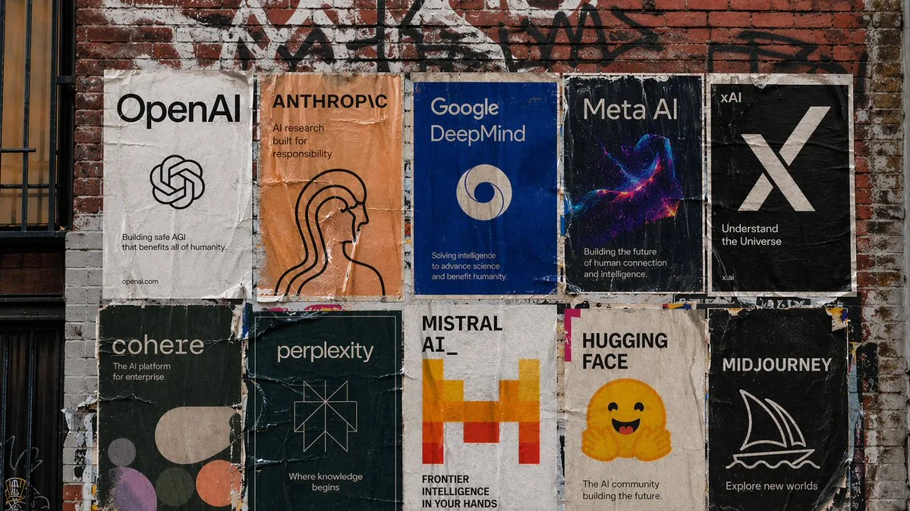</a> <a href="https://x.com/venturetwins/status/2046700418554851630"><b>@venturetwins</b></a> · <a href="../prompts/x/x-01414.md">Prompt</a> GPT Image · via X</td><td width="33%" valign="top"> <a href="https://x.com/aleenaamiir/status/2047325329052823996"><b>@aleenaamiir</b></a> · <a href="../prompts/x/x-01427.md">Prompt</a> GPT Image · via X</td></tr>
<tr><td width="33%" valign="top"> <a href="https://x.com/old_pgmrs_will/status/2045852114673635507"><b>@old_pgmrs_will</b></a> · <a href="../prompts/x/x-01428.md">Prompt</a> GPT Image · via X</td><td width="33%" valign="top"><a href="../prompts/x/x-01431.md">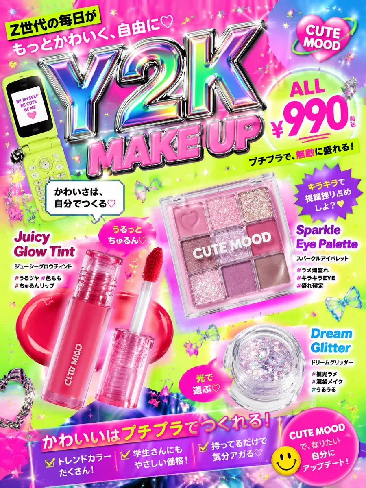</a> <a href="https://x.com/midori_tatsuta/status/2045378877363798279"><b>@midori_tatsuta</b></a> · <a href="../prompts/x/x-01431.md">Prompt</a> GPT Image · via X</td><td width="33%" valign="top"> <a href="https://x.com/austinit/status/2046037688969769346"><b>@austinit</b></a> · <a href="../prompts/x/x-01432.md">Prompt</a> GPT Image · via X</td></tr>
<tr><td width="33%" valign="top"> <a href="https://x.com/Diplomeme/status/2047986905896427670"><b>@Diplomeme</b></a> · <a href="../prompts/x/x-01435.md">Prompt</a> GPT Image · via X</td><td width="33%" valign="top"><a href="../prompts/x/x-01437.md">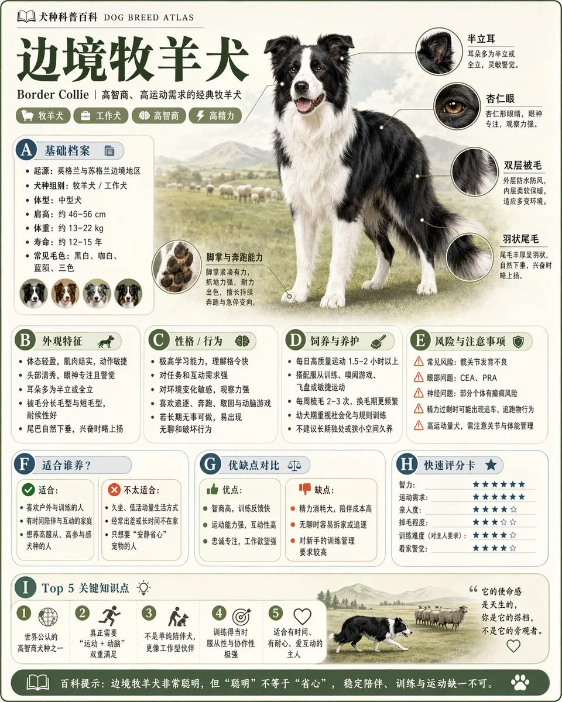</a> <a href="https://x.com/MrLarus/status/2046231542817497392"><b>@MrLarus</b></a> · <a href="../prompts/x/x-01437.md">Prompt</a> GPT Image · via X</td><td width="33%" valign="top"><a href="../prompts/x/x-01440.md">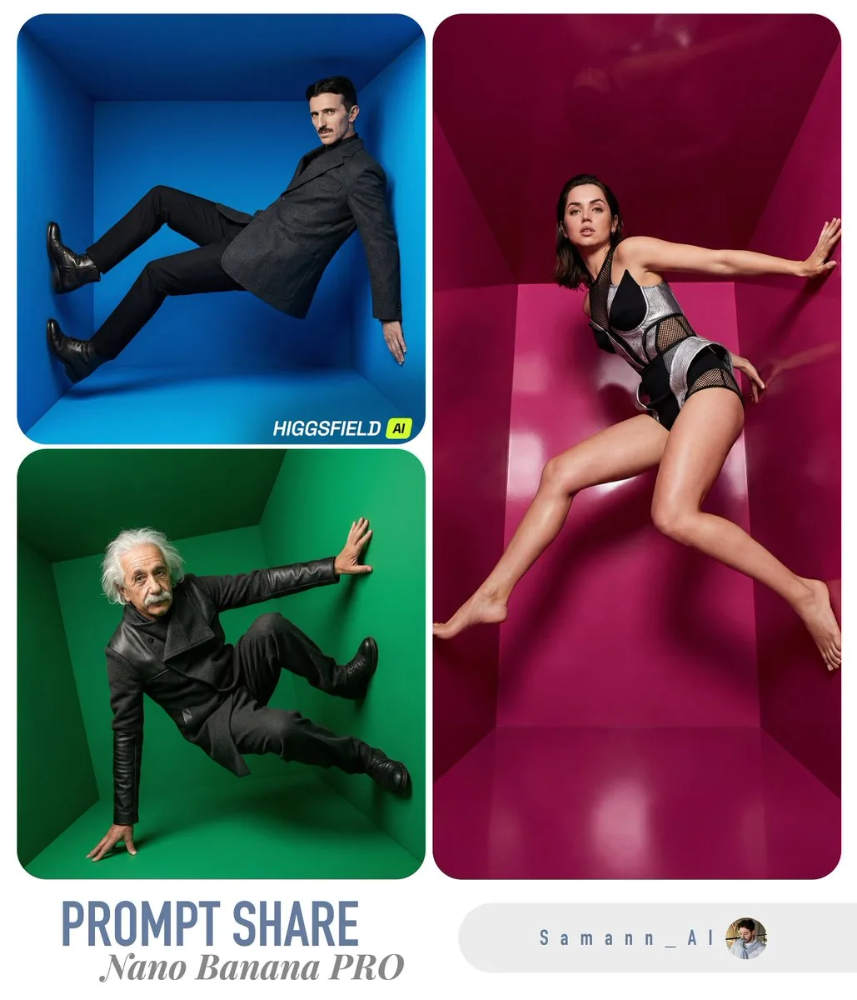</a> <a href="https://x.com/Samann_ai/status/2017598696678895882"><b>@Samann_ai</b></a> · <a href="../prompts/x/x-01440.md">Prompt</a> GPT Image · via X</td></tr>
<tr><td width="33%" valign="top"><a href="../prompts/x/x-01441.md">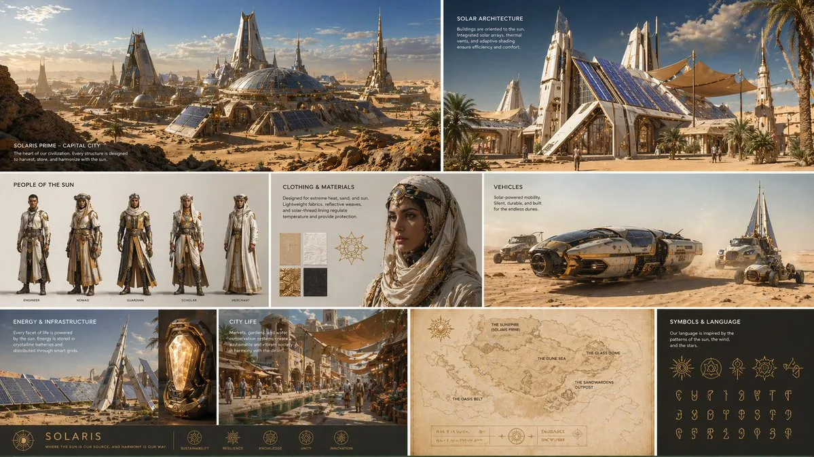</a> <a href="https://x.com/aleenaamiir/status/2046866168208916503"><b>@aleenaamiir</b></a> · <a href="../prompts/x/x-01441.md">Prompt</a> GPT Image · via X</td><td width="33%" valign="top"> <a href="https://x.com/MrLarus/status/2048360321379701233"><b>@MrLarus</b></a> · <a href="../prompts/x/x-01443.md">Prompt</a> GPT Image · via X</td><td width="33%" valign="top"> <a href="https://x.com/MrLarus/status/2045504669401653414"><b>@MrLarus</b></a> · <a href="../prompts/x/x-01444.md">Prompt</a> GPT Image · via X</td></tr>
<tr><td width="33%" valign="top"><a href="../prompts/x/x-01446.md">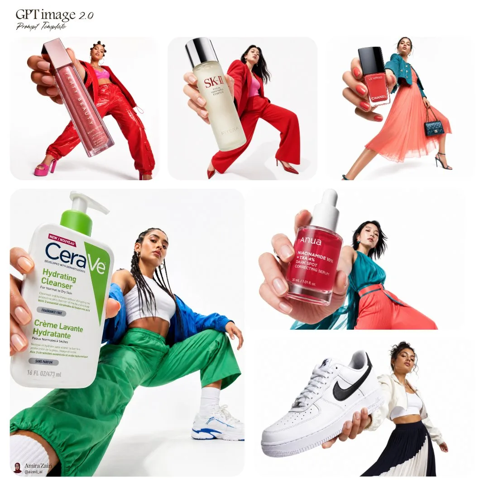</a> <a href="https://x.com/azed_ai/status/2048748266293190833"><b>@azed_ai</b></a> · <a href="../prompts/x/x-01446.md">Prompt</a> GPT Image · via X</td><td width="33%" valign="top"><a href="../prompts/x/x-01478.md">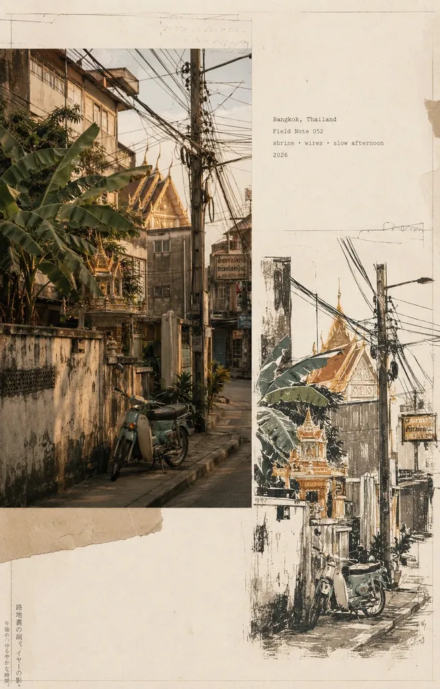</a> <a href="https://x.com/aniyaintel/status/2093658819427741802"><b>@aniyaintel</b></a> · <a href="../prompts/x/x-01478.md">Prompt</a> Nano Banana Pro · via X</td><td width="33%" valign="top"><a href="../prompts/x/x-01484.md">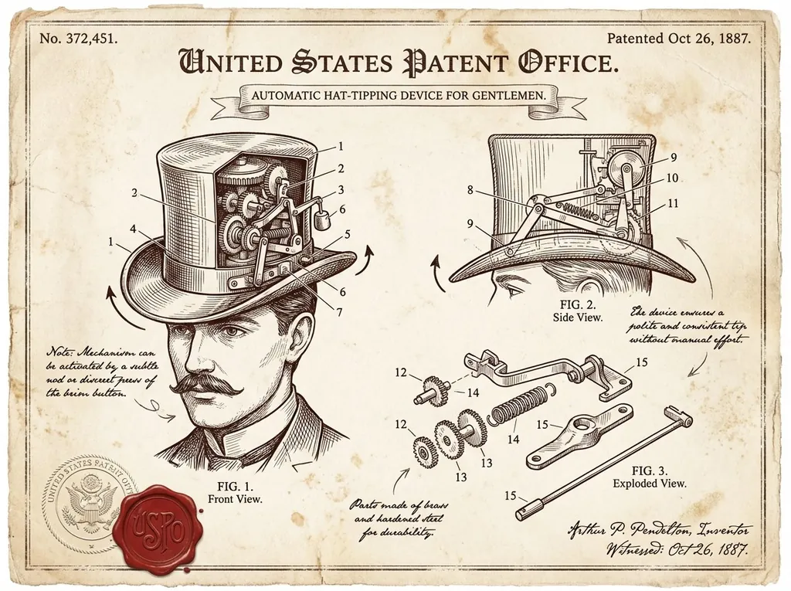</a> <a href="https://x.com/AllaAisling/status/2004212035333365763"><b>@AllaAisling</b></a> · <a href="../prompts/x/x-01484.md">Prompt</a> Nano Banana · via X</td></tr>
<tr><td width="33%" valign="top"> <a href="https://x.com/Aiwithkami/status/2124401464932184540"><b>@Aiwithkami</b></a> · <a href="../prompts/x/x-01504.md">Prompt</a> GPT Image 2.6 · via X</td><td width="33%" valign="top"> <a href="https://x.com/churvikv/status/2123819465796206817"><b>@churvikv</b></a> · <a href="../prompts/x/x-01505.md">Prompt</a> GPT Image 2.6 Sunburst · via X</td><td width="33%" valign="top"><a href="../prompts/x/x-01525.md">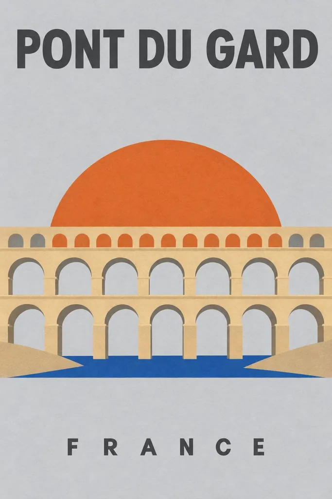</a> <a href="https://x.com/Alyssa4aicreate/status/2124252164352610526"><b>@Alyssa4aicreate</b></a> · <a href="../prompts/x/x-01525.md">Prompt</a> GPT Image 2.6 Flare · via X</td></tr>
<tr><td width="33%" valign="top"><a href="../prompts/x/x-01528.md">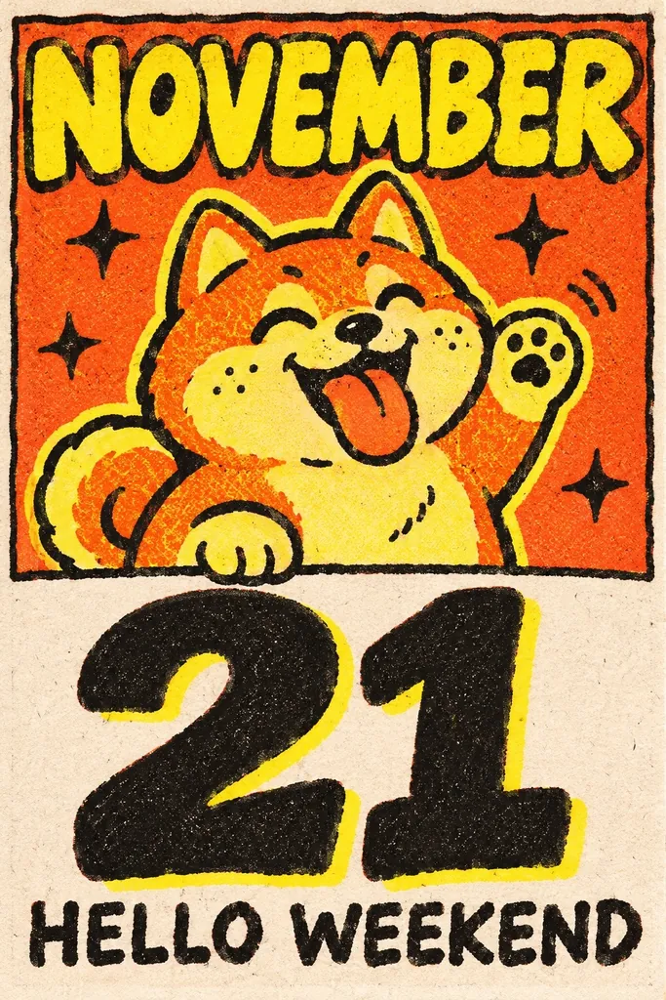</a> <a href="https://x.com/static_stare/status/2124075903554928681"><b>@static_stare</b></a> · <a href="../prompts/x/x-01528.md">Prompt</a> GPT Image 2.5 · via X</td><td width="33%" valign="top"><a href="../prompts/x/x-01531.md">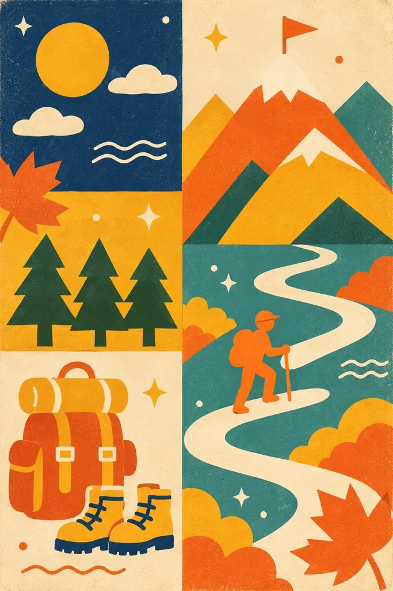</a> <a href="https://x.com/static_stare/status/2123998701295489519"><b>@static_stare</b></a> · <a href="../prompts/x/x-01531.md">Prompt</a> GPT Image 2.5 · via X</td><td width="33%" valign="top"> <a href="https://x.com/static_stare/status/2124437182425518275"><b>@static_stare</b></a> · <a href="../prompts/x/x-01533.md">Prompt</a> GPT Image 2.5 · via X</td></tr>
<tr><td width="33%" valign="top"><a href="../prompts/x/x-01538.md">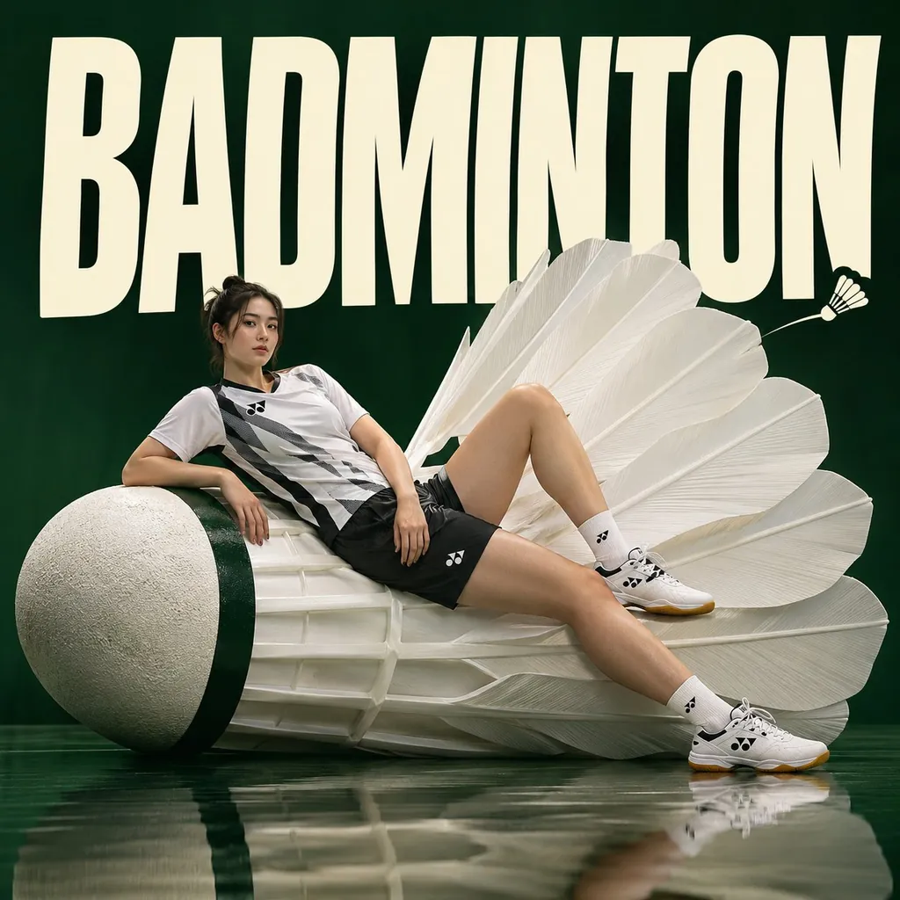</a> <a href="https://x.com/Goodmanprotocol/status/2124756790143488011"><b>@Goodmanprotocol</b></a> · <a href="../prompts/x/x-01538.md">Prompt</a> GPT Image 2.6 · via X</td><td width="33%" valign="top"> <a href="https://x.com/ZDuo_MoreAi/status/2124764888480543222"><b>@ZDuo_MoreAi</b></a> · <a href="../prompts/x/x-01547.md">Prompt</a> GPT Image 2.6 · via X</td><td width="33%" valign="top"><a href="../prompts/x/x-01549.md">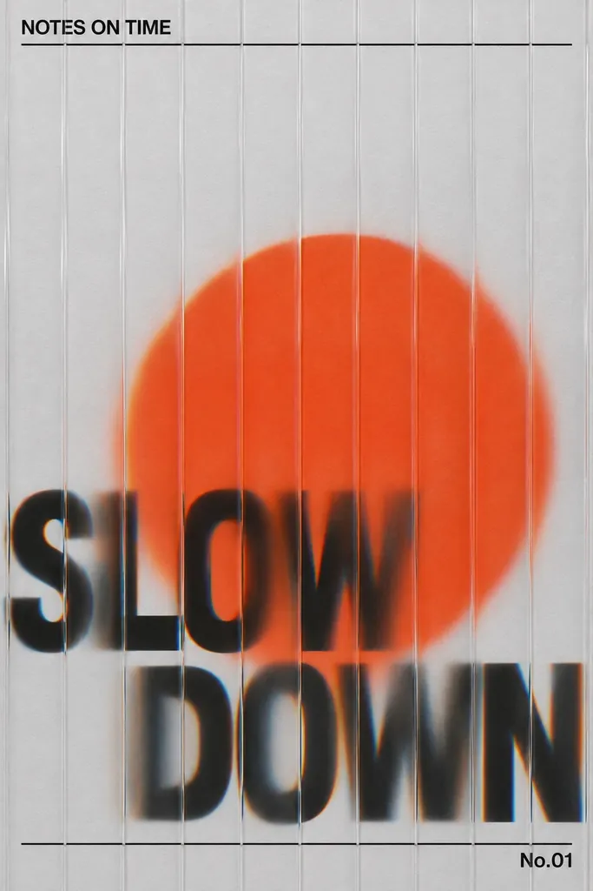</a> <a href="https://x.com/static_stare/status/2124799205839606209"><b>@static_stare</b></a> · <a href="../prompts/x/x-01549.md">Prompt</a> GPT Image 2.5 · via X</td></tr>
<tr><td width="33%" valign="top"><a href="../prompts/x/x-01554.md">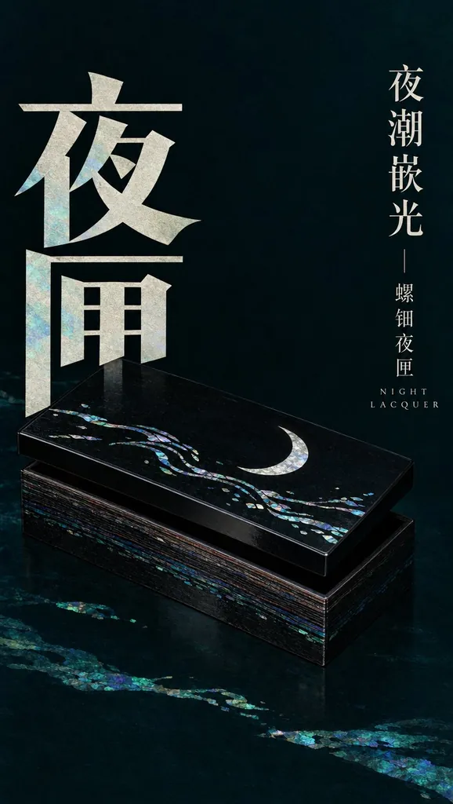</a> <a href="https://x.com/Andy4aicreate/status/2124934011592085845"><b>@Andy4aicreate</b></a> · <a href="../prompts/x/x-01554.md">Prompt</a> GPT Image 2.5 Flare · via X</td><td width="33%" valign="top"><a href="../prompts/x/x-01558.md">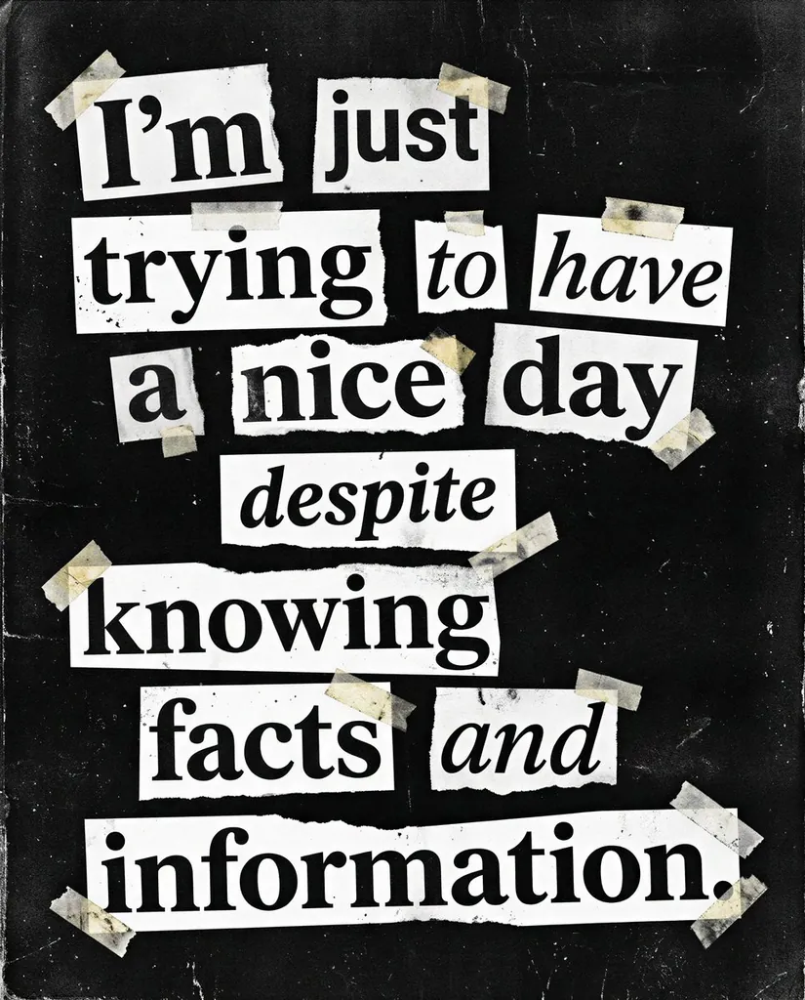</a> <a href="https://x.com/heathergreen/status/2124321978911711493"><b>@heathergreen</b></a> · <a href="../prompts/x/x-01558.md">Prompt</a> Nano Banana 2.1 · via X</td><td width="33%" valign="top"><a href="../prompts/x/x-01559.md">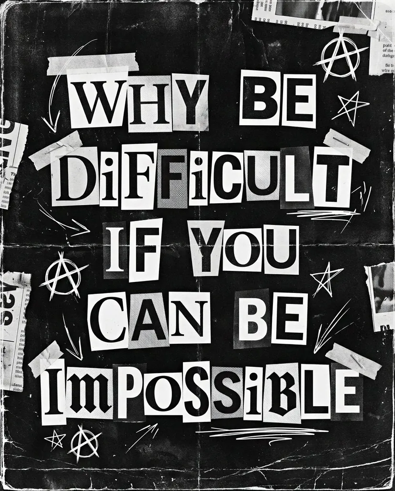</a> <a href="https://x.com/heathergreen/status/2124684359680630949"><b>@heathergreen</b></a> · <a href="../prompts/x/x-01559.md">Prompt</a> Nano Banana 2.1 · via X</td></tr>
<tr><td width="33%" valign="top"> <a href="https://x.com/CoopandKCmom/status/2124727709351715301"><b>@CoopandKCmom</b></a> · <a href="../prompts/x/x-01578.md">Prompt</a> Nano Banana 2.1 · via X</td><td width="33%" valign="top"> <a href="https://x.com/MrLarus/status/2125257923131773007"><b>@MrLarus</b></a> · <a href="../prompts/x/x-01618.md">Prompt</a> GPT Image 2.6 · via X</td><td width="33%" valign="top"> <a href="https://x.com/Aiwithkami/status/2125476933056217417"><b>@Aiwithkami</b></a> · <a href="../prompts/x/x-01626.md">Prompt</a> GPT Image 2.6 · via X</td></tr>
<tr><td width="33%" valign="top"> <a href="https://x.com/Just_Anika_Here/status/2125627017622323425"><b>@Just_Anika_Here</b></a> · <a href="../prompts/x/x-01630.md">Prompt</a> GPT Image 2.5 · via X</td><td width="33%" valign="top"> <a href="https://x.com/DavidLi36143625/status/2125535309999796460"><b>@DavidLi36143625</b></a> · <a href="../prompts/x/x-01639.md">Prompt</a> GPT Image 2.6 Sunburst · via X</td><td width="33%" valign="top"> <a href="https://x.com/Goodmanprotocol/status/2125825694693564441"><b>@Goodmanprotocol</b></a> · <a href="../prompts/x/x-01675.md">Prompt</a> GPT Image 2.6 · via X</td></tr>
<tr><td width="33%" valign="top"> <a href="https://x.com/ZDuo_MoreAi/status/2125907419213771113"><b>@ZDuo_MoreAi</b></a> · <a href="../prompts/x/x-01679.md">Prompt</a> GPT Image 2.6 · via X</td><td width="33%" valign="top"><a href="../prompts/x/x-01694.md">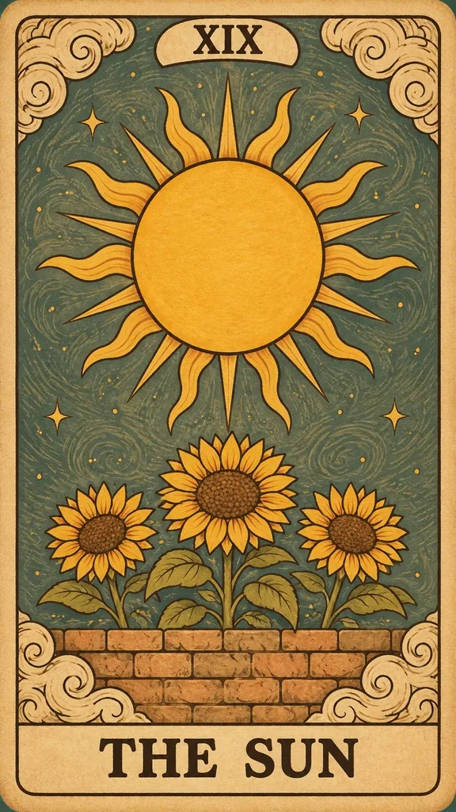</a> <a href="https://x.com/static_stare/status/2125887339839000879"><b>@static_stare</b></a> · <a href="../prompts/x/x-01694.md">Prompt</a> GPT Image 2.5 · via X</td><td width="33%" valign="top"><a href="../prompts/x/x-01699.md">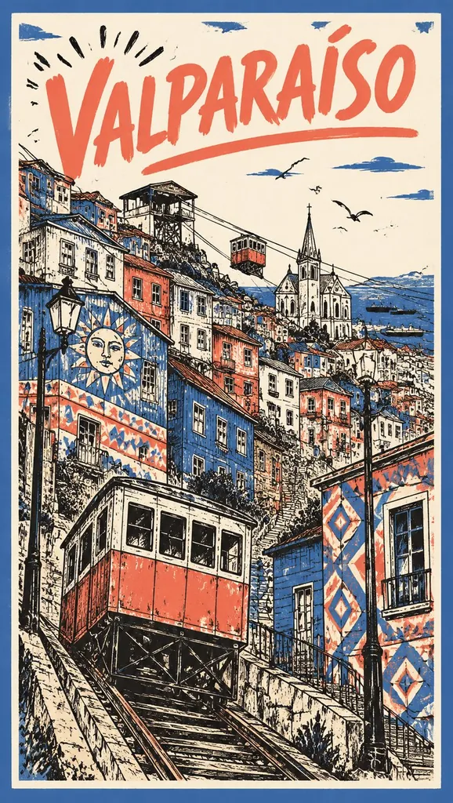</a> <a href="https://x.com/Andy4aicreate/status/2126019163009286328"><b>@Andy4aicreate</b></a> · <a href="../prompts/x/x-01699.md">Prompt</a> GPT Image 2.6 Flare · via X</td></tr>
<tr><td width="33%" valign="top"> <a href="https://x.com/static_stare/status/2126175529011495033"><b>@static_stare</b></a> · <a href="../prompts/x/x-01725.md">Prompt</a> GPT Image 2.5 · via X</td><td width="33%" valign="top"> <a href="https://x.com/xiaoxiaodong/status/2121587331371290946"><b>@xiaoxiaodong</b></a> · <a href="../prompts/x/x-01741.md">Prompt</a> GPT Image 2 · via X</td><td width="33%" valign="top"> <a href="https://x.com/xiaoxiaodong/status/2120876175656710416"><b>@xiaoxiaodong</b></a> · <a href="../prompts/x/x-01742.md">Prompt</a> GPT Image 2 · via X</td></tr>
</table>

**[▶ Generate your own version on vinano.ai](https://vinano.ai?utm_source=github&utm_medium=readme&utm_campaign=awesome-image-video-prompts-updating&utm_content=x-gallery-bottom)**
