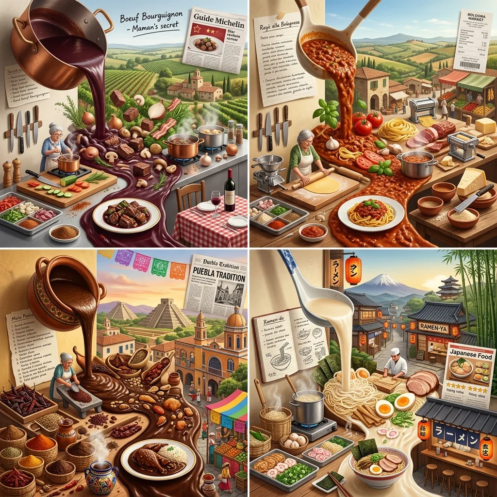

# 2x2 grid, do this for 4 famous cuisines

[← Back to the collection](../../README.md) · Category: [Food & Drink](../../gallery/food-drink.md) · Model: `Vinano Image Pro` · ID: `vn-00037`

<a href="https://vinano.ai?utm_source=github&utm_medium=readme&utm_campaign=awesome-image-video-prompts-updating&utm_content=prompt-page-image"></a>

<sub>Preview generated with <a href="https://vinano.ai?utm_source=github&utm_medium=readme&utm_campaign=awesome-image-video-prompts-updating&utm_content=prompt-page-caption">vinano.ai</a></sub>

## Prompt

```text
2x2 grid, do this for 4 famous cuisines: function dish(AA){
<instruction>
Input A is a Famous Dish / Culinary Tradition / Signature Dessert / Regional Specialty.

Analyze:
- ingredient hierarchy, cooking method, plating logic
- origin region, historical story, ritual or social context
- flavor architecture translated into visual composition
- symbolic ingredients, cookware, and dining environment
- chef or tradition lineage

Goal:
A "sauce pour environment."
A giant ladle, piping bag, or sauce boat is pouring the primary sauce, cream, glaze, broth, or puree onto a table.
The flowing edible medium rises into a detailed 3D world of the dish: ingredients, preparation stages, origin landscape, and plated final form merging together.

Rules:
- the poured substance must remain recognizably edible while forming the scene
- include knives, cutting board, handwritten recipe notes, ingredient trays, steam, spice dust, region-appropriate tools
- include a tiny chef or grandmother figure preparing a miniature version nearby
- include a food critic headline, market receipt, or origin-story clipping
- semantically infer cuisine-specific vessels, table culture, garnish logic, and environment
- no random food pile; composition must reveal flavor structure and culinary history
- lighting: appetizing natural kitchen light rich edible texture

Output:
ONE image, 4:5, culinary-process diorama aesthetic
</instruction>

Output:
2x2 grid, each grid a different dish(AA) output
}

Preserve realistic proportions and depth for a confident, professional finish.
```

## Try it on vinano.ai

1. Copy the prompt above.
2. Open **[vinano.ai](https://vinano.ai?utm_source=github&utm_medium=readme&utm_campaign=awesome-image-video-prompts-updating&utm_content=prompt-page-try)**, paste it into the image generator and pick a model.
3. Swap any placeholders (brand, product, city, person…) for your own details, then generate.

More prompts like this: [Food & Drink gallery](../../gallery/food-drink.md) · [all categories](../../README.md#contents)
