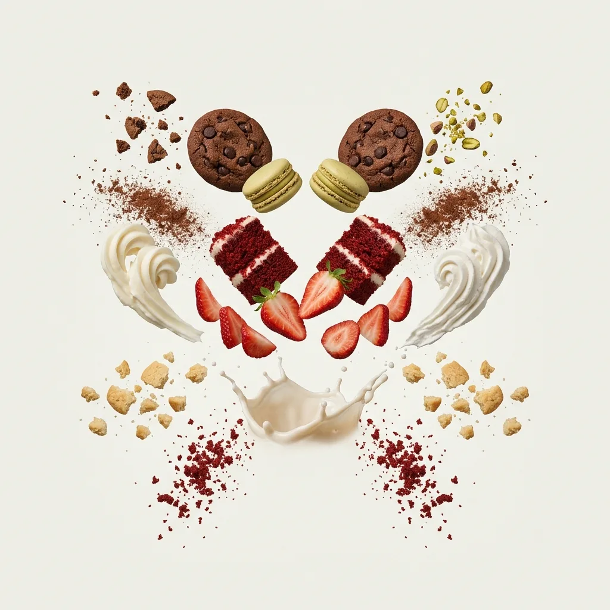

# ARRI Alexa 65

[← Back to the collection](../../README.md) · Category: [Food & Drink](../../gallery/food-drink.md) · Model: `Vinano Image v2` · ID: `vn-00042`

<a href="https://vinano.ai?utm_source=github&utm_medium=readme&utm_campaign=awesome-image-video-prompts-updating&utm_content=prompt-page-image"></a>

<sub>Preview generated with <a href="https://vinano.ai?utm_source=github&utm_medium=readme&utm_campaign=awesome-image-video-prompts-updating&utm_content=prompt-page-caption">vinano.ai</a></sub>

## Prompt

```text
{
 "production_manifest": {
 "metadata": {
 "series_id": "CIN-FOOD-2025",
 "aspect_ratio": "9:16",
 "resolution_target": "8k_uhd"
 },
 "technical_stack": {
 "hardware": {
 "camera": "ARRI Alexa 65",
 "lens_profile": "Large format cinematic prime"
 },
 "film_emulation": {
 "stock": "Kodak Portra 400",
 "characteristics": ["Fine grain", "Natural skin tones", "Warm highlights"]
 },
 "lighting_rig": {
 "style": "Cinematic soft glow",
 "atmosphere": "Timeless indoor",
 "diffusion": "High"
 }
 },
 "artistic_direction": {
 "visionary_style": "Greta Gerwig",
 "composition_rule": "Graphic centered symmetry",
 "physics_engine": "Suspended animation / Zero gravity",
 "background_specification": "Flat off-white / Studio bone"
 },
 "variant_registry": [{
 "id": "VAR-001",
 "flavor_profile": "Dark Chocolate Chip & Oat",
 "tonal_emotion": "Playful, cheeky yet chic",
 "ingredients": {
 "primary_solids": ["Dark chocolate chip cookies"],
 "fluid_fx": ["Oat milk splash"],
 "debris": ["Cookie crumbs"]
 }
 },
 {
 "id": "VAR-002",
 "flavor_profile": "Red Velvet",
 "tonal_emotion": "Bold, playful chic",
 "ingredients": {
 "primary_solids": ["Red velvet cake pieces"],
 "fluid_fx": ["Cream cheese frosting swirls"],
 "debris": ["Cocoa dust", "Fine red cake crumbs"]
 }
 },
 {
 "id": "VAR-003",
 "flavor_profile": "Pistachio Macaron",
 "tonal_emotion": "Refined, playful chic",
 "ingredients": {
 "primary_solids": ["Pistachio macarons"],
 "fluid_fx": ["Cream filling swirls"],
 "debris": ["Crushed pistachio nuts"]
 }
 },
 {
 "id": "VAR-004",
 "flavor_profile": "Strawberry Shortcake",
 "tonal_emotion": "Sweet, playful yet chic",
 "ingredients": {
 "primary_solids": ["Fresh strawberry slices"],
 "fluid_fx": ["Whipped cream swirls"],
 "debris": ["Shortcake biscuit crumbs"]
 }
 }]
 }
}

Aim for an editorial, design-driven look with deliberate negative space.
```

## Try it on vinano.ai

1. Copy the prompt above.
2. Open **[vinano.ai](https://vinano.ai?utm_source=github&utm_medium=readme&utm_campaign=awesome-image-video-prompts-updating&utm_content=prompt-page-try)**, paste it into the image generator and pick a model.
3. Swap any placeholders (brand, product, city, person…) for your own details, then generate.

More prompts like this: [Food & Drink gallery](../../gallery/food-drink.md) · [all categories](../../README.md#contents)
