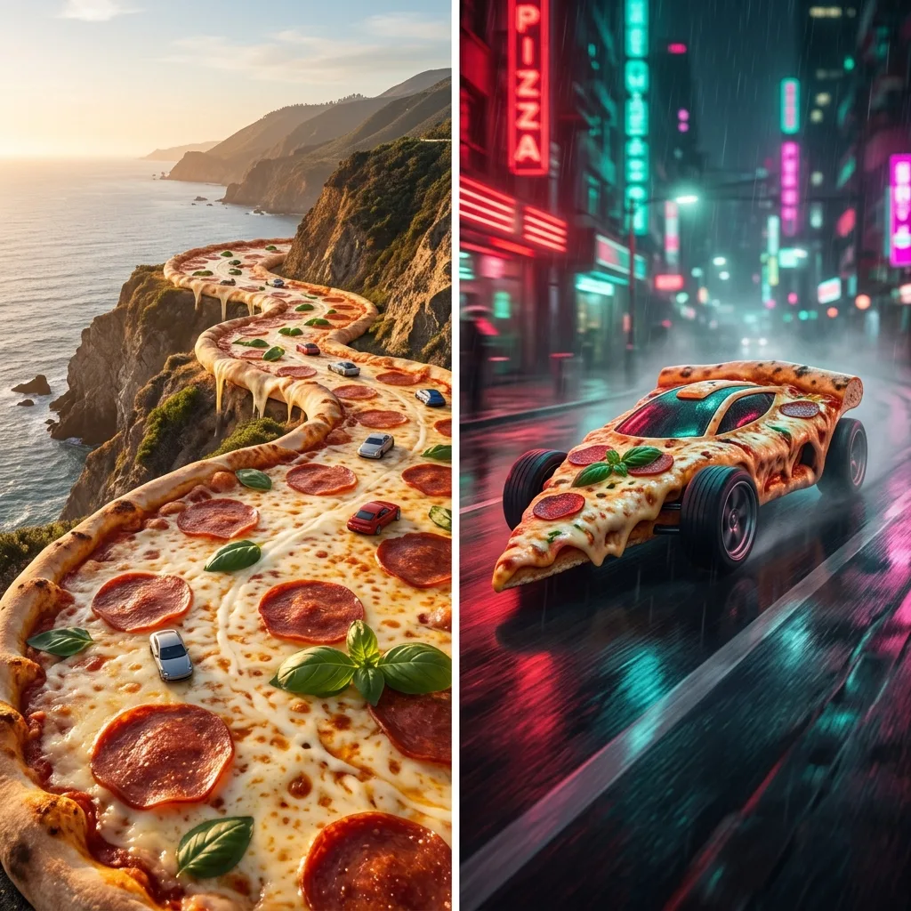

# Pizza Coastline Mountain Road

[← Back to the collection](../../README.md) · Category: [Food & Drink](../../gallery/food-drink.md) · Model: `Vinano Image v2` · ID: `vn-00067`

<a href="https://vinano.ai?utm_source=github&utm_medium=readme&utm_campaign=awesome-image-video-prompts-updating&utm_content=prompt-page-image"></a>

<sub>Preview generated with <a href="https://vinano.ai?utm_source=github&utm_medium=readme&utm_campaign=awesome-image-video-prompts-updating&utm_content=prompt-page-caption">vinano.ai</a></sub>

## Prompt

```text
{
 "Objective": "Create a surreal, hyper-detailed fantasy world where pizza becomes an integral part of landscapes and technology",
 "Concept": "Imaginative surrealism blending true-to-life photorealistic food textures cinematic fantasy environments",
 "Scenes": [{
 "SceneName": "Pizza Coastline Mountain Road",
 "SceneDescription": {
 "Environment": "Dramatic coastal cliffs overlooking the ocean",
 "PrimaryStructure": "A giant pepperoni pizza forming a winding mountain road",
 "WorldIntegration": {
 "Cheese": "Melted cheese forming the roadway surface",
 "Toppings": "Pepperoni slices and basil leaves acting as traffic islands and terrain features"
 },
 "ScaleElements": {
 "Vehicles": "Tiny cars driving across the pizza road",
 "ScaleContrast": "Massive pizza landscape versus miniature vehicles"
 }
 },
 "LightingAndMood": {
 "TimeOfDay": "Golden hour",
 "Lighting": "Warm coastal sunlight long shadows",
 "Mood": "Whimsical, epic, playful wonder"
 },
 "Composition": {
 "Camera": "Cinematic wide-angle view",
 "Perspective": "Elevated, sweeping landscape shot",
 "DepthOfField": "Moderate depth foreground and background clarity"
 }
 },
 {
 "SceneName": "Pizza Futuristic Car",
 "SceneDescription": {
 "Environment": "Rainy neon-lit cyberpunk city street at night",
 "PrimarySubject": "A pizza slice transformed into a futuristic car",
 "DesignDetails": {
 "Body": "Pizza crust and melted cheese forming aerodynamic shape",
 "Toppings": "Pepperoni and basil integrated into vehicle design",
 "Wheels": "Realistic rubber tires attached to the pizza vehicle"
 },
 "Motion": "Speeding through the street dynamic motion blur"
 },
 "LightingAndMood": {
 "TimeOfDay": "Night",
 "Lighting": "Moody cyberpunk neon lights in red, teal, and magenta",
 "Atmosphere": "Rain, mist, reflections on wet asphalt",
 "Mood": "Energetic, futuristic, playful surrealism"
 },
 "Composition": {
 "Camera": "Low-angle wide shot",
 "Perspective": "Dynamic chase-style framing",
 "DepthOfField": "Shallow depth of field background bokeh"
 }
 }],
 "ArtDirection": {
 "Style": "Playful yet true-to-life photorealistic surrealism",
 "TextureQuality": {
 "Food": "Ultra-realistic pizza textures, visible oil sheen, stretchy melted cheese",
 "Environment": "High-detail rocks, asphalt, rain droplets, reflections"
 },
 "RealismBalance": "true-to-life photorealistic materials combined impossible scale and concepts"
 },
 "VisualStyle": {
 "Resolution": "8K ultra-high detail",
 "ColorGrading": "Cinematic contrast warm coastal tones and cool neon city tones",
 "Depth": "Strong sense of scale and dimensionality"
 },
 "Mood": {
 "OverallTone": "Imaginative, whimsical, cinematic",
 "EmotionalFeel": "Playful awe and creative wonder"
 },
 "NegativePrompt": ["flat lighting",
 "cartoon-only style",
 "low detail textures",
 "plastic food",
 "blurry focus",
 "dull colors"],
 "ResponseFormat": {
 "Type": "Two-scene cinematic illustration or render",
 "OutputOptions": ["Split composition",
 "Diptych",
 "Two separate images"],
 "AspectRatio": "16:9"
 }
}

Aim for an editorial, design-driven look with deliberate negative space.
```

## Try it on vinano.ai

1. Copy the prompt above.
2. Open **[vinano.ai](https://vinano.ai?utm_source=github&utm_medium=readme&utm_campaign=awesome-image-video-prompts-updating&utm_content=prompt-page-try)**, paste it into the image generator and pick a model.
3. Swap any placeholders (brand, product, city, person…) for your own details, then generate.

More prompts like this: [Food & Drink gallery](../../gallery/food-drink.md) · [all categories](../../README.md#contents)
