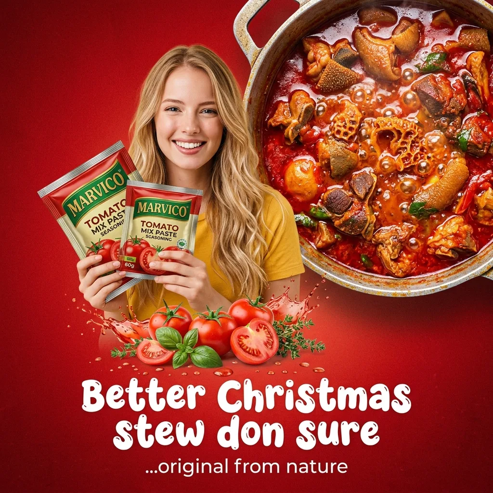

# Two foil sachets of Marvico Tomato Mix Paste seasoning

[← Back to the collection](../../README.md) · Category: [Food & Drink](../../gallery/food-drink.md) · Model: `Vinano Image Pro` · ID: `vn-00084`

<a href="https://vinano.ai?utm_source=github&utm_medium=readme&utm_campaign=awesome-image-video-prompts-updating&utm_content=prompt-page-image"></a>

<sub>Preview generated with <a href="https://vinano.ai?utm_source=github&utm_medium=readme&utm_campaign=awesome-image-video-prompts-updating&utm_content=prompt-page-caption">vinano.ai</a></sub>

## Prompt

```text
{
 "subject": {
 "primary": "Two foil sachets of Marvico Tomato Mix Paste seasoning tilted diagonally",
 "secondary": "A rustic metal pot filled rich, bubbling red Nigerian-style tomato stew containing assorted meats and tripe",
 "details": ["Vibrant red tomato sauce consistency",
 "Fresh whole tomato splash at the bottom foreground",
 "Sachets feature green and gold 'MARVICO' branding realistic tomato illustrations",
 "A cheerful young Western blonde woman long hair, wearing a casual bright outfit, holding the sachets and smiling at the camera"]
 },
 "composition": {
 "layout": "Dynamic vertical advertisement",
 "focal_point": "Product sachets held by the girl in the center-left, overlapping a large pot of stew in the top-right",
 "background": "Solid textured red gradient a subtle grainy paper effect",
 "perspective": "Eye-level a slight Dutch angle for energy"
 },
 "typography": {
 "main_text": "Better Christmas stew don sure",
 "sub_text": "...original from nature",
 "font_style": "Bold, playful white bubble script for main text; refined minimalist lowercase sans-serif for sub-text",
 "placement": "Centered at the bottom over the red background"
 },
 "color_palette": {
 "dominant": ["Crimson Red", "Deep Scarlet"],
 "accents": ["Forest Green", "Metallic Gold", "Bright White"],
 "lighting": "Studio lighting high contrast to make the red sauce look glossy and appetizing"
 },
 "style_descriptors": ["Commercial food photography",
 "West African culinary aesthetic",
 "High-definition textures",
 "Vibrant and warm color grading",
 "Professional product placement",
 "Lifestyle advertising a relatable model"],
 "technical_settings": {
 "aspect_ratio": "4:5",
 "sharpness": "High",
 "texture": "Subtle film grain on the background"
 }
}

Aim for an editorial, design-driven look with deliberate negative space.
```

## Try it on vinano.ai

1. Copy the prompt above.
2. Open **[vinano.ai](https://vinano.ai?utm_source=github&utm_medium=readme&utm_campaign=awesome-image-video-prompts-updating&utm_content=prompt-page-try)**, paste it into the image generator and pick a model.
3. Swap any placeholders (brand, product, city, person…) for your own details, then generate.

More prompts like this: [Food & Drink gallery](../../gallery/food-drink.md) · [all categories](../../README.md#contents)
