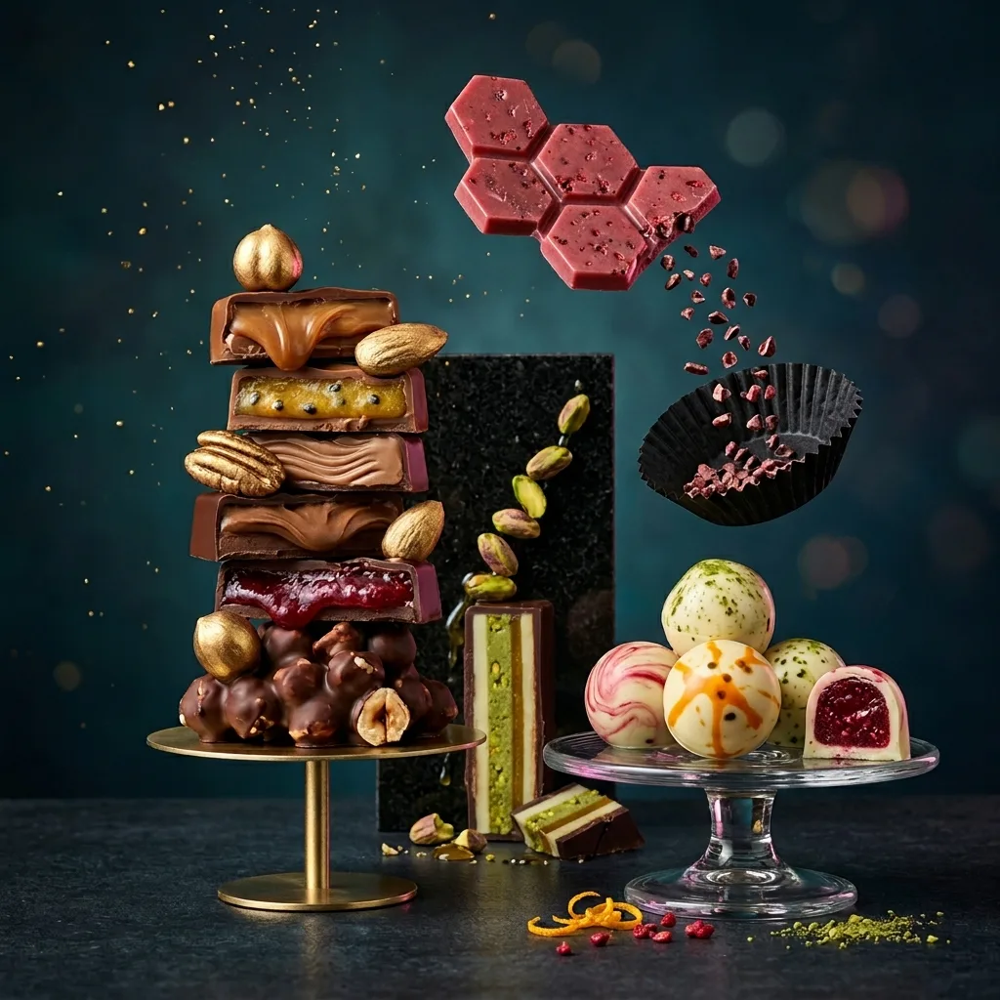

# Assorted praline tower

[← Back to the collection](../../README.md) · Category: [Food & Drink](../../gallery/food-drink.md) · Model: `Vinano Image v2` · ID: `vn-00104`

<a href="https://vinano.ai?utm_source=github&utm_medium=readme&utm_campaign=awesome-image-video-prompts-updating&utm_content=prompt-page-image"></a>

<sub>Preview generated with <a href="https://vinano.ai?utm_source=github&utm_medium=readme&utm_campaign=awesome-image-video-prompts-updating&utm_content=prompt-page-caption">vinano.ai</a></sub>

## Prompt

```text
{
"style": "ultra-realistic food photography, luxury editorial, macro-detail, natural textures",
 "images": [{
 "id": "image_1",
 "subject": "assorted praline tower",
 "composition": "staggered vertical tower, center frame, loose organic stacking",
 "details": {
 "fillings": ["hazelnut chunks irregularly clumped at base",
 "raspberry gel naturally puddled",
 "salted caramel realistic flow lines",
 "coffee ganache smooth wave texture",
 "passionfruit filling visible pulp specks"],
 "accent": "one unique metallic gold nut per filling type placed at layer transitions",
 "stand": "brushed gold stand subtle reflections"
 },
 "lighting": {
 "type": "dramatic side lighting",
 "angle": "35 degrees left",
 "effects": "authentic filling refractions, layered shadow play"
 },
 "background": "teal-to-navy gradient suspended gold motes",
 "mood": "luxurious, indulgent, artisanal depth"
 },
 {
 "id": "image_2",
 "subject": "ruby chocolate tablet",
 "composition": "floating hexagonal segments above black textured paper liner",
 "details": {
 "surface": "hand-tempered imperfections, translucent ruby pink",
 "inclusions": "embedded fruit flecks visible through chocolate",
 "motion": "ruby cacao nibs falling in gravity-realistic arc from one segment"
 },
 "lighting": {
 "key": "top-down at 12 o'clock",
 "rim": "soft pink rim light at 3 o'clock",
 "effects": "authentic shadows, enhanced translucency"
 },
 "background": "black-to-warm pink radial gradient subtle sparkle specks",
 "mood": "modern, vibrant, floating tension"
 },
 {
 "id": "image_3",
 "subject": "white chocolate bonbons",
 "composition": "organic cluster on clear glass stand",
 "details": {
 "marbling": ["central bonbon irregular orange passionfruit veins",
 "surrounding bonbons pink raspberry swirls",
 "green matcha flecks varied density"],
 "cutaway": "one bonbon sliced vertically showing gel core real fruit speckles",
 "props": "dried fruit flecks scattered below (orange zest curls, raspberry seeds)"
 },
 "lighting": {
 "key": "soft high-key front light at 10 degrees",
 "rim": "rear rim light at 35 degrees",
 "effects": "enhanced marbling contrast and glass refractions"
 },
 "background": "soft taupe fruit-toned bokeh",
 "mood": "elegant, fresh, handcrafted"
 },
 {
 "id": "image_5",
 "subject": "dark chocolate pistachio bar",
 "composition": "vertical bar centered on polished black granite slab",
 "details": {
 "cross_section": "precision side cut revealing layered pistachio filling",
 "filling": "whole roasted green pistachios suspended in smooth white chocolate matrix",
 "binding": "subtle golden honey swirl",
 "break": "front broken segment clean snap and visible pistachio pieces",
 "props": "whole roasted pistachios arranged in ascending curve, honey drips nearby"
 },
 "lighting": {
 "key": "soft spotlight from top-left at 45 degrees",
 "rim": "warm side rim light from right at 30 degrees",
 "highlight": "single pinpoint highlight on largest pistachio"
 },
 "background": "dark espresso brown gradient floating pistachio shell dust particles",
 "mood": "rich, bold, premium indulgence"
 }]
}

Aim for an editorial, design-driven look with deliberate negative space.
```

## Try it on vinano.ai

1. Copy the prompt above.
2. Open **[vinano.ai](https://vinano.ai?utm_source=github&utm_medium=readme&utm_campaign=awesome-image-video-prompts-updating&utm_content=prompt-page-try)**, paste it into the image generator and pick a model.
3. Swap any placeholders (brand, product, city, person…) for your own details, then generate.

More prompts like this: [Food & Drink gallery](../../gallery/food-drink.md) · [all categories](../../README.md#contents)
