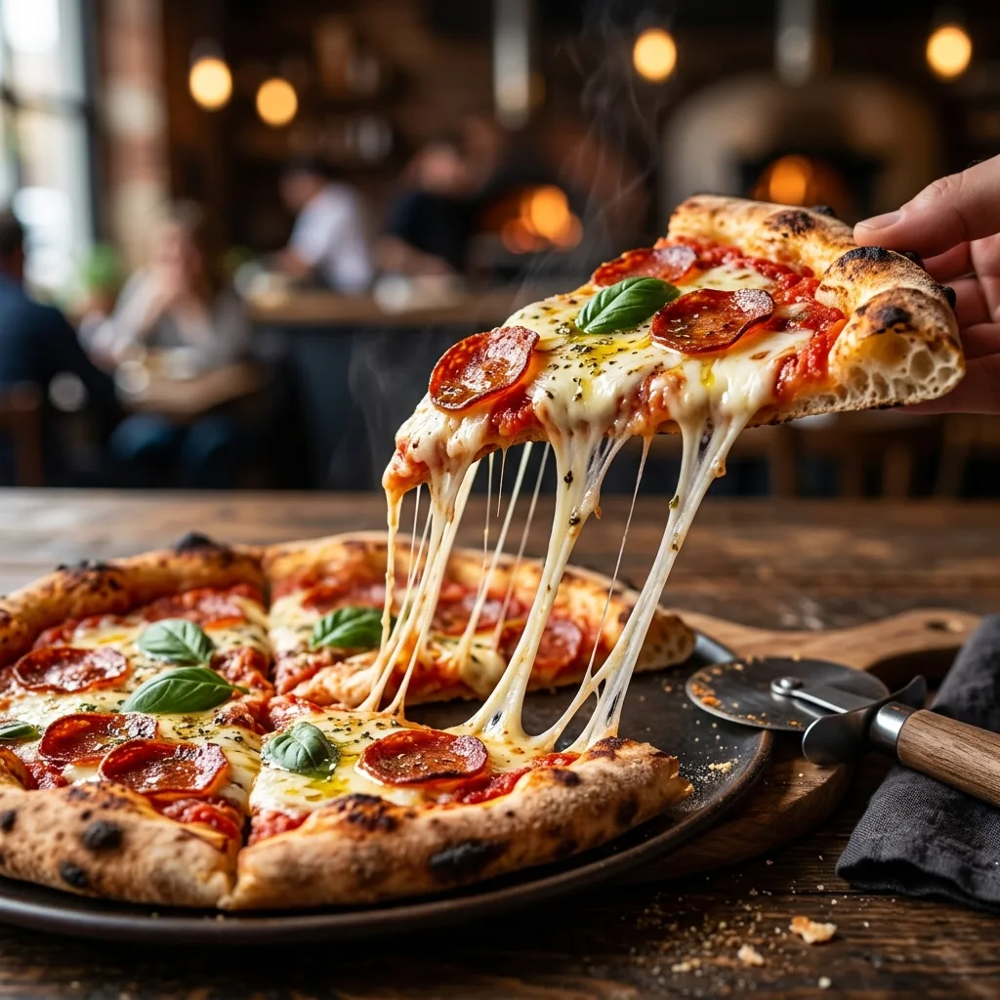

# Premium artisan pizza

[← Back to the collection](../../README.md) · Category: [Food & Drink](../../gallery/food-drink.md) · Model: `Vinano Image Pro` · ID: `vn-00114`

<a href="https://vinano.ai?utm_source=github&utm_medium=readme&utm_campaign=awesome-image-video-prompts-updating&utm_content=prompt-page-image"></a>

<sub>Preview generated with <a href="https://vinano.ai?utm_source=github&utm_medium=readme&utm_campaign=awesome-image-video-prompts-updating&utm_content=prompt-page-caption">vinano.ai</a></sub>

## Prompt

```text
{
 "content_goal":
 "viral food photography post",
 "image_type":
"professional food photography",
 "food_concept": {
 "item":
"pizza slice",
 "style":
"premium artisan pizza",
 "serving_state":
"freshly lifted slice cheese pull",
 "temperature_feel":
"hot, freshly baked"
 },
 "visual_style": {
 "aesthetic": "cinematic food editorial",
 "vibe": "crave-worthy, indulgent, luxurious",
 "realism": "ultra-realistic"
 },
 "composition": {
 "framing": "close-up macro partial pizza visible",
 "angle": "45-degree side angle",
 "focus_point": "cheese stretch and toppings",
 "depth_of_field": "shallow background blur"
 },
 "pizza_details": {
 "crust": "golden-brown, crispy edges soft interior",
 "cheese": "melted mozzarella long stretchy pull",
 "sauce": "rich red tomato sauce",
 "toppings": ["pepperoni slices",
 "fresh basil leaves",
 "olive oil glaze"],
 "texture": "glossy cheese, crisp crust, juicy toppings"
 },
 "lighting": {
 "type": "soft directional studio lighting",
 "direction": "side light for texture definition",
 "highlight": "cheese shine and crust detail",
 "shadow": "soft natural shadows"
 },
 "color_palette": {
 "primary_colors": ["cheese yellow",
 "tomato red",
 "golden brown"],
 "contrast_level": "medium-high",
 "mood": "warm, appetizing, mouth-watering"
 },
 "environment": {
 "surface": "rustic wooden table or marble slab",
 "background": "dark blurred restaurant or kitchen",
 "props": ["pizza cutter",
 "linen napkin",
 "wooden board"]
 },
 "camera_details": {
 "lens": "macro or 50mm food lens",
 "focus": "extreme sharpness on slice",
 "resolution": "high-end commercial quality",
 "noise": "none"
 },
 "sensory_impact": {
 "visual_effect": "cheese pull in motion",
 "viewer_reaction": "instant craving",
 "emotional_trigger": "comfort food desire"
 },
 "quality_control": {
 "food_realism": "authentic pizza texture",
 "ai_artifacts": "none",
 "professional_finish": "restaurant advertisement grade"
 },
 "intended_use": {
 "primary": "viral food post on X",
 "secondary": "restaurant promo, food brand content"
 }
}

Emphasise material texture and natural light so the final frame feels tactile and premium.
```

## Try it on vinano.ai

1. Copy the prompt above.
2. Open **[vinano.ai](https://vinano.ai?utm_source=github&utm_medium=readme&utm_campaign=awesome-image-video-prompts-updating&utm_content=prompt-page-try)**, paste it into the image generator and pick a model.
3. Swap any placeholders (brand, product, city, person…) for your own details, then generate.

More prompts like this: [Food & Drink gallery](../../gallery/food-drink.md) · [all categories](../../README.md#contents)
