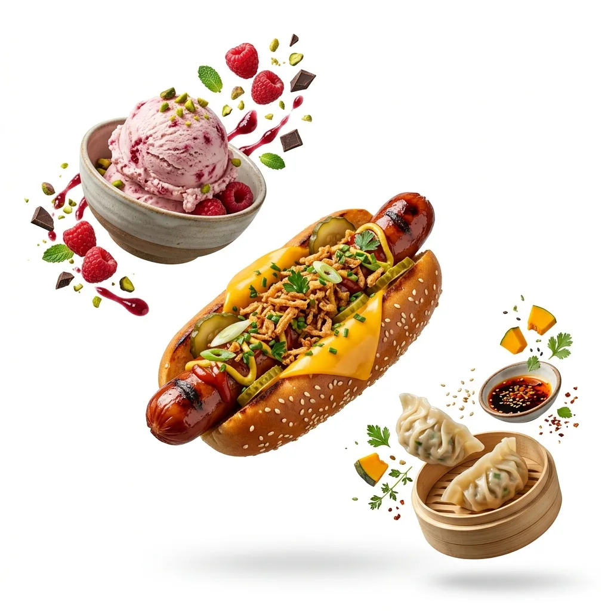

# Creamy raspberry ice cream

[← Back to the collection](../../README.md) · Category: [Food & Drink](../../gallery/food-drink.md) · Model: `Vinano Image v2` · ID: `vn-00119`

<a href="https://vinano.ai?utm_source=github&utm_medium=readme&utm_campaign=awesome-image-video-prompts-updating&utm_content=prompt-page-image"></a>

<sub>Preview generated with <a href="https://vinano.ai?utm_source=github&utm_medium=readme&utm_campaign=awesome-image-video-prompts-updating&utm_content=prompt-page-caption">vinano.ai</a></sub>

## Prompt

```text
{
 "image_prompt": {
 "main_concept": "High-end commercial food photography a floating composition (food levitation effect).",
 "composition": {
 "arrangement": "Hero food item suspended in mid-air complementary ingredients orbiting in perfect balance",
 "background": "Pure white background",
 "shadows": "Soft shadows beneath the suspended food"
 },
 "subject_variations": [{
 "item": "Creamy raspberry ice cream",
 "details": "Pistachio crumbs, chocolate chunks, mint leaves, berry drizzle"
 },
 {
 "item": "Gourmet hotdog",
 "details": "Glossy sausage, toasted bun, melted cheese, pickles, crispy onions, herbs, sauce"
 },
 {
 "item": "Handmade dumplings",
 "details": "Visible filling, fresh herbs, spices, pumpkin pieces, dipping sauce"
 }],
 "lighting_and_color": {
 "type": "Studio lighting",
 "highlights": "Clean highlights",
 "color_accuracy": "Natural color accuracy, realistic depth"
 },
 "technical_specs": {
 "style": "refined minimalist luxury aesthetic, modern advertising style, commercial product photography",
 "focus": "Ultra-sharp focus on textures, crisp edges",
 "quality": "Hyper-realistic details, high resolution, 8K quality"
 }
 }
}

Preserve realistic proportions and depth for a confident, professional finish.
```

## Try it on vinano.ai

1. Copy the prompt above.
2. Open **[vinano.ai](https://vinano.ai?utm_source=github&utm_medium=readme&utm_campaign=awesome-image-video-prompts-updating&utm_content=prompt-page-try)**, paste it into the image generator and pick a model.
3. Swap any placeholders (brand, product, city, person…) for your own details, then generate.

More prompts like this: [Food & Drink gallery](../../gallery/food-drink.md) · [all categories](../../README.md#contents)
