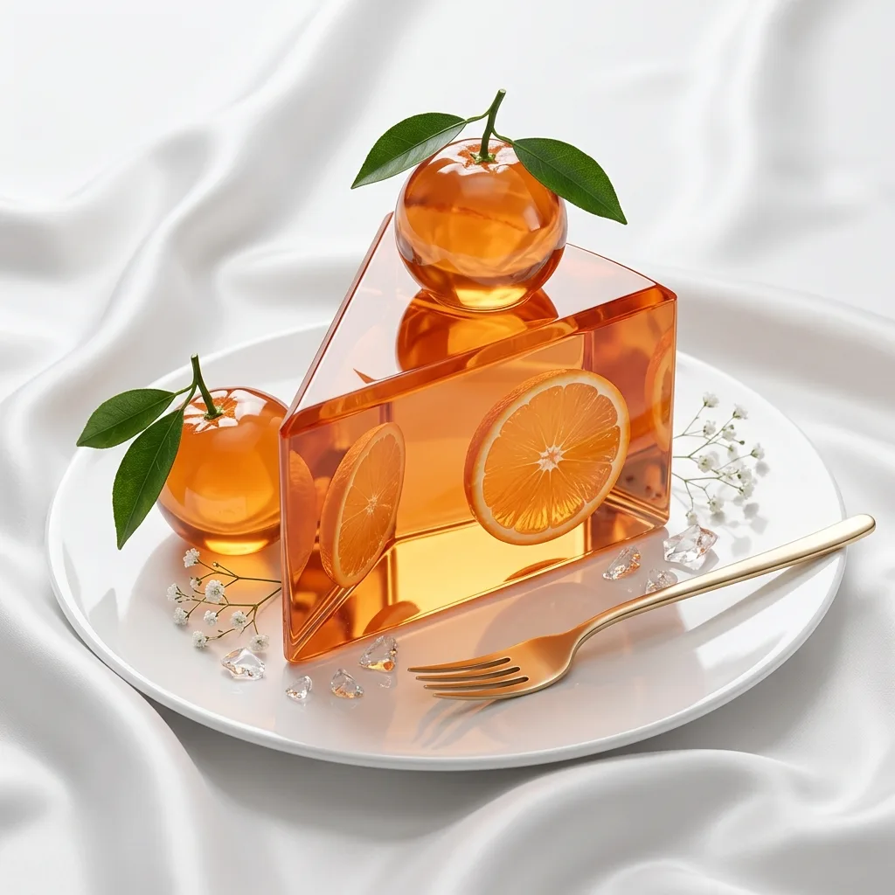

# Luxury fashion-editorial still life of a sharp triangular prism

[← Back to the collection](../../README.md) · Category: [Food & Drink](../../gallery/food-drink.md) · Model: `Vinano Image Pro` · ID: `vn-00120`

<a href="https://vinano.ai?utm_source=github&utm_medium=readme&utm_campaign=awesome-image-video-prompts-updating&utm_content=prompt-page-image"></a>

<sub>Preview generated with <a href="https://vinano.ai?utm_source=github&utm_medium=readme&utm_campaign=awesome-image-video-prompts-updating&utm_content=prompt-page-caption">vinano.ai</a></sub>

## Prompt

```text
Create a luxury fashion-editorial still life of a sharp triangular prism cake slice made of hard crystal-clear glass-like material, the featured fruit being [orange], a single unified candy-glass color tone while preserving the fruit’s original natural hue and form logic, explicitly excluding stems and leaves from recoloring so they retain natural green, the transparent glass cake has polished edges, elegant refraction, crisp highlights and internal reflections identical to solid crystal, inside the cake thick full-bodied seedless fruit cross-sections appear as pure clear glass perfectly smooth seamless surfaces, one whole fruit in mirror-polished translucent crystal-glass candy style sits on top and another rests beside it, all fruit instances sharing identical color tone and material finish except leaves, arranged on a glossy white ceramic plate clear crystal shards, a champagne-gold metallic fork and minimal baby’s-breath accents against softly draped white silk fabric, composed balanced proportions and refined negative space, lit soft diffused high-end editorial lighting that preserves candy-like color richness and material clarity, hyper-realistic, ultra-detailed, premium aesthetic, no text, no typography, no logo, no watermark, no graphic elements, exclude rough texture, matte surface, cube, square or round cake, ice cube, acrylic or resin block, cloudy transparency, people, hands, faces Keep edges clean and the overall composition balanced for a polished, gallery-ready result.
```

## Try it on vinano.ai

1. Copy the prompt above.
2. Open **[vinano.ai](https://vinano.ai?utm_source=github&utm_medium=readme&utm_campaign=awesome-image-video-prompts-updating&utm_content=prompt-page-try)**, paste it into the image generator and pick a model.
3. Swap any placeholders (brand, product, city, person…) for your own details, then generate.

More prompts like this: [Food & Drink gallery](../../gallery/food-drink.md) · [all categories](../../README.md#contents)
