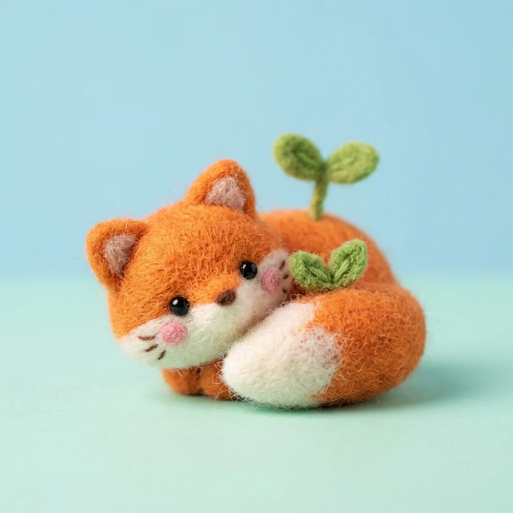

# User-provided product photograph

[← Back to the collection](../../README.md) · Category: [Food & Drink](../../gallery/food-drink.md) · Model: `Vinano Image v2` · ID: `vn-00126`

<a href="https://vinano.ai?utm_source=github&utm_medium=readme&utm_campaign=awesome-image-video-prompts-updating&utm_content=prompt-page-image"></a>

<sub>Preview generated with <a href="https://vinano.ai?utm_source=github&utm_medium=readme&utm_campaign=awesome-image-video-prompts-updating&utm_content=prompt-page-caption">vinano.ai</a></sub>

## Prompt

```text
{
 "prompt": "A realistic, needle-felted sculpture of a product from a photo, captured in a high-detail macro studio shot a whimsical aesthetic.",
 "subject": {
 "type": "Needle-felted sculpture",
 "based_on": "User-provided product photograph",
 "material": "Soft wool felt",
 "attributes": ["Fluffy textures",
 "Hand-felted details",
 "Soft edges",
 "Cozy appearance",
 "3D look"]
 },
 "photography": {
 "shot_type": "Studio shot",
 "focus": "Macro focus",
 "detail_level": "High detail"
 },
 "lighting": {
 "type": "Soft, diffused lighting",
 "mood": "Warm and gentle"
 },
 "setting": {
 "background": "Minimal, solid pastel color"
 },
 "aesthetics": {
 "overall_style": "Whimsical and charming"
 },
 "parameters": {
 "aspect_ratio": "4:5"
 }
}

Aim for an editorial, design-driven look with deliberate negative space.
```

## Try it on vinano.ai

1. Copy the prompt above.
2. Open **[vinano.ai](https://vinano.ai?utm_source=github&utm_medium=readme&utm_campaign=awesome-image-video-prompts-updating&utm_content=prompt-page-try)**, paste it into the image generator and pick a model.
3. Swap any placeholders (brand, product, city, person…) for your own details, then generate.

More prompts like this: [Food & Drink gallery](../../gallery/food-drink.md) · [all categories](../../README.md#contents)
