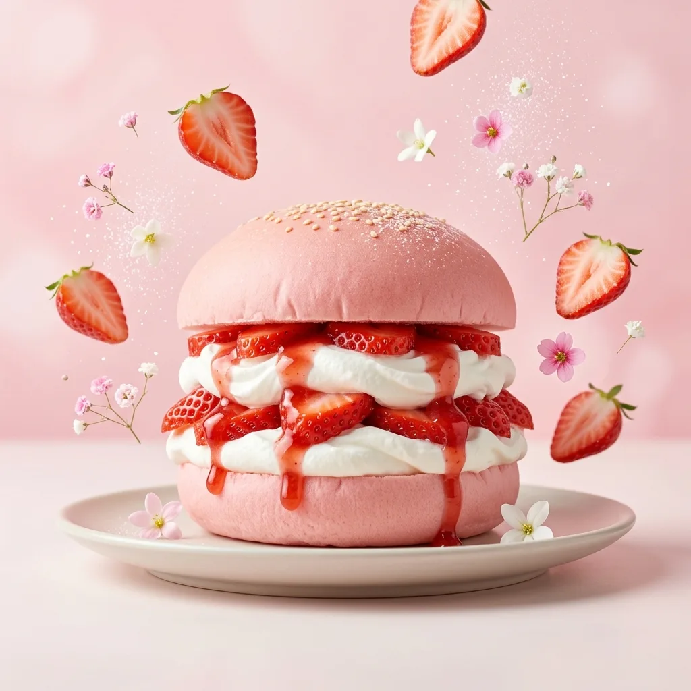

# FRUIT dessert burger, centered composition, soft pastel FRUIT COLOR

[← Back to the collection](../../README.md) · Category: [Food & Drink](../../gallery/food-drink.md) · Model: `Vinano Image v2` · ID: `vn-00127`

<a href="https://vinano.ai?utm_source=github&utm_medium=readme&utm_campaign=awesome-image-video-prompts-updating&utm_content=prompt-page-image"></a>

<sub>Preview generated with <a href="https://vinano.ai?utm_source=github&utm_medium=readme&utm_campaign=awesome-image-video-prompts-updating&utm_content=prompt-page-caption">vinano.ai</a></sub>

## Prompt

```text
A hyper-realistic {FRUIT} dessert burger, centered composition, soft pastel {FRUIT_COLOR} color palette. Fluffy {FRUIT_COLOR} burger buns smooth matte texture and light sesame seeds on top. Layers of fresh sliced {FRUIT} and airy white whipped cream inside, glossy {FRUIT} sauce dripping naturally. Floating {FRUIT} slices and tiny flowers surrounding the burger. Minimal {FRUIT_COLOR} gradient background, soft studio lighting, luxury food advertising style, ultra clean, high detail, shallow depth of field. Keep edges clean and the overall composition balanced for a polished, gallery-ready result.
```

## Try it on vinano.ai

1. Copy the prompt above.
2. Open **[vinano.ai](https://vinano.ai?utm_source=github&utm_medium=readme&utm_campaign=awesome-image-video-prompts-updating&utm_content=prompt-page-try)**, paste it into the image generator and pick a model.
3. Swap any placeholders (brand, product, city, person…) for your own details, then generate.

More prompts like this: [Food & Drink gallery](../../gallery/food-drink.md) · [all categories](../../README.md#contents)
