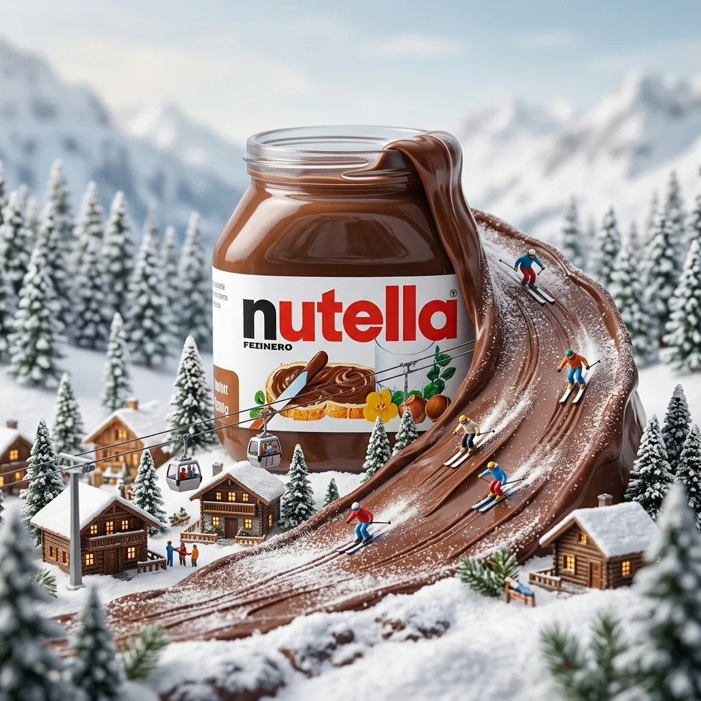

# Miniature winter world built around a giant Nutella jar

[← Back to the collection](../../README.md) · Category: [Food & Drink](../../gallery/food-drink.md) · Model: `Vinano Image v2` · ID: `vn-00215`

<a href="https://vinano.ai?utm_source=github&utm_medium=readme&utm_campaign=awesome-image-video-prompts-updating&utm_content=prompt-page-image"></a>

<sub>Preview generated with <a href="https://vinano.ai?utm_source=github&utm_medium=readme&utm_campaign=awesome-image-video-prompts-updating&utm_content=prompt-page-caption">vinano.ai</a></sub>

## Prompt

```text
{
 "cinematic miniature winter world built around a giant Nutella jar, thick chocolate hazelnut spread flowing out forming a glossy mountain ski slope, tiny skiers skiing down the chocolate hill covered light snow powder, miniature alpine village wooden cabins and pine trees, ski lift small gondolas carrying people, snowy forest background and distant mountains, soft winter lighting, ultra realistic textures of melting chocolate and snow, macro tilt shift photography, fantasy food landscape, commercial food advertising style, highly detailed, 8k",
 "negative_prompt": "blurry, low resolution, distorted jar, incorrect logo, messy composition, unrealistic proportions, extra limbs, duplicate people",
 "aspect_ratio": "4:5",
 "style": "ultra realistic macro photography",
 "lighting": "soft cinematic winter daylight",
 "camera": "macro lens, tilt shift effect",
 "quality": "high detail, 8k"
}

Maintain consistent colour harmony and crisp focus across the whole frame.
```

## Try it on vinano.ai

1. Copy the prompt above.
2. Open **[vinano.ai](https://vinano.ai?utm_source=github&utm_medium=readme&utm_campaign=awesome-image-video-prompts-updating&utm_content=prompt-page-try)**, paste it into the image generator and pick a model.
3. Swap any placeholders (brand, product, city, person…) for your own details, then generate.

More prompts like this: [Food & Drink gallery](../../gallery/food-drink.md) · [all categories](../../README.md#contents)
