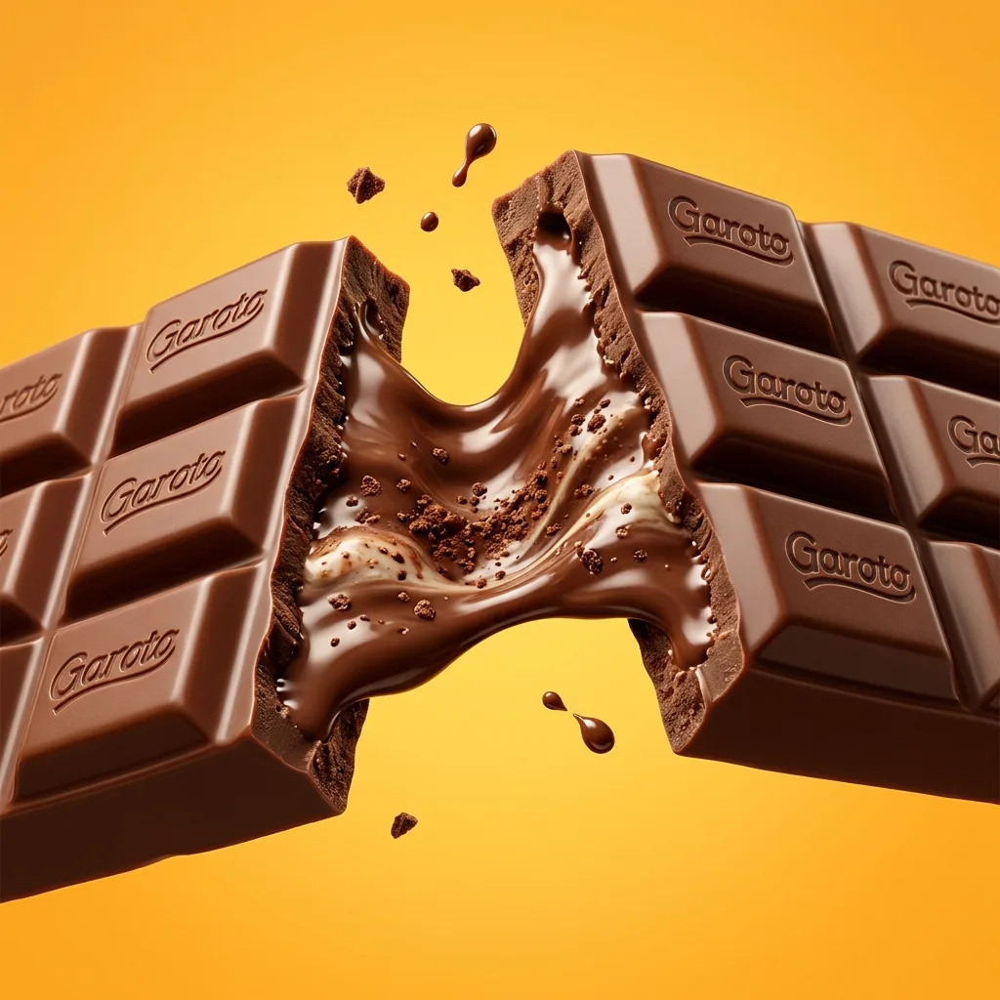

# Use the uploaded product image as reference

[← Back to the collection](../../README.md) · Category: [Food & Drink](../../gallery/food-drink.md) · Model: `Vinano Image v2` · ID: `vn-00254`

<a href="https://vinano.ai?utm_source=github&utm_medium=readme&utm_campaign=awesome-image-video-prompts-updating&utm_content=prompt-page-image"></a>

<sub>Preview generated with <a href="https://vinano.ai?utm_source=github&utm_medium=readme&utm_campaign=awesome-image-video-prompts-updating&utm_content=prompt-page-caption">vinano.ai</a></sub>

## Prompt

```text
Use the uploaded product image as reference. Create an ultra-realistic commercial image of a Garoto chocolate bar. Show a broken bar melted chocolate texture, visible cocoa details and rich gloss. Add subtle chocolate splashes and floating crumbs. Clean studio setup, vibrant colored background, bold advertising style for social media. 8K ultra realistic, high sharpness, high contrast, professional lighting realistic shadows and highlights, no text, no watermark, no blur, no distortion, no low quality, no cartoonish style Keep edges clean and the overall composition balanced for a polished, gallery-ready result.
```

## Try it on vinano.ai

1. Copy the prompt above.
2. Open **[vinano.ai](https://vinano.ai?utm_source=github&utm_medium=readme&utm_campaign=awesome-image-video-prompts-updating&utm_content=prompt-page-try)**, paste it into the image generator and pick a model.
3. Swap any placeholders (brand, product, city, person…) for your own details, then generate.

More prompts like this: [Food & Drink gallery](../../gallery/food-drink.md) · [all categories](../../README.md#contents)
