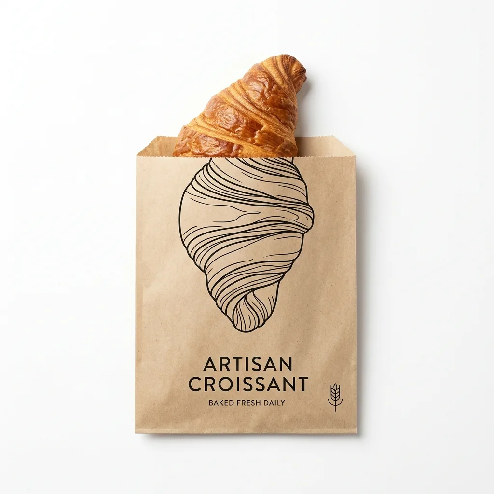

# Minimal studio shot on pure white background, real Food

[← Back to the collection](../../README.md) · Category: [Food & Drink](../../gallery/food-drink.md) · Model: `Vinano Image v2` · ID: `vn-00281`

<a href="https://vinano.ai?utm_source=github&utm_medium=readme&utm_campaign=awesome-image-video-prompts-updating&utm_content=prompt-page-image"></a>

<sub>Preview generated with <a href="https://vinano.ai?utm_source=github&utm_medium=readme&utm_campaign=awesome-image-video-prompts-updating&utm_content=prompt-page-caption">vinano.ai</a></sub>

## Prompt

```text
minimal studio shot on pure white background, real [Food Name] emerging from a paper packaging, the visible part outside the packaging is fully true-to-life photorealistic, the continuation of the same food is drawn as a clean black line illustration printed directly on the surface of the packaging, perfectly aligned the real food shape, the illustration stays strictly on the packaging material, not floating, not extending into the background, seamless transition between real and printed illustration, modern minimal branding, top-down composition, soft shadows. Maintain consistent colour harmony and crisp focus across the whole frame.
```

## Try it on vinano.ai

1. Copy the prompt above.
2. Open **[vinano.ai](https://vinano.ai?utm_source=github&utm_medium=readme&utm_campaign=awesome-image-video-prompts-updating&utm_content=prompt-page-try)**, paste it into the image generator and pick a model.
3. Swap any placeholders (brand, product, city, person…) for your own details, then generate.

More prompts like this: [Food & Drink gallery](../../gallery/food-drink.md) · [all categories](../../README.md#contents)
