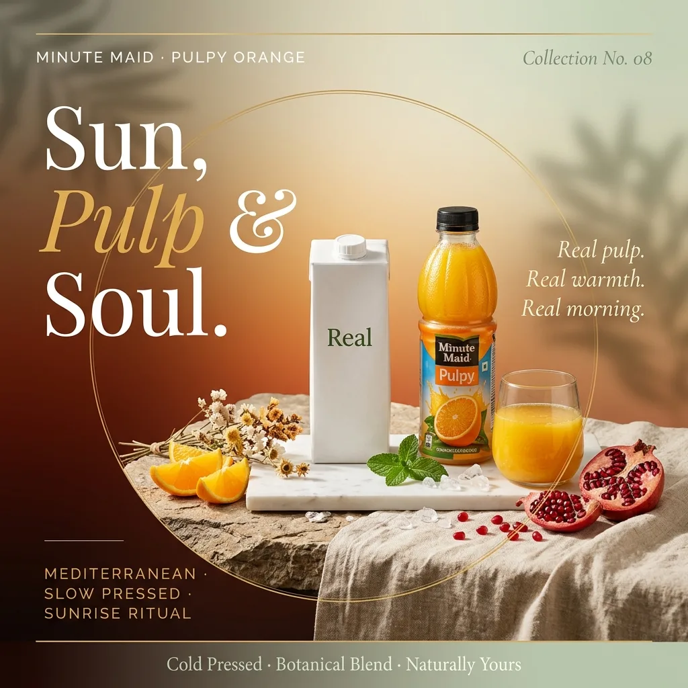

# High-end cinematic campaign poster

[← Back to the collection](../../README.md) · Category: [Food & Drink](../../gallery/food-drink.md) · Model: `Vinano Image Pro` · ID: `vn-00289`

<a href="https://vinano.ai?utm_source=github&utm_medium=readme&utm_campaign=awesome-image-video-prompts-updating&utm_content=prompt-page-image"></a>

<sub>Preview generated with <a href="https://vinano.ai?utm_source=github&utm_medium=readme&utm_campaign=awesome-image-video-prompts-updating&utm_content=prompt-page-caption">vinano.ai</a></sub>

## Prompt

```text
High-end cinematic campaign poster. A Minute Maid Pulpy orange bottle positioned off-center right on a sun-bleached linen draped over rough coastal stone. Surrounding: a heavy ceramic glass half-filled pulpy orange juice, fresh orange wedges, dried wildflowers. Background: deep terracotta darkness bleeding to warm amber glow at top — Mediterranean late afternoon atmosphere. Two thin horizontal gold rule lines framing the upper and lower composition.
Typography overlaid: left-aligned Playfair Display headline “Sun,” on first line, italic amber “Pulp &” second line, “Soul.” third line — stacked at 64–72px, white and gold alternating. Right-aligned italic Cormorant Garamond subtext “Real pulp. Real warmth. Real morning.” in warm cream. Bottom left spaced caps “MEDITERRANEAN · SLOW PRESSED · SUNRISE RITUAL” in faint amber. Top left eyebrow “MINUTE MAID · PULPY ORANGE” in tracked caps.
Lighting: natural diffused window light left-frame, warm terracotta fill, golden pulp glow through glass. Mood: slow coastal morning, honest premium warmth. Shot on ARRI Alexa 35, 75mm prime, shallow DOF, terracotta-ivory bokeh, HDR, lifestyle brunch campaign poster, 4:5 portrait.

High-end refined minimalist campaign poster. A clean Real fruit juice carton standing perfectly centered on cool white Italian marble, surrounded by split pomegranates showing jewel-red seeds, a fresh mint sprig, and scattered ice chips. Background: warm ivory-to-pale-sage gradient, soft botanical shadow suggestion of leaves at edges. Large thin circular frame element surrounding the bottle — elegant geometric restraint.
Typography overlaid: large light-weight Cormorant Garamond serif headline “Quietly” then italic bold “Brilliant.” stacked left-aligned in deep forest green, generous line spacing. Small Josefin Sans ultra-tracked subtext “NO DRAMA · JUST FRUIT” below in sage. Thin horizontal divider line. Footer italic “Cold pressed · Botanical blend · Naturally yours” in light sage. Top right “Collection No. 08” in delicate italic grey-green.
Lighting: soft cool overhead diffused studio light, clean marble reflection, zero drama. Mood: refined wellness luxury, botanical calm. Shot on Sony VENICE 2, 90mm macro, ultra-shallow DOF, sage bokeh, HDR, lifestyle wellness poster, 4:5 portrait

Aim for an editorial, design-driven look with deliberate negative space.
```

## Try it on vinano.ai

1. Copy the prompt above.
2. Open **[vinano.ai](https://vinano.ai?utm_source=github&utm_medium=readme&utm_campaign=awesome-image-video-prompts-updating&utm_content=prompt-page-try)**, paste it into the image generator and pick a model.
3. Swap any placeholders (brand, product, city, person…) for your own details, then generate.

More prompts like this: [Food & Drink gallery](../../gallery/food-drink.md) · [all categories](../../README.md#contents)
