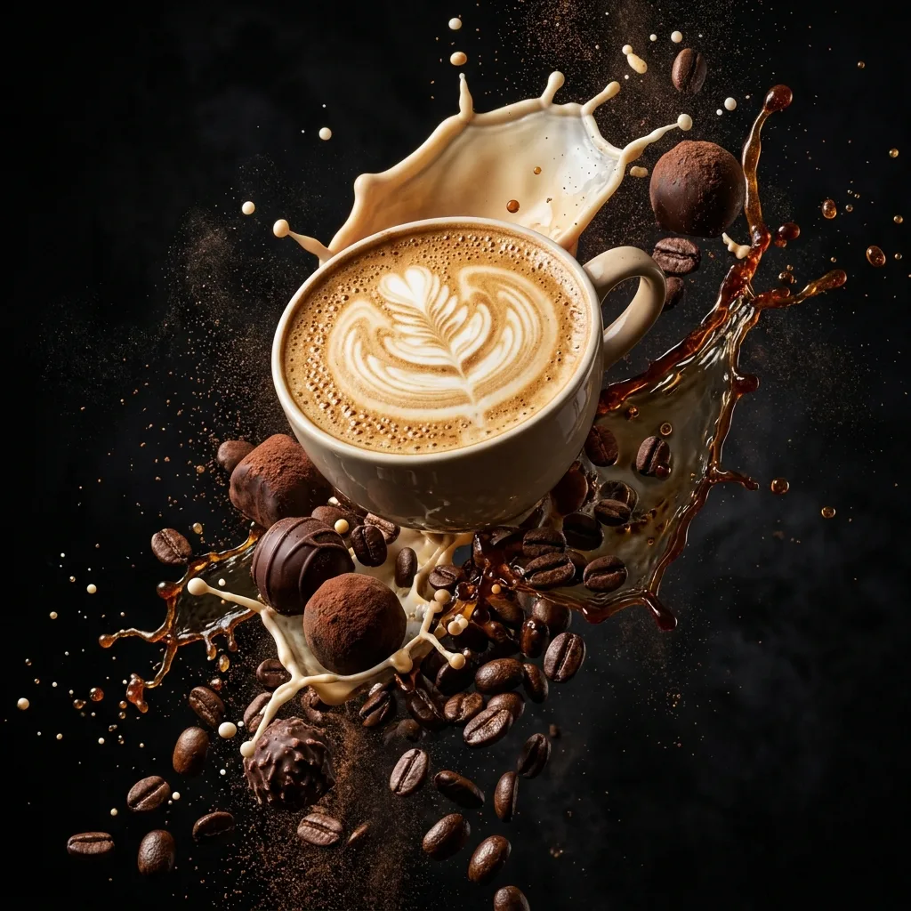

# Ultra-cinematic vertical composition of coffee elements suspended in mid-air

[← Back to the collection](../../README.md) · Category: [Food & Drink](../../gallery/food-drink.md) · Model: `Vinano Image v2` · ID: `vn-00299`

<a href="https://vinano.ai?utm_source=github&utm_medium=readme&utm_campaign=awesome-image-video-prompts-updating&utm_content=prompt-page-image"></a>

<sub>Preview generated with <a href="https://vinano.ai?utm_source=github&utm_medium=readme&utm_campaign=awesome-image-video-prompts-updating&utm_content=prompt-page-caption">vinano.ai</a></sub>

## Prompt

```text
Ultra-cinematic vertical composition of coffee elements suspended in mid-air cascading roasted coffee beans, chocolate bonbons, swirling latte art in a mid-air coffee cup, splashes of milk and espresso frozen in motion, fine coffee grounds dusting through the air captured rich brown and cream color tones.
Hyper-detailed textures glossy liquid surfaces, crema bubbles, and matte bean textures, lit dramatic high-contrast studio lighting against a deep, velvety black background. Cinematic depth of field, splash photography aesthetic, premium café advertising style. Shot a virtual Nikon D850, 105mm macro lens, aperture f/4.0, crisp editorial clarity.

Render with rich micro-detail while keeping the layout uncluttered and intentional.
```

## Try it on vinano.ai

1. Copy the prompt above.
2. Open **[vinano.ai](https://vinano.ai?utm_source=github&utm_medium=readme&utm_campaign=awesome-image-video-prompts-updating&utm_content=prompt-page-try)**, paste it into the image generator and pick a model.
3. Swap any placeholders (brand, product, city, person…) for your own details, then generate.

More prompts like this: [Food & Drink gallery](../../gallery/food-drink.md) · [all categories](../../README.md#contents)
