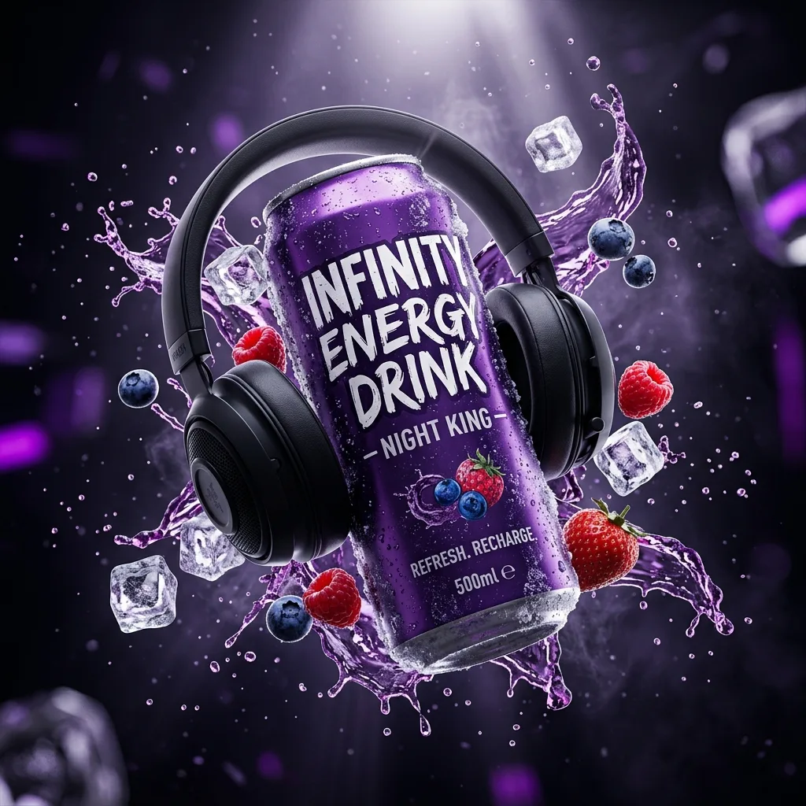

# Ultra-cinematic product photography of a purple energy drink can

[← Back to the collection](../../README.md) · Category: [Food & Drink](../../gallery/food-drink.md) · Model: `Vinano Image Pro` · ID: `vn-00304`

<a href="https://vinano.ai?utm_source=github&utm_medium=readme&utm_campaign=awesome-image-video-prompts-updating&utm_content=prompt-page-image"></a>

<sub>Preview generated with <a href="https://vinano.ai?utm_source=github&utm_medium=readme&utm_campaign=awesome-image-video-prompts-updating&utm_content=prompt-page-caption">vinano.ai</a></sub>

## Prompt

```text
Ultra-cinematic product photography of a purple energy drink can labeled “INFINITY ENERGY DRINK – NIGHT KING” in bold white typography, floating mid-air at a dynamic three-quarter angle, wrapped sleek black over-ear headphones; explosive liquid arcs and splashes frozen in time around the can, crystal-clear ice cubes and glossy berries (raspberries, blueberries, strawberries) suspended in motion, tiny droplets and mist filling the scene; dramatic high-contrast studio lighting a powerful top key light, sharp rim lights tracing the can edges, and deep shadows for a dark, premium mood; monochromatic purple color palette luminous highlights and metallic reflections, subtle neon glow accents; shallow depth of field isolating the can as the hero subject, hyper-detailed condensation on the aluminum surface, macro texture on fruit and water; volumetric light rays, floating particles, high-speed splash photography aesthetic, true-to-life photorealistic, ultra-detailed, 8K, luxury advertising style, sharp focus, no watermark. Preserve realistic proportions and depth for a confident, professional finish.
```

## Try it on vinano.ai

1. Copy the prompt above.
2. Open **[vinano.ai](https://vinano.ai?utm_source=github&utm_medium=readme&utm_campaign=awesome-image-video-prompts-updating&utm_content=prompt-page-try)**, paste it into the image generator and pick a model.
3. Swap any placeholders (brand, product, city, person…) for your own details, then generate.

More prompts like this: [Food & Drink gallery](../../gallery/food-drink.md) · [all categories](../../README.md#contents)
