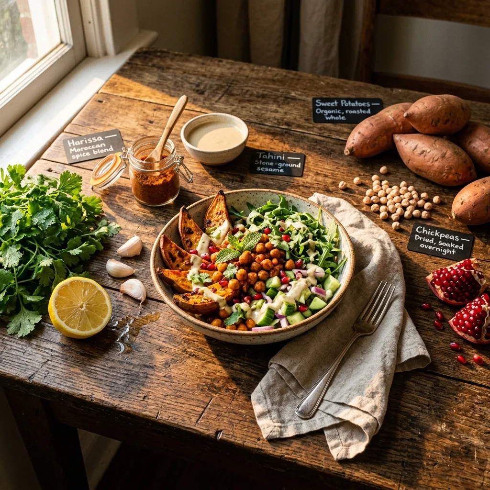

# DISH styled on a weathered MATERIAL surface

[← Back to the collection](../../README.md) · Category: [Food & Drink](../../gallery/food-drink.md) · Model: `Vinano Image Pro` · ID: `vn-00314`

<a href="https://vinano.ai?utm_source=github&utm_medium=readme&utm_campaign=awesome-image-video-prompts-updating&utm_content=prompt-page-image"></a>

<sub>Preview generated with <a href="https://vinano.ai?utm_source=github&utm_medium=readme&utm_campaign=awesome-image-video-prompts-updating&utm_content=prompt-page-caption">vinano.ai</a></sub>

## Prompt

```text
[DISH] styled on a weathered [MATERIAL] surface, shot in pure golden hour light streaming from one side, casting long warm shadows. Hero dish center, surrounded by its raw ingredients casually scattered artistic intention, whole vegetables, fresh herbs, open spice jars, linen cloth, wooden spoon. Every surface texture hyperreal: wood grain, condensation droplets, herb oil sheen, char marks. Ingredient labels as small handwritten-style chalk or ink tags resting beside each item: "[INGREDIENT] — [origin, preparation]". Dish name in warm hand-lettered typography: "[DISH NAME]". Subtitle: "[TAGLINE]". Mood: Ottolenghi cookbook meets Italian farmhouse meets Sunday farmers market. Warm golden tones, long shadows, film grain, extraordinary and craveable. Render with rich micro-detail while keeping the layout uncluttered and intentional.
```

## Try it on vinano.ai

1. Copy the prompt above.
2. Open **[vinano.ai](https://vinano.ai?utm_source=github&utm_medium=readme&utm_campaign=awesome-image-video-prompts-updating&utm_content=prompt-page-try)**, paste it into the image generator and pick a model.
3. Swap any placeholders (brand, product, city, person…) for your own details, then generate.

More prompts like this: [Food & Drink gallery](../../gallery/food-drink.md) · [all categories](../../README.md#contents)
