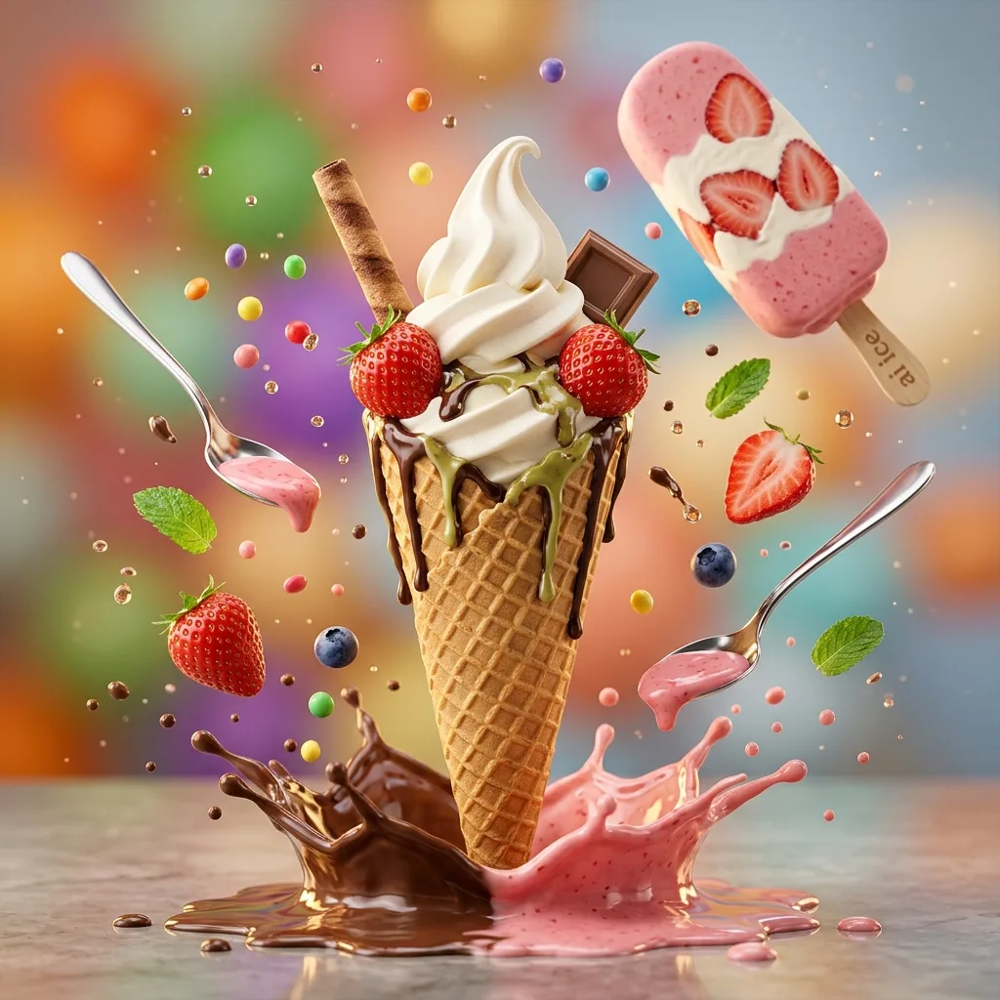

# Master prompt

[← Back to the collection](../../README.md) · Category: [Food & Drink](../../gallery/food-drink.md) · Model: `Vinano Image Pro` · ID: `vn-00341`

<a href="https://vinano.ai?utm_source=github&utm_medium=readme&utm_campaign=awesome-image-video-prompts-updating&utm_content=prompt-page-image"></a>

<sub>Preview generated with <a href="https://vinano.ai?utm_source=github&utm_medium=readme&utm_campaign=awesome-image-video-prompts-updating&utm_content=prompt-page-caption">vinano.ai</a></sub>

## Prompt

```text
{
 "master_prompt": {
 "global_settings": {
 "resolution": "8K",
 "aspect_ratio": "3:4",
 "render_style": "hyper-realistic AI-generated food photography",
 "focus": "extreme detail, sharp textures, dynamic motion, filmic, cinematic lighting",
 "depth_of_field": "shallow foreground focus",
 "noise": "none",
 "artifacts": "none"
 },

 "Module_1_Image_Style": {
 "subject": "Single ice cream cone standing upright",
 "ice_cream": {
 "top": "vanilla soft-serve swirl",
 "toppings": ["two whole strawberries",
 "one chocolate wafer roll",
 "one chocolate square partially embedded"],
 "sauces": ["dark chocolate sauce dripping",
 "green pistachio-like glaze dripping"]
 },
 "cone": {
 "type": "waffle cone",
 "texture": "crisp grid pattern",
 "condition": "sauce dripping down the cone and pooling at the base"
 },
 "motion_elements": {
 "floating": ["small colorful candy spheres",
 "liquid droplets suspended mid-air"],
 "splashes": "sauce splashes around cone base"
 },
 "background": {
 "style": "soft bokeh",
 "colors": ["orange",
 "green",
 "purple",
 "gold"],
 "lighting": "warm, cinematic, high contrast"
 }
 },

 "Module_2_Image_Style": {
 "subject": "Strawberry ice cream bar on wooden stick, tilted diagonally",
 "ice_cream": {
 "base": "pink strawberry ice cream",
 "top_layer": "white cream layer",
 "toppings": ["sliced strawberries embedded",
 "whole strawberries floating"]
 },
 "stick": {
 "material": "wood",
 "text": "ai ice",
 "orientation": "visible, centered"
 },
 "motion_elements": {
 "liquid": "cream and strawberry liquid splashing outward",
 "floating_objects": ["metal spoons pink liquid",
 "whole strawberries",
 "mint leaves",
 "droplets"]
 },
 "background": {
 "style": "soft gradient bokeh particles",
 "colors": ["peach",
 "blue",
 "cream"],
 "lighting": "bright highlights soft shadows"
 }
 },

 "Module_3_Image_Style": {
 "subject": "Spherical scoop composition of strawberry and vanilla ice cream",
 "ice_cream": {
 "layers": ["pink strawberry scoop",
 "white vanilla scoop"],
 "embedded_elements": ["halved strawberries",
 "whole strawberries"]
 },
 "motion_elements": {
 "liquid": "pink strawberry liquid splashing and dripping downward",
 "floating_objects": ["blueberries",
 "strawberries",
 "liquid droplets"],
 "utensils": "metal spoons suspended mid-air liquid"
 },
 "surface_detail": {
 "texture": "smooth ice cream visible melting edges",
 "droplets": "high-gloss liquid beads"
 },
 "background": {
 "style": "cool-toned blur",
 "colors": ["light blue",
 "gray"],
 "lighting": "clean studio lighting specular highlights"
 }
 }

Maintain consistent colour harmony and crisp focus across the whole frame.
```

## Try it on vinano.ai

1. Copy the prompt above.
2. Open **[vinano.ai](https://vinano.ai?utm_source=github&utm_medium=readme&utm_campaign=awesome-image-video-prompts-updating&utm_content=prompt-page-try)**, paste it into the image generator and pick a model.
3. Swap any placeholders (brand, product, city, person…) for your own details, then generate.

More prompts like this: [Food & Drink gallery](../../gallery/food-drink.md) · [all categories](../../README.md#contents)
