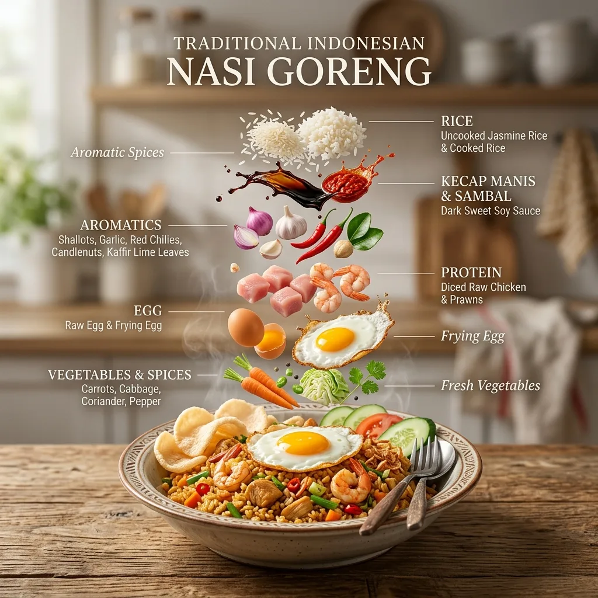

# Food photography of a traditional Indonesian dish, presented as

[← Back to the collection](../../README.md) · Category: [Food & Drink](../../gallery/food-drink.md) · Model: `Vinano Image Pro` · ID: `vn-00358`

<a href="https://vinano.ai?utm_source=github&utm_medium=readme&utm_campaign=awesome-image-video-prompts-updating&utm_content=prompt-page-image"></a>

<sub>Preview generated with <a href="https://vinano.ai?utm_source=github&utm_medium=readme&utm_campaign=awesome-image-video-prompts-updating&utm_content=prompt-page-caption">vinano.ai</a></sub>

## Prompt

```text
Ultra-realistic cinematic food photography of a traditional Indonesian dish, presented as a floating ingredients infographic. The finished dish sits at the bottom in a ceramic bowl on a wooden surface. Above it, key ingredients float in mid-air in a clean vertical layout, each clearly separated and visually balanced. Thin refined minimalist pointer lines connect ingredients to elegant readable labels. Natural textures, hyper-detailed food surfaces, glossy sauces, steam rising gently, high-speed splash effects frozen in motion. Soft studio lighting mixed natural daylight, shallow depth of field, premium editorial food poster style, commercial advertising quality, ultra-sharp focus, 8K resolution, realistic shadows, clean background. Render with rich micro-detail while keeping the layout uncluttered and intentional.
```

## Try it on vinano.ai

1. Copy the prompt above.
2. Open **[vinano.ai](https://vinano.ai?utm_source=github&utm_medium=readme&utm_campaign=awesome-image-video-prompts-updating&utm_content=prompt-page-try)**, paste it into the image generator and pick a model.
3. Swap any placeholders (brand, product, city, person…) for your own details, then generate.

More prompts like this: [Food & Drink gallery](../../gallery/food-drink.md) · [all categories](../../README.md#contents)
