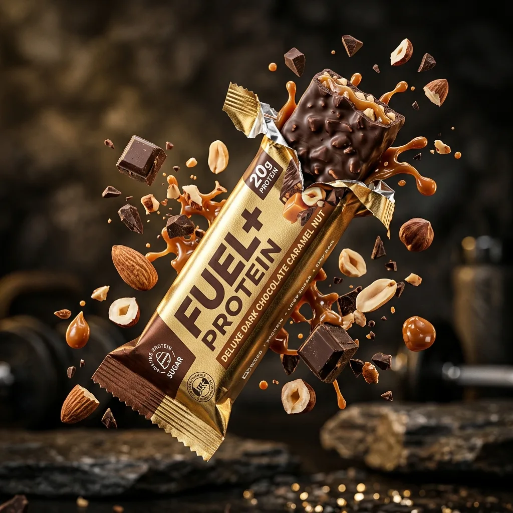

# Ultra-cinematic product photography of a premium protein bar wrapped

[← Back to the collection](../../README.md) · Category: [Food & Drink](../../gallery/food-drink.md) · Model: `Vinano Image v2` · ID: `vn-00366`

<a href="https://vinano.ai?utm_source=github&utm_medium=readme&utm_campaign=awesome-image-video-prompts-updating&utm_content=prompt-page-image"></a>

<sub>Preview generated with <a href="https://vinano.ai?utm_source=github&utm_medium=readme&utm_campaign=awesome-image-video-prompts-updating&utm_content=prompt-page-caption">vinano.ai</a></sub>

## Prompt

```text
Ultra-cinematic product photography of a premium protein bar wrapped in metallic packaging, floating at a dynamic angle; explosive chocolate chunks, caramel drips, and nut fragments frozen mid-air; high-speed splash and crumble effect, dramatic studio lighting sharp highlights; rich brown and gold palette, ultra-detailed textures, shallow depth of field, true-to-life photorealistic, 8K, fitness luxury advertising. Emphasise material texture and natural light so the final frame feels tactile and premium.
```

## Try it on vinano.ai

1. Copy the prompt above.
2. Open **[vinano.ai](https://vinano.ai?utm_source=github&utm_medium=readme&utm_campaign=awesome-image-video-prompts-updating&utm_content=prompt-page-try)**, paste it into the image generator and pick a model.
3. Swap any placeholders (brand, product, city, person…) for your own details, then generate.

More prompts like this: [Food & Drink gallery](../../gallery/food-drink.md) · [all categories](../../README.md#contents)
