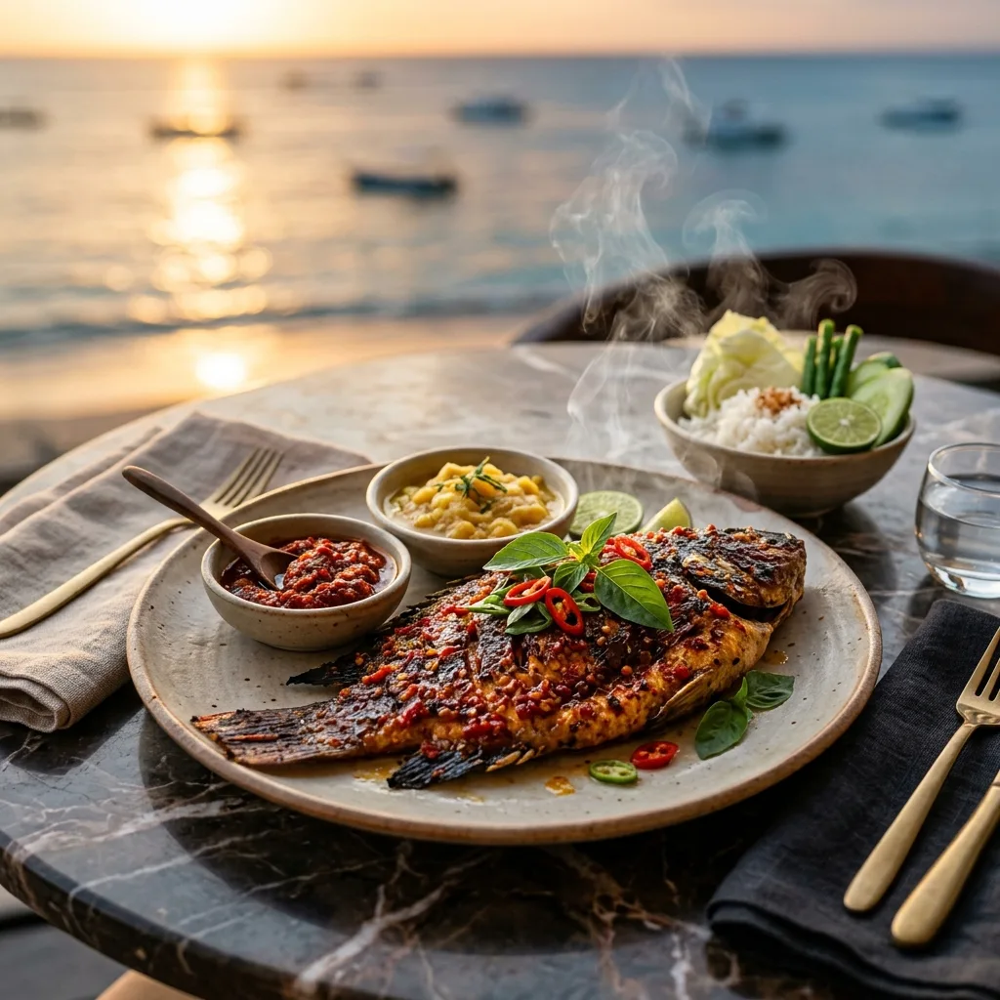

# Luxury cinematic food photography of traditional Indonesian “Seruit Lampung”

[← Back to the collection](../../README.md) · Category: [Food & Drink](../../gallery/food-drink.md) · Model: `Vinano Image v2` · ID: `vn-00371`

<a href="https://vinano.ai?utm_source=github&utm_medium=readme&utm_campaign=awesome-image-video-prompts-updating&utm_content=prompt-page-image"></a>

<sub>Preview generated with <a href="https://vinano.ai?utm_source=github&utm_medium=readme&utm_campaign=awesome-image-video-prompts-updating&utm_content=prompt-page-caption">vinano.ai</a></sub>

## Prompt

```text
Luxury cinematic food photography of traditional Indonesian “Seruit Lampung” — beautifully grilled fish fillet glazed chili sambal, garnished red chili slices, fresh basil, and lime wedges. Served on an elegant ceramic plate a small bowl of sambal and a side of golden mashed condiment. Visible steam rising from the hot dish. Background shows a refined coastal sunset ambiance soft bokeh reflections on water, warm golden-hour lighting. Shot on a polished marble table surface. Fine-dining restaurant atmosphere, shallow depth of field, dramatic food styling, ultra-realistic, 85mm lens, f/2.0, rich contrast, 8K resolution. Elegant editorial food magazine style. Keep edges clean and the overall composition balanced for a polished, gallery-ready result.
```

## Try it on vinano.ai

1. Copy the prompt above.
2. Open **[vinano.ai](https://vinano.ai?utm_source=github&utm_medium=readme&utm_campaign=awesome-image-video-prompts-updating&utm_content=prompt-page-try)**, paste it into the image generator and pick a model.
3. Swap any placeholders (brand, product, city, person…) for your own details, then generate.

More prompts like this: [Food & Drink gallery](../../gallery/food-drink.md) · [all categories](../../README.md#contents)
