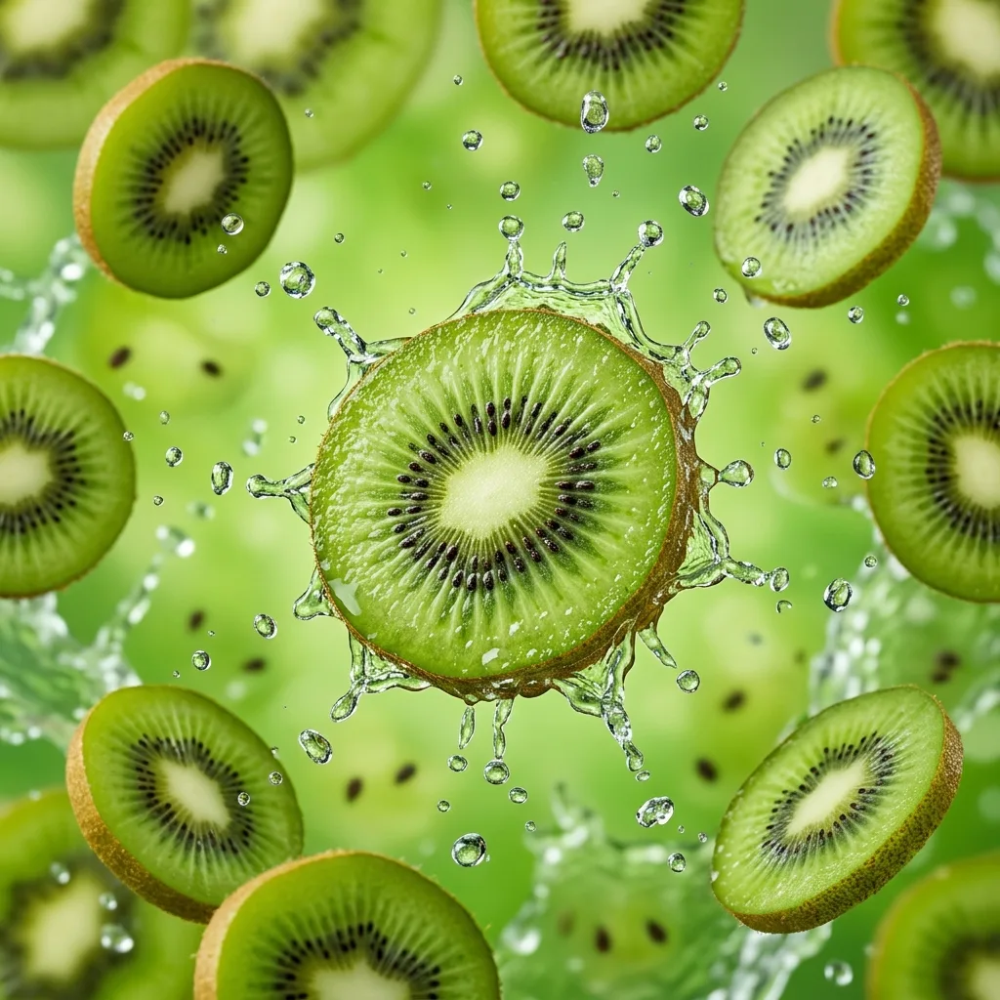

# Image of a sliced kiwi splashing in a spray

[← Back to the collection](../../README.md) · Category: [Food & Drink](../../gallery/food-drink.md) · Model: `Vinano Image v2` · ID: `vn-00395`

<a href="https://vinano.ai?utm_source=github&utm_medium=readme&utm_campaign=awesome-image-video-prompts-updating&utm_content=prompt-page-image"></a>

<sub>Preview generated with <a href="https://vinano.ai?utm_source=github&utm_medium=readme&utm_campaign=awesome-image-video-prompts-updating&utm_content=prompt-page-caption">vinano.ai</a></sub>

## Prompt

```text
A hyper-realistic image of a sliced kiwi splashing in a spray of water droplets suspended in the air. Fresh kiwi slices, dynamically arranged in a floating composition, create a smooth green background. The smooth green gradient creates a fresh, bright, and juicy aesthetic. Studio lighting, soft shadows, high detail, macro photography of objects, an emphasis on texture and reflections. Ultra-realistic rendering, 8K, sharp focus, rich green tones. --ar 9:16 --raw Emphasise material texture and natural light so the final frame feels tactile and premium.
```

## Try it on vinano.ai

1. Copy the prompt above.
2. Open **[vinano.ai](https://vinano.ai?utm_source=github&utm_medium=readme&utm_campaign=awesome-image-video-prompts-updating&utm_content=prompt-page-try)**, paste it into the image generator and pick a model.
3. Swap any placeholders (brand, product, city, person…) for your own details, then generate.

More prompts like this: [Food & Drink gallery](../../gallery/food-drink.md) · [all categories](../../README.md#contents)
