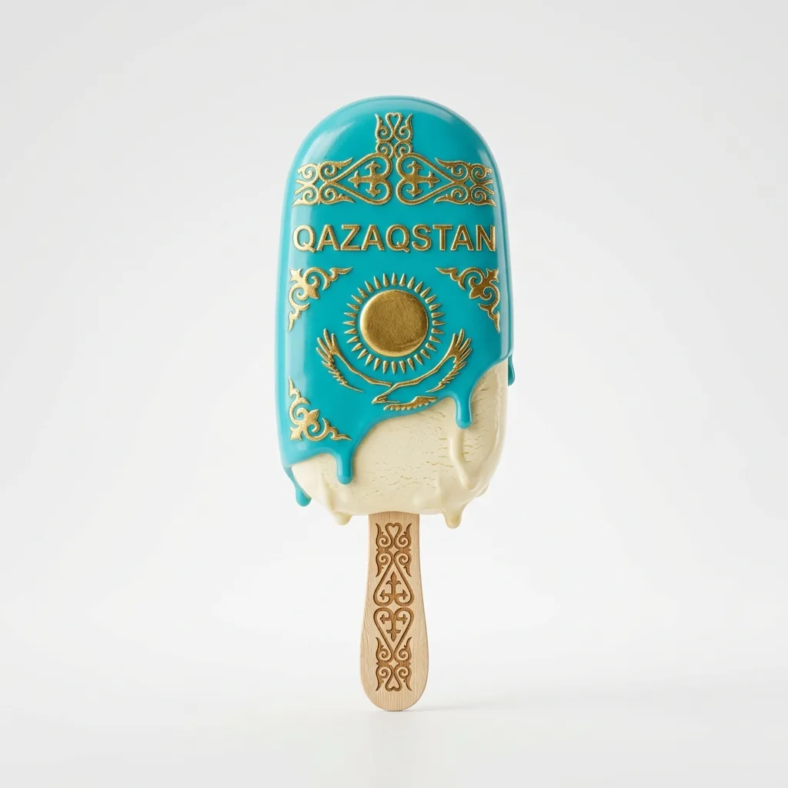

# Refined minimalist, ultra-realistic product shot of a premium ice

[← Back to the collection](../../README.md) · Category: [Food & Drink](../../gallery/food-drink.md) · Model: `Vinano Image v2` · ID: `vn-00451`

<a href="https://vinano.ai?utm_source=github&utm_medium=readme&utm_campaign=awesome-image-video-prompts-updating&utm_content=prompt-page-image"></a>

<sub>Preview generated with <a href="https://vinano.ai?utm_source=github&utm_medium=readme&utm_campaign=awesome-image-video-prompts-updating&utm_content=prompt-page-caption">vinano.ai</a></sub>

## Prompt

```text
A refined minimalist, ultra-realistic product shot of a premium ice cream bar inspired by Kazakhstan. The popsicle is coated in glossy turquoise icing elegant gold ornamental patterns and the word “QAZAQSTAN” embossed in metallic gold, featuring a golden sun-and-eagle motif. The lower half reveals creamy vanilla ice cream smooth texture and subtle melting drips. Wooden stick engraved traditional Kazakh patterns. Clean white studio background, soft diffused lighting, sharp focus, luxury food branding aesthetic, high-detail textures, modern cultural fusion design, 8K quality. Keep edges clean and the overall composition balanced for a polished, gallery-ready result.
```

## Try it on vinano.ai

1. Copy the prompt above.
2. Open **[vinano.ai](https://vinano.ai?utm_source=github&utm_medium=readme&utm_campaign=awesome-image-video-prompts-updating&utm_content=prompt-page-try)**, paste it into the image generator and pick a model.
3. Swap any placeholders (brand, product, city, person…) for your own details, then generate.

More prompts like this: [Food & Drink gallery](../../gallery/food-drink.md) · [all categories](../../README.md#contents)
