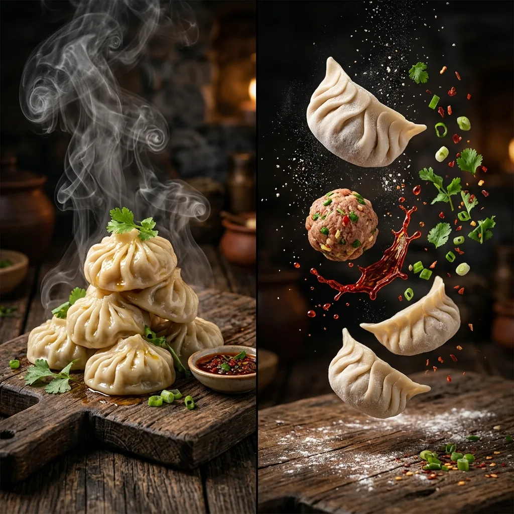

# Food & Drink prompt #466

[← Back to the collection](../../README.md) · Category: [Food & Drink](../../gallery/food-drink.md) · Model: `Vinano Image Pro` · ID: `vn-00466`

<a href="https://vinano.ai?utm_source=github&utm_medium=readme&utm_campaign=awesome-image-video-prompts-updating&utm_content=prompt-page-image"></a>

<sub>Preview generated with <a href="https://vinano.ai?utm_source=github&utm_medium=readme&utm_campaign=awesome-image-video-prompts-updating&utm_content=prompt-page-caption">vinano.ai</a></sub>

## Prompt

```text
{
The Cinematic Momo Duo
Subject & Scene
 * Finished Dish: Freshly steamed dumplings (momos) stacked on a rustic wooden board.
 * The Details: Glossy dough delicate handmade pleats, a light sheen of oil, and thick dramatic steam rising.
 * Exploded View: A side-by-side or split scene showing the "deconstructed" momo. Floating dumpling wrappers, balls of spiced minced filling, and scattered fresh herbs.
Motion & Action
 * Frozen in Time: Flour particles suspended mid-air, motion-frozen spices, and a dramatic slow-motion splash effect.
 * Atmosphere: Wispy, swirling steam and falling herb leaves.
Setting & Background
 * Environment: A dark, moody, rustic kitchen.
 * Surface: A weathered, textured wooden cutting board grains and cracks visible.
Lighting & Color
 * Style: Cinematic studio lighting.
 * Palette: Warm, inviting tones high contrast and deep shadows for a professional editorial look.
Technical Specs
 * Camera: Macro photography, 8K resolution, hyper-detailed textures.
 * Focus: Shallow depth of field (blurred background) sharp, crisp focus on the ingredients.

Keep edges clean and the overall composition balanced for a polished, gallery-ready result.
```

## Try it on vinano.ai

1. Copy the prompt above.
2. Open **[vinano.ai](https://vinano.ai?utm_source=github&utm_medium=readme&utm_campaign=awesome-image-video-prompts-updating&utm_content=prompt-page-try)**, paste it into the image generator and pick a model.
3. Swap any placeholders (brand, product, city, person…) for your own details, then generate.

More prompts like this: [Food & Drink gallery](../../gallery/food-drink.md) · [all categories](../../README.md#contents)
