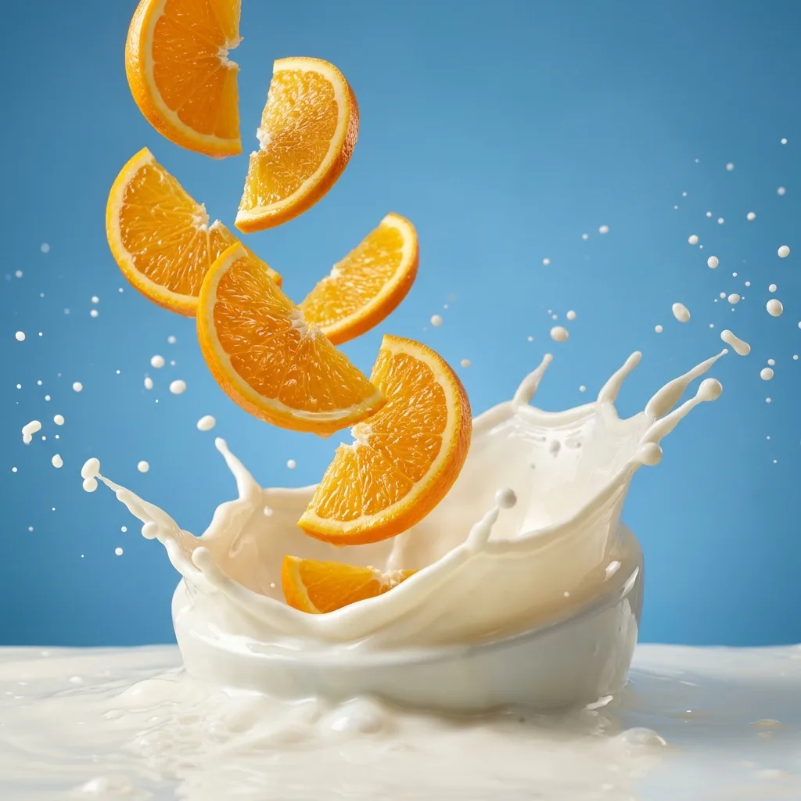

# Vibrant orange slices

[← Back to the collection](../../README.md) · Category: [Food & Drink](../../gallery/food-drink.md) · Model: `Vinano Image v2` · ID: `vn-00485`

<a href="https://vinano.ai?utm_source=github&utm_medium=readme&utm_campaign=awesome-image-video-prompts-updating&utm_content=prompt-page-image"></a>

<sub>Preview generated with <a href="https://vinano.ai?utm_source=github&utm_medium=readme&utm_campaign=awesome-image-video-prompts-updating&utm_content=prompt-page-caption">vinano.ai</a></sub>

## Prompt

```text
{
"subject": {
 "primary": "Vibrant orange slices",
 "action": "Falling through the air toward rising milk",
 "secondary": "Thick, glossy white milk splash forming arcs and crown-like curves",
 "details": "Milk droplets frozen mid-air creamy texture"
 },
 "environment": {
 "background": "Clean blue studio backdrop",
 "lighting": "Cinematic soft studio lighting dramatic highlights and shadows"
 },
 "visual_style": {
 "genre": "Ultra-realistic commercial splash photography",
 "textures": "High-detail creamy milk and fresh citrus pulp",
 "motion": "Frozen action, high-speed capture",
 "depth_of_field": "Shallow depth of field"
 },
 "camera": {
 "lens": "85mm macro",
 "framing": "Wide composition",
 "focus": "Sharp focus on splash and fruit"
 },
 "composition": {
 "aspect_ratio": "3:4",
 "color_palette": ["Vibrant Orange", "Pure White", "Clean Blue"]
 },
 "quality": {
 "detail_level": "Ultra-high detail",
 "rendering": "true-to-life photorealistic"
 },
 "profile": "9ewnbdc"
}

Keep edges clean and the overall composition balanced for a polished, gallery-ready result.
```

## Try it on vinano.ai

1. Copy the prompt above.
2. Open **[vinano.ai](https://vinano.ai?utm_source=github&utm_medium=readme&utm_campaign=awesome-image-video-prompts-updating&utm_content=prompt-page-try)**, paste it into the image generator and pick a model.
3. Swap any placeholders (brand, product, city, person…) for your own details, then generate.

More prompts like this: [Food & Drink gallery](../../gallery/food-drink.md) · [all categories](../../README.md#contents)
