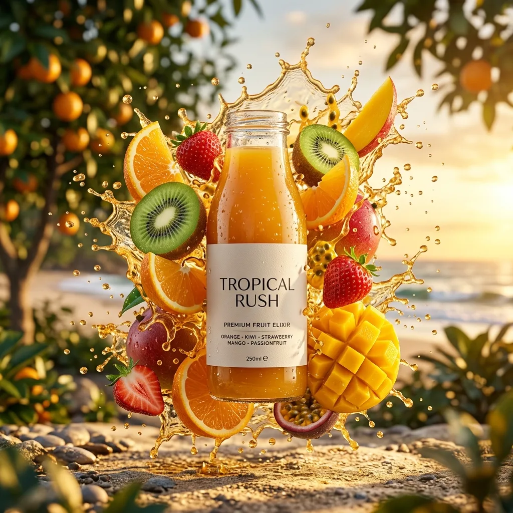

# Product ad of a premium fruit drink bottle, dynamic

[← Back to the collection](../../README.md) · Category: [Food & Drink](../../gallery/food-drink.md) · Model: `Vinano Image v2` · ID: `vn-00489`

<a href="https://vinano.ai?utm_source=github&utm_medium=readme&utm_campaign=awesome-image-video-prompts-updating&utm_content=prompt-page-image"></a>

<sub>Preview generated with <a href="https://vinano.ai?utm_source=github&utm_medium=readme&utm_campaign=awesome-image-video-prompts-updating&utm_content=prompt-page-caption">vinano.ai</a></sub>

## Prompt

```text
Ultra-realistic product ad of a premium fruit drink bottle, dynamic liquid splash frozen mid-air, fresh fruits (orange, kiwi, strawberry, mango, passionfruit) exploding around the bottle, cinematic golden sunlight, outdoor orchard/beach setting, shallow depth of field, vibrant colors, glossy reflections, high-speed photography style, hyper-detailed liquid physics, clean branding label, 8K, commercial advertising, perfect composition. Render with rich micro-detail while keeping the layout uncluttered and intentional.
```

## Try it on vinano.ai

1. Copy the prompt above.
2. Open **[vinano.ai](https://vinano.ai?utm_source=github&utm_medium=readme&utm_campaign=awesome-image-video-prompts-updating&utm_content=prompt-page-try)**, paste it into the image generator and pick a model.
3. Swap any placeholders (brand, product, city, person…) for your own details, then generate.

More prompts like this: [Food & Drink gallery](../../gallery/food-drink.md) · [all categories](../../README.md#contents)
