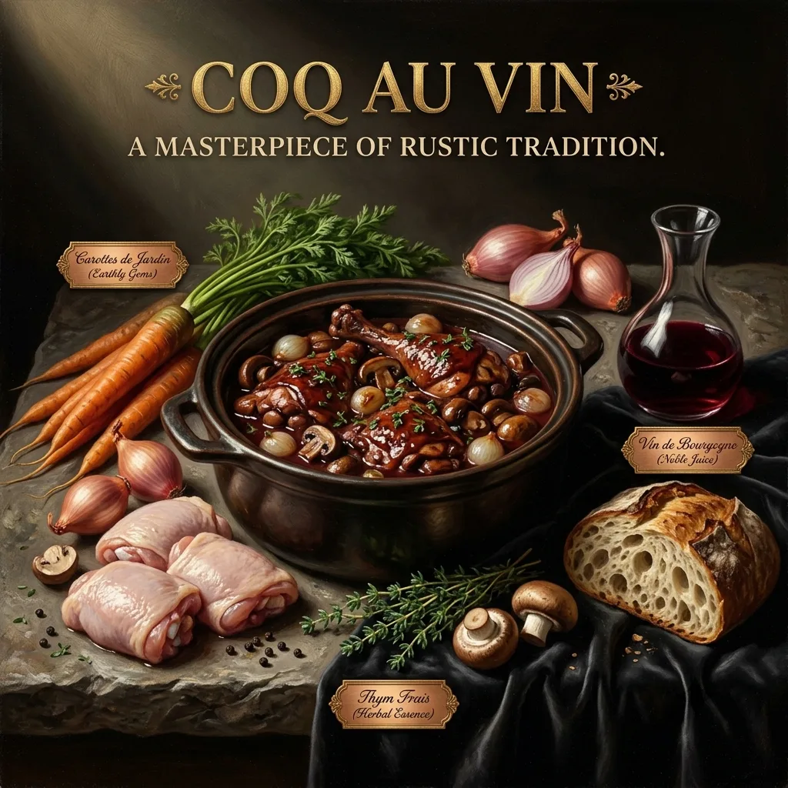

# DISH painted a Dutch Golden Age or Italian Renaissance

[← Back to the collection](../../README.md) · Category: [Food & Drink](../../gallery/food-drink.md) · Model: `Vinano Image Pro` · ID: `vn-00537`

<a href="https://vinano.ai?utm_source=github&utm_medium=readme&utm_campaign=awesome-image-video-prompts-updating&utm_content=prompt-page-image"></a>

<sub>Preview generated with <a href="https://vinano.ai?utm_source=github&utm_medium=readme&utm_campaign=awesome-image-video-prompts-updating&utm_content=prompt-page-caption">vinano.ai</a></sub>

## Prompt

```text
[DISH] painted a Dutch Golden Age or Italian Renaissance still life, hyperrealistic oil painting aesthetic dramatic chiaroscuro lighting. Hero dish at center on a dark velvet or stone surface, surrounded by its ingredients arranged in a baroque composition. Single dramatic light source from upper left illuminating every texture painterly depth: glistening proteins, translucent sauces, jewel-bright vegetables, crusty bread, scattered herbs. Each ingredient labeled a small elegant gold cartouche, ornate bordered label in copperplate: "[INGREDIENT] [poetic Latin or French descriptor]". Dish name in ornate gilt typography at top: "[DISH NAME]". Subtitle: "[TAGLINE]". Mood: Caravaggio meets Rembrandt meets the world's most craveable food photograph. Deep rich shadows, jewel-tone colors, extraordinary museum-quality, craveable. Emphasise material texture and natural light so the final frame feels tactile and premium.
```

## Try it on vinano.ai

1. Copy the prompt above.
2. Open **[vinano.ai](https://vinano.ai?utm_source=github&utm_medium=readme&utm_campaign=awesome-image-video-prompts-updating&utm_content=prompt-page-try)**, paste it into the image generator and pick a model.
3. Swap any placeholders (brand, product, city, person…) for your own details, then generate.

More prompts like this: [Food & Drink gallery](../../gallery/food-drink.md) · [all categories](../../README.md#contents)
