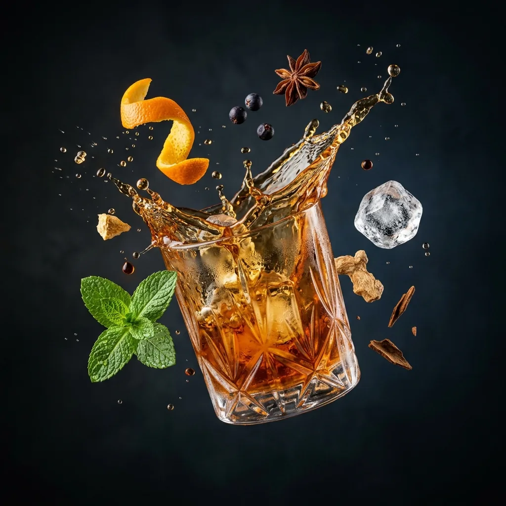

# Food photography, ultra high-definition, dynamic floating ingredients and liquids

[← Back to the collection](../../README.md) · Category: [Food & Drink](../../gallery/food-drink.md) · Model: `Vinano Image v2` · ID: `vn-00544`

<a href="https://vinano.ai?utm_source=github&utm_medium=readme&utm_campaign=awesome-image-video-prompts-updating&utm_content=prompt-page-image"></a>

<sub>Preview generated with <a href="https://vinano.ai?utm_source=github&utm_medium=readme&utm_campaign=awesome-image-video-prompts-updating&utm_content=prompt-page-caption">vinano.ai</a></sub>

## Prompt

```text
Hyper-realistic food photography, ultra high-definition, dynamic floating ingredients and liquids, ingredients suspended in mid-air, 
motion captured in high-speed freeze, dramatic cinematic studio lighting, dark moody background subtle gradient, extreme sharpness and fine textures, 
strong contrast highlighting food, splashes, crumbs, sauces, and liquids flying around, central hero composition ample negative space, 
clean luxury advertising style, no text, no logos, no props, 
realistic shadows and reflections, ultra-detailed, true-to-life photorealistic, 8K. {image of a cocktail}

Maintain consistent colour harmony and crisp focus across the whole frame.
```

## Try it on vinano.ai

1. Copy the prompt above.
2. Open **[vinano.ai](https://vinano.ai?utm_source=github&utm_medium=readme&utm_campaign=awesome-image-video-prompts-updating&utm_content=prompt-page-try)**, paste it into the image generator and pick a model.
3. Swap any placeholders (brand, product, city, person…) for your own details, then generate.

More prompts like this: [Food & Drink gallery](../../gallery/food-drink.md) · [all categories](../../README.md#contents)
