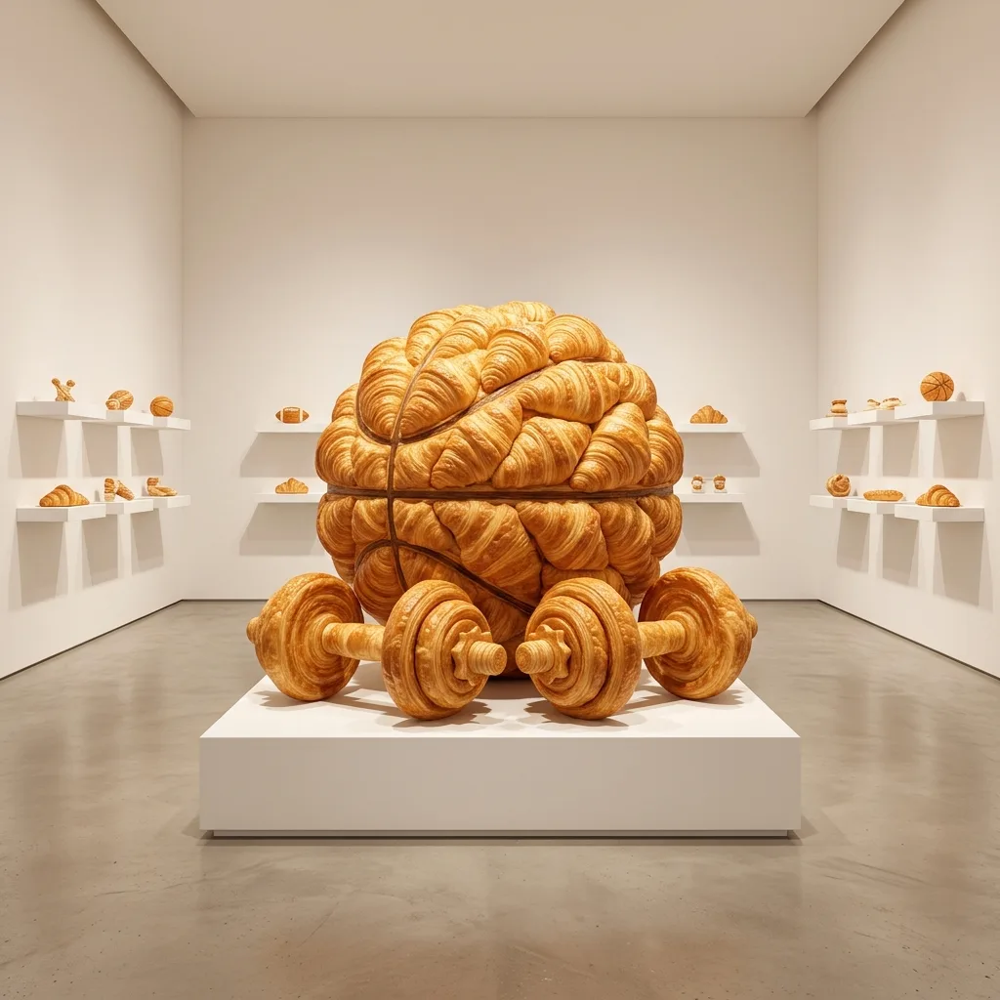

# Oversized sports equipment sculpture made entirely from croissants

[← Back to the collection](../../README.md) · Category: [Food & Drink](../../gallery/food-drink.md) · Model: `Vinano Image v2` · ID: `vn-00553`

<a href="https://vinano.ai?utm_source=github&utm_medium=readme&utm_campaign=awesome-image-video-prompts-updating&utm_content=prompt-page-image"></a>

<sub>Preview generated with <a href="https://vinano.ai?utm_source=github&utm_medium=readme&utm_campaign=awesome-image-video-prompts-updating&utm_content=prompt-page-caption">vinano.ai</a></sub>

## Prompt

```text
{
 "scene": "refined minimalist white contemporary art gallery",
 "environment": {
 "floor": "smooth concrete floor",
 "lighting": "soft warm museum lighting",
 "atmosphere": "clean, surreal, high-end contemporary museum aesthetic"
 },
 "main_subject": {
 "description": "Oversized sports equipment sculpture made entirely from croissants",
 "material": "hyper-realistic golden flaky croissant pastry",
 "sports_equipment_options": ["boxing gloves",
 "dumbbells",
 "basketballs",
 "kettlebells",
 "barbell"],
 "placement": "center of the gallery on white pedestal",
 "scale": "oversized, dominant focal point"
 },
 "secondary_elements": {
 "floating_shelves": "white floating shelves on walls",
 "miniature_objects": "tiny pastry-based sports objects and croissant sculptures",
 "arrangement": "evenly spaced, gallery-style display"
 },
 "visual_style": {
 "texture_detail": "ultra-realistic pastry layers, crisp flaky edges, buttery sheen",
 "color_palette": "white, warm gold, soft beige",
 "composition": "symmetrical, minimal, museum exhibition layout"
 },
 "photography": {
 "style": "professional photography",
 "camera": "high-resolution, sharp focus",
 "depth_of_field": "subtle depth, gallery clarity",
 "quality": "ultra-detailed, premium art photography"
 }
}

Render with rich micro-detail while keeping the layout uncluttered and intentional.
```

## Try it on vinano.ai

1. Copy the prompt above.
2. Open **[vinano.ai](https://vinano.ai?utm_source=github&utm_medium=readme&utm_campaign=awesome-image-video-prompts-updating&utm_content=prompt-page-try)**, paste it into the image generator and pick a model.
3. Swap any placeholders (brand, product, city, person…) for your own details, then generate.

More prompts like this: [Food & Drink gallery](../../gallery/food-drink.md) · [all categories](../../README.md#contents)
