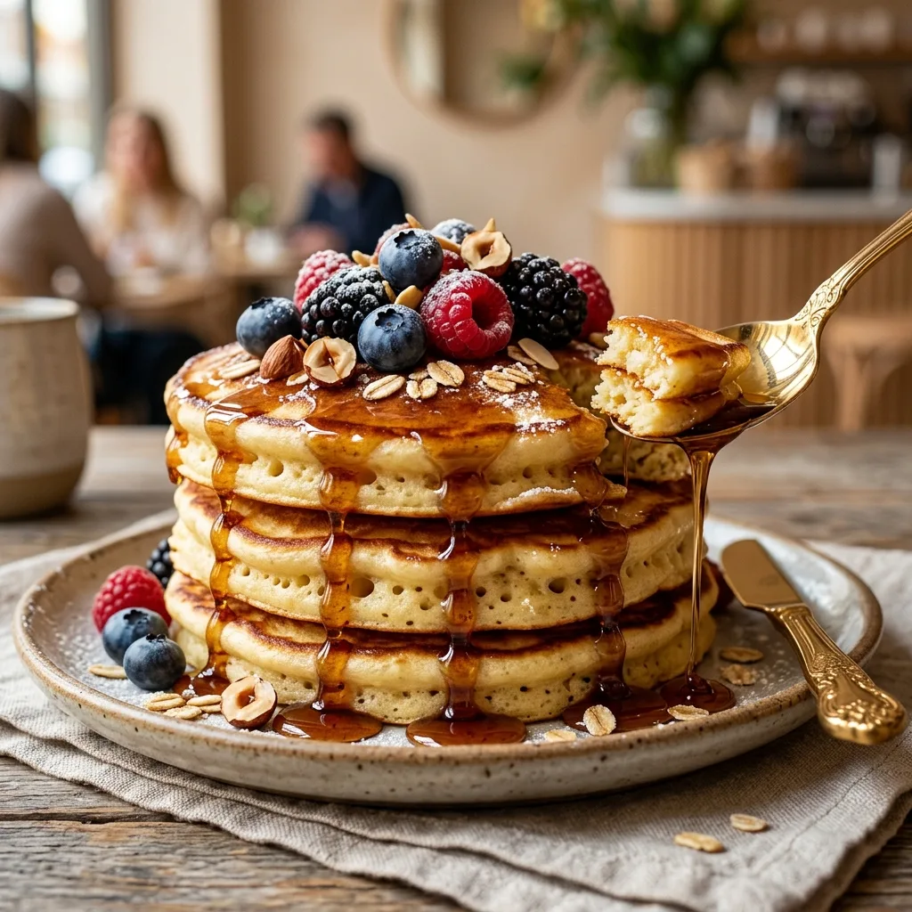

# Ultra-luxury food commercial of a stack of thick, fluffy

[← Back to the collection](../../README.md) · Category: [Food & Drink](../../gallery/food-drink.md) · Model: `Vinano Image v2` · ID: `vn-00570`

<a href="https://vinano.ai?utm_source=github&utm_medium=readme&utm_campaign=awesome-image-video-prompts-updating&utm_content=prompt-page-image"></a>

<sub>Preview generated with <a href="https://vinano.ai?utm_source=github&utm_medium=readme&utm_campaign=awesome-image-video-prompts-updating&utm_content=prompt-page-caption">vinano.ai</a></sub>

## Prompt

```text
Ultra-luxury food commercial of a stack of thick, fluffy American pancakes perfectly golden-brown edges. Pure maple syrup cascades slowly down the sides in glossy, slow-motion streams, highlighting every drip. Pancakes topped fresh mixed berries (blueberries, raspberries, blackberries), scattered roasted hazelnuts and almonds, and crunchy oat flakes. Cinematic close-up shots rich warm morning light, soft beige bokeh background, hyper-detailed textures emphasizing fluffiness and glossiness. Luxury golden ornate spoon takes a delicate bite, syrup stretching realistically. Smooth camera moves circling and slightly top-down over the stack, emphasizing elegance and indulgence. Minimalistic, high-end plating, cinematic depth of field, extremely appetizing, mouthwatering, trending food photography aesthetic, ultra-realistic 8K detail, professional ad-style video. Include subtle background soft music or ambient café sounds for premium feel. Preserve realistic proportions and depth for a confident, professional finish.
```

## Try it on vinano.ai

1. Copy the prompt above.
2. Open **[vinano.ai](https://vinano.ai?utm_source=github&utm_medium=readme&utm_campaign=awesome-image-video-prompts-updating&utm_content=prompt-page-try)**, paste it into the image generator and pick a model.
3. Swap any placeholders (brand, product, city, person…) for your own details, then generate.

More prompts like this: [Food & Drink gallery](../../gallery/food-drink.md) · [all categories](../../README.md#contents)
