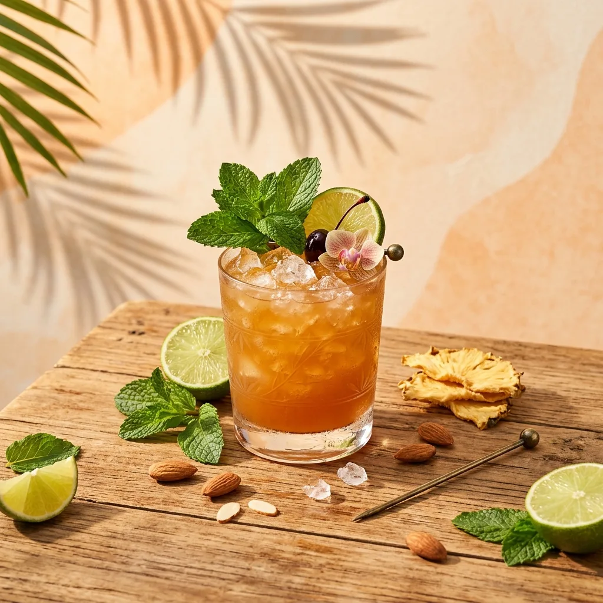

# High-end studio photograph of a YOUR COCKTAIL

[← Back to the collection](../../README.md) · Category: [Food & Drink](../../gallery/food-drink.md) · Model: `Vinano Image v2` · ID: `vn-00593`

<a href="https://vinano.ai?utm_source=github&utm_medium=readme&utm_campaign=awesome-image-video-prompts-updating&utm_content=prompt-page-image"></a>

<sub>Preview generated with <a href="https://vinano.ai?utm_source=github&utm_medium=readme&utm_campaign=awesome-image-video-prompts-updating&utm_content=prompt-page-caption">vinano.ai</a></sub>

## Prompt

```text
A high-end studio photograph of a [YOUR COCKTAIL], shot from a high-angle slightly top-down perspective. The drink is served in its appropriate traditional glass an elegant design and professional garnish. Artfully scattered around the base of the glass are fresh fruits and ingredients associated the cocktail recipe. The scene features a warm, summery atmosphere a light orange-tinted background. Artistic soft shadows of tropical palm leaves are cast across the frame, creating a vacation vibe. Realistic condensation on the glass, soft golden hour lighting, 8k resolution, professional food photography, sharp focus, clean and sophisticated composition. Aim for an editorial, design-driven look with deliberate negative space.
```

## Try it on vinano.ai

1. Copy the prompt above.
2. Open **[vinano.ai](https://vinano.ai?utm_source=github&utm_medium=readme&utm_campaign=awesome-image-video-prompts-updating&utm_content=prompt-page-try)**, paste it into the image generator and pick a model.
3. Swap any placeholders (brand, product, city, person…) for your own details, then generate.

More prompts like this: [Food & Drink gallery](../../gallery/food-drink.md) · [all categories](../../README.md#contents)
