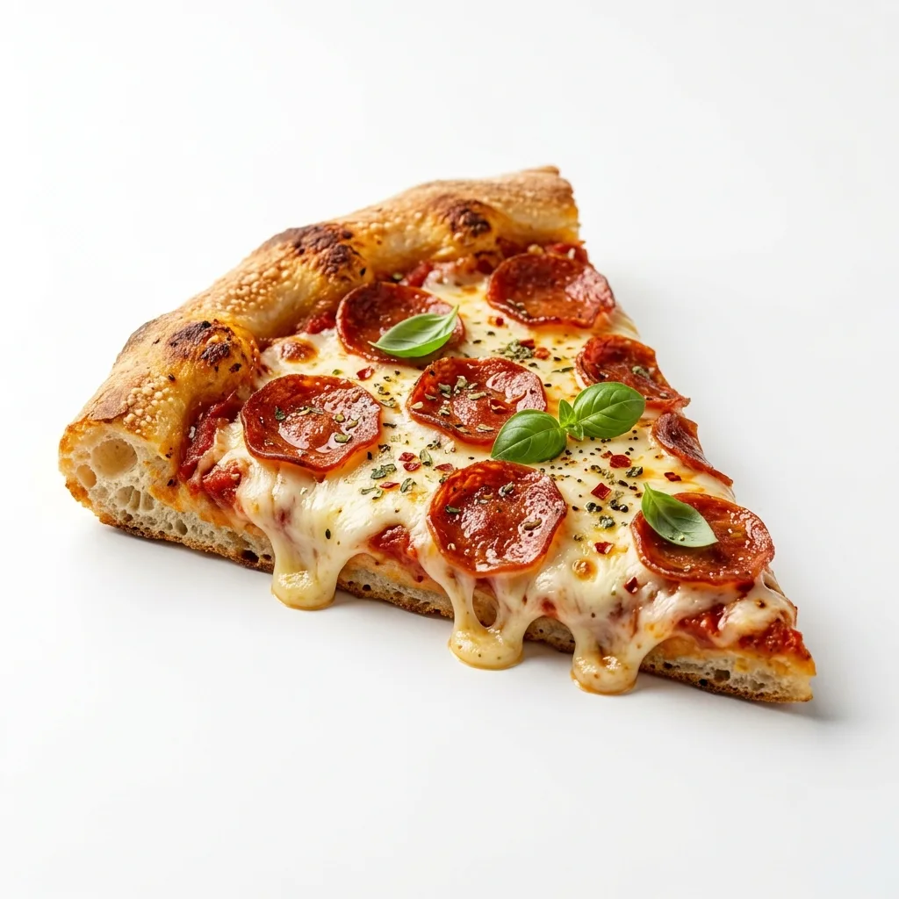

# - Ultra-realistic prepared pepperoni pizza slice, fully assembled, gooey

[← Back to the collection](../../README.md) · Category: [Food & Drink](../../gallery/food-drink.md) · Model: `Vinano Image v2` · ID: `vn-00597`

<a href="https://vinano.ai?utm_source=github&utm_medium=readme&utm_campaign=awesome-image-video-prompts-updating&utm_content=prompt-page-image"></a>

<sub>Preview generated with <a href="https://vinano.ai?utm_source=github&utm_medium=readme&utm_campaign=awesome-image-video-prompts-updating&utm_content=prompt-page-caption">vinano.ai</a></sub>

## Prompt

```text
- Ultra-realistic prepared pepperoni pizza slice, fully assembled, gooey melted mozzarella cheese stretching and dripping over the edges, crispy pepperoni slices on top, rich tomato sauce beneath, thick golden baked crust, fresh basil leaves and light seasoning floating subtly above, clean pure white background, professional commercial food photography lighting, soft natural shadows under the slice, sharp focus, extreme texture detail, glossy cheese, crunchy crust surface, studio shot, minimal composition, no text, no labels, no hands, premium food advertisement style, 8K resolution, ultra-detailed, hyper-realistic. Preserve realistic proportions and depth for a confident, professional finish.
```

## Try it on vinano.ai

1. Copy the prompt above.
2. Open **[vinano.ai](https://vinano.ai?utm_source=github&utm_medium=readme&utm_campaign=awesome-image-video-prompts-updating&utm_content=prompt-page-try)**, paste it into the image generator and pick a model.
3. Swap any placeholders (brand, product, city, person…) for your own details, then generate.

More prompts like this: [Food & Drink gallery](../../gallery/food-drink.md) · [all categories](../../README.md#contents)
