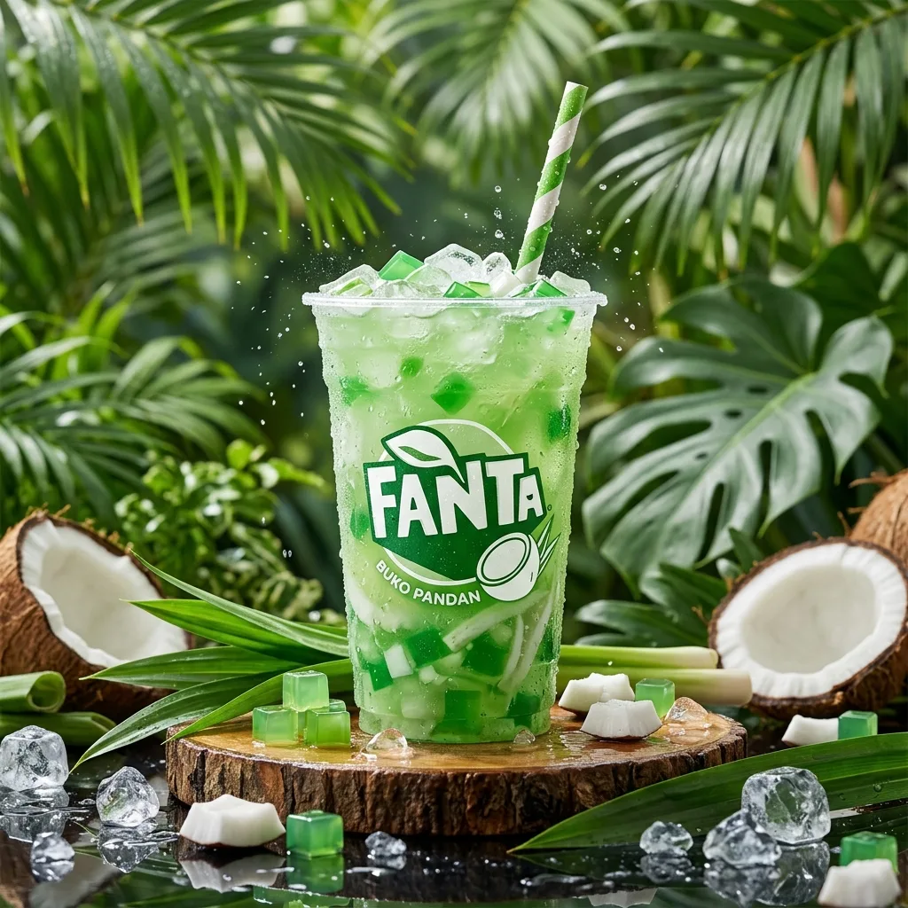

# Commercial product photography of a cold green tropical drink

[← Back to the collection](../../README.md) · Category: [Food & Drink](../../gallery/food-drink.md) · Model: `Vinano Image v2` · ID: `vn-00654`

<a href="https://vinano.ai?utm_source=github&utm_medium=readme&utm_campaign=awesome-image-video-prompts-updating&utm_content=prompt-page-image"></a>

<sub>Preview generated with <a href="https://vinano.ai?utm_source=github&utm_medium=readme&utm_campaign=awesome-image-video-prompts-updating&utm_content=prompt-page-caption">vinano.ai</a></sub>

## Prompt

```text
Ultra-realistic commercial product photography of a cold green tropical drink in a transparent plastic cup Fanta Buko Pandan branding, crushed ice inside, condensation droplets on the cup, green striped paper straw, surrounded by floating ice cubes and pandan jelly cubes, coconut pieces and pandan leaves around the base, drink placed on a small wooden platform, reflective wet surface scattered ice, tropical jungle leaves background, vibrant green color palette, refreshing summer beverage advertisement, dramatic studio lighting, shallow depth of field, macro details, high-speed splash photography, 8k ultra detailed, professional advertising shot.
Optional parameters
•Aspect ratio: --ar 1:1
•Style: --style raw
•Quality: --q 2

Prompt:

Premium advertising photo of Fanta Buko Pandan tropical beverage, tall clear cup filled icy green pandan coconut drink, condensation droplets on the cup, white straw, surrounded by crystal ice cubes and pandan jelly cubes, fresh coconut halves and pandan stalks on table, placed on a wooden display stand, glossy reflective surface, lush tropical leaf background soft bokeh, vibrant green tones, filmic, cinematic lighting, hyper-realistic food photography, commercial beverage campaign style, ultra sharp details, 8k resolution, shallow depth of field.
Optional parameters
•Aspect ratio: --ar 1:1
•Lighting: studio softbox lighting
•Style keywords: true-to-life photorealistic, beverage advertising, macro texture

Keep edges clean and the overall composition balanced for a polished, gallery-ready result.
```

## Try it on vinano.ai

1. Copy the prompt above.
2. Open **[vinano.ai](https://vinano.ai?utm_source=github&utm_medium=readme&utm_campaign=awesome-image-video-prompts-updating&utm_content=prompt-page-try)**, paste it into the image generator and pick a model.
3. Swap any placeholders (brand, product, city, person…) for your own details, then generate.

More prompts like this: [Food & Drink gallery](../../gallery/food-drink.md) · [all categories](../../README.md#contents)
