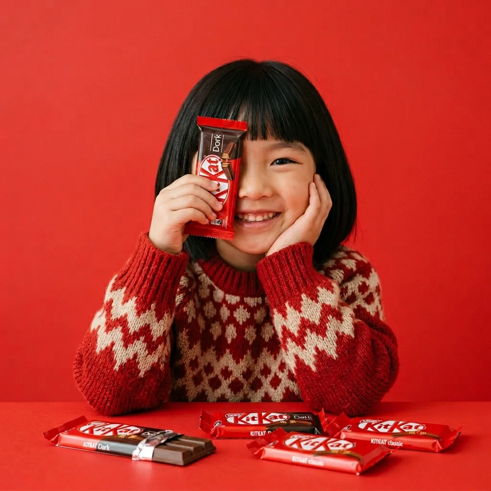

# Cute young girl short black hair and bangs smiling

[← Back to the collection](../../README.md) · Category: [Food & Drink](../../gallery/food-drink.md) · Model: `Vinano Image v2` · ID: `vn-00669`

<a href="https://vinano.ai?utm_source=github&utm_medium=readme&utm_campaign=awesome-image-video-prompts-updating&utm_content=prompt-page-image"></a>

<sub>Preview generated with <a href="https://vinano.ai?utm_source=github&utm_medium=readme&utm_campaign=awesome-image-video-prompts-updating&utm_content=prompt-page-caption">vinano.ai</a></sub>

## Prompt

```text
A cute young girl short black hair and bangs smiling while holding a red KitKat Dark chocolate bar covering one eye, resting her cheek on her hand, wearing a cozy red and beige patterned winter sweater. The background and table are solid bright red. Several KitKat chocolate bars are placed on the table in front of her. Soft studio lighting, vibrant colors, commercial food advertisement style, ultra-realistic photography, sharp focus, high detail, 50mm lens, shallow depth of field, professional product photography, centered composition. Keep edges clean and the overall composition balanced for a polished, gallery-ready result.
```

## Try it on vinano.ai

1. Copy the prompt above.
2. Open **[vinano.ai](https://vinano.ai?utm_source=github&utm_medium=readme&utm_campaign=awesome-image-video-prompts-updating&utm_content=prompt-page-try)**, paste it into the image generator and pick a model.
3. Swap any placeholders (brand, product, city, person…) for your own details, then generate.

More prompts like this: [Food & Drink gallery](../../gallery/food-drink.md) · [all categories](../../README.md#contents)
