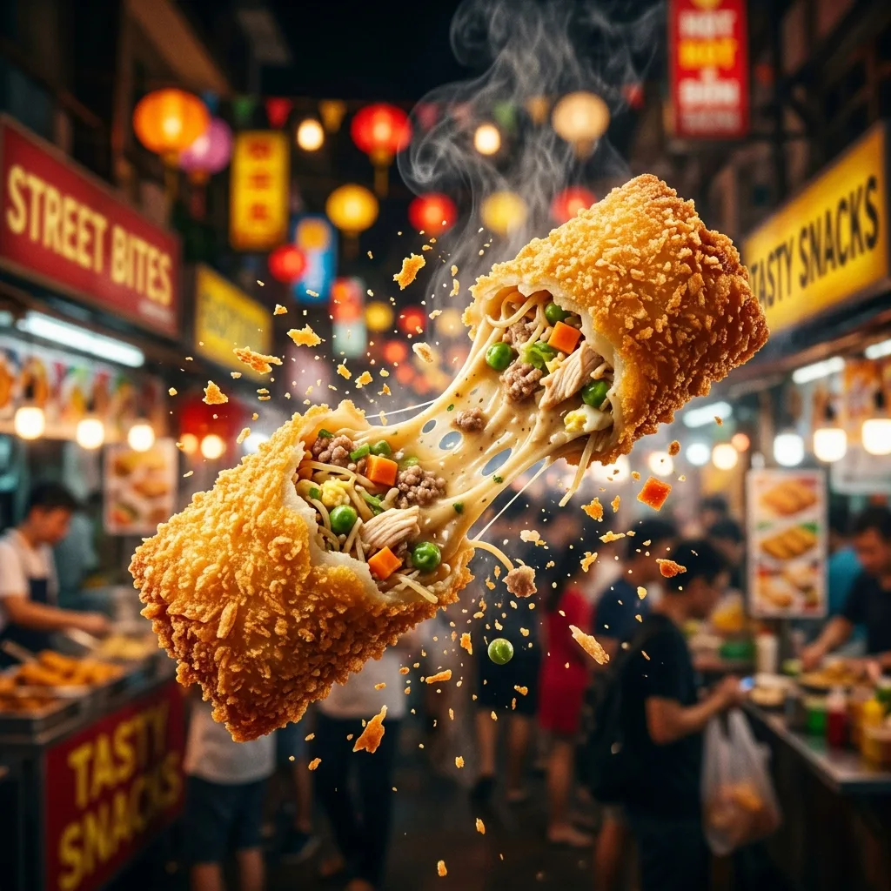

# High-speed food photography of a crispy golden fried snack

[← Back to the collection](../../README.md) · Category: [Food & Drink](../../gallery/food-drink.md) · Model: `Vinano Image v2` · ID: `vn-00683`

<a href="https://vinano.ai?utm_source=github&utm_medium=readme&utm_campaign=awesome-image-video-prompts-updating&utm_content=prompt-page-image"></a>

<sub>Preview generated with <a href="https://vinano.ai?utm_source=github&utm_medium=readme&utm_campaign=awesome-image-video-prompts-updating&utm_content=prompt-page-caption">vinano.ai</a></sub>

## Prompt

```text
Ultra-realistic high-speed food photography of a crispy golden fried snack breaking apart mid-air, creamy savory filling stretching between the halves, visible chunks of chicken, peas, carrots, minced meat, noodles, or egg inside. Crumbs and flakes flying in slow motion, hot steam rising, dramatic food explosion effect. Shot in a vibrant night street market environment warm bokeh lights, blurred food stalls in the background. Shallow depth of field, 85mm lens, f/1.8, ultra-sharp focus on texture, crunchy coating detail, dynamic motion capture, commercial food photography, filmic, cinematic lighting, HDR, 8K resolution, hyper-detailed, masterpiece quality. Maintain consistent colour harmony and crisp focus across the whole frame.
```

## Try it on vinano.ai

1. Copy the prompt above.
2. Open **[vinano.ai](https://vinano.ai?utm_source=github&utm_medium=readme&utm_campaign=awesome-image-video-prompts-updating&utm_content=prompt-page-try)**, paste it into the image generator and pick a model.
3. Swap any placeholders (brand, product, city, person…) for your own details, then generate.

More prompts like this: [Food & Drink gallery](../../gallery/food-drink.md) · [all categories](../../README.md#contents)
