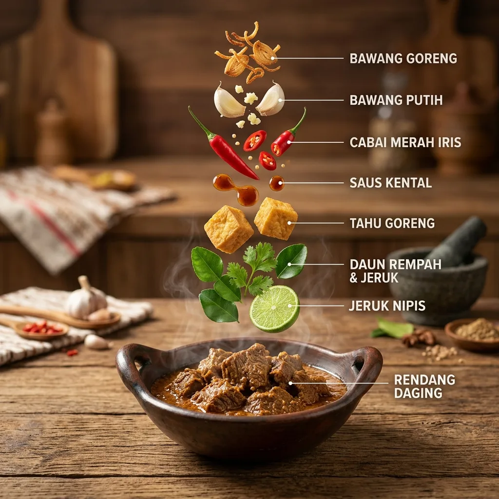

# Traditional serving bowl holding a steaming hot dish

[← Back to the collection](../../README.md) · Category: [Food & Drink](../../gallery/food-drink.md) · Model: `Vinano Image Pro` · ID: `vn-00689`

<a href="https://vinano.ai?utm_source=github&utm_medium=readme&utm_campaign=awesome-image-video-prompts-updating&utm_content=prompt-page-image"></a>

<sub>Preview generated with <a href="https://vinano.ai?utm_source=github&utm_medium=readme&utm_campaign=awesome-image-video-prompts-updating&utm_content=prompt-page-caption">vinano.ai</a></sub>

## Prompt

```text
{
 "image_prompt": {
 "type": "Ultra-realistic culinary infographic",
 "subject": {
 "cuisine": "Indonesian",
 "base_element": "A traditional serving bowl holding a steaming hot dish",
 "levitating_ingredients": ["Tender meat pieces",
 "Golden crispy tofu",
 "Rich sauce droplets in mid-air",
 "Fresh green herbs",
 "Red chilies",
 "Sliced lime",
 "Crushed garlic",
 "Crispy fried shallots"]
 },
 "composition": {
 "layout": "Minimal, vertically stacked layout",
 "arrangement": "Ingredients floating naturally as if suspended in motion",
 "background": "Textured rustic wooden tabletop",
 "visual_hierarchy": "The bowl remains grounded at the base, ingredients ascending above it"
 },
 "graphic_design_elements": {
 "labels": "Clean Indonesian-language annotations",
 "lines": "Fine white connector lines",
 "style": "High-end editorial food infographic, magazine-quality design"
 },
 "lighting_and_mood": {
 "lighting": "Controlled cinematic studio lighting",
 "color_palette": "Warm, appetizing color tones",
 "effects": "Visible steam and frozen-action food elements"
 },
 "technical_specs": {
 "camera_settings": "Shallow depth of field crisp focal detail, DSLR-style capture",
 "details": "Extremely detailed surface textures",
 "resolution": "8K, true-to-life photorealistic finish"
 }
 }
}

Maintain consistent colour harmony and crisp focus across the whole frame.
```

## Try it on vinano.ai

1. Copy the prompt above.
2. Open **[vinano.ai](https://vinano.ai?utm_source=github&utm_medium=readme&utm_campaign=awesome-image-video-prompts-updating&utm_content=prompt-page-try)**, paste it into the image generator and pick a model.
3. Swap any placeholders (brand, product, city, person…) for your own details, then generate.

More prompts like this: [Food & Drink gallery](../../gallery/food-drink.md) · [all categories](../../README.md#contents)
