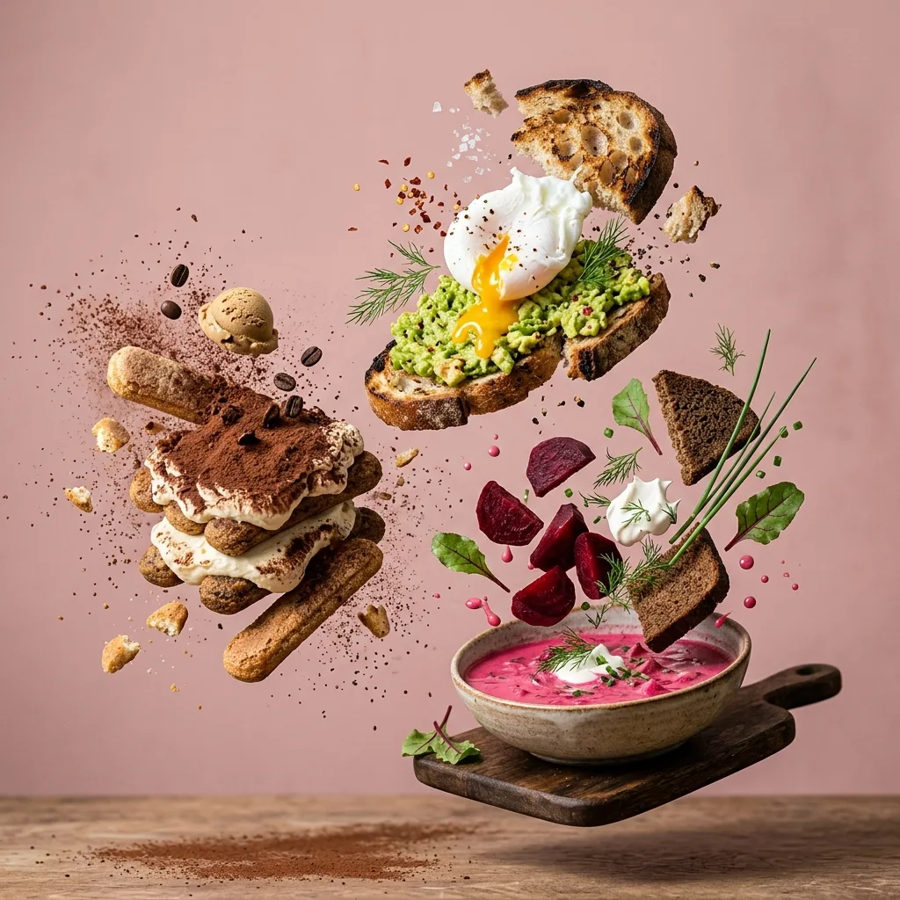

# Studio food photography series featuring deconstructed dishes in high-speed

[← Back to the collection](../../README.md) · Category: [Food & Drink](../../gallery/food-drink.md) · Model: `Vinano Image v2` · ID: `vn-00700`

<a href="https://vinano.ai?utm_source=github&utm_medium=readme&utm_campaign=awesome-image-video-prompts-updating&utm_content=prompt-page-image"></a>

<sub>Preview generated with <a href="https://vinano.ai?utm_source=github&utm_medium=readme&utm_campaign=awesome-image-video-prompts-updating&utm_content=prompt-page-caption">vinano.ai</a></sub>

## Prompt

```text
Professional studio food photography series featuring deconstructed dishes in high-speed levitation. Against a seamless dusty pink background soft, diffused studio lighting, ingredients float and explode dynamically. Subjects include a hovering stack of tiramisu components (gelato, ladyfingers, mascarpone, coffee beans), borscht ingredients (beets, rye bread, herbs) suspended above a ceramic bowl of soup on a wooden board, and sourdough toast mashed avocado and a runny poached egg separating in mid-air. Capture fine details like flying crumbs, spice particles, herbs, and liquid droplets sharp focus and a shallow depth of field. A soft shadow is cast beneath the main floating elements. Emphasise material texture and natural light so the final frame feels tactile and premium.
```

## Try it on vinano.ai

1. Copy the prompt above.
2. Open **[vinano.ai](https://vinano.ai?utm_source=github&utm_medium=readme&utm_campaign=awesome-image-video-prompts-updating&utm_content=prompt-page-try)**, paste it into the image generator and pick a model.
3. Swap any placeholders (brand, product, city, person…) for your own details, then generate.

More prompts like this: [Food & Drink gallery](../../gallery/food-drink.md) · [all categories](../../README.md#contents)
