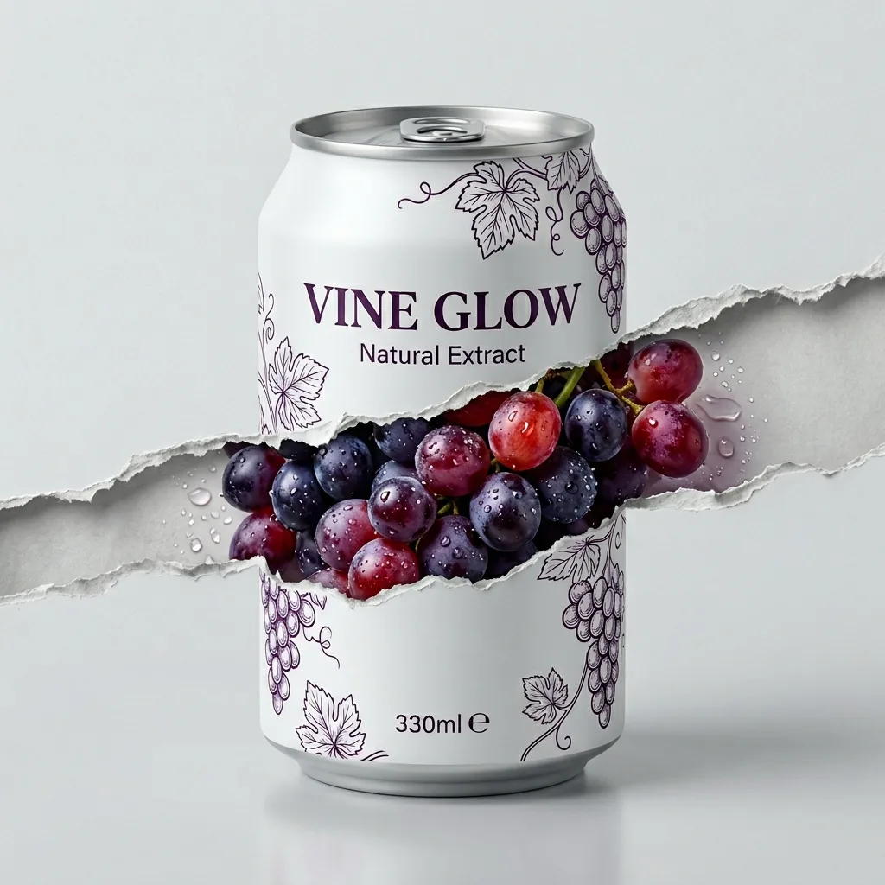

# Grape Can

[← Back to the collection](../../README.md) · Category: [Food & Drink](../../gallery/food-drink.md) · Model: `Vinano Image v2` · ID: `vn-00703`

<a href="https://vinano.ai?utm_source=github&utm_medium=readme&utm_campaign=awesome-image-video-prompts-updating&utm_content=prompt-page-image"></a>

<sub>Preview generated with <a href="https://vinano.ai?utm_source=github&utm_medium=readme&utm_campaign=awesome-image-video-prompts-updating&utm_content=prompt-page-caption">vinano.ai</a></sub>

## Prompt

```text
Grape Can – “Vine Glow”

refined minimalist product photography of a 330ml aluminum can labeled “VINE GLOW – Natural Extract”, centered on a clean light grey background. The can features elegant purple vine line art. A realistic horizontal torn paper effect cuts across the middle of the can and background, revealing fresh red and purple grapes inside water droplets and glossy texture. Soft studio lighting, high detail, sharp focus, commercial advertising style, modern packaging design, symmetrical composition, ultra-realistic, 8k resolution.

Maintain consistent colour harmony and crisp focus across the whole frame.
```

## Try it on vinano.ai

1. Copy the prompt above.
2. Open **[vinano.ai](https://vinano.ai?utm_source=github&utm_medium=readme&utm_campaign=awesome-image-video-prompts-updating&utm_content=prompt-page-try)**, paste it into the image generator and pick a model.
3. Swap any placeholders (brand, product, city, person…) for your own details, then generate.

More prompts like this: [Food & Drink gallery](../../gallery/food-drink.md) · [all categories](../../README.md#contents)
